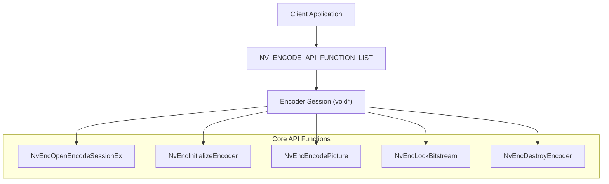
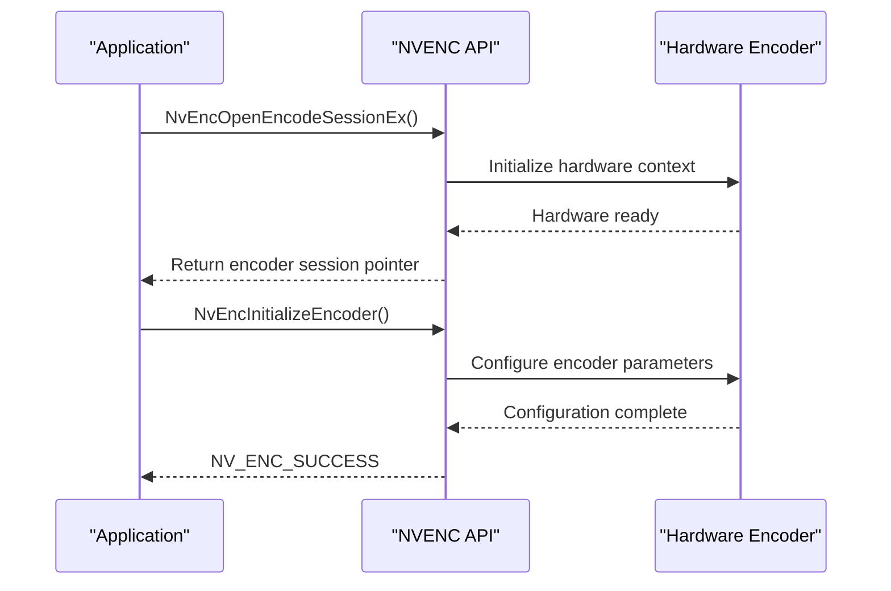
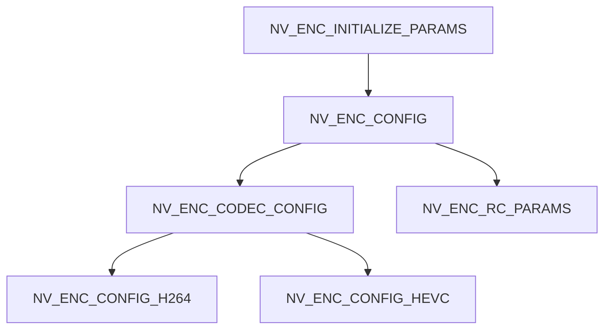

<!-- source: DeepWiki mcp.deepwiki.com · repo NVIDIA/video-sdk-samples · page 4.1 NVENC Hardware API · fetched 2026-10-26 -->

# NVENC Hardware API

Relevant source files

The following files were used as context for generating this wiki page:

- [nvEncBroadcastSample/nvEnc/nvCodec/nvEncoder/nvEncodeAPI.h](nvEncBroadcastSample/nvEnc/nvCodec/nvEncoder/nvEncodeAPI.h)

This document covers the low-level NVIDIA NVENC hardware API interface, which provides direct access to NVIDIA's hardware video encoder capabilities. This API serves as the foundation for higher-level encoder implementations in the Video SDK samples.

For information about the higher-level encoder framework and platform-specific implementations, see [NVENC Framework](#4). For details about specific sample applications that use this API, see [Desktop Capture Sample](#2) and [Broadcast Sample](#3).

## API Architecture

The NVENC Hardware API is implemented as a C-style interface using function pointers organized in a function table structure. The API follows a session-based model where clients must first create an encoder session, then configure and use the encoder through a series of API calls.

Sources: [nvEncBroadcastSample/nvEnc/nvCodec/nvEncoder/nvEncodeAPI.h:3340-3348](), [nvEncBroadcastSample/nvEnc/nvCodec/nvEncoder/nvEncodeAPI.h:3054-3082]()

## Session Management

Encoder sessions are managed through a lifecycle of creation, initialization, usage, and destruction. The API uses opaque session pointers to maintain encoder state.

### Session Creation

The `NvEncOpenEncodeSessionEx` function creates a new encoder session:

| Parameter | Type | Description |
|-----------|------|-------------|
| `openSessionExParams` | `NV_ENC_OPEN_ENCODE_SESSION_EX_PARAMS*` | Session creation parameters |
| `encoder` | `void**` | Output pointer to encoder session |

Sources: [nvEncBroadcastSample/nvEnc/nvCodec/nvEncoder/nvEncodeAPI.h:3054-3082](), [nvEncBroadcastSample/nvEnc/nvCodec/nvEncoder/nvEncodeAPI.h:2273-2356]()

### Device Types

The API supports multiple device types for encoder sessions:

- `NV_ENC_DEVICE_TYPE_DIRECTX` - DirectX 9 device
- `NV_ENC_DEVICE_TYPE_CUDA` - CUDA device context  
- `NV_ENC_DEVICE_TYPE_OPENGL` - OpenGL context (Linux only)

Sources: [nvEncBroadcastSample/nvEnc/nvCodec/nvEncoder/nvEncodeAPI.h:682-688]()

## Encoder Configuration

Encoder configuration involves multiple nested data structures that define codec settings, rate control parameters, and format specifications.

### Configuration Hierarchy

### Key Configuration Structures

| Structure | Purpose | Key Fields |
|-----------|---------|------------|
| `NV_ENC_INITIALIZE_PARAMS` | Top-level initialization | `encodeGUID`, `encodeWidth`, `encodeHeight` |
| `NV_ENC_CONFIG` | Encoder configuration | `profileGUID`, `gopLength`, `frameIntervalP` |
| `NV_ENC_RC_PARAMS` | Rate control settings | `rateControlMode`, `averageBitRate`, `maxBitRate` |

Sources: [nvEncBroadcastSample/nvEnc/nvCodec/nvEncoder/nvEncodeAPI.h:1461-1495](), [nvEncBroadcastSample/nvEnc/nvCodec/nvEncoder/nvEncodeAPI.h:1436-1451](), [nvEncBroadcastSample/nvEnc/nvCodec/nvEncoder/nvEncodeAPI.h:1141-1191]()

## Encoding Operations

The core encoding workflow involves submitting input frames and retrieving encoded bitstreams through a series of API calls.

### Encoding Pipeline

```mermaid
graph LR
    subgraph "Input Stage"
        CreateInput["NvEncCreateInputBuffer"]
        LockInput["NvEncLockInputBuffer"]
        LoadData["Load YUV Data"]
        UnlockInput["NvEncUnlockInputBuffer"]
    end
    
    subgraph "Encoding Stage"
        EncodePic["NvEncEncodePicture"]
        Hardware["Hardware Encoding"]
    end
    
    subgraph "Output Stage"
        LockOutput["NvEncLockBitstream"]
        ReadData["Read Encoded Data"]
        UnlockOutput["NvEncUnlockBitstream"]
    end
    
    CreateInput --> LockInput
    LockInput --> LoadData
    LoadData --> UnlockInput
    UnlockInput --> EncodePic
    EncodePic --> Hardware
    Hardware --> LockOutput
    LockOutput --> ReadData
    ReadData --> UnlockOutput
```

### Picture Parameters

Each encoding call uses `NV_ENC_PIC_PARAMS` to specify frame-specific parameters:

- Input buffer pointer (`inputBuffer`)
- Output bitstream buffer (`outputBitstream`) 
- Picture type (`pictureType`)
- Completion event for asynchronous mode (`completionEvent`)

Sources: [nvEncBroadcastSample/nvEnc/nvCodec/nvEncoder/nvEncodeAPI.h:1660-1695](), [nvEncBroadcastSample/nvEnc/nvCodec/nvEncoder/nvEncodeAPI.h:2482-2660]()

## Buffer Management

The API uses separate buffer objects for input frames and output bitstreams, with explicit locking mechanisms for CPU access.

### Buffer Types

| Buffer Type | Creation Function | Lock Function | Purpose |
|-------------|------------------|---------------|---------|
| Input Buffer | `NvEncCreateInputBuffer` | `NvEncLockInputBuffer` | Uncompressed video input |
| Bitstream Buffer | `NvEncCreateBitstreamBuffer` | `NvEncLockBitstream` | Encoded video output |
| MV Buffer | `NvEncCreateMVBuffer` | `NvEncLockBitstream` | Motion vectors (ME-only mode) |

### Buffer Format Support

The API supports multiple input buffer formats:

- `NV_ENC_BUFFER_FORMAT_NV12` - Semi-planar YUV 4:2:0
- `NV_ENC_BUFFER_FORMAT_YV12` - Planar YUV 4:2:0
- `NV_ENC_BUFFER_FORMAT_ARGB` - 8-bit packed RGB
- `NV_ENC_BUFFER_FORMAT_YUV444` - Planar YUV 4:4:4

Sources: [nvEncBroadcastSample/nvEnc/nvCodec/nvEncoder/nvEncodeAPI.h:326-356](), [nvEncBroadcastSample/nvEnc/nvCodec/nvEncoder/nvEncodeAPI.h:2359-2387]()

## Capability Query System

The API provides a comprehensive capability query system to determine encoder features and limitations before initialization.

### Capability Categories

```mermaid
graph TD
    Caps["NV_ENC_CAPS"]
    
    subgraph "Hardware Capabilities"
        MaxBFrames["NV_ENC_CAPS_NUM_MAX_BFRAMES"]
        MaxRes["NV_ENC_CAPS_WIDTH_MAX / HEIGHT_MAX"]
        RateControl["NV_ENC_CAPS_SUPPORTED_RATECONTROL_MODES"]
    end
    
    subgraph "Feature Support"
        FieldEncoding["NV_ENC_CAPS_SUPPORT_FIELD_ENCODING"]
        Lookahead["NV_ENC_CAPS_SUPPORT_LOOKAHEAD"]
        LosslessEncode["NV_ENC_CAPS_SUPPORT_LOSSLESS_ENCODE"]
    end
    
    subgraph "Codec Specific"
        CABAC["NV_ENC_CAPS_SUPPORT_CABAC"]
        BDirectMode["NV_ENC_CAPS_SUPPORT_BDIRECT_MODE"]
        YUV444["NV_ENC_CAPS_SUPPORT_YUV444_ENCODE"]
    end
    
    Caps --> MaxBFrames
    Caps --> MaxRes
    Caps --> RateControl
    Caps --> FieldEncoding
    Caps --> Lookahead
    Caps --> LosslessEncode
    Caps --> CABAC
    Caps --> BDirectMode
    Caps --> YUV444
```

### Query Functions

| Function | Purpose |
|----------|---------|
| `NvEncGetEncodeGUIDs` | Supported codec GUIDs |
| `NvEncGetEncodeProfileGUIDs` | Supported profile GUIDs for a codec |
| `NvEncGetInputFormats` | Supported input buffer formats |
| `NvEncGetEncodeCaps` | Specific capability values |

Sources: [nvEncBroadcastSample/nvEnc/nvCodec/nvEncoder/nvEncodeAPI.h:693-1013](), [nvEncBroadcastSample/nvEnc/nvCodec/nvEncoder/nvEncodeAPI.h:2129-2158]()

## Error Handling

The API uses a comprehensive error code system (`NVENCSTATUS`) for operation status reporting.

### Status Codes

| Status Code | Meaning |
|-------------|---------|
| `NV_ENC_SUCCESS` | Operation completed successfully |
| `NV_ENC_ERR_NEED_MORE_INPUT` | Encoder needs more input for B-frame reordering |
| `NV_ENC_ERR_ENCODER_BUSY` | Hardware encoder is busy |
| `NV_ENC_ERR_LOCK_BUSY` | Output buffer lock failed (try again) |
| `NV_ENC_ERR_INVALID_PARAM` | Invalid parameter passed |
| `NV_ENC_ERR_OUT_OF_MEMORY` | Insufficient memory |

### Synchronous vs Asynchronous Operation

The API supports both synchronous and asynchronous encoding modes:

- **Synchronous**: Blocking calls, simpler error handling
- **Asynchronous**: Event-based completion, requires careful error state management

Sources: [nvEncBroadcastSample/nvEnc/nvCodec/nvEncoder/nvEncodeAPI.h:410-577](), [nvEncBroadcastSample/nvEnc/nvCodec/nvEncoder/nvEncodeAPI.h:1472-1473]()

---

