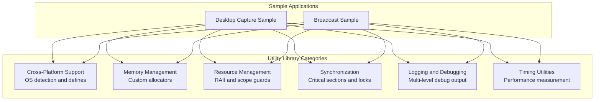
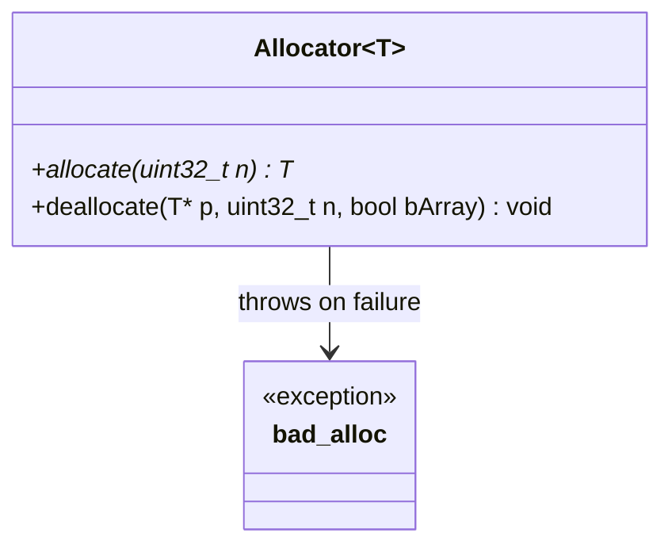
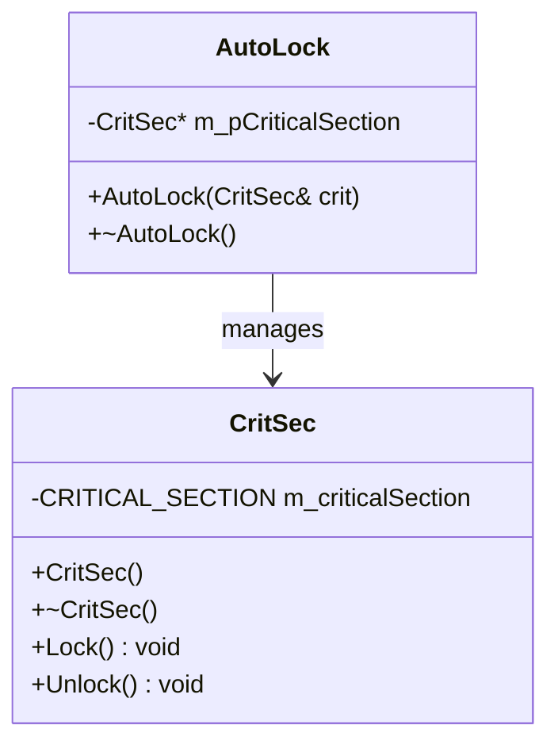
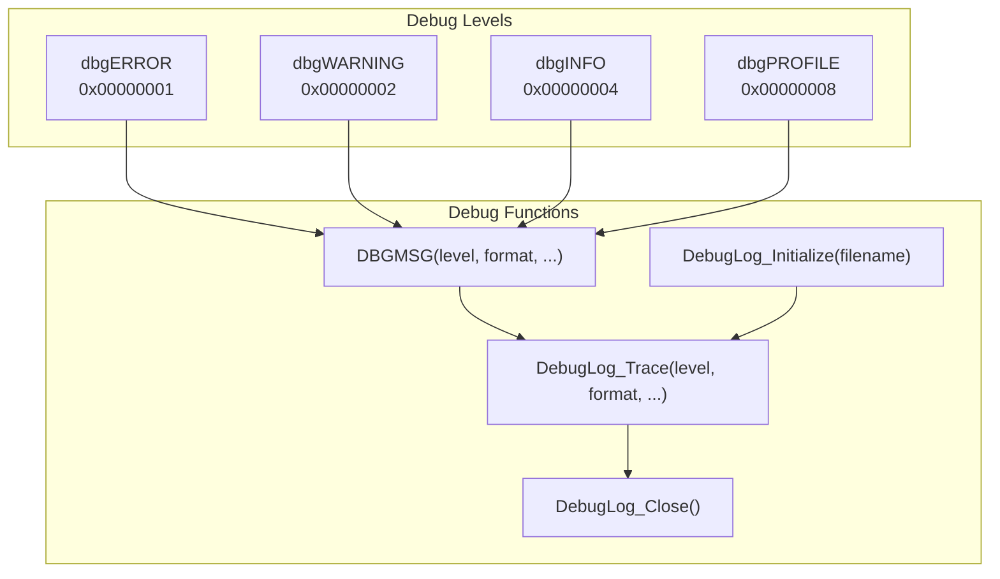
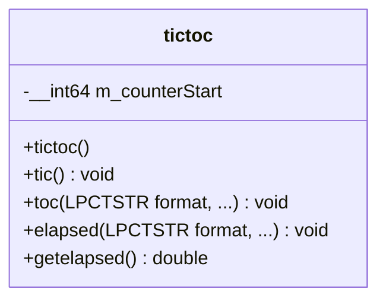

<!-- source: DeepWiki mcp.deepwiki.com · repo NVIDIA/video-sdk-samples · page 5 Utility Libraries · fetched 2026-10-26 -->

# Utility Libraries

<details>
<summary>Relevant source files</summary>

The following files were used as context for generating this wiki page:

- [nvEncBroadcastSample/nvEnc/api/nvEncBroadcastOsDefines.h](nvEncBroadcastSample/nvEnc/api/nvEncBroadcastOsDefines.h)
- [nvEncBroadcastSample/nvEnc/common/inc/ScopeGuard.h](nvEncBroadcastSample/nvEnc/common/inc/ScopeGuard.h)
- [nvEncBroadcastSample/nvEnc/common/inc/allocator.h](nvEncBroadcastSample/nvEnc/common/inc/allocator.h)
- [nvEncBroadcastSample/nvEnc/common/inc/nvEncBroadcastUtils.h](nvEncBroadcastSample/nvEnc/common/inc/nvEncBroadcastUtils.h)

</details>


This document covers the common utility components that provide foundational infrastructure for the NVIDIA Video SDK sample applications. These utilities include cross-platform support, memory management, synchronization primitives, logging systems, and timing facilities that are shared across both the Desktop Capture Sample and Broadcast Sample applications.

For information about the main application architectures that use these utilities, see [Desktop Capture Sample](#2) and [Broadcast Sample](#3). For details about the core NVENC encoding framework, see [NVENC Framework](#4).

## Overview

The utility libraries provide essential infrastructure services organized into several key categories:



Sources: [nvEncBroadcastSample/nvEnc/api/nvEncBroadcastOsDefines.h:1-77](), [nvEncBroadcastSample/nvEnc/common/inc/allocator.h:1-53](), [nvEncBroadcastSample/nvEnc/common/inc/ScopeGuard.h:1-47](), [nvEncBroadcastSample/nvEnc/common/inc/nvEncBroadcastUtils.h:1-117]()

## Cross-Platform Support

The `nvEncBroadcastOsDefines.h` header provides platform detection and OS-specific macros to enable cross-platform compilation across Windows, macOS, and Linux.

### Platform Detection Macros

| Platform | Detection Macro | Define Set |
|----------|----------------|------------|
| Windows | `WIN32` | `WIN_OS` |
| macOS | `__APPLE__` | `OS_MACOSX` |
| Linux | `__linux__` | `OS_LINUX` |

### Compiler-Specific Constructs

The library defines platform-specific constructs for optimal code generation:

- **NVENCBROADCAST_NOVTABLE**: Uses `__declspec(novtable)` on MSVC for pure virtual base classes [nvEncBroadcastSample/nvEnc/api/nvEncBroadcastOsDefines.h:50-60]()
- **NVENCBROADCAST_EXPORT**: Handles DLL export declarations with `__declspec(dllexport)` on Windows [nvEncBroadcastSample/nvEnc/api/nvEncBroadcastOsDefines.h:62-69]()
- **NVENCBROADCAST_Func**: Specifies calling convention with `__stdcall` [nvEncBroadcastSample/nvEnc/api/nvEncBroadcastOsDefines.h:65]()

Sources: [nvEncBroadcastSample/nvEnc/api/nvEncBroadcastOsDefines.h:30-69]()

## Memory Management

The `Allocator` template class provides a standardized interface for memory allocation with exception handling.



### Key Features

The `Allocator` class template provides:

- **Static allocation interface**: `allocate(uint32_t n)` for array-style allocation [nvEncBroadcastSample/nvEnc/common/inc/allocator.h:36-44]()
- **Exception safety**: Propagates `std::bad_alloc` on allocation failure [nvEncBroadcastSample/nvEnc/common/inc/allocator.h:40-41]()
- **Flexible deallocation**: `deallocate()` with optional array flag for proper cleanup [nvEncBroadcastSample/nvEnc/common/inc/allocator.h:46-53]()

Sources: [nvEncBroadcastSample/nvEnc/common/inc/allocator.h:27-53]()

## RAII and Resource Management

The `ScopeGuards` class implements a stack-based RAII pattern for automatic resource cleanup using function objects.

```mermaid
classDiagram
    class ScopeGuards {
        -deque~function~void()~~ : base
        +operator+=(Callable&& undo_func) ScopeGuards&
        +~ScopeGuards()
        +dismiss() void
    }
    
    class deque~function~void()~~ {
        <<std>>
    }
    
    ScopeGuards --|> deque~function~void()~~
```

### Usage Pattern

The `ScopeGuards` class allows registration of cleanup functions that execute automatically when the object is destroyed:

- **Function registration**: Use `operator+=` to add cleanup functions [nvEncBroadcastSample/nvEnc/common/inc/ScopeGuard.h:30-34]()
- **Automatic cleanup**: Destructor executes all registered functions in LIFO order [nvEncBroadcastSample/nvEnc/common/inc/ScopeGuard.h:36-38]()
- **Early dismissal**: `dismiss()` clears all pending cleanup functions [nvEncBroadcastSample/nvEnc/common/inc/ScopeGuard.h:40-42]()

Sources: [nvEncBroadcastSample/nvEnc/common/inc/ScopeGuard.h:28-47]()

## Synchronization Primitives

The broadcast utilities provide thread-safe synchronization through critical sections and automatic locking mechanisms.

### Critical Section Implementation



### Synchronization Classes

| Class | Purpose | Key Methods |
|-------|---------|-------------|
| `CritSec` | Wraps Windows `CRITICAL_SECTION` | `Lock()`, `Unlock()` |
| `AutoLock` | RAII automatic locking | Constructor locks, destructor unlocks |

The `AutoLock` class provides exception-safe automatic locking by acquiring the lock in its constructor and releasing it in its destructor [nvEncBroadcastSample/nvEnc/common/inc/nvEncBroadcastUtils.h:69-77]().

Sources: [nvEncBroadcastSample/nvEnc/common/inc/nvEncBroadcastUtils.h:49-78]()

## Logging and Debugging

The debugging system provides multi-level logging with file output capabilities and configurable debug levels.

### Debug Level System



### Debug Level Enumeration

The system defines four debug levels with bitmask values for filtering:

- **dbgERROR** (0x00000001): Critical error messages
- **dbgWARNING** (0x00000002): Warning notifications  
- **dbgINFO** (0x00000004): Informational messages
- **dbgPROFILE** (0x00000008): Performance profiling data

### Logging Functions

| Function | Purpose |
|----------|---------|
| `DBGMSG(DebugLevel, format, ...)` | General debug message output |
| `DebugLog_Initialize(filename)` | Initialize file-based logging |
| `DebugLog_Trace(level, format, ...)` | Write formatted message to log |
| `DebugLog_Close()` | Close log file and cleanup |

Sources: [nvEncBroadcastSample/nvEnc/common/inc/nvEncBroadcastUtils.h:97-117]()

## Timing Utilities

The `tictoc` class provides performance measurement capabilities for profiling encoder operations.



### Timing Interface

The `tictoc` class implements a simple stopwatch pattern:

- **tic()**: Start timing measurement [nvEncBroadcastSample/nvEnc/common/inc/nvEncBroadcastUtils.h:86]()
- **toc()**: Stop timing and optionally print elapsed time [nvEncBroadcastSample/nvEnc/common/inc/nvEncBroadcastUtils.h:87]()
- **elapsed()**: Print elapsed time without stopping [nvEncBroadcastSample/nvEnc/common/inc/nvEncBroadcastUtils.h:88]()
- **getelapsed()**: Return elapsed time as double [nvEncBroadcastSample/nvEnc/common/inc/nvEncBroadcastUtils.h:89]()

### Utility Macros

The utilities also define several commonly used helper macros:

- **SAFE_RELEASE(x)**: Safe COM object release with null check [nvEncBroadcastSample/nvEnc/common/inc/nvEncBroadcastUtils.h:92]()
- **SAFE_DELETE(x)**: Safe pointer deletion with null assignment [nvEncBroadcastSample/nvEnc/common/inc/nvEncBroadcastUtils.h:93]()
- **CHECK_HR(hr)**: HRESULT error checking with goto [nvEncBroadcastSample/nvEnc/common/inc/nvEncBroadcastUtils.h:94]()

Sources: [nvEncBroadcastSample/nvEnc/common/inc/nvEncBroadcastUtils.h:80-95]()

---

