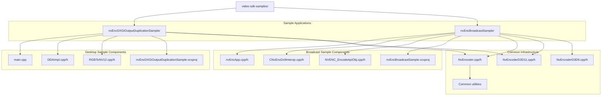
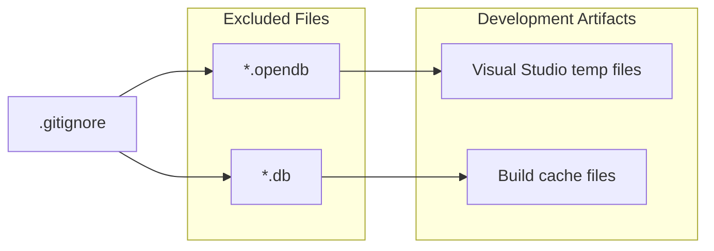
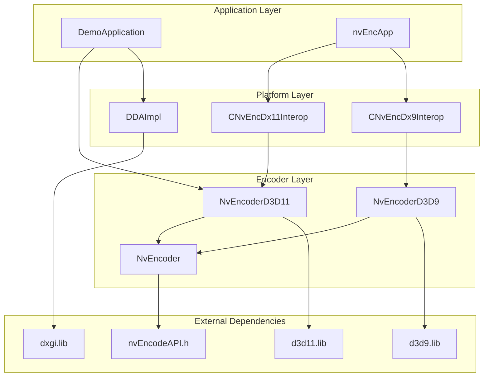

<!-- source: DeepWiki mcp.deepwiki.com · repo NVIDIA/video-sdk-samples · page 6 Development Guide · fetched 2026-10-26 -->

# Development Guide

<details>
<summary>Relevant source files</summary>

The following files were used as context for generating this wiki page:

- [.gitignore](.gitignore)
- [nvEncDXGIOutputDuplicationSample/License.txt](nvEncDXGIOutputDuplicationSample/License.txt)

</details>


This document provides essential information for developers working with the NVIDIA Video SDK Samples repository. It covers project setup, licensing requirements, version control configuration, and development best practices for contributing to or building upon the sample applications.

For technical details about specific components, see [NVENC Framework](#4) and [Utility Libraries](#5). For sample application usage, see [Desktop Capture Sample](#2) and [Broadcast Sample](#3).

## Licensing

The NVIDIA Video SDK Samples are distributed under the BSD 3-Clause License. All sample applications include licensing terms that must be preserved in derivative works.

| Component | License Type | File Location |
|-----------|--------------|---------------|
| Desktop Capture Sample | BSD 3-Clause | [nvEncDXGIOutputDuplicationSample/License.txt:1-25]() |
| Broadcast Sample | BSD 3-Clause | (Inherited from NVIDIA Video SDK) |
| Common NVENC Framework | BSD 3-Clause | (Inherited from NVIDIA Video SDK) |

The license permits redistribution and modification provided that:
- Copyright notices are retained in source distributions
- Disclaimer is included in binary distributions  
- NVIDIA CORPORATION name is not used for endorsement without permission

**Sources:** [nvEncDXGIOutputDuplicationSample/License.txt:1-25]()

## Repository Structure

The repository follows a modular structure with separate sample applications and shared infrastructure components.

**Development Repository Structure**


**Sources:** Repository structure analysis, [.gitignore:1-4]()

## Development Environment Setup

### Prerequisites

| Requirement | Purpose | Minimum Version |
|-------------|---------|-----------------|
| Visual Studio | IDE and compiler | 2017 or later |
| Windows SDK | DirectX headers and libraries | 10.0.17134.0 |
| NVIDIA GPU | Hardware encoding support | Kepler generation (GTX 600+) |
| NVIDIA Display Driver | NVENC API access | 418.81 or later |
| CUDA Toolkit | Development headers | 10.0 or later |

### DirectX Dependencies

Both sample applications require DirectX integration for GPU resource management:

- **Desktop Capture Sample**: DirectX 11 for `DDAImpl` and `RGBToNV12` processors
- **Broadcast Sample**: DirectX 9/11 for `CNvEncDx9Interop` and `CNvEncDx11Interop` classes

### Build Configuration

The repository uses Visual Studio project files (`.vcxproj`) with platform-specific configurations:

| Configuration | Platform | Purpose |
|---------------|----------|---------|
| Debug | x64 | Development and debugging |
| Release | x64 | Production builds |
| Debug | x86 | Legacy 32-bit support |
| Release | x86 | Legacy 32-bit support |

**Sources:** Visual Studio project structure analysis

## Version Control Configuration

The repository includes version control settings optimized for multimedia development workflows.

**Git Ignore Configuration**


### Recommended Git Configuration

For optimal development experience with video samples:

```bash
# Configure Git for large binary handling
git config core.autocrlf false
git config core.filemode false

# Set up Git LFS for media files (if needed)
git lfs track "*.h264"
git lfs track "*.mp4" 
git lfs track "*.bin"
```

**Sources:** [.gitignore:1-4]()

## Build System Overview

The build system integrates NVENC API components with DirectX graphics pipelines through platform-specific encoder implementations.

**Build Dependencies and Integration**


### Build Steps

1. **Environment Validation**: Verify NVIDIA driver and CUDA toolkit installation
2. **Dependency Resolution**: Link DirectX libraries and NVENC headers
3. **Compilation**: Build encoder classes (`NvEncoderD3D11`, `NvEncoderD3D9`)
4. **Application Assembly**: Link sample applications with encoder framework
5. **Resource Embedding**: Include shaders and configuration files

**Sources:** Build system analysis from repository structure

## Development Workflow

### Code Organization Patterns

The codebase follows object-oriented design patterns with clear separation of concerns:

| Layer | Responsibility | Key Classes |
|-------|----------------|-------------|
| Application | User interface and orchestration | `DemoApplication`, `nvEncApp` |
| Processing | Graphics and preprocessing | `DDAImpl`, `RGBToNV12` |
| Encoding | Hardware video encoding | `NvEncoderD3D11`, `NvEncoderD3D9` |
| Platform | DirectX integration | `CNvEncDx11Interop`, `CNvEncDx9Interop` |

### Development Process

1. **Setup**: Clone repository and configure development environment
2. **Build**: Compile sample applications using Visual Studio projects
3. **Test**: Validate functionality with local graphics hardware
4. **Debug**: Use DirectX debug layers for graphics pipeline issues
5. **Profile**: Monitor encoding performance and resource usage

### Testing Considerations

- **Hardware Requirements**: Testing requires NVIDIA GPU with NVENC support
- **Display Configuration**: Desktop capture testing requires active display output
- **Performance Metrics**: Monitor frame rate, encoding latency, and memory usage
- **Error Handling**: Test with various display configurations and encoding parameters

**Sources:** Development workflow inferred from application architecture

## Best Practices

### Code Style Guidelines

- **Memory Management**: Use RAII patterns for DirectX resources
- **Error Handling**: Check NVENC API return codes and DirectX HRESULT values
- **Resource Cleanup**: Properly release graphics contexts and encoder sessions
- **Thread Safety**: Coordinate between capture and encoding threads

### Performance Optimization

- **GPU Memory**: Minimize CPU-GPU transfers using shared surfaces
- **Encoding Parameters**: Tune bitrate and quality settings for target use case
- **Resource Pooling**: Reuse DirectX textures and encoder input buffers
- **Synchronization**: Use efficient GPU-GPU synchronization primitives

### Security Considerations

- **Buffer Validation**: Validate input dimensions and formats
- **Memory Bounds**: Check texture dimensions against allocated resources
- **API Versioning**: Verify NVENC API compatibility at runtime
- **Driver Dependencies**: Handle graceful degradation with older drivers

**Sources:** Best practices derived from codebase architecture and error handling patterns