# Page: Overview

# Overview

<details>
<summary>Relevant source files</summary>

The following files were used as context for generating this wiki page:

- [README.md](README.md)

</details>


## Purpose and Scope

The NVIDIA Video SDK Samples repository provides sample applications demonstrating GPU-accelerated video encoding and decoding capabilities using NVIDIA's Video SDK APIs. This collection serves as practical reference implementations for developers integrating hardware-accelerated video processing into their applications.

The repository contains two primary sample applications: a desktop screen capture encoder and a broadcast encoding sample, along with supporting NVENC framework components. For detailed implementation guides of specific samples, see [Desktop Capture Sample](#2) and [Broadcast Sample](#3). For information about the underlying encoding framework, see [NVENC Framework](#4).

Sources: [README.md:1-4]()

## Repository Architecture

The repository is organized around two main sample applications that demonstrate different aspects of GPU-accelerated video encoding, supported by a common NVENC framework infrastructure.

### High-Level System Organization

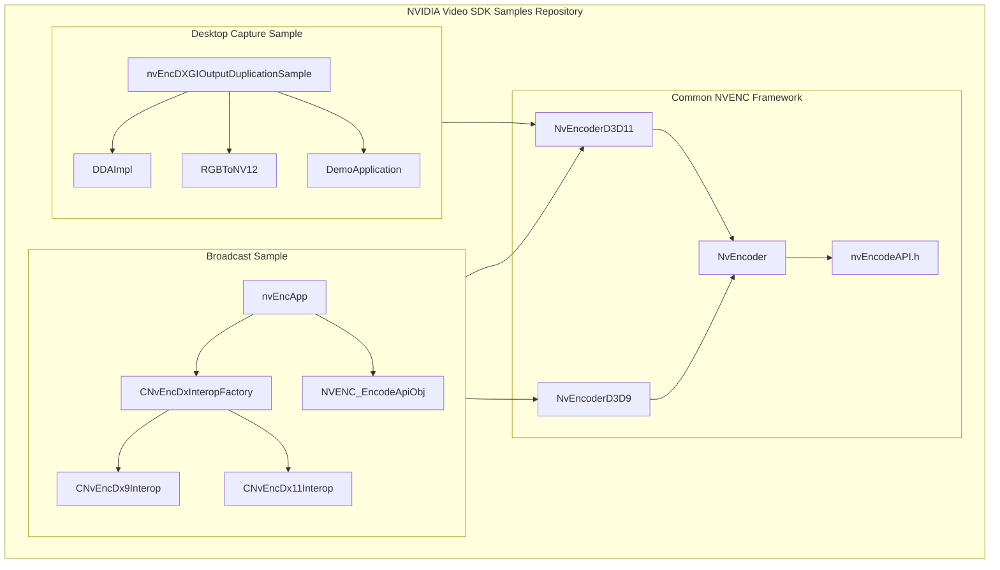

Sources: [README.md:1-4]()

## Technology Stack

The samples leverage NVIDIA's hardware encoding capabilities through a layered architecture spanning from low-level GPU APIs to high-level application interfaces.

### Technology Dependencies and API Layers

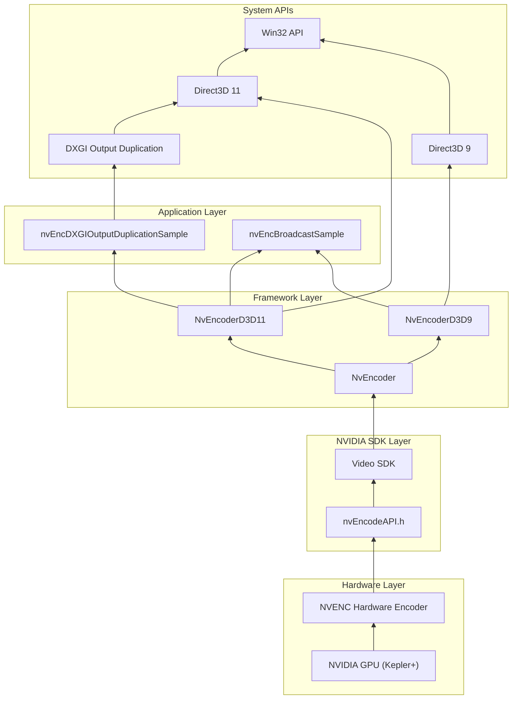

Sources: [README.md:1-4]()

## Sample Applications

### Desktop Capture Sample (`nvEncDXGIOutputDuplicationSample`)

The desktop capture sample demonstrates real-time screen recording using Windows DXGI Output Duplication API combined with NVIDIA NVENC hardware encoding. The application captures desktop frames, performs color space conversion, and encodes them to H.264 format.

| Component | Class/Function | Purpose |
|-----------|---------------|---------|
| Application Controller | `DemoApplication` | Orchestrates capture and encoding pipeline |
| Screen Capture | `DDAImpl` | Wraps DXGI Desktop Duplication API |
| Color Conversion | `RGBToNV12` | Hardware-accelerated RGB to NV12 conversion |
| Video Encoding | `NvEncoderD3D11` | NVENC-based H.264 encoding |

### Broadcast Sample (`nvEncBroadcastSample`)

The broadcast sample provides a more comprehensive NVENC API demonstration with support for both DirectX 9 and DirectX 11 contexts. It includes advanced encoder configuration options and broadcast-specific features.

| Component | Class/Function | Purpose |
|-----------|---------------|---------|
| Application Core | `nvEncApp` | Main application and encoder lifecycle management |
| DirectX Factory | `CNvEncDxInteropFactory` | Creates DirectX 9/11 contexts |
| DirectX 9 Integration | `CNvEncDx9Interop` | DirectX 9 encoder interface |
| DirectX 11 Integration | `CNvEncDx11Interop` | DirectX 11 encoder interface |
| Encoding API | `NVENC_EncodeApiObj` | High-level encoding interface |

Sources: [README.md:1-4]()

## Common NVENC Framework

The repository includes a shared NVENC framework that provides base classes and utilities used by both sample applications. This framework abstracts the low-level NVENC API into more manageable C++ classes.

### Core Framework Components

| Component | Purpose | Key Classes |
|-----------|---------|-------------|
| Base Encoder | Abstract interface for NVENC operations | `NvEncoder` |
| DirectX 11 Implementation | D3D11-specific encoder implementation | `NvEncoderD3D11` |
| DirectX 9 Implementation | D3D9-specific encoder implementation | `NvEncoderD3D9` |
| Hardware API | Low-level NVENC function declarations | Functions in `nvEncodeAPI.h` |

The framework provides platform abstraction, memory management utilities, and error handling mechanisms that simplify integration of NVENC capabilities into applications.

Sources: [README.md:1-4]()

---

# Page: Desktop Capture Sample

# Desktop Capture Sample

<details>
<summary>Relevant source files</summary>

The following files were used as context for generating this wiki page:

- [nvEncDXGIOutputDuplicationSample/README.md](nvEncDXGIOutputDuplicationSample/README.md)

</details>


## Purpose and Scope

The Desktop Capture Sample (`nvEncDXGIOutputDuplicationSample`) demonstrates real-time desktop screen capture and hardware video encoding using NVIDIA's NVENC technology. This sample shows how to integrate Windows Desktop Duplication API with NVIDIA's hardware encoder to create efficient screen recording or live streaming applications.

The sample covers the complete pipeline from desktop capture to compressed H.264 output, including color space conversion and GPU-accelerated encoding. For information about the broader NVENC framework and common encoder components, see [NVENC Framework](#4). For details about the broadcast-oriented encoding API, see [Broadcast Sample](#3).

## System Overview

The Desktop Capture Sample implements a streamlined architecture that captures desktop content and encodes it to H.264 video format using hardware acceleration throughout the entire pipeline.

### High-Level Architecture

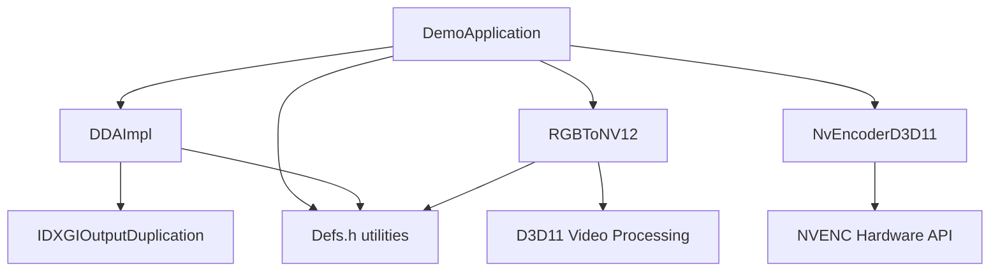

Sources: [nvEncDXGIOutputDuplicationSample/README.md:1-3]()

## Core Components

The sample consists of four primary components that work together to implement the capture-encode pipeline:

### Component Mapping to Code Entities

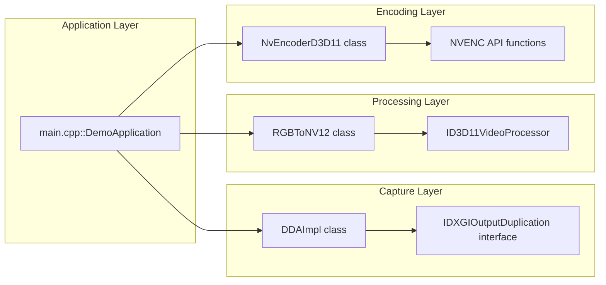

Sources: [nvEncDXGIOutputDuplicationSample/README.md:1-3]()

| Component | Purpose | Key Responsibilities |
|-----------|---------|---------------------|
| `DemoApplication` | Main orchestrator | Application lifecycle, frame capture loop, resource coordination |
| `DDAImpl` | Desktop capture wrapper | DXGI Output Duplication management, frame acquisition |
| `RGBToNV12` | Color space converter | Hardware-accelerated RGB to NV12 conversion |
| `NvEncoderD3D11` | Hardware encoder | NVENC-based H.264 encoding with D3D11 interop |

## Data Flow Pipeline

The sample implements a linear pipeline that processes desktop frames from capture to encoded output:

### Frame Processing Pipeline

```mermaid
flowchart LR
    Desktop["Windows Desktop"] --> DXGICapture["IDXGIOutputDuplication::AcquireNextFrame"]
    DXGICapture --> RGBTexture["ID3D11Texture2D (DXGI_FORMAT_B8G8R8A8)"]
    RGBTexture --> ColorConvert["RGBToNV12::ConvertRGBToNV12"]
    ColorConvert --> NV12Texture["ID3D11Texture2D (DXGI_FORMAT_NV12)"]
    NV12Texture --> EncodeFrame["NvEncoderD3D11::EncodeFrame"]
    EncodeFrame --> H264Stream["H.264 Bitstream"]
    H264Stream --> OutputFile["output.h264"]
```

Sources: [nvEncDXGIOutputDuplicationSample/README.md:2]()

The pipeline leverages GPU memory throughout, avoiding CPU copies:

1. **Capture Stage**: `IDXGIOutputDuplication` captures desktop content directly to GPU texture memory
2. **Conversion Stage**: `RGBToNV12` performs format conversion using D3D11 Video Processing API
3. **Encoding Stage**: `NvEncoderD3D11` encodes directly from GPU texture using NVENC hardware
4. **Output Stage**: Compressed bitstream is written to disk as H.264 file

## Technical Implementation

### D3D11 Context Management

The sample uses a shared D3D11 device context across all components to enable efficient GPU memory sharing. The `DemoApplication` creates and manages the primary D3D11 device, which is passed to each processing component during initialization.

### Frame Synchronization

Desktop duplication operates asynchronously, requiring proper synchronization between capture and encoding threads. The sample implements frame timing to match desktop refresh rates and avoid dropped or duplicate frames.

### Error Handling

Common error scenarios include:
- Desktop duplication timeouts during periods of no screen updates
- NVENC encoder initialization failures on unsupported hardware
- D3D11 device lost conditions requiring context recreation

Sources: [nvEncDXGIOutputDuplicationSample/README.md:1-3]()

## Related Documentation

This page provides the high-level overview of the Desktop Capture Sample. For detailed implementation information, see:

- [Application Architecture](#2.1) - Deep dive into `DemoApplication` class and main execution flow
- [Desktop Duplication Implementation](#2.2) - Technical details of `DDAImpl` and DXGI integration  
- [Color Space Conversion](#2.3) - `RGBToNV12` implementation and D3D11 Video Processing usage
- [Build Configuration](#2.4) - Project setup and compilation requirements

---

# Page: Application Architecture

# Application Architecture

<details>
<summary>Relevant source files</summary>

The following files were used as context for generating this wiki page:

- [nvEncDXGIOutputDuplicationSample/Defs.h](nvEncDXGIOutputDuplicationSample/Defs.h)
- [nvEncDXGIOutputDuplicationSample/main.cpp](nvEncDXGIOutputDuplicationSample/main.cpp)

</details>


This document details the architectural design of the Desktop Capture Sample application, specifically the `DemoApplication` class and its orchestration of the desktop capture and encoding pipeline. The architecture demonstrates how to integrate Windows DXGI Output Duplication API with NVIDIA's NVENC hardware encoder through DirectX 11 interoperability.

For information about the underlying desktop duplication implementation, see [Desktop Duplication Implementation](#2.2). For details about color space conversion, see [Color Space Conversion](#2.3).

## Core Architecture Overview

The Desktop Capture Sample is built around a single orchestration class `DemoApplication` that coordinates four primary subsystems: desktop capture via DXGI, color space conversion, hardware video encoding, and DirectX 11 resource management. The application follows a producer-consumer pipeline pattern where each stage processes frames in sequence.

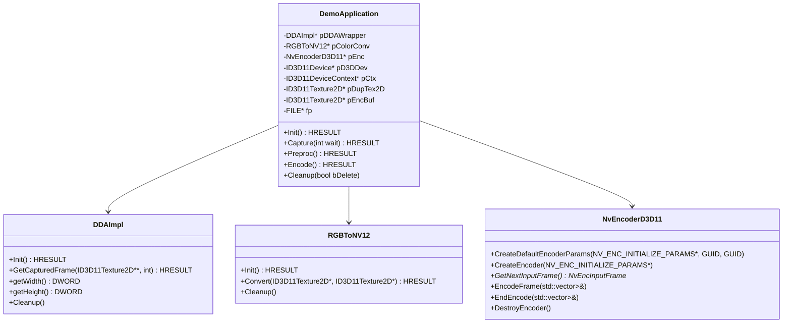

**Application Architecture Diagram**

Sources: [nvEncDXGIOutputDuplicationSample/main.cpp:34-329]()

## Component Responsibilities

The `DemoApplication` class manages five core components, each with specific responsibilities in the video capture and encoding pipeline:

| Component | Type | Purpose | Key Methods |
|-----------|------|---------|-------------|
| `pDDAWrapper` | `DDAImpl*` | Desktop screen capture using DXGI Output Duplication | `GetCapturedFrame()`, `getWidth()`, `getHeight()` |
| `pColorConv` | `RGBToNV12*` | Color space conversion from RGB to NV12 format | `Convert()` |
| `pEnc` | `NvEncoderD3D11*` | Hardware video encoding using NVENC | `EncodeFrame()`, `GetNextInputFrame()` |
| `pD3DDev` | `ID3D11Device*` | DirectX 11 device for GPU operations | Device creation and resource management |
| `pCtx` | `ID3D11DeviceContext*` | DirectX 11 immediate context | GPU command submission |

Sources: [nvEncDXGIOutputDuplicationSample/main.cpp:44-62]()

## Initialization Sequence

The application follows a strict initialization order to ensure proper dependency resolution between DirectX 11, DXGI, and NVENC components:

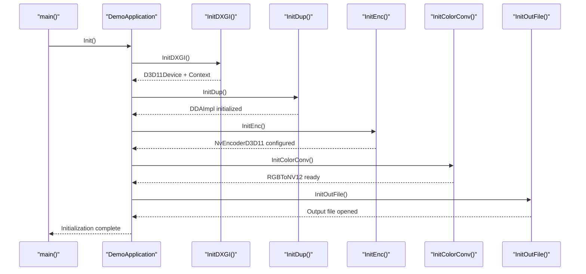

**Initialization Sequence Diagram**

### DirectX 11 Initialization

The `InitDXGI()` method creates a DirectX 11 device and context with hardware acceleration preference. It iterates through available driver types (`D3D_DRIVER_TYPE_HARDWARE`, `D3D_DRIVER_TYPE_WARP`, `D3D_DRIVER_TYPE_REFERENCE`) and feature levels starting from DirectX 11.0 down to 9.1 for maximum compatibility.

Sources: [nvEncDXGIOutputDuplicationSample/main.cpp:80-115]()

### NVENC Encoder Configuration

The encoder initialization in `InitEnc()` configures encoding parameters based on whether video preprocessing is enabled (`bNoVPBlt` flag). The encoder supports two modes:

- **Direct encoding**: RGB input format, dimensions match captured desktop
- **Preprocessed encoding**: NV12 input format, fixed 1920x1080 output resolution

Key encoding parameters include GOP length of 5 frames and H.264 codec with low-latency high-performance preset.

Sources: [nvEncDXGIOutputDuplicationSample/main.cpp:131-164]()

## Main Capture Loop

The application's primary execution occurs in the `Grab60FPS()` function, which implements a timing-controlled capture loop targeting approximately 60 frames per second:

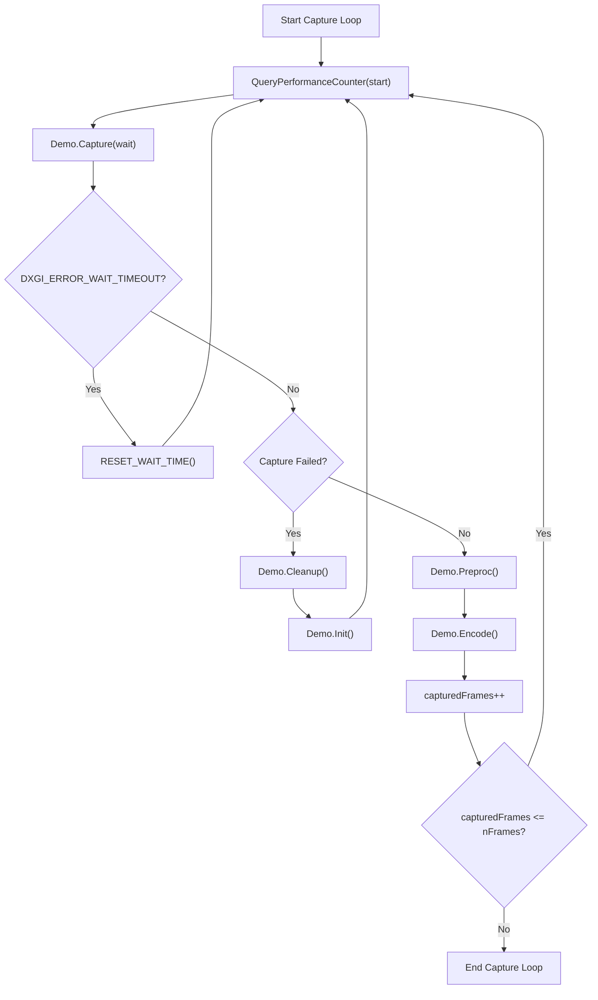

**Main Capture Loop Flow**

The loop implements adaptive timing control using Windows performance counters to maintain consistent frame rates. The base wait time of 17ms targets 60 FPS, with dynamic adjustment based on actual processing time.

Sources: [nvEncDXGIOutputDuplicationSample/main.cpp:332-414]()

## Data Flow Pipeline

The frame processing pipeline transforms desktop pixels through multiple stages before final H.264 output:

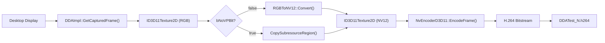

**Frame Processing Pipeline**

The pipeline supports two processing modes controlled by the `bNoVPBlt` constant:
- **Direct mode**: Bypasses color conversion for ARGB input directly to encoder
- **Conversion mode**: Converts RGB to NV12 using hardware-accelerated video processing

Sources: [nvEncDXGIOutputDuplicationSample/main.cpp:226-273]()

## Resource Management

The application implements deterministic resource management through the `Cleanup()` method with support for partial cleanup during error recovery:

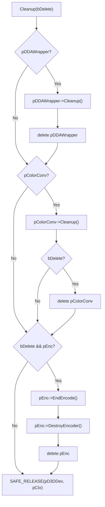

**Resource Cleanup Flow**

The cleanup process ensures proper shutdown of the NVENC encoder by flushing remaining frames before destroying encoder resources. The `SAFE_RELEASE` macro provides null-safe COM object release.

Sources: [nvEncDXGIOutputDuplicationSample/main.cpp:275-329](), [nvEncDXGIOutputDuplicationSample/Defs.h:33-35]()

## Error Handling

The application implements comprehensive error handling with automatic recovery capabilities. The `returnIfError` macro provides consistent error propagation with detailed logging including function name, line number, and file path.

Key error handling features:
- **Timeout handling**: `DXGI_ERROR_WAIT_TIMEOUT` indicates no screen updates, triggers retry with timing adjustment
- **Capture failure recovery**: Failed captures trigger complete reinitialization of DDA subsystem
- **Resource safety**: All DirectX and NVENC resources use RAII patterns and safe release mechanisms

Sources: [nvEncDXGIOutputDuplicationSample/main.cpp:37-42](), [nvEncDXGIOutputDuplicationSample/Defs.h:37-43]()

---

# Page: Desktop Duplication Implementation

# Desktop Duplication Implementation

<details>
<summary>Relevant source files</summary>

The following files were used as context for generating this wiki page:

- [nvEncDXGIOutputDuplicationSample/DDAImpl.cpp](nvEncDXGIOutputDuplicationSample/DDAImpl.cpp)
- [nvEncDXGIOutputDuplicationSample/DDAImpl.h](nvEncDXGIOutputDuplicationSample/DDAImpl.h)

</details>


## Purpose and Scope

This document covers the `DDAImpl` class, which provides a wrapper around the Windows DXGI Desktop Duplication API for capturing desktop screen content. The implementation handles the lifecycle management of DXGI Output Duplication objects and provides a simplified interface for acquiring captured desktop frames as Direct3D 11 textures.

For information about the overall application architecture that uses this desktop capture system, see [Application Architecture](#2.1). For details about color space conversion applied to captured frames, see [Color Space Conversion](#2.3).

## Class Overview

The `DDAImpl` class serves as a thin wrapper around the `IDXGIOutputDuplication` interface, managing the complete lifecycle of desktop capture operations from initialization through frame acquisition to cleanup.

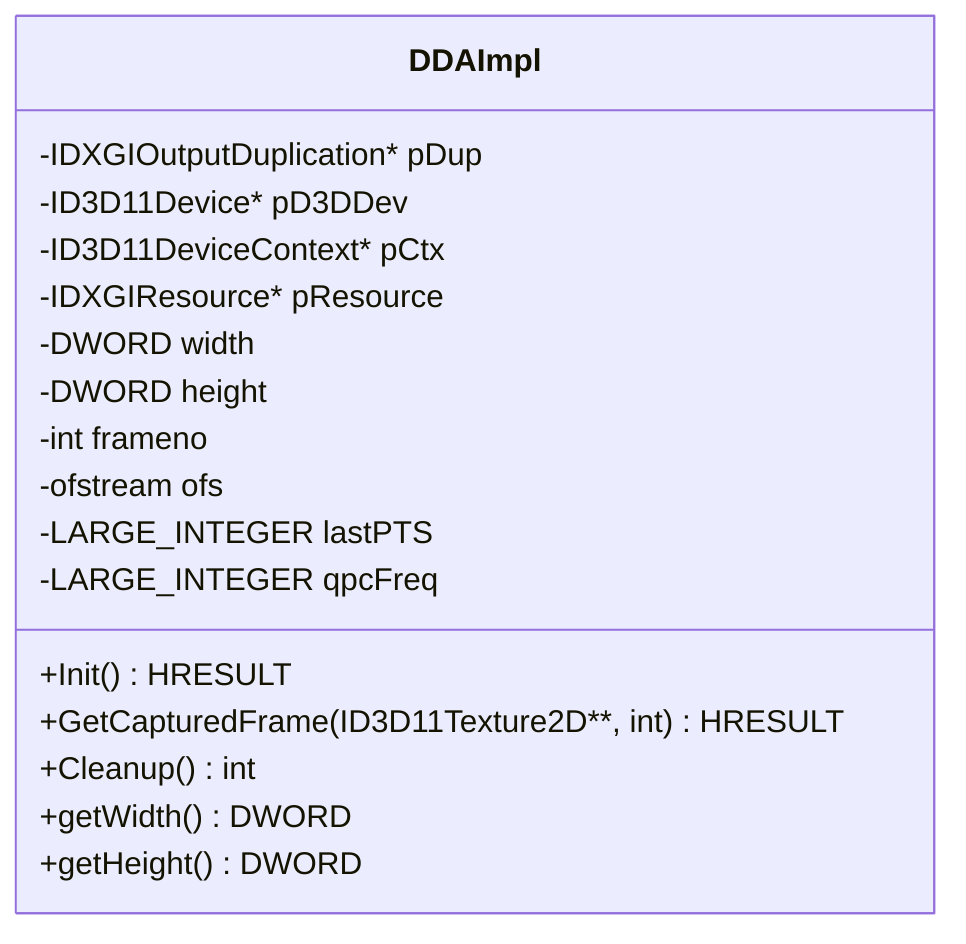

**Sources:** [nvEncDXGIOutputDuplicationSample/DDAImpl.h:37-93]()

## Initialization Process

The `Init()` method establishes the DXGI Output Duplication session through a series of interface queries and object creation steps:

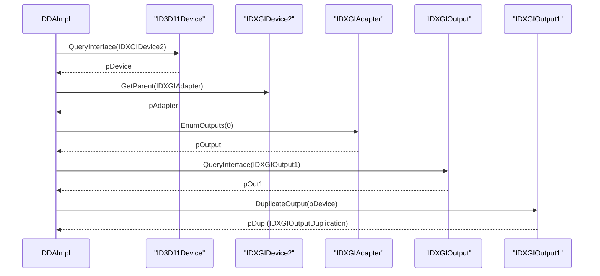

### Key Initialization Steps

| Step | Operation | Purpose |
|------|-----------|---------|
| 1 | Query `IDXGIDevice2` from `ID3D11Device` | Bridge from D3D11 to DXGI interfaces |
| 2 | Get parent `IDXGIAdapter` | Access display adapter capabilities |
| 3 | Enumerate outputs (index 0) | Select primary display output |
| 4 | Query `IDXGIOutput1` interface | Access duplication functionality |
| 5 | Create `IDXGIOutputDuplication` | Establish desktop capture session |

The method captures display dimensions from `DXGI_OUTDUPL_DESC` and stores them in the `width` and `height` member variables.

**Sources:** [nvEncDXGIOutputDuplicationSample/DDAImpl.cpp:34-86]()

## Frame Acquisition

The `GetCapturedFrame()` method implements the core capture loop, acquiring new desktop updates and converting them to `ID3D11Texture2D` objects:

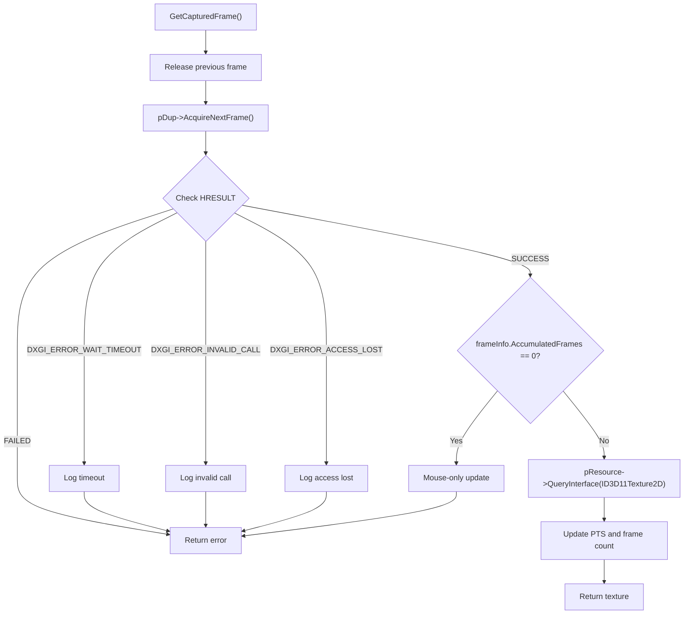

### Frame Information Processing

The method processes `DXGI_OUTDUPL_FRAME_INFO` to track presentation timing and frame accumulation:

- **AccumulatedFrames**: Number of desktop updates since last acquisition
- **LastPresentTime**: High-precision timestamp for frame presentation
- **LastMouseUpdateTime**: Timestamp for mouse-only updates

Frame timing calculations use `QueryPerformanceFrequency()` for microsecond precision timing measurements.

**Sources:** [nvEncDXGIOutputDuplicationSample/DDAImpl.cpp:88-150]()

## Error Handling

The implementation includes comprehensive error handling for common DXGI Output Duplication scenarios:

| Error Code | Condition | Handling |
|------------|-----------|----------|
| `DXGI_ERROR_WAIT_TIMEOUT` | No new frames within timeout period | Log and return timeout |
| `DXGI_ERROR_INVALID_CALL` | Previous frame not properly released | Log invalid state |
| `DXGI_ERROR_ACCESS_LOST` | Desktop session changed (RDP, mode switch) | Log access loss |

Mouse-only updates (when `AccumulatedFrames == 0`) are treated as non-visual updates and result in timeout returns.

**Sources:** [nvEncDXGIOutputDuplicationSample/DDAImpl.cpp:110-129]()

## Resource Management

The `DDAImpl` class follows RAII principles with proper resource lifecycle management:

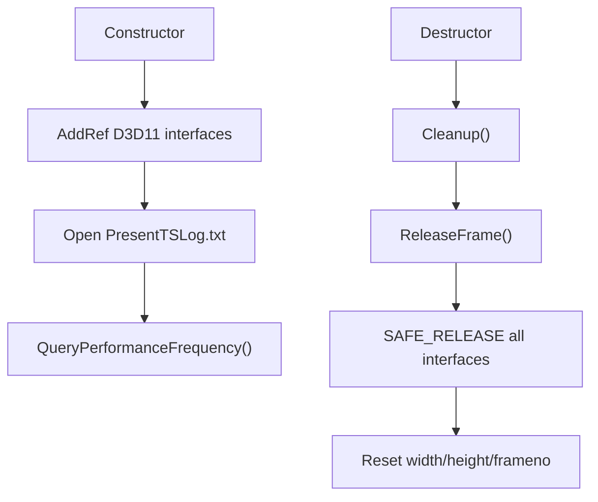

### Constructor Responsibilities
- Reference counting for `ID3D11Device` and `ID3D11DeviceContext`
- Performance counter frequency initialization
- Timestamp logging file creation

### Cleanup Responsibilities  
- Frame release via `IDXGIOutputDuplication::ReleaseFrame()`
- Interface cleanup using `SAFE_RELEASE` macro
- State variable reset

**Sources:** [nvEncDXGIOutputDuplicationSample/DDAImpl.h:82-92](), [nvEncDXGIOutputDuplicationSample/DDAImpl.cpp:153-168]()

## Integration Points

The `DDAImpl` class integrates with the broader desktop capture system through well-defined interfaces:

- **Input**: Requires initialized `ID3D11Device` and `ID3D11DeviceContext` from the D3D11 rendering system
- **Output**: Provides `ID3D11Texture2D` objects containing captured desktop content in RGB format
- **Timing**: Generates high-precision presentation timestamps for frame synchronization

The captured textures flow directly into the color space conversion pipeline before NVENC encoding.

**Sources:** [nvEncDXGIOutputDuplicationSample/DDAImpl.h:43-63]()

---

# Page: Color Space Conversion

# Color Space Conversion

<details>
<summary>Relevant source files</summary>

The following files were used as context for generating this wiki page:

- [nvEncDXGIOutputDuplicationSample/Preproc.cpp](nvEncDXGIOutputDuplicationSample/Preproc.cpp)
- [nvEncDXGIOutputDuplicationSample/Preproc.h](nvEncDXGIOutputDuplicationSample/Preproc.h)

</details>


## Purpose and Scope

This document covers the color space conversion system in the Desktop Capture Sample, specifically the `RGBToNV12` class that performs hardware-accelerated conversion from RGB to NV12 color format using DirectX 11 Video Processing API. This conversion is essential for preparing captured desktop frames for NVENC hardware encoding, which requires input in NV12 (YUV 4:2:0 planar) format.

For information about the broader desktop capture pipeline, see [Application Architecture](#2.1). For details about the NVENC encoding that follows this conversion, see [NVENC Framework](#4).

## Technical Overview

The color space conversion system bridges the gap between DXGI Desktop Duplication output (RGB format) and NVENC encoder input requirements (NV12 format). The conversion leverages DirectX 11 Video Processing API (`ID3D11VideoProcessor`) to perform hardware-accelerated format conversion with minimal CPU overhead.

The system handles dynamic resolution changes and implements performance optimizations through view caching and intelligent resource management.

**Sources:** [nvEncDXGIOutputDuplicationSample/Preproc.h:35-85](), [nvEncDXGIOutputDuplicationSample/Preproc.cpp:32-168]()

## RGBToNV12 Class Architecture

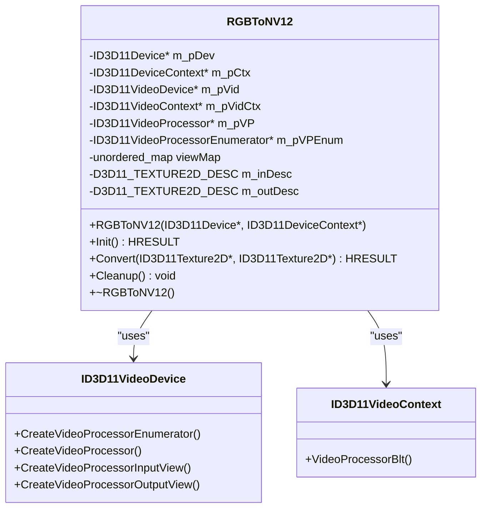

The `RGBToNV12` class encapsulates DirectX 11 Video Processing functionality with the following key components:

| Component | Type | Purpose |
|-----------|------|---------|
| `m_pDev` | `ID3D11Device*` | Primary D3D11 device for resource creation |
| `m_pCtx` | `ID3D11DeviceContext*` | D3D11 context for command submission |
| `m_pVid` | `ID3D11VideoDevice*` | Video-specific D3D11 device interface |
| `m_pVidCtx` | `ID3D11VideoContext*` | Video-specific context for processing |
| `m_pVP` | `ID3D11VideoProcessor*` | Configured video processor instance |
| `viewMap` | `std::unordered_map` | Cache for output view optimization |

**Sources:** [nvEncDXGIOutputDuplicationSample/Preproc.h:40-61]()

## Color Space Conversion Process

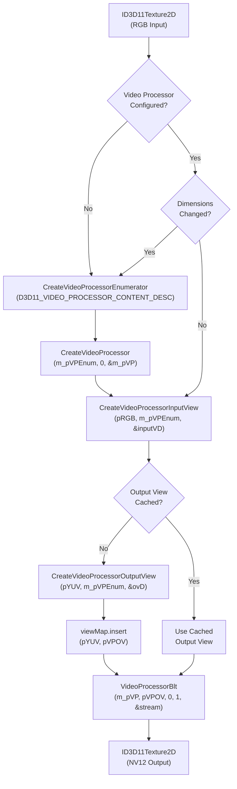

The conversion process in the `Convert()` method follows these steps:

1. **Configuration Check**: Verifies if video processor needs reconfiguration based on texture dimensions
2. **Video Processor Setup**: Creates processor enumerator and processor instance if needed
3. **View Creation**: Creates input view from RGB texture and obtains/creates output view for NV12 texture
4. **Processing**: Executes hardware-accelerated conversion using `VideoProcessorBlt`

**Sources:** [nvEncDXGIOutputDuplicationSample/Preproc.cpp:76-168]()

## Performance Optimizations

### Dynamic Reconfiguration

The system optimizes for changing input/output dimensions by detecting when video processor reconfiguration is required:

```cpp
// Dimension change detection
if (m_inDesc.Width != inDesc.Width ||
    m_inDesc.Height != inDesc.Height ||
    m_outDesc.Width != outDesc.Width ||
    m_outDesc.Height != outDesc.Height)
{
    // Recreate video processor
}
```

**Sources:** [nvEncDXGIOutputDuplicationSample/Preproc.cpp:90-97]()

### Output View Caching

The `viewMap` optimization prevents repeated creation of `ID3D11VideoProcessorOutputView` objects:

| Optimization | Implementation | Benefit |
|--------------|----------------|---------|
| View Caching | `std::unordered_map<ID3D11Texture2D*, ID3D11VideoProcessorOutputView*>` | Reduces API overhead |
| Cache Lookup | `viewMap.find(pYUV)` before creation | Avoids redundant allocations |
| Cleanup Management | Views released in `Cleanup()` | Prevents resource leaks |

**Sources:** [nvEncDXGIOutputDuplicationSample/Preproc.h:55-57](), [nvEncDXGIOutputDuplicationSample/Preproc.cpp:135-153]()

## DirectX Video Processing Integration

### Initialization Sequence

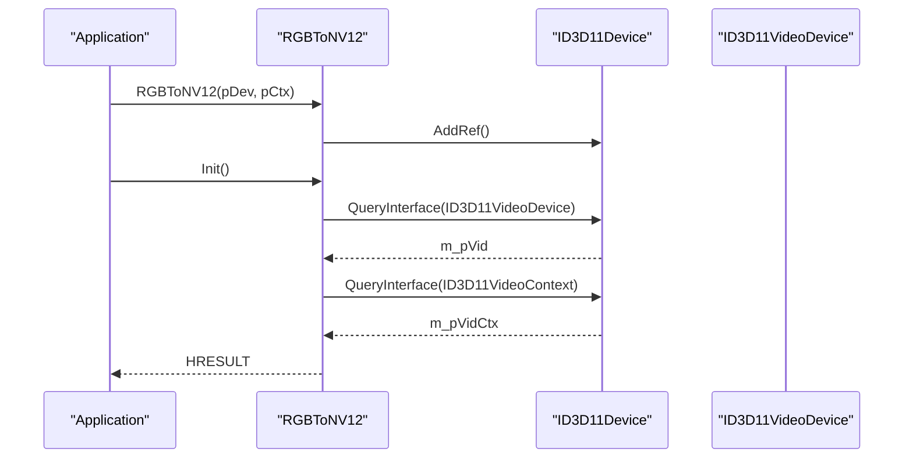

The initialization process establishes video processing capabilities by obtaining video-specific interfaces from the standard D3D11 device.

**Sources:** [nvEncDXGIOutputDuplicationSample/Preproc.cpp:42-57]()

### Video Processor Configuration

The video processor configuration uses `D3D11_VIDEO_PROCESSOR_CONTENT_DESC` to specify processing parameters:

```cpp
D3D11_VIDEO_PROCESSOR_CONTENT_DESC contentDesc = {
    D3D11_VIDEO_FRAME_FORMAT_PROGRESSIVE,  // Progressive frames
    { 1, 1 },                              // Input frame rate
    inDesc.Width, inDesc.Height,           // Input dimensions
    { 1, 1 },                              // Output frame rate  
    outDesc.Width, outDesc.Height,         // Output dimensions
    D3D11_VIDEO_USAGE_PLAYBACK_NORMAL      // Usage scenario
};
```

**Sources:** [nvEncDXGIOutputDuplicationSample/Preproc.cpp:105-111]()

---

# Page: Build Configuration

# Build Configuration

<details>
<summary>Relevant source files</summary>

The following files were used as context for generating this wiki page:

- [nvEncDXGIOutputDuplicationSample/nvEncDXGIOutputDuplicationSample.sln](nvEncDXGIOutputDuplicationSample/nvEncDXGIOutputDuplicationSample.sln)
- [nvEncDXGIOutputDuplicationSample/nvEncDXGIOutputDuplicationSample.vcxproj](nvEncDXGIOutputDuplicationSample/nvEncDXGIOutputDuplicationSample.vcxproj)
- [nvEncDXGIOutputDuplicationSample/nvEncDXGIOutputDuplicationSample.vcxproj.filters](nvEncDXGIOutputDuplicationSample/nvEncDXGIOutputDuplicationSample.vcxproj.filters)

</details>


This document covers the build system configuration for the Desktop Capture Sample (`nvEncDXGIOutputDuplicationSample`), including Visual Studio project structure, compiler settings, dependencies, and platform support. The sample is built using Microsoft Visual Studio with a traditional MSBuild project structure.

For information about the application architecture and runtime behavior, see [Application Architecture](#2.1). For details about the NVENC framework dependencies, see [NVENC Framework](#4).

## Project Structure

The Desktop Capture Sample uses a standard Visual Studio solution containing a single C++ console application project. The build system supports multiple platforms and configurations through MSBuild project files.

### Build Configuration Matrix

The solution supports four build configurations across two platforms:

| Configuration | Platform | Purpose |
|---------------|----------|---------|
| Debug | Win32 | 32-bit debug build with full debugging symbols |
| Debug | x64 | 64-bit debug build with full debugging symbols |
| Release | Win32 | 32-bit optimized release build |
| Release | x64 | 64-bit optimized release build |

**Build Configuration Overview**
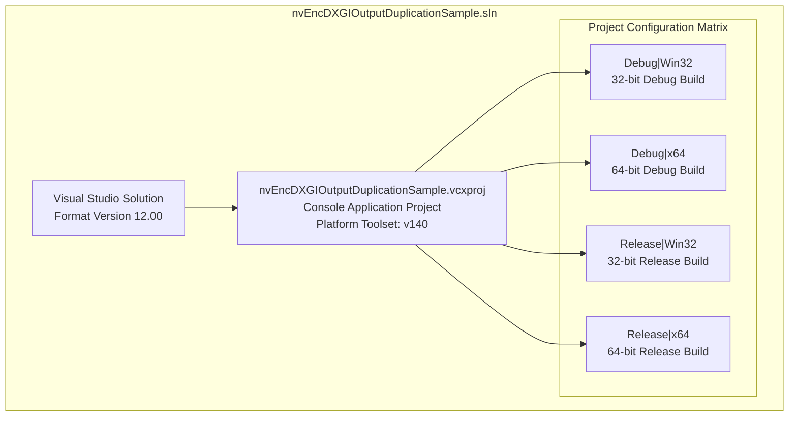

Sources: [nvEncDXGIOutputDuplicationSample/nvEncDXGIOutputDuplicationSample.sln:1-28](), [nvEncDXGIOutputDuplicationSample/nvEncDXGIOutputDuplicationSample.vcxproj:3-19]()

## Compiler Configuration

The project uses Visual Studio 2015 toolset (`v140`) with specific compiler and linker settings optimized for DirectX and NVENC integration.

### Platform Toolset and Runtime

| Setting | Value | Description |
|---------|-------|-------------|
| `PlatformToolset` | `v140` | Visual Studio 2015 compiler toolset |
| `CharacterSet` | `MultiByte` | ANSI character encoding |
| `ConfigurationType` | `Application` | Standalone executable |
| `RuntimeLibrary` (Debug) | `MultiThreadedDebug` | Static runtime linking for debug builds |

### Preprocessor Definitions

The build system defines platform-specific macros for conditional compilation:

**Debug Builds:**
- `WIN32`
- `_DEBUG` 
- `_CONSOLE`
- `_LIB`

**Release Builds:**
- `WIN32`
- `NDEBUG`
- `_CONSOLE` 
- `_LIB`

Sources: [nvEncDXGIOutputDuplicationSample/nvEncDXGIOutputDuplicationSample.vcxproj:28-53](), [nvEncDXGIOutputDuplicationSample/nvEncDXGIOutputDuplicationSample.vcxproj:84-163]()

## Dependencies and Include Paths

The project depends on DirectX libraries for graphics operations and includes shared NVENC framework code from the samples directory.

### System Library Dependencies

**DirectX and Windows Libraries:**
```
d3d11.lib          // Direct3D 11 graphics API
dxgi.lib           // DirectX Graphics Infrastructure
kernel32.lib       // Windows kernel functions
user32.lib         // Windows user interface
gdi32.lib          // Graphics Device Interface
ole32.lib          // OLE automation
oleaut32.lib       // OLE automation utilities
uuid.lib           // GUID utilities
```

### Include Directory Structure

**Include Path Resolution**
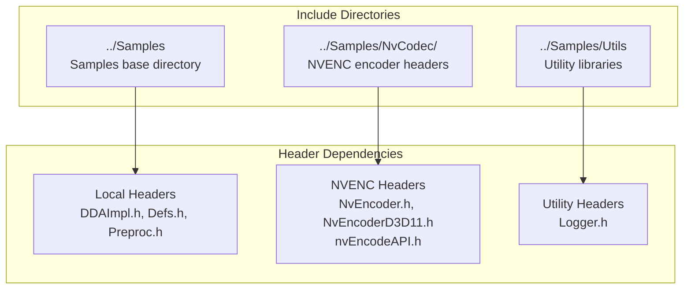

Sources: [nvEncDXGIOutputDuplicationSample/nvEncDXGIOutputDuplicationSample.vcxproj:93-94](), [nvEncDXGIOutputDuplicationSample/nvEncDXGIOutputDuplicationSample.vcxproj:98-99](), [nvEncDXGIOutputDuplicationSample/nvEncDXGIOutputDuplicationSample.vcxproj:112-113]()

## Source File Organization

The project compiles both local implementation files and shared NVENC framework components.

### Source File Compilation Structure

**Project Source Organization**
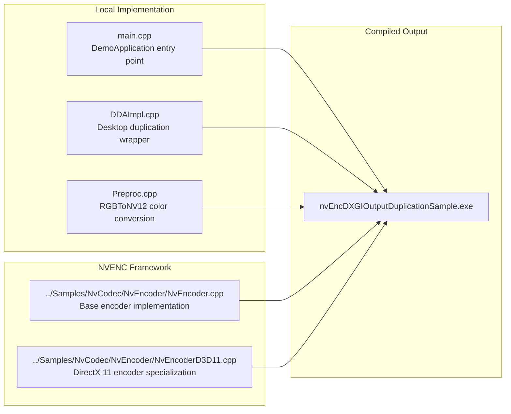

### Header File Organization

The project includes both application-specific headers and shared framework headers organized by functional groups:

| Filter Group | Headers | Purpose |
|--------------|---------|---------|
| Header Files | `Defs.h`, `DDAImpl.h`, `Preproc.h` | Local application headers |
| Header Files\NVEnc | `NvEncoder.h`, `NvEncoderD3D11.h`, `nvEncodeAPI.h`, `Logger.h` | NVENC framework headers |

Sources: [nvEncDXGIOutputDuplicationSample/nvEncDXGIOutputDuplicationSample.vcxproj:164-179](), [nvEncDXGIOutputDuplicationSample/nvEncDXGIOutputDuplicationSample.vcxproj.filters:16-62]()

## Build Optimization Settings

The build system applies different optimization strategies for debug and release configurations.

### Debug Configuration

**Debug Build Settings:**
- `Optimization`: Disabled
- `GenerateDebugInformation`: true
- `LinkIncremental`: true
- `RuntimeLibrary`: MultiThreadedDebug
- `WarningLevel`: Level3
- `SDLCheck`: true

### Release Configuration

**Release Build Settings:**
- `Optimization`: MaxSpeed
- `FunctionLevelLinking`: true
- `IntrinsicFunctions`: true
- `EnableCOMDATFolding`: true
- `OptimizeReferences`: true
- `WholeProgramOptimization`: true
- `CodeAnalysisRuleSet`: AllRules.ruleset

### Library Directory Configuration

Release builds include additional library search paths for optional testing dependencies:

```
$(SolutionDir)/gmock/release_Win32
```

Sources: [nvEncDXGIOutputDuplicationSample/nvEncDXGIOutputDuplicationSample.vcxproj:84-102](), [nvEncDXGIOutputDuplicationSample/nvEncDXGIOutputDuplicationSample.vcxproj:122-163]()

---

# Page: Broadcast Sample

# Broadcast Sample

<details>
<summary>Relevant source files</summary>

The following files were used as context for generating this wiki page:

- [nvEncBroadcastSample/common/inc/nvEncApp.h](nvEncBroadcastSample/common/inc/nvEncApp.h)
- [nvEncBroadcastSample/common/inc/nvEncAppUtils.h](nvEncBroadcastSample/common/inc/nvEncAppUtils.h)

</details>


## Purpose and Scope

The Broadcast Sample (`nvEncBroadcastSample`) demonstrates a comprehensive NVENC-based video encoding solution designed for broadcast and professional video applications. This sample provides a more feature-rich implementation compared to the Desktop Capture Sample, offering advanced encoding capabilities, DirectX 9/11 interoperability, and configurable encoder settings suitable for live streaming and broadcast workflows.

For desktop screen capture functionality, see [Desktop Capture Sample](#2). For detailed information about the underlying NVENC hardware API, see [NVENC Hardware API](#4.1).

## Architecture Overview

The Broadcast Sample implements a layered architecture that separates graphics API concerns from encoding logic, enabling flexible integration with different DirectX versions and encoding configurations.

### High-Level Component Architecture

```mermaid
graph TB
    subgraph "Application Layer"
        nvEncApp["nvEncApp<br/>Main Application Controller"]
        AppParams["AppEncodeParams<br/>Application Configuration"]
        EncSettings["nvEncSettings<br/>Encoder Configuration"]
    end
    
    subgraph "DirectX Interop Layer"
        INvEncDxInterop["INvEncDxInterop<br/>Abstract DirectX Interface"]
        DxFactory["CNvEncDxInteropFactory<br/>Context Factory"]
        Dx9Interop["DirectX 9 Implementation"]
        Dx11Interop["DirectX 11 Implementation"]
    end
    
    subgraph "NVENC API Layer"
        EncodeApiObj["INVENC_EncodeApiObj<br/>Encoding Interface"]
        BroadcastApi["nvEncBroadcastEncodeApi<br/>Core API Implementation"]
    end
    
    nvEncApp --> AppParams
    nvEncApp --> EncSettings
    nvEncApp --> INvEncDxInterop
    nvEncApp --> EncodeApiObj
    
    DxFactory --> Dx9Interop
    DxFactory --> Dx11Interop
    INvEncDxInterop --> Dx9Interop
    INvEncDxInterop --> Dx11Interop
    
    EncodeApiObj --> BroadcastApi
    
    style nvEncApp fill:#f9f9f9
    style INvEncDxInterop fill:#e8f4f8
    style EncodeApiObj fill:#f0e8f8
```

**Sources:** [nvEncBroadcastSample/common/inc/nvEncApp.h:98-426](), [nvEncBroadcastSample/common/inc/nvEncAppUtils.h:55-74]()

### Application Initialization Flow

```mermaid
sequenceDiagram
    participant App as "nvEncApp"
    participant Factory as "CNvEncDxInteropFactory"
    participant DxInterop as "INvEncDxInterop"
    participant EncodeAPI as "INVENC_EncodeApiObj"
    
    App->>App: "GetVersionEx(&OsVer)"
    App->>App: "IsWin7() ? DX9 : DX11"
    App->>Factory: "CreateDxInterop(dxType)"
    Factory-->>App: "INvEncDxInterop instance"
    
    App->>DxInterop: "Initialize(&initParams)"
    App->>App: "NVENC_EncodeInitialize(createParams)"
    App-->>EncodeAPI: "m_pEncodeObj created"
    
    App->>App: "initializeEncoderSettings()"
    App->>EncodeAPI: "initialize(&initParams, &m_encodeSettingsParams)"
    
    Note over App: "Ready for encoding operations"
```

**Sources:** [nvEncBroadcastSample/common/inc/nvEncApp.h:135-154](), [nvEncBroadcastSample/common/inc/nvEncApp.h:296-354]()

## Core Components

### nvEncApp Class

The `nvEncApp` class serves as the main application controller, managing the entire encoding pipeline from initialization to cleanup. It handles platform detection, graphics context creation, and encoder configuration.

| Component | Type | Purpose |
|-----------|------|---------|
| `m_pGraphicsContext` | `INvEncDxInterop*` | DirectX context management |
| `m_pEncodeObj` | `INVENC_EncodeApiObj*` | NVENC API interface |
| `m_encodeSettingsParams` | `NVENC_EncodeSettingsParams` | Encoder configuration |
| `OsVer` | `OSVERSIONINFO` | Platform version detection |

**Sources:** [nvEncBroadcastSample/common/inc/nvEncApp.h:98-106]()

### Encoder Configuration Structure

The `nvEncSettings` structure provides application-level encoder configuration that maps to the lower-level NVENC API parameters:

```mermaid
graph LR
    subgraph "Application Settings"
        nvEncSettings["nvEncSettings<br/>App-level config"]
        DefaultSettings["defaultEncoderSettings<br/>Default values"]
    end
    
    subgraph "API Parameters"
        EncodeParams["NVENC_EncodeSettingsParams<br/>API-level config"]
        AdvParams["NVENC_AdvancedEncodeParams<br/>Advanced features"]
    end
    
    nvEncSettings --> EncodeParams
    DefaultSettings --> nvEncSettings
    EncodeParams --> AdvParams
    
    style nvEncSettings fill:#f9f9f9
    style EncodeParams fill:#e8f4f8
```

**Sources:** [nvEncBroadcastSample/common/inc/nvEncApp.h:64-96]()

### DirectX Interoperability Factory

The factory pattern implementation enables runtime selection between DirectX 9 and DirectX 11 based on platform capabilities:

| Method | Purpose | Platform Logic |
|--------|---------|----------------|
| `IsWin7()` | Platform detection | Windows 7 → DX9, Windows 8+ → DX11 |
| `CreateDxInterop()` | Context creation | Factory method for DX context |
| `Initialize()` | Context setup | Graphics resource initialization |

**Sources:** [nvEncBroadcastSample/common/inc/nvEncApp.h:109-117](), [nvEncBroadcastSample/common/inc/nvEncApp.h:135-154](), [nvEncBroadcastSample/common/inc/nvEncAppUtils.h:71-74]()

## Default Configuration

The sample provides sensible defaults for broadcast applications:

| Parameter | Default Value | Range/Options |
|-----------|---------------|---------------|
| Resolution | 1920x1080 | Configurable |
| Frame Rate | 30 fps (30000/1000) | Configurable numerator/denominator |
| Bitrate | 6000 Kbps | Up to 40000 Kbps |
| Profile | High | Baseline, Main, High |
| Preset | Medium | Fast, Medium, Slow, Fastest |
| Rate Control | CBR | CBR, VBR, CONSTQUAL |
| B-Frames | 2 | 0-3 |

**Sources:** [nvEncBroadcastSample/common/inc/nvEncApp.h:43-96]()

## Input Format Support

The application supports multiple input formats with automatic detection based on file extensions:

```mermaid
graph LR
    subgraph "Input Formats"
        YUV[".yuv files<br/>kBufferFormat_NV12<br/>1.5 bytes per pixel"]
        RGB[".rgb/.argb files<br/>kBufferFormat_ARGB<br/>4 bytes per pixel"]
    end
    
    subgraph "Processing"
        InitParams["NVENC_EncodeInitParams<br/>Format configuration"]
        SizeCalc["Buffer size calculation"]
    end
    
    YUV --> InitParams
    RGB --> InitParams
    InitParams --> SizeCalc
    
    style YUV fill:#e8f4f8
    style RGB fill:#f0e8f8
```

**Sources:** [nvEncBroadcastSample/common/inc/nvEncApp.h:253-271]()

## Key Differences from Desktop Capture Sample

The Broadcast Sample provides several advantages over the simpler Desktop Capture Sample:

- **Multi-API Support**: DirectX 9 and DirectX 11 compatibility through abstraction layer
- **Advanced Configuration**: Comprehensive encoder settings with presets and advanced parameters
- **File Input Support**: Reads from video files rather than live screen capture
- **Broadcast Features**: Optimized for streaming with configurable bitrates and quality settings
- **Platform Adaptation**: Automatic platform detection and appropriate API selection

For DirectX interoperability details, see [DirectX Interoperability](#3.1). For encoding API specifics, see [Broadcast Encoding API](#3.2).

---

# Page: DirectX Interoperability

# DirectX Interoperability

<details>
<summary>Relevant source files</summary>

The following files were used as context for generating this wiki page:

- [nvEncBroadcastSample/common/inc/nvEncDx11App.h](nvEncBroadcastSample/common/inc/nvEncDx11App.h)
- [nvEncBroadcastSample/common/inc/nvEncDx9App.h](nvEncBroadcastSample/common/inc/nvEncDx9App.h)
- [nvEncBroadcastSample/common/src/nvEncDx11App.cpp](nvEncBroadcastSample/common/src/nvEncDx11App.cpp)
- [nvEncBroadcastSample/common/src/nvEncDx9App.cpp](nvEncBroadcastSample/common/src/nvEncDx9App.cpp)
- [nvEncBroadcastSample/common/src/nvEncDxInteropFactory.cpp](nvEncBroadcastSample/common/src/nvEncDxInteropFactory.cpp)

</details>


This document covers the DirectX interoperability layer in the broadcast sample that provides a unified interface for both DirectX 9 and DirectX 11 contexts, enabling flexible graphics API integration with NVENC encoding. For information about the broader broadcast encoding API, see [Broadcast Encoding API](#3.2). For details about the NVENC framework itself, see [NVENC Framework](#4).

## Purpose and Scope

The DirectX interoperability layer abstracts the differences between DirectX 9 and DirectX 11 APIs, allowing the broadcast sample to work with either graphics context. This layer handles device initialization, texture management, memory synchronization, and frame data preparation for NVENC encoding. The system supports both system memory and GPU memory (shared texture) workflows.

## Architecture Overview

The interoperability layer follows a factory pattern with a common interface and platform-specific implementations:

```mermaid
classDiagram
    class INvEncDxInterop {
        <<interface>>
        +Initialize(pVideoInfo)* bool
        +SetFrameParams(encodeInfo, initParams, pSrc)* bool
        +GetDxInteropType()* DxContextType
        +ReleaseNvEnc()* bool
        #m_dxContextType DxContextType
    }
    
    class CNvEncDx11Interop {
        -m_pDevice ID3D11Device
        -m_pContext ID3D11DeviceContext
        -m_pFactory IDXGIFactory1
        -m_pAdapter IDXGIAdapter
        -m_pTexSysMem ID3D11Texture2D
        -m_pTexSharedMem ID3D11Texture2D
        -m_sharedHandle HANDLE
        +Initialize(pVideoInfo) bool
        +SetFrameParams(encodeInfo, initParams, pSrc) bool
    }
    
    class CNvEncDx9Interop {
        -m_pD3D9 IDirect3D9Ex
        -m_pDevice IDirect3DDevice9
        -m_pTex IDirect3DSurface9
        +Initialize(pVideoInfo) bool
        +SetFrameParams(encodeInfo, initParams, pSrc) bool
    }
    
    class CNvEncDxInteropFactory {
        <<factory>>
        +CreateDxInterop(type) unique_ptr~INvEncDxInterop~
    }
    
    class DxContextType {
        <<enumeration>>
        eDx9Type
        eDx11Type
    }
    
    INvEncDxInterop <|-- CNvEncDx11Interop
    INvEncDxInterop <|-- CNvEncDx9Interop
    CNvEncDxInteropFactory --> INvEncDxInterop : creates
    INvEncDxInterop --> DxContextType : uses
```

**Sources:** [nvEncBroadcastSample/common/inc/nvEncDx11App.h:30-49](), [nvEncBroadcastSample/common/inc/nvEncDx9App.h:30-46](), [nvEncBroadcastSample/common/src/nvEncDxInteropFactory.cpp:30-71]()

## Interface Design

The `INvEncDxInterop` interface provides the contract for DirectX interoperability:

| Method | Purpose | Return Type |
|--------|---------|-------------|
| `Initialize()` | Sets up DirectX context and resources | `bool` |
| `SetFrameParams()` | Prepares frame data for encoding | `bool` |
| `GetDxInteropType()` | Returns the DirectX context type | `DxContextType` |
| `ReleaseNvEnc()` | Cleanup resources | `bool` |

The interface supports two buffer types through the `NVENC_EncodeInfo` structure:
- `kBufferType_Sys` - System memory buffers
- `kBufferType_Vid` - GPU memory buffers (shared textures)

**Sources:** [nvEncBroadcastSample/common/inc/nvEncDx11App.h:35-39](), [nvEncBroadcastSample/common/inc/nvEncDx9App.h:35-39]()

## DirectX 11 Implementation

The `CNvEncDx11Interop` class provides comprehensive DirectX 11 integration with support for both system memory and shared texture workflows:

```mermaid
flowchart TD
    subgraph "Initialization Flow"
        A["CreateDXGIFactory1()"] --> B["EnumAdapters()"]
        B --> C["D3D11CreateDevice()"]
        C --> D["CreateTexture2D(STAGING)"]
        D --> E["CreateTexture2D(SHARED)"]
        E --> F["QueryInterface(IDXGIResource)"]
        F --> G["GetSharedHandle()"]
    end
    
    subgraph "Frame Processing Flow"
        H["Map(m_pTexSysMem)"] --> I["Copy CPU data to staging texture"]
        I --> J["Unmap(m_pTexSysMem)"]
        J --> K["AcquireSync(KeyedMutex)"]
        K --> L["CopyResource(staging → shared)"]
        L --> M["ReleaseSync(KeyedMutex)"]
        M --> N["Set shared handle in NVENC_EncodeInfo"]
    end
    
    G --> H
```

### Key Components

- **Device Management**: Creates D3D11 device using DXGI factory and adapter enumeration
- **Dual Texture System**: 
  - `m_pTexSysMem`: Staging texture with CPU write access (`D3D11_USAGE_STAGING`)
  - `m_pTexSharedMem`: Shared texture with keyed mutex (`D3D11_RESOURCE_MISC_SHARED_KEYEDMUTEX`)
- **Synchronization**: Uses `IDXGIKeyedMutex` for thread-safe access to shared resources
- **Format Support**: Handles both `DXGI_FORMAT_B8G8R8A8_UNORM` (ARGB) and `DXGI_FORMAT_NV12` formats

**Sources:** [nvEncBroadcastSample/common/src/nvEncDx11App.cpp:56-165](), [nvEncBroadcastSample/common/src/nvEncDx11App.cpp:170-299]()

## DirectX 9 Implementation

The `CNvEncDx9Interop` class provides a simpler DirectX 9 integration that primarily uses system memory:

```mermaid
flowchart TD
    A["Direct3DCreate9Ex()"] --> B["CreateDevice()"]
    B --> C["GetAdapterIdentifier()"]
    C --> D["SetFrameParams() uses system memory"]
    D --> E["bufferType = kBufferType_Sys"]
```

### Characteristics

- **Simplified Architecture**: No shared texture support, relies on system memory transfers
- **Direct Memory Access**: Directly references source buffer pointer in `NVENC_EncodeInfo.SysBuffer.pixelBuffer`
- **Format Support**: Supports ARGB format through `D3DFMT_A8R8G8B8`
- **Presentation Parameters**: Configures windowed mode with immediate presentation interval

**Sources:** [nvEncBroadcastSample/common/src/nvEncDx9App.cpp:51-85](), [nvEncBroadcastSample/common/src/nvEncDx9App.cpp:90-102]()

## Factory Pattern Implementation

The `CNvEncDxInteropFactory` provides centralized creation of interop instances:

```mermaid
flowchart LR
    A["CreateDxInterop(DxContextType)"] --> B{type}
    B -->|eDx11Type| C["new CNvEncDx11Interop()"]
    B -->|eDx9Type| D["new CNvEncDx9Interop()"]
    C --> E["unique_ptr<INvEncDxInterop>"]
    D --> E
```

The factory method handles:
- Type-safe creation based on `DxContextType` enumeration
- Memory management through `std::unique_ptr`
- Error handling for failed allocations

**Sources:** [nvEncBroadcastSample/common/src/nvEncDxInteropFactory.cpp:35-71]()

## Data Flow Pipeline

The interoperability layer sits between the application and NVENC, handling format conversion and memory management:

```mermaid
sequenceDiagram
    participant App as "Application"
    participant Factory as "CNvEncDxInteropFactory"
    participant Interop as "INvEncDxInterop"
    participant DX as "DirectX API"
    participant NVENC as "NVENC Encoder"
    
    App->>Factory: CreateDxInterop(type)
    Factory->>Interop: new CNvEncDx11Interop()
    Factory-->>App: unique_ptr<INvEncDxInterop>
    
    App->>Interop: Initialize(pVideoInfo)
    Interop->>DX: CreateDevice(), CreateTexture2D()
    DX-->>Interop: Device and texture handles
    Interop-->>App: true/false
    
    loop For each frame
        App->>Interop: SetFrameParams(encodeInfo, initParams, pSrc)
        Interop->>DX: Map(), Copy data, CopyResource()
        DX-->>Interop: Shared texture handle
        Interop-->>App: Updated encodeInfo
        App->>NVENC: Encode with encodeInfo
    end
```

**Sources:** [nvEncBroadcastSample/common/src/nvEncDx11App.cpp:170-299](), [nvEncBroadcastSample/common/src/nvEncDx9App.cpp:90-102](), [nvEncBroadcastSample/common/src/nvEncDxInteropFactory.cpp:35-71]()

---

# Page: Broadcast Encoding API

# Broadcast Encoding API

<details>
<summary>Relevant source files</summary>

The following files were used as context for generating this wiki page:

- [nvEncBroadcastSample/nvEnc/api/nvEncBroadcastEncodeApi.h](nvEncBroadcastSample/nvEnc/api/nvEncBroadcastEncodeApi.h)
- [nvEncBroadcastSample/nvEnc/nvEncCore/NvEncBroadcastBitstreamBuffer.h](nvEncBroadcastSample/nvEnc/nvEncCore/NvEncBroadcastBitstreamBuffer.h)
- [nvEncBroadcastSample/nvEnc/nvEncCore/NvEncBroadcastBitstreamBufferInst.h](nvEncBroadcastSample/nvEnc/nvEncCore/NvEncBroadcastBitstreamBufferInst.h)

</details>


## Purpose and Scope

The Broadcast Encoding API provides a high-level, object-oriented interface for GPU-accelerated video encoding using NVIDIA's NVENC hardware encoder. This API abstracts the complexity of the low-level NVENC hardware API and provides simplified parameter structures, automatic resource management, and integrated bitstream handling specifically designed for broadcast applications.

This documentation covers the API interfaces, parameter structures, and bitstream management components. For information about DirectX interoperability layers that work with this API, see [DirectX Interoperability](#3.1). For details about the underlying NVENC hardware API, see [NVENC Hardware API](#4.1).

## API Architecture

The Broadcast Encoding API is organized around two primary abstract interfaces that define the encoding workflow: `INVENC_EncodeApiObj` for encoder management and `INVENC_EncodeBitstreamBuffer` for output data handling.

```mermaid
graph TB
    subgraph "nvEncBroadcastApi Namespace"
        CreateFn["NVENC_EncodeInitialize()"]
        
        subgraph "Core Interfaces"
            EncodeAPI["INVENC_EncodeApiObj"]
            BitstreamBuffer["INVENC_EncodeBitstreamBuffer"]
        end
        
        subgraph "Parameter Structures"
            CreateParams["NVENC_EncodeCreateParams"]
            InitParams["NVENC_EncodeInitParams"]
            SettingsParams["NVENC_EncodeSettingsParams"]
            EncodeInfo["NVENC_EncodeInfo"]
        end
        
        subgraph "Buffer Management"
            BufferInfo["NVENC_BufferInfo"]
            AdvancedParams["NVENC_AdvancedEncodeParams"]
        end
        
        subgraph "Event System"
            EventNotify["NVENC_EventNotify"]
            EventHandler["pfnEventHandler"]
        end
    end
    
    CreateFn --> EncodeAPI
    EncodeAPI --> BitstreamBuffer
    CreateParams --> CreateFn
    InitParams --> EncodeAPI
    SettingsParams --> EncodeAPI
    EncodeInfo --> EncodeAPI
    BufferInfo --> EncodeInfo
    AdvancedParams --> SettingsParams
    EventNotify --> CreateParams
    EventHandler --> EventNotify
```

Sources: [nvEncBroadcastSample/nvEnc/api/nvEncBroadcastEncodeApi.h:331-403]()

## Core Interfaces

### INVENC_EncodeApiObj Interface

The `INVENC_EncodeApiObj` class serves as the primary encoder interface, managing the complete encoding lifecycle from initialization through finalization.

| Method | Purpose | Parameters |
|--------|---------|------------|
| `initialize()` | Initialize encoder with frame and encoding parameters | `NVENC_EncodeInitParams*`, `NVENC_EncodeSettingsParams*` |
| `createBitstreamBuffer()` | Create a buffer for encoded output | `INVENC_EncodeBitstreamBuffer**` |
| `encode()` | Encode a single frame | `NVENC_EncodeInfo*`, `INVENC_EncodeBitstreamBuffer*` |
| `getSequenceParams()` | Retrieve sequence parameter set | `INVENC_EncodeBitstreamBuffer*` |
| `finalize()` | Complete encoding and flush remaining frames | `INVENC_EncodeBitstreamBuffer*` |
| `isInitalized()` | Check initialization status | None |
| `releaseObject()` | Release encoder resources | None |

Sources: [nvEncBroadcastSample/nvEnc/api/nvEncBroadcastEncodeApi.h:336-365]()

### INVENC_EncodeBitstreamBuffer Interface

The `INVENC_EncodeBitstreamBuffer` class provides access to encoded bitstream data with integrated timestamp and metadata management.

| Method | Purpose | Return Type |
|--------|---------|-------------|
| `isInitalized()` | Check buffer initialization status | `bool` |
| `release()` | Release buffer resources | `eNVENC_RetCode` |
| `recycle()` | Prepare buffer for reuse | `eNVENC_RetCode` |
| `isKeyFrame()` | Check if current packet is a keyframe | `bool` |
| `getPts()` | Get presentation or decoding timestamp | `uint64_t` |
| `getBitStreamBuffer()` | Access raw bitstream data | `uint8_t*` |

Sources: [nvEncBroadcastSample/nvEnc/api/nvEncBroadcastEncodeApi.h:301-328]()

## Encoding Parameter Structures

### Initialization Parameters

The API uses a structured approach to encoding configuration, separating frame properties from encoding settings.

```mermaid
graph TD
    subgraph "Frame Properties"
        InitParams["NVENC_EncodeInitParams"]
        Width["width: uint32_t"]
        Height["height: uint32_t"]
        BufferFormat["bufferFormat: eNVENC_BufferFormat"]
    end
    
    subgraph "Encoding Configuration"
        SettingsParams["NVENC_EncodeSettingsParams"]
        
        subgraph "Rate Control"
            Bitrate["bitrate: uint32_t"]
            MaxBitrate["maxBitrate: uint32_t"]
            RateControl["rateControl: eNVENC_EncParamsRateControl"]
            ConstQuality["constantQuality: uint32_t"]
        end
        
        subgraph "Frame Structure"
            FrameRateNum["frameRateNum: uint32_t"]
            FrameRateDen["frameRateDen: uint32_t"]
            KeyFrameInterval["keyFrameInterval: uint32_t"]
            BFrames["bFrames: uint32_t"]
        end
        
        subgraph "Codec Settings"
            Profile["encProfile: eNVENC_EncParamsProfile"]
            Preset["preset: eNVENC_EncParamsPreset"]
            Level["level: eNVENC_EncParamsLevel"]
        end
        
        subgraph "Advanced Features"
            AdvParams["advParams: NVENC_AdvancedEncodeParams"]
            PSY_AQ["enablePSY_AQ: 1 bit"]
            LookAhead["enableLookAhead: 1 bit"]
            LookAheadDepth["loopAheadDepth: uint32_t"]
        end
    end
    
    InitParams --> Width
    InitParams --> Height
    InitParams --> BufferFormat
    
    SettingsParams --> Bitrate
    SettingsParams --> RateControl
    SettingsParams --> FrameRateNum
    SettingsParams --> Profile
    SettingsParams --> AdvParams
    AdvParams --> PSY_AQ
    AdvParams --> LookAhead
```

Sources: [nvEncBroadcastSample/nvEnc/api/nvEncBroadcastEncodeApi.h:176-285]()

### Rate Control Modes

The API supports three primary rate control strategies:

| Mode | Enum Value | Description |
|------|------------|-------------|
| Variable Bitrate | `NVENC_EncParams_RC_VBR` | Allows bitrate to vary while maintaining target average |
| Constant Bitrate | `NVENC_EncParams_RC_CBR` | Maintains steady bitrate output |
| Constant Quality | `NVENC_EncParams_RC_CONSTQUAL` | Prioritizes visual quality over bitrate consistency |

Sources: [nvEncBroadcastSample/nvEnc/api/nvEncBroadcastEncodeApi.h:186-192]()

### Profile and Level Support

The API provides comprehensive support for H.264 and HEVC encoding standards:

| Profile Type | Available Options |
|--------------|-------------------|
| H.264 Profiles | Baseline, Main, High, Auto |
| H.264 Levels | 1.0 through 5.2 |
| HEVC Levels | 1.0 through 6.2 |
| Encoding Presets | Fast, Fastest, Medium/Default, Slow |

Sources: [nvEncBroadcastSample/nvEnc/api/nvEncBroadcastEncodeApi.h:197-253]()

## Buffer Management System

### Buffer Type Hierarchy

The API supports multiple buffer types and graphics API integration through a unified buffer information structure.

```mermaid
graph TD
    subgraph "Buffer Classification"
        BufferInfo["NVENC_BufferInfo"]
        
        subgraph "Memory Location"
            SysBuffer["kBufferType_Sys"]
            VidBuffer["kBufferType_Vid"]
        end
        
        subgraph "Graphics API"
            DX9["kDxBufferType_DX9"]
            DX10["kDxBufferType_DX10"]
            DX11["kDxBufferType_DX11"]
            DX12["kDxBufferType_DX12"]
        end
        
        subgraph "Pixel Formats"
            ARGB["kBufferFormat_ARGB"]
            NV12["kBufferFormat_NV12"]
            ABGR["kBufferFormat_ABGR"]
        end
        
        subgraph "Platform-Specific Data"
            SysData["SysBuffer.pixelBuffer: uint64_t"]
            SysWidth["SysBuffer.lineWidth: uint32_t"]
            DxHandle["DxBuffer.bufferHandle: HANDLE"]
            DxWidth["DxBuffer.lineWidth: uint32_t"]
        end
    end
    
    BufferInfo --> SysBuffer
    BufferInfo --> VidBuffer
    BufferInfo --> DX9
    BufferInfo --> DX11
    BufferInfo --> ARGB
    BufferInfo --> NV12
    
    SysBuffer --> SysData
    SysBuffer --> SysWidth
    VidBuffer --> DxHandle
    VidBuffer --> DxWidth
```

Sources: [nvEncBroadcastSample/nvEnc/api/nvEncBroadcastEncodeApi.h:140-161]()

### Encode Information Structure

Each encoding operation uses `NVENC_EncodeInfo` to package frame data with timing information:

| Field | Type | Purpose |
|-------|------|---------|
| `bufferInfo` | `NVENC_BufferInfo` | Frame buffer details and format |
| `pts` | `int64_t` | Presentation timestamp |
| `reserved` | `uint32_t[4]` | Reserved for future use |

Sources: [nvEncBroadcastSample/nvEnc/api/nvEncBroadcastEncodeApi.h:166-171]()

## Bitstream Buffer Implementation

### Template-Based Buffer Object

The `nvEncBroadcastBitstreamBufferObject` class provides a template-based implementation of the `INVENC_EncodeBitstreamBuffer` interface with configurable memory allocation strategies.

```mermaid
graph TD
    subgraph "nvEncBroadcastBitstreamBufferObject<T, Alloc>"
        subgraph "State Management"
            Initialized["m_bBufferInitialized: bool"]
            RefCount["m_RefCount: uint32_t"]
        end
        
        subgraph "Data Storage"
            DataPtr["m_pData: T*"]
            DataSize["m_DataSize: uint32_t"]
            Allocator["allocatorObj: Alloc"]
        end
        
        subgraph "Timing Information"
            PTSArray["m_ptsArray[NVENC_TimeStamp_Max]: int64_t[]"]
        end
        
        subgraph "NVENC Integration"
            BitstreamData["m_bitStreamData: NV_ENC_LOCK_BITSTREAM"]
        end
        
        subgraph "Key Methods"
            CreateInstance["CreateInstance()"]
            AllocBuffer["allocBuffer(uint32_t size)"]
            SetPts["setPts(eNVENC_TimeStampType, uint64_t)"]
            SetBitstreamParams["setBitstreamParams(NV_ENC_LOCK_BITSTREAM*)"]
        end
    end
    
    Initialized --> RefCount
    DataPtr --> DataSize
    DataSize --> Allocator
    PTSArray --> BitstreamData
    CreateInstance --> AllocBuffer
    AllocBuffer --> SetPts
    SetPts --> SetBitstreamParams
```

Sources: [nvEncBroadcastSample/nvEnc/nvEncCore/NvEncBroadcastBitstreamBuffer.h:30-101]()

### Buffer Lifecycle Management

The bitstream buffer supports reference counting and recycling for efficient memory management:

| Operation | Method | Description |
|-----------|--------|-------------|
| Creation | `CreateInstance()` | Static factory method for buffer instantiation |
| Initialization | `initialize()` | Prepare buffer for use |
| Data Access | `getBitStreamBuffer()` | Retrieve pointer to encoded data |
| Timestamp Query | `getPts()` | Get frame timing information |
| Recycling | `recycle()` | Reset buffer for reuse |
| Cleanup | `release()` | Deallocate resources |

Sources: [nvEncBroadcastSample/nvEnc/nvEncCore/NvEncBroadcastBitstreamBuffer.h:89-101](), [nvEncBroadcastSample/nvEnc/nvEncCore/NvEncBroadcastBitstreamBufferInst.h:25-39]()

## API Initialization and Error Handling

### Error Code System

The API uses a comprehensive error code enumeration for detailed error reporting:

| Category | Error Codes | Description |
|----------|-------------|-------------|
| Success | `API_SUCCESS` | Operation completed successfully |
| Parameter Errors | `API_ERR_INVALID_PARAMETERS`, `API_ERR_INVALID_VER` | Invalid input parameters or version mismatch |
| State Errors | `API_ERR_UNINITIALIZED`, `API_ERR_ALREADY_CREATED` | Incorrect API usage sequence |
| Resource Errors | `API_ERR_OUT_OF_MEMORY`, `API_ERR_INSUFFICIENT_BUFFER` | Memory or buffer allocation failures |
| Feature Errors | `API_ERR_UNSUPPORTED`, `API_ERR_NO_IMPLEMENTATION` | Unsupported features or missing implementation |
| Operational | `API_ERR_XCODE_FAIL`, `API_PENDING` | Encoding failures or asynchronous operations |

Sources: [nvEncBroadcastSample/nvEnc/api/nvEncBroadcastEncodeApi.h:42-59]()

### Initialization Function

The primary entry point `NVENC_EncodeInitialize` creates encoder instances with specified configuration:

```mermaid
graph LR
    subgraph "Initialization Flow"
        CreateParams["NVENC_EncodeCreateParams"]
        InitFunction["NVENC_EncodeInitialize()"]
        EncodeAPI["INVENC_EncodeApiObj**"]
        
        subgraph "CreateParams Fields"
            Size["size: uint32_t"]
            Version["version: uint32_t"] 
            CreateFlags["createFlags: eNVENC_EncodeCreateFlags"]
            EventNotify["eventNotify: NVENC_EventNotify"]
        end
    end
    
    CreateParams --> InitFunction
    Size --> CreateParams
    Version --> CreateParams
    CreateFlags --> CreateParams
    EventNotify --> CreateParams
    InitFunction --> EncodeAPI
```

Sources: [nvEncBroadcastSample/nvEnc/api/nvEncBroadcastEncodeApi.h:382-395]()

---

# Page: NVENC Framework

# NVENC Framework

<details>
<summary>Relevant source files</summary>

The following files were used as context for generating this wiki page:

- [nvEncBroadcastSample/nvEnc/nvCodec/nvEncoder/NvEncoder.h](nvEncBroadcastSample/nvEnc/nvCodec/nvEncoder/NvEncoder.h)
- [nvEncBroadcastSample/nvEnc/nvCodec/nvEncoder/NvEncoderD3D11.h](nvEncBroadcastSample/nvEnc/nvCodec/nvEncoder/NvEncoderD3D11.h)
- [nvEncBroadcastSample/nvEnc/nvCodec/nvEncoder/NvEncoderD3D9.h](nvEncBroadcastSample/nvEnc/nvCodec/nvEncoder/NvEncoderD3D9.h)

</details>


The NVENC Framework provides a unified C++ wrapper around NVIDIA's hardware video encoding API, offering platform-specific implementations for DirectX 9 and DirectX 11 integration. This framework abstracts the low-level NVENC hardware API into a more manageable object-oriented interface used by both sample applications in this repository.

For information about the underlying NVENC hardware API functions and data structures, see [NVENC Hardware API](#4.1). For usage examples in real applications, see [Desktop Capture Sample](#2) and [Broadcast Sample](#3).

## Framework Architecture

The NVENC Framework follows a base class design pattern with platform-specific derived classes that handle DirectX integration. The framework manages encoder sessions, input buffer allocation, and encoding operations while providing consistent error handling across all implementations.

```mermaid
classDiagram
    class NvEncoder {
        <<abstract>>
        -m_hEncoder: void*
        -m_nvenc: NV_ENCODE_API_FUNCTION_LIST
        -m_vInputFrames: vector~NvEncInputFrame~
        -m_eDeviceType: NV_ENC_DEVICE_TYPE
        +CreateEncoder(params)
        +DestroyEncoder()
        +EncodeFrame(vPacket)
        +GetNextInputFrame()
        +AllocateInputBuffers()* 
        +ReleaseInputBuffers()*
    }
    
    class NvEncoderD3D11 {
        -m_pD3D11Device: ID3D11Device*
        -m_pD3D11DeviceContext: ID3D11DeviceContext*
        +AllocateInputBuffers(numInputBuffers)
        +ReleaseInputBuffers()
        +ReleaseD3D11Resources()
    }
    
    class NvEncoderD3D9 {
        -m_pD3D9Device: IDirect3DDevice9*
        -m_pDXVAService: IDirectXVideoAccelerationService*
        +AllocateInputBuffers(numInputBuffers)
        +ReleaseInputBuffers()
        +ReleaseD3D9Resources()
    }
    
    class NVENCException {
        -m_errorString: string
        -m_errorCode: NVENCSTATUS
        +getErrorCode()
        +getErrorString()
        +makeNVENCException()
    }
    
    class NvEncInputFrame {
        +inputPtr: void*
        +chromaOffsets: uint32_t[2]
        +numChromaPlanes: uint32_t
        +pitch: uint32_t
        +bufferFormat: NV_ENC_BUFFER_FORMAT
        +resourceType: NV_ENC_INPUT_RESOURCE_TYPE
    }
    
    NvEncoder <|-- NvEncoderD3D11
    NvEncoder <|-- NvEncoderD3D9
    NvEncoder ..> NVENCException : throws
    NvEncoder *-- NvEncInputFrame : manages
```

**Framework Component Relationships**

Sources: [nvEncBroadcastSample/nvEnc/nvCodec/nvEncoder/NvEncoder.h:96-411](), [nvEncBroadcastSample/nvEnc/nvCodec/nvEncoder/NvEncoderD3D11.h:32-60](), [nvEncBroadcastSample/nvEnc/nvCodec/nvEncoder/NvEncoderD3D9.h:34-63]()

## Base Encoder Class

The `NvEncoder` class serves as the abstract base for all platform-specific encoder implementations. It manages the NVENC hardware session, provides encoding operations, and handles resource allocation through pure virtual functions implemented by derived classes.

### Core Operations

| Method | Purpose | Parameters |
|--------|---------|------------|
| `CreateEncoder` | Initialize encoder session | `NV_ENC_INITIALIZE_PARAMS*`, optional surface allocation |
| `DestroyEncoder` | Clean up encoder session | None |
| `EncodeFrame` | Encode a single frame | Output packet vector, picture parameters |
| `GetNextInputFrame` | Get available input buffer | Returns `NvEncInputFrame*` |
| `EndEncode` | Flush encoder queue | Output packet vector for remaining frames |
| `Reconfigure` | Dynamically change encoding parameters | `NV_ENC_RECONFIGURE_PARAMS*` |

### Encoder Session Management

```mermaid
stateDiagram-v2
    [*] --> Uninitialized
    Uninitialized --> Initialized : CreateEncoder()
    Initialized --> Encoding : First EncodeFrame()
    Encoding --> Encoding : EncodeFrame()
    Encoding --> Reconfigured : Reconfigure()
    Reconfigured --> Encoding : EncodeFrame()
    Encoding --> Flushing : EndEncode()
    Flushing --> Destroyed : DestroyEncoder()
    Initialized --> Destroyed : DestroyEncoder()
    Destroyed --> [*]
```

**Encoder Session Lifecycle**

The encoder maintains state through member variables including `m_hEncoder` for the hardware session handle, `m_bEncoderInitialized` for initialization status, and `m_vInputFrames` for input buffer management.

Sources: [nvEncBroadcastSample/nvEnc/nvCodec/nvEncoder/NvEncoder.h:104-228](), [nvEncBroadcastSample/nvEnc/nvCodec/nvEncoder/NvEncoder.h:383-411]()

### Buffer Management

The base class manages input frames through the `NvEncInputFrame` structure and provides utilities for chroma plane calculations and format conversions. Input buffer allocation is delegated to platform-specific implementations through pure virtual functions.

```mermaid
graph LR
    subgraph "Buffer Allocation Flow"
        A["RegisterResources()"] --> B["AllocateInputBuffers()"]
        B --> C["m_vInputFrames populated"]
        C --> D["GetNextInputFrame()"]
        D --> E["Application writes data"]
        E --> F["EncodeFrame()"]
        F --> D
    end
    
    subgraph "Platform-Specific"
        B --> G["NvEncoderD3D11::AllocateInputBuffers()"]
        B --> H["NvEncoderD3D9::AllocateInputBuffers()"]
    end
```

**Input Buffer Management Flow**

Sources: [nvEncBroadcastSample/nvEnc/nvCodec/nvEncoder/NvEncoder.h:128-129](), [nvEncBroadcastSample/nvEnc/nvCodec/nvEncoder/NvEncoder.h:268-276](), [nvEncBroadcastSample/nvEnc/nvCodec/nvEncoder/NvEncoder.h:372-378]()

## Platform-Specific Implementations

### DirectX 11 Implementation

The `NvEncoderD3D11` class provides DirectX 11 integration by allocating `ID3D11Texture2D` resources for input buffers. It maintains references to the D3D11 device and device context for resource management.

**Key Components:**
- `m_pD3D11Device`: DirectX 11 device for resource creation
- `m_pD3D11DeviceContext`: Device context for resource operations
- `AllocateInputBuffers()`: Creates D3D11 textures for encoding input
- `ReleaseD3D11Resources()`: Cleanup for DirectX 11 specific resources

### DirectX 9 Implementation

The `NvEncoderD3D9` class handles DirectX 9 integration using `IDirect3DSurface9` surfaces for input data. It optionally supports DirectX Video Acceleration (DXVA) services for enhanced performance.

**Key Components:**
- `m_pD3D9Device`: DirectX 9 device for surface creation
- `m_pDXVAService`: Optional DXVA service for video acceleration
- `AllocateInputBuffers()`: Creates D3D9 surfaces for encoding input
- `ReleaseD3D9Resources()`: Cleanup for DirectX 9 specific resources

Sources: [nvEncBroadcastSample/nvEnc/nvCodec/nvEncoder/NvEncoderD3D11.h:35-60](), [nvEncBroadcastSample/nvEnc/nvCodec/nvEncoder/NvEncoderD3D9.h:37-63]()

## Error Handling

The framework implements comprehensive error handling through the `NVENCException` class and standardized error checking macros.

### Exception Infrastructure

```cpp
// Exception class definition from NvEncoder.h:37-52
class NVENCException : public std::exception {
    std::string m_errorString;
    NVENCSTATUS m_errorCode;
public:
    const char* what() const throw();
    NVENCSTATUS getErrorCode() const;
    static NVENCException makeNVENCException(/*...*/);
};
```

### Error Checking Macros

| Macro | Purpose | Usage |
|-------|---------|-------|
| `NVENC_API_CALL` | Automatic error checking for NVENC API calls | Wraps any NVENC function call |
| `NVENC_THROW_ERROR` | Manual error throwing | Custom error conditions |

The `NVENC_API_CALL` macro automatically checks return codes and generates detailed error messages including function name, file, and line number for debugging.

Sources: [nvEncBroadcastSample/nvEnc/nvCodec/nvEncoder/NvEncoder.h:37-80]()

## Input Frame Structure

The `NvEncInputFrame` structure standardizes input data representation across all encoder implementations, supporting various pixel formats and resource types.

### Frame Data Layout

```mermaid
graph TD
    subgraph "NvEncInputFrame Structure"
        A["inputPtr: void*"] --> B["Main buffer pointer"]
        C["chromaOffsets[2]: uint32_t"] --> D["Y/U/V plane offsets"]
        E["numChromaPlanes: uint32_t"] --> F["Chroma plane count"]
        G["pitch: uint32_t"] --> H["Luma plane stride"]
        I["chromaPitch: uint32_t"] --> J["Chroma plane stride"]
        K["bufferFormat: NV_ENC_BUFFER_FORMAT"] --> L["Pixel format type"]
        M["resourceType: NV_ENC_INPUT_RESOURCE_TYPE"] --> N["DirectX/CUDA/OpenGL"]
    end
```

**Input Frame Data Structure**

### Format Support Utilities

The base class provides static utility functions for handling various YUV planar formats:

- `GetChromaSubPlaneOffsets()`: Calculate chroma plane memory offsets
- `GetChromaPitch()`: Determine chroma plane stride requirements  
- `GetNumChromaPlanes()`: Get number of chroma planes for format
- `GetChromaWidthInBytes()`: Calculate chroma plane width
- `GetChromaHeight()`: Calculate chroma plane height
- `GetWidthInBytes()`: Get frame width in bytes for any format

Sources: [nvEncBroadcastSample/nvEnc/nvCodec/nvEncoder/NvEncoder.h:82-91](), [nvEncBroadcastSample/nvEnc/nvCodec/nvEncoder/NvEncoder.h:234-262]()

---

# Page: NVENC Hardware API

# NVENC Hardware API

<details>
<summary>Relevant source files</summary>

The following files were used as context for generating this wiki page:

- [nvEncBroadcastSample/nvEnc/nvCodec/nvEncoder/nvEncodeAPI.h](nvEncBroadcastSample/nvEnc/nvCodec/nvEncoder/nvEncodeAPI.h)

</details>


This document covers the low-level NVIDIA NVENC hardware API interface, which provides direct access to NVIDIA's hardware video encoder capabilities. This API serves as the foundation for higher-level encoder implementations in the Video SDK samples.

For information about the higher-level encoder framework and platform-specific implementations, see [NVENC Framework](#4). For details about specific sample applications that use this API, see [Desktop Capture Sample](#2) and [Broadcast Sample](#3).

## API Architecture

The NVENC Hardware API is implemented as a C-style interface using function pointers organized in a function table structure. The API follows a session-based model where clients must first create an encoder session, then configure and use the encoder through a series of API calls.

```mermaid
graph TD
    Client["Client Application"]
    FuncList["NV_ENCODE_API_FUNCTION_LIST"]
    Session["Encoder Session (void*)"]
    
    Client --> FuncList
    FuncList --> Session
    
    subgraph "Core API Functions"
        OpenSession["NvEncOpenEncodeSessionEx"]
        InitEncoder["NvEncInitializeEncoder"] 
        EncodePicture["NvEncEncodePicture"]
        LockBitstream["NvEncLockBitstream"]
        DestroyEncoder["NvEncDestroyEncoder"]
    end
    
    Session --> OpenSession
    Session --> InitEncoder
    Session --> EncodePicture
    Session --> LockBitstream
    Session --> DestroyEncoder
```

Sources: [nvEncBroadcastSample/nvEnc/nvCodec/nvEncoder/nvEncodeAPI.h:3340-3348](), [nvEncBroadcastSample/nvEnc/nvCodec/nvEncoder/nvEncodeAPI.h:3054-3082]()

## Session Management

Encoder sessions are managed through a lifecycle of creation, initialization, usage, and destruction. The API uses opaque session pointers to maintain encoder state.

### Session Creation

The `NvEncOpenEncodeSessionEx` function creates a new encoder session:

| Parameter | Type | Description |
|-----------|------|-------------|
| `openSessionExParams` | `NV_ENC_OPEN_ENCODE_SESSION_EX_PARAMS*` | Session creation parameters |
| `encoder` | `void**` | Output pointer to encoder session |

```mermaid
sequenceDiagram
    participant App as "Application"
    participant API as "NVENC API"
    participant HW as "Hardware Encoder"
    
    App->>API: NvEncOpenEncodeSessionEx()
    API->>HW: Initialize hardware context
    HW-->>API: Hardware ready
    API-->>App: Return encoder session pointer
    
    App->>API: NvEncInitializeEncoder()
    API->>HW: Configure encoder parameters
    HW-->>API: Configuration complete
    API-->>App: NV_ENC_SUCCESS
```

Sources: [nvEncBroadcastSample/nvEnc/nvCodec/nvEncoder/nvEncodeAPI.h:3054-3082](), [nvEncBroadcastSample/nvEnc/nvCodec/nvEncoder/nvEncodeAPI.h:2273-2356]()

### Device Types

The API supports multiple device types for encoder sessions:

- `NV_ENC_DEVICE_TYPE_DIRECTX` - DirectX 9 device
- `NV_ENC_DEVICE_TYPE_CUDA` - CUDA device context  
- `NV_ENC_DEVICE_TYPE_OPENGL` - OpenGL context (Linux only)

Sources: [nvEncBroadcastSample/nvEnc/nvCodec/nvEncoder/nvEncodeAPI.h:682-688]()

## Encoder Configuration

Encoder configuration involves multiple nested data structures that define codec settings, rate control parameters, and format specifications.

### Configuration Hierarchy

```mermaid
graph TD
    InitParams["NV_ENC_INITIALIZE_PARAMS"]
    Config["NV_ENC_CONFIG"]
    CodecConfig["NV_ENC_CODEC_CONFIG"]
    RCParams["NV_ENC_RC_PARAMS"]
    
    H264Config["NV_ENC_CONFIG_H264"]
    HEVCConfig["NV_ENC_CONFIG_HEVC"]
    
    InitParams --> Config
    Config --> CodecConfig
    Config --> RCParams
    
    CodecConfig --> H264Config
    CodecConfig --> HEVCConfig
```

### Key Configuration Structures

| Structure | Purpose | Key Fields |
|-----------|---------|------------|
| `NV_ENC_INITIALIZE_PARAMS` | Top-level initialization | `encodeGUID`, `encodeWidth`, `encodeHeight` |
| `NV_ENC_CONFIG` | Encoder configuration | `profileGUID`, `gopLength`, `frameIntervalP` |
| `NV_ENC_RC_PARAMS` | Rate control settings | `rateControlMode`, `averageBitRate`, `maxBitRate` |

Sources: [nvEncBroadcastSample/nvEnc/nvCodec/nvEncoder/nvEncodeAPI.h:1461-1495](), [nvEncBroadcastSample/nvEnc/nvCodec/nvEncoder/nvEncodeAPI.h:1436-1451](), [nvEncBroadcastSample/nvEnc/nvCodec/nvEncoder/nvEncodeAPI.h:1141-1191]()

## Encoding Operations

The core encoding workflow involves submitting input frames and retrieving encoded bitstreams through a series of API calls.

### Encoding Pipeline

```mermaid
graph LR
    subgraph "Input Stage"
        CreateInput["NvEncCreateInputBuffer"]
        LockInput["NvEncLockInputBuffer"]
        LoadData["Load YUV Data"]
        UnlockInput["NvEncUnlockInputBuffer"]
    end
    
    subgraph "Encoding Stage"
        EncodePic["NvEncEncodePicture"]
        Hardware["Hardware Encoding"]
    end
    
    subgraph "Output Stage"
        LockOutput["NvEncLockBitstream"]
        ReadData["Read Encoded Data"]
        UnlockOutput["NvEncUnlockBitstream"]
    end
    
    CreateInput --> LockInput
    LockInput --> LoadData
    LoadData --> UnlockInput
    UnlockInput --> EncodePic
    EncodePic --> Hardware
    Hardware --> LockOutput
    LockOutput --> ReadData
    ReadData --> UnlockOutput
```

### Picture Parameters

Each encoding call uses `NV_ENC_PIC_PARAMS` to specify frame-specific parameters:

- Input buffer pointer (`inputBuffer`)
- Output bitstream buffer (`outputBitstream`) 
- Picture type (`pictureType`)
- Completion event for asynchronous mode (`completionEvent`)

Sources: [nvEncBroadcastSample/nvEnc/nvCodec/nvEncoder/nvEncodeAPI.h:1660-1695](), [nvEncBroadcastSample/nvEnc/nvCodec/nvEncoder/nvEncodeAPI.h:2482-2660]()

## Buffer Management

The API uses separate buffer objects for input frames and output bitstreams, with explicit locking mechanisms for CPU access.

### Buffer Types

| Buffer Type | Creation Function | Lock Function | Purpose |
|-------------|------------------|---------------|---------|
| Input Buffer | `NvEncCreateInputBuffer` | `NvEncLockInputBuffer` | Uncompressed video input |
| Bitstream Buffer | `NvEncCreateBitstreamBuffer` | `NvEncLockBitstream` | Encoded video output |
| MV Buffer | `NvEncCreateMVBuffer` | `NvEncLockBitstream` | Motion vectors (ME-only mode) |

### Buffer Format Support

The API supports multiple input buffer formats:

- `NV_ENC_BUFFER_FORMAT_NV12` - Semi-planar YUV 4:2:0
- `NV_ENC_BUFFER_FORMAT_YV12` - Planar YUV 4:2:0
- `NV_ENC_BUFFER_FORMAT_ARGB` - 8-bit packed RGB
- `NV_ENC_BUFFER_FORMAT_YUV444` - Planar YUV 4:4:4

Sources: [nvEncBroadcastSample/nvEnc/nvCodec/nvEncoder/nvEncodeAPI.h:326-356](), [nvEncBroadcastSample/nvEnc/nvCodec/nvEncoder/nvEncodeAPI.h:2359-2387]()

## Capability Query System

The API provides a comprehensive capability query system to determine encoder features and limitations before initialization.

### Capability Categories

```mermaid
graph TD
    Caps["NV_ENC_CAPS"]
    
    subgraph "Hardware Capabilities"
        MaxBFrames["NV_ENC_CAPS_NUM_MAX_BFRAMES"]
        MaxRes["NV_ENC_CAPS_WIDTH_MAX / HEIGHT_MAX"]
        RateControl["NV_ENC_CAPS_SUPPORTED_RATECONTROL_MODES"]
    end
    
    subgraph "Feature Support"
        FieldEncoding["NV_ENC_CAPS_SUPPORT_FIELD_ENCODING"]
        Lookahead["NV_ENC_CAPS_SUPPORT_LOOKAHEAD"]
        LosslessEncode["NV_ENC_CAPS_SUPPORT_LOSSLESS_ENCODE"]
    end
    
    subgraph "Codec Specific"
        CABAC["NV_ENC_CAPS_SUPPORT_CABAC"]
        BDirectMode["NV_ENC_CAPS_SUPPORT_BDIRECT_MODE"]
        YUV444["NV_ENC_CAPS_SUPPORT_YUV444_ENCODE"]
    end
    
    Caps --> MaxBFrames
    Caps --> MaxRes
    Caps --> RateControl
    Caps --> FieldEncoding
    Caps --> Lookahead
    Caps --> LosslessEncode
    Caps --> CABAC
    Caps --> BDirectMode
    Caps --> YUV444
```

### Query Functions

| Function | Purpose |
|----------|---------|
| `NvEncGetEncodeGUIDs` | Supported codec GUIDs |
| `NvEncGetEncodeProfileGUIDs` | Supported profile GUIDs for a codec |
| `NvEncGetInputFormats` | Supported input buffer formats |
| `NvEncGetEncodeCaps` | Specific capability values |

Sources: [nvEncBroadcastSample/nvEnc/nvCodec/nvEncoder/nvEncodeAPI.h:693-1013](), [nvEncBroadcastSample/nvEnc/nvCodec/nvEncoder/nvEncodeAPI.h:2129-2158]()

## Error Handling

The API uses a comprehensive error code system (`NVENCSTATUS`) for operation status reporting.

### Status Codes

| Status Code | Meaning |
|-------------|---------|
| `NV_ENC_SUCCESS` | Operation completed successfully |
| `NV_ENC_ERR_NEED_MORE_INPUT` | Encoder needs more input for B-frame reordering |
| `NV_ENC_ERR_ENCODER_BUSY` | Hardware encoder is busy |
| `NV_ENC_ERR_LOCK_BUSY` | Output buffer lock failed (try again) |
| `NV_ENC_ERR_INVALID_PARAM` | Invalid parameter passed |
| `NV_ENC_ERR_OUT_OF_MEMORY` | Insufficient memory |

### Synchronous vs Asynchronous Operation

The API supports both synchronous and asynchronous encoding modes:

- **Synchronous**: Blocking calls, simpler error handling
- **Asynchronous**: Event-based completion, requires careful error state management

Sources: [nvEncBroadcastSample/nvEnc/nvCodec/nvEncoder/nvEncodeAPI.h:410-577](), [nvEncBroadcastSample/nvEnc/nvCodec/nvEncoder/nvEncodeAPI.h:1472-1473]()

---

# Page: Utility Libraries

# Utility Libraries

<details>
<summary>Relevant source files</summary>

The following files were used as context for generating this wiki page:

- [nvEncBroadcastSample/nvEnc/api/nvEncBroadcastOsDefines.h](nvEncBroadcastSample/nvEnc/api/nvEncBroadcastOsDefines.h)
- [nvEncBroadcastSample/nvEnc/common/inc/ScopeGuard.h](nvEncBroadcastSample/nvEnc/common/inc/ScopeGuard.h)
- [nvEncBroadcastSample/nvEnc/common/inc/allocator.h](nvEncBroadcastSample/nvEnc/common/inc/allocator.h)
- [nvEncBroadcastSample/nvEnc/common/inc/nvEncBroadcastUtils.h](nvEncBroadcastSample/nvEnc/common/inc/nvEncBroadcastUtils.h)

</details>


This document covers the common utility components that provide foundational infrastructure for the NVIDIA Video SDK sample applications. These utilities include cross-platform support, memory management, synchronization primitives, logging systems, and timing facilities that are shared across both the Desktop Capture Sample and Broadcast Sample applications.

For information about the main application architectures that use these utilities, see [Desktop Capture Sample](#2) and [Broadcast Sample](#3). For details about the core NVENC encoding framework, see [NVENC Framework](#4).

## Overview

The utility libraries provide essential infrastructure services organized into several key categories:

```mermaid
graph TB
    subgraph "Utility Library Categories"
        PLATFORM["Cross-Platform Support<br/>OS detection and defines"]
        MEMORY["Memory Management<br/>Custom allocators"]
        RESOURCE["Resource Management<br/>RAII and scope guards"]
        SYNC["Synchronization<br/>Critical sections and locks"]
        LOGGING["Logging and Debugging<br/>Multi-level debug output"]
        TIMING["Timing Utilities<br/>Performance measurement"]
    end
    
    subgraph "Sample Applications"
        DESKTOP["Desktop Capture Sample"]
        BROADCAST["Broadcast Sample"]
    end
    
    DESKTOP --> PLATFORM
    DESKTOP --> MEMORY
    DESKTOP --> RESOURCE
    DESKTOP --> SYNC
    DESKTOP --> LOGGING
    DESKTOP --> TIMING
    
    BROADCAST --> PLATFORM
    BROADCAST --> MEMORY
    BROADCAST --> RESOURCE
    BROADCAST --> SYNC
    BROADCAST --> LOGGING
    BROADCAST --> TIMING
```

Sources: [nvEncBroadcastSample/nvEnc/api/nvEncBroadcastOsDefines.h:1-77](), [nvEncBroadcastSample/nvEnc/common/inc/allocator.h:1-53](), [nvEncBroadcastSample/nvEnc/common/inc/ScopeGuard.h:1-47](), [nvEncBroadcastSample/nvEnc/common/inc/nvEncBroadcastUtils.h:1-117]()

## Cross-Platform Support

The `nvEncBroadcastOsDefines.h` header provides platform detection and OS-specific macros to enable cross-platform compilation across Windows, macOS, and Linux.

### Platform Detection Macros

| Platform | Detection Macro | Define Set |
|----------|----------------|------------|
| Windows | `WIN32` | `WIN_OS` |
| macOS | `__APPLE__` | `OS_MACOSX` |
| Linux | `__linux__` | `OS_LINUX` |

### Compiler-Specific Constructs

The library defines platform-specific constructs for optimal code generation:

- **NVENCBROADCAST_NOVTABLE**: Uses `__declspec(novtable)` on MSVC for pure virtual base classes [nvEncBroadcastSample/nvEnc/api/nvEncBroadcastOsDefines.h:50-60]()
- **NVENCBROADCAST_EXPORT**: Handles DLL export declarations with `__declspec(dllexport)` on Windows [nvEncBroadcastSample/nvEnc/api/nvEncBroadcastOsDefines.h:62-69]()
- **NVENCBROADCAST_Func**: Specifies calling convention with `__stdcall` [nvEncBroadcastSample/nvEnc/api/nvEncBroadcastOsDefines.h:65]()

Sources: [nvEncBroadcastSample/nvEnc/api/nvEncBroadcastOsDefines.h:30-69]()

## Memory Management

The `Allocator` template class provides a standardized interface for memory allocation with exception handling.

```mermaid
classDiagram
    class Allocator~T~ {
        +allocate(uint32_t n) T*
        +deallocate(T* p, uint32_t n, bool bArray) void
    }
    
    class bad_alloc {
        <<exception>>
    }
    
    Allocator~T~ --> bad_alloc : throws on failure
```

### Key Features

The `Allocator` class template provides:

- **Static allocation interface**: `allocate(uint32_t n)` for array-style allocation [nvEncBroadcastSample/nvEnc/common/inc/allocator.h:36-44]()
- **Exception safety**: Propagates `std::bad_alloc` on allocation failure [nvEncBroadcastSample/nvEnc/common/inc/allocator.h:40-41]()
- **Flexible deallocation**: `deallocate()` with optional array flag for proper cleanup [nvEncBroadcastSample/nvEnc/common/inc/allocator.h:46-53]()

Sources: [nvEncBroadcastSample/nvEnc/common/inc/allocator.h:27-53]()

## RAII and Resource Management

The `ScopeGuards` class implements a stack-based RAII pattern for automatic resource cleanup using function objects.

```mermaid
classDiagram
    class ScopeGuards {
        -deque~function~void()~~ : base
        +operator+=(Callable&& undo_func) ScopeGuards&
        +~ScopeGuards()
        +dismiss() void
    }
    
    class deque~function~void()~~ {
        <<std>>
    }
    
    ScopeGuards --|> deque~function~void()~~
```

### Usage Pattern

The `ScopeGuards` class allows registration of cleanup functions that execute automatically when the object is destroyed:

- **Function registration**: Use `operator+=` to add cleanup functions [nvEncBroadcastSample/nvEnc/common/inc/ScopeGuard.h:30-34]()
- **Automatic cleanup**: Destructor executes all registered functions in LIFO order [nvEncBroadcastSample/nvEnc/common/inc/ScopeGuard.h:36-38]()
- **Early dismissal**: `dismiss()` clears all pending cleanup functions [nvEncBroadcastSample/nvEnc/common/inc/ScopeGuard.h:40-42]()

Sources: [nvEncBroadcastSample/nvEnc/common/inc/ScopeGuard.h:28-47]()

## Synchronization Primitives

The broadcast utilities provide thread-safe synchronization through critical sections and automatic locking mechanisms.

### Critical Section Implementation

```mermaid
classDiagram
    class CritSec {
        -CRITICAL_SECTION m_criticalSection
        +CritSec()
        +~CritSec()
        +Lock() void
        +Unlock() void
    }
    
    class AutoLock {
        -CritSec* m_pCriticalSection
        +AutoLock(CritSec& crit)
        +~AutoLock()
    }
    
    AutoLock --> CritSec : manages
```

### Synchronization Classes

| Class | Purpose | Key Methods |
|-------|---------|-------------|
| `CritSec` | Wraps Windows `CRITICAL_SECTION` | `Lock()`, `Unlock()` |
| `AutoLock` | RAII automatic locking | Constructor locks, destructor unlocks |

The `AutoLock` class provides exception-safe automatic locking by acquiring the lock in its constructor and releasing it in its destructor [nvEncBroadcastSample/nvEnc/common/inc/nvEncBroadcastUtils.h:69-77]().

Sources: [nvEncBroadcastSample/nvEnc/common/inc/nvEncBroadcastUtils.h:49-78]()

## Logging and Debugging

The debugging system provides multi-level logging with file output capabilities and configurable debug levels.

### Debug Level System

```mermaid
graph TD
    subgraph "Debug Levels"
        ERROR["dbgERROR<br/>0x00000001"]
        WARNING["dbgWARNING<br/>0x00000002"]
        INFO["dbgINFO<br/>0x00000004"]
        PROFILE["dbgPROFILE<br/>0x00000008"]
    end
    
    subgraph "Debug Functions"
        DBGMSG["DBGMSG(level, format, ...)"]
        DEBUGLOG_TRACE["DebugLog_Trace(level, format, ...)"]
        DEBUGLOG_INIT["DebugLog_Initialize(filename)"]
        DEBUGLOG_CLOSE["DebugLog_Close()"]
    end
    
    ERROR --> DBGMSG
    WARNING --> DBGMSG
    INFO --> DBGMSG
    PROFILE --> DBGMSG
    
    DBGMSG --> DEBUGLOG_TRACE
    DEBUGLOG_INIT --> DEBUGLOG_TRACE
    DEBUGLOG_TRACE --> DEBUGLOG_CLOSE
```

### Debug Level Enumeration

The system defines four debug levels with bitmask values for filtering:

- **dbgERROR** (0x00000001): Critical error messages
- **dbgWARNING** (0x00000002): Warning notifications  
- **dbgINFO** (0x00000004): Informational messages
- **dbgPROFILE** (0x00000008): Performance profiling data

### Logging Functions

| Function | Purpose |
|----------|---------|
| `DBGMSG(DebugLevel, format, ...)` | General debug message output |
| `DebugLog_Initialize(filename)` | Initialize file-based logging |
| `DebugLog_Trace(level, format, ...)` | Write formatted message to log |
| `DebugLog_Close()` | Close log file and cleanup |

Sources: [nvEncBroadcastSample/nvEnc/common/inc/nvEncBroadcastUtils.h:97-117]()

## Timing Utilities

The `tictoc` class provides performance measurement capabilities for profiling encoder operations.

```mermaid
classDiagram
    class tictoc {
        -__int64 m_counterStart
        +tictoc()
        +tic() void
        +toc(LPCTSTR format, ...) void
        +elapsed(LPCTSTR format, ...) void
        +getelapsed() double
    }
```

### Timing Interface

The `tictoc` class implements a simple stopwatch pattern:

- **tic()**: Start timing measurement [nvEncBroadcastSample/nvEnc/common/inc/nvEncBroadcastUtils.h:86]()
- **toc()**: Stop timing and optionally print elapsed time [nvEncBroadcastSample/nvEnc/common/inc/nvEncBroadcastUtils.h:87]()
- **elapsed()**: Print elapsed time without stopping [nvEncBroadcastSample/nvEnc/common/inc/nvEncBroadcastUtils.h:88]()
- **getelapsed()**: Return elapsed time as double [nvEncBroadcastSample/nvEnc/common/inc/nvEncBroadcastUtils.h:89]()

### Utility Macros

The utilities also define several commonly used helper macros:

- **SAFE_RELEASE(x)**: Safe COM object release with null check [nvEncBroadcastSample/nvEnc/common/inc/nvEncBroadcastUtils.h:92]()
- **SAFE_DELETE(x)**: Safe pointer deletion with null assignment [nvEncBroadcastSample/nvEnc/common/inc/nvEncBroadcastUtils.h:93]()
- **CHECK_HR(hr)**: HRESULT error checking with goto [nvEncBroadcastSample/nvEnc/common/inc/nvEncBroadcastUtils.h:94]()

Sources: [nvEncBroadcastSample/nvEnc/common/inc/nvEncBroadcastUtils.h:80-95]()

---

# Page: Development Guide

# Development Guide

<details>
<summary>Relevant source files</summary>

The following files were used as context for generating this wiki page:

- [.gitignore](.gitignore)
- [nvEncDXGIOutputDuplicationSample/License.txt](nvEncDXGIOutputDuplicationSample/License.txt)

</details>


This document provides essential information for developers working with the NVIDIA Video SDK Samples repository. It covers project setup, licensing requirements, version control configuration, and development best practices for contributing to or building upon the sample applications.

For technical details about specific components, see [NVENC Framework](#4) and [Utility Libraries](#5). For sample application usage, see [Desktop Capture Sample](#2) and [Broadcast Sample](#3).

## Licensing

The NVIDIA Video SDK Samples are distributed under the BSD 3-Clause License. All sample applications include licensing terms that must be preserved in derivative works.

| Component | License Type | File Location |
|-----------|--------------|---------------|
| Desktop Capture Sample | BSD 3-Clause | [nvEncDXGIOutputDuplicationSample/License.txt:1-25]() |
| Broadcast Sample | BSD 3-Clause | (Inherited from NVIDIA Video SDK) |
| Common NVENC Framework | BSD 3-Clause | (Inherited from NVIDIA Video SDK) |

The license permits redistribution and modification provided that:
- Copyright notices are retained in source distributions
- Disclaimer is included in binary distributions  
- NVIDIA CORPORATION name is not used for endorsement without permission

**Sources:** [nvEncDXGIOutputDuplicationSample/License.txt:1-25]()

## Repository Structure

The repository follows a modular structure with separate sample applications and shared infrastructure components.

**Development Repository Structure**
```mermaid
graph TD
    REPO["video-sdk-samples/"]
    
    subgraph "Sample Applications"
        DESKTOP["nvEncDXGIOutputDuplicationSample/"]
        BROADCAST["nvEncBroadcastSample/"]
    end
    
    subgraph "Desktop Sample Components"
        DESKTOP_MAIN["main.cpp"]
        DESKTOP_DDA["DDAImpl.cpp/h"]
        DESKTOP_PREPROC["RGBToNV12.cpp/h"]
        DESKTOP_PROJ["nvEncDXGIOutputDuplicationSample.vcxproj"]
    end
    
    subgraph "Broadcast Sample Components"  
        BROADCAST_APP["nvEncApp.cpp/h"]
        BROADCAST_DX["CNvEncDx9Interop.cpp/h"]
        BROADCAST_API["NVENC_EncodeApiObj.cpp/h"]
        BROADCAST_PROJ["nvEncBroadcastSample.vcxproj"]
    end
    
    subgraph "Common Infrastructure"
        NVENC_BASE["NvEncoder.cpp/h"]
        NVENC_D3D11["NvEncoderD3D11.cpp/h"]
        NVENC_D3D9["NvEncoderD3D9.cpp/h"]
        COMMON_UTILS["Common utilities"]
    end
    
    REPO --> DESKTOP
    REPO --> BROADCAST
    
    DESKTOP --> DESKTOP_MAIN
    DESKTOP --> DESKTOP_DDA
    DESKTOP --> DESKTOP_PREPROC
    DESKTOP --> DESKTOP_PROJ
    
    BROADCAST --> BROADCAST_APP
    BROADCAST --> BROADCAST_DX
    BROADCAST --> BROADCAST_API
    BROADCAST --> BROADCAST_PROJ
    
    DESKTOP --> NVENC_BASE
    DESKTOP --> NVENC_D3D11
    BROADCAST --> NVENC_BASE
    BROADCAST --> NVENC_D3D11
    BROADCAST --> NVENC_D3D9
    
    NVENC_BASE --> COMMON_UTILS
```

**Sources:** Repository structure analysis, [.gitignore:1-4]()

## Development Environment Setup

### Prerequisites

| Requirement | Purpose | Minimum Version |
|-------------|---------|-----------------|
| Visual Studio | IDE and compiler | 2017 or later |
| Windows SDK | DirectX headers and libraries | 10.0.17134.0 |
| NVIDIA GPU | Hardware encoding support | Kepler generation (GTX 600+) |
| NVIDIA Display Driver | NVENC API access | 418.81 or later |
| CUDA Toolkit | Development headers | 10.0 or later |

### DirectX Dependencies

Both sample applications require DirectX integration for GPU resource management:

- **Desktop Capture Sample**: DirectX 11 for `DDAImpl` and `RGBToNV12` processors
- **Broadcast Sample**: DirectX 9/11 for `CNvEncDx9Interop` and `CNvEncDx11Interop` classes

### Build Configuration

The repository uses Visual Studio project files (`.vcxproj`) with platform-specific configurations:

| Configuration | Platform | Purpose |
|---------------|----------|---------|
| Debug | x64 | Development and debugging |
| Release | x64 | Production builds |
| Debug | x86 | Legacy 32-bit support |
| Release | x86 | Legacy 32-bit support |

**Sources:** Visual Studio project structure analysis

## Version Control Configuration

The repository includes version control settings optimized for multimedia development workflows.

**Git Ignore Configuration**
```mermaid
graph LR
    GITIGNORE[".gitignore"]
    
    subgraph "Excluded Files"
        OPENDB["*.opendb"]
        DB["*.db"]
    end
    
    subgraph "Development Artifacts"
        VS_TEMP["Visual Studio temp files"]
        BUILD_CACHE["Build cache files"]
    end
    
    GITIGNORE --> OPENDB
    GITIGNORE --> DB
    
    OPENDB --> VS_TEMP
    DB --> BUILD_CACHE
```

### Recommended Git Configuration

For optimal development experience with video samples:

```bash
# Configure Git for large binary handling
git config core.autocrlf false
git config core.filemode false

# Set up Git LFS for media files (if needed)
git lfs track "*.h264"
git lfs track "*.mp4" 
git lfs track "*.bin"
```

**Sources:** [.gitignore:1-4]()

## Build System Overview

The build system integrates NVENC API components with DirectX graphics pipelines through platform-specific encoder implementations.

**Build Dependencies and Integration**
```mermaid
graph TD
    subgraph "Application Layer"
        DEMO_APP["DemoApplication"]
        NVENC_APP["nvEncApp"]
    end
    
    subgraph "Encoder Layer"
        NVENC_D3D11["NvEncoderD3D11"]
        NVENC_D3D9["NvEncoderD3D9"]
        NVENC_BASE["NvEncoder"]
    end
    
    subgraph "Platform Layer"
        DX11_INTEROP["CNvEncDx11Interop"]
        DX9_INTEROP["CNvEncDx9Interop"]
        DDA_IMPL["DDAImpl"]
    end
    
    subgraph "External Dependencies"
        NVENC_API["nvEncodeAPI.h"]
        D3D11_LIB["d3d11.lib"]
        D3D9_LIB["d3d9.lib"]
        DXGI_LIB["dxgi.lib"]
    end
    
    DEMO_APP --> NVENC_D3D11
    DEMO_APP --> DDA_IMPL
    
    NVENC_APP --> DX11_INTEROP
    NVENC_APP --> DX9_INTEROP
    
    NVENC_D3D11 --> NVENC_BASE
    NVENC_D3D9 --> NVENC_BASE
    
    DX11_INTEROP --> NVENC_D3D11
    DX9_INTEROP --> NVENC_D3D9
    
    NVENC_BASE --> NVENC_API
    DDA_IMPL --> DXGI_LIB
    NVENC_D3D11 --> D3D11_LIB
    NVENC_D3D9 --> D3D9_LIB
```

### Build Steps

1. **Environment Validation**: Verify NVIDIA driver and CUDA toolkit installation
2. **Dependency Resolution**: Link DirectX libraries and NVENC headers
3. **Compilation**: Build encoder classes (`NvEncoderD3D11`, `NvEncoderD3D9`)
4. **Application Assembly**: Link sample applications with encoder framework
5. **Resource Embedding**: Include shaders and configuration files

**Sources:** Build system analysis from repository structure

## Development Workflow

### Code Organization Patterns

The codebase follows object-oriented design patterns with clear separation of concerns:

| Layer | Responsibility | Key Classes |
|-------|----------------|-------------|
| Application | User interface and orchestration | `DemoApplication`, `nvEncApp` |
| Processing | Graphics and preprocessing | `DDAImpl`, `RGBToNV12` |
| Encoding | Hardware video encoding | `NvEncoderD3D11`, `NvEncoderD3D9` |
| Platform | DirectX integration | `CNvEncDx11Interop`, `CNvEncDx9Interop` |

### Development Process

1. **Setup**: Clone repository and configure development environment
2. **Build**: Compile sample applications using Visual Studio projects
3. **Test**: Validate functionality with local graphics hardware
4. **Debug**: Use DirectX debug layers for graphics pipeline issues
5. **Profile**: Monitor encoding performance and resource usage

### Testing Considerations

- **Hardware Requirements**: Testing requires NVIDIA GPU with NVENC support
- **Display Configuration**: Desktop capture testing requires active display output
- **Performance Metrics**: Monitor frame rate, encoding latency, and memory usage
- **Error Handling**: Test with various display configurations and encoding parameters

**Sources:** Development workflow inferred from application architecture

## Best Practices

### Code Style Guidelines

- **Memory Management**: Use RAII patterns for DirectX resources
- **Error Handling**: Check NVENC API return codes and DirectX HRESULT values
- **Resource Cleanup**: Properly release graphics contexts and encoder sessions
- **Thread Safety**: Coordinate between capture and encoding threads

### Performance Optimization

- **GPU Memory**: Minimize CPU-GPU transfers using shared surfaces
- **Encoding Parameters**: Tune bitrate and quality settings for target use case
- **Resource Pooling**: Reuse DirectX textures and encoder input buffers
- **Synchronization**: Use efficient GPU-GPU synchronization primitives

### Security Considerations

- **Buffer Validation**: Validate input dimensions and formats
- **Memory Bounds**: Check texture dimensions against allocated resources
- **API Versioning**: Verify NVENC API compatibility at runtime
- **Driver Dependencies**: Handle graceful degradation with older drivers

**Sources:** Best practices derived from codebase architecture and error handling patterns