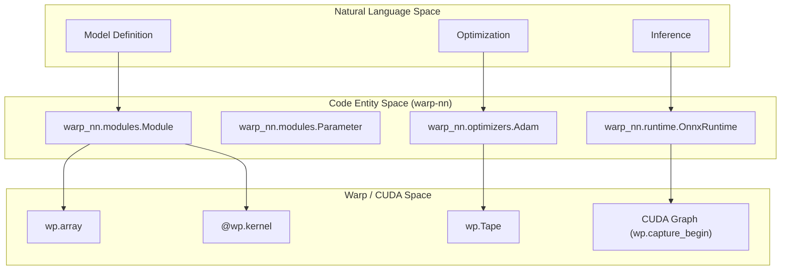
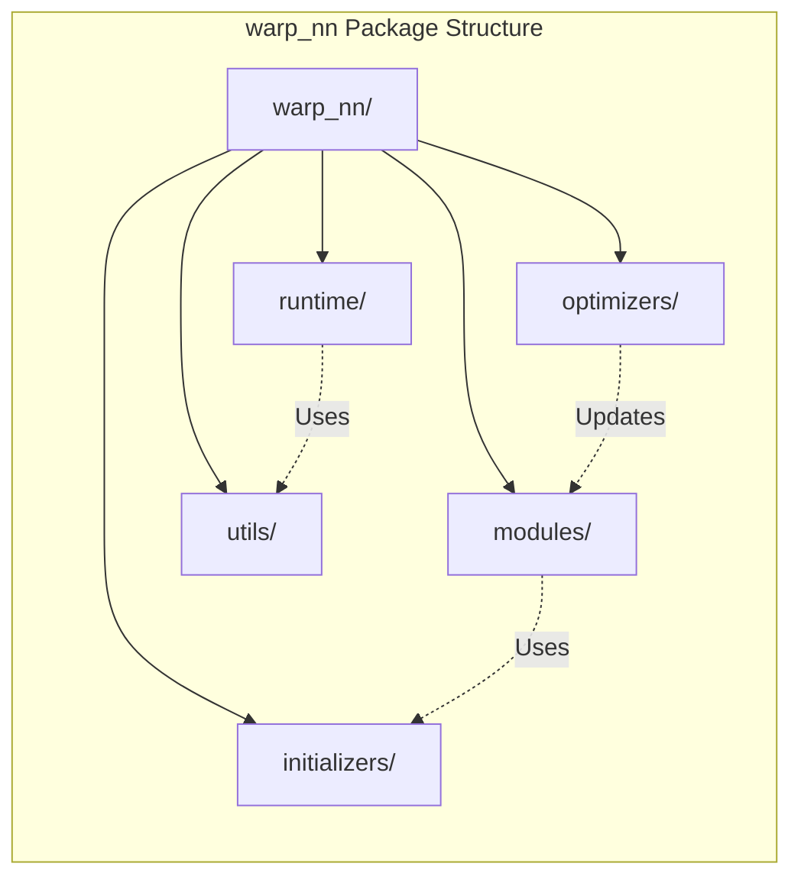

<!-- source: DeepWiki mcp.deepwiki.com · repo NVIDIA/warp-nn · page 1 Overview · fetched 2026-10-26 -->

# Overview

Relevant source files

The following files were used as context for generating this wiki page:

- [CHANGELOG.md](CHANGELOG.md)
- [README.md](README.md)
- [docs/index.rst](docs/index.rst)
- [pyproject.toml](pyproject.toml)

`warp-nn` is a Warp-native Python library designed for building and training neural networks within Physical AI workflows. It provides compact, CUDA-graphable neural network components that integrate directly into [NVIDIA Warp](https://nvidia.github.io/warp) simulation, robotics, and differentiable computing pipelines [README.md:8-10]().

Unlike general-purpose frameworks like PyTorch or JAX, `warp-nn` focuses on being "graphable" within the Warp ecosystem, allowing neural network execution to be captured into CUDA Graphs alongside physics simulations for minimal overhead [README.md:11-12]().

### System Architecture Overview

The library is structured to mirror familiar ML framework patterns (like `torch.nn`) while utilizing Warp's kernel dispatch and memory management. The following diagram illustrates how the high-level Python entities map to the underlying Warp infrastructure.

**Bridge: Python API to Warp Execution**

**Sources:** [README.md:8-12](), [pyproject.toml:36-38]()

---

### Core Components

The library is organized into several key modules that handle the lifecycle of a neural network, from initialization to training and optimized inference.

| Module | Responsibility | Key Entities |
|:---|:---|:---|
| **Modules** | Base classes and standard layers. | `Module`, `Linear`, `Conv2D`, `LSTMCell` |
| **Optimizers** | Gradient-based parameter updates. | `Adam`, `SGD` |
| **Runtime** | Lightweight ONNX inference engine. | `OnnxRuntime` |
| **Initializers** | Weight and bias initialization. | `kaiming_uniform`, `constant` |
| **Utils** | Kernel and CUDA Graph management. | `KernelConfig`, `ScopedCapture` |

**Sources:** [CHANGELOG.md:8-17](), [pyproject.toml:68-70]()

---

### Relationship to NVIDIA Warp

`warp-nn` is an ecosystem library maintained by the NVIDIA Isaac Sim team, rather than the core `warp-lang` team [README.md:13-17](). It requires `warp-lang>=1.12.0` [pyproject.toml:37-38](). 

While standard ML frameworks often rely on `cuBLAS` or `cuDNN`, `warp-nn` prioritizes Warp-native kernels. This allows for:
1. **Differentiability:** Seamless integration with `wp.Tape` for end-to-end autodiff through both physics and neural networks.
2. **Graphability:** The ability to capture the entire forward/backward pass into a single CUDA Graph using `wp.capture_begin()`.
3. **Customizability:** Users can inspect and modify the underlying `@wp.kernel` implementations.

**Bridge: Library Organization**

**Sources:** [pyproject.toml:68-70](), [CHANGELOG.md:3-18]()

---

### Detailed Sections

For in-depth technical documentation, refer to the following child pages:

*   **[Getting Started](#1.1)**: Installation via `pip install warp-nn`, system requirements (Python 3.10+), and a minimal end-to-end training example.
*   **[Design Philosophy and Architecture](#1.2)**: A deep dive into why `warp-nn` uses native kernels instead of vendor libraries, and how it achieves CUDA Graph compatibility for Physical AI.

**Sources:** [pyproject.toml:16-22](), [docs/index.rst:4-26]()

---

