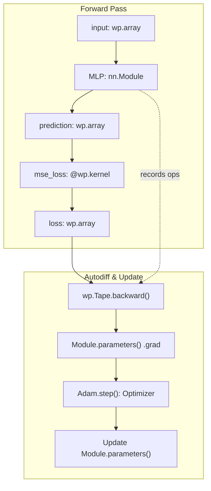
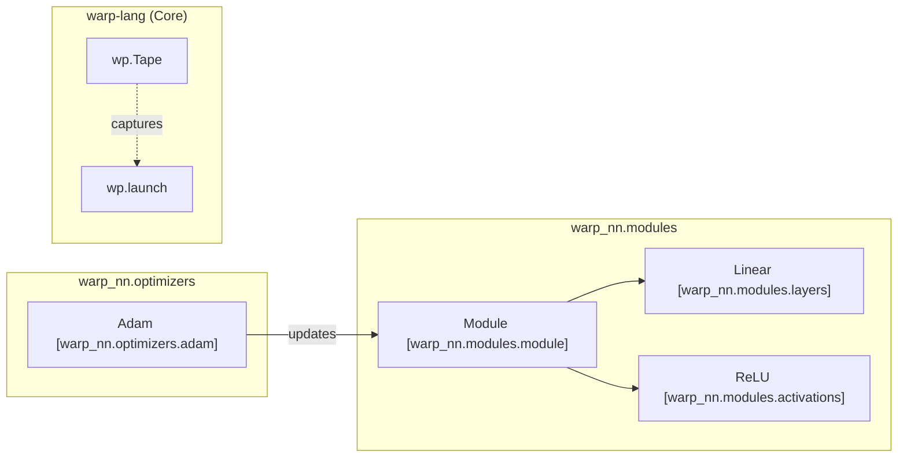

<!-- source: DeepWiki mcp.deepwiki.com · repo NVIDIA/warp-nn · page 1.1 Getting Started · fetched 2026-10-26 -->

# Getting Started

<details>
<summary>Relevant source files</summary>

The following files were used as context for generating this wiki page:

- [README.md](README.md)
- [docs/index.rst](docs/index.rst)
- [docs/snippets/basics.py](docs/snippets/basics.py)
- [pyproject.toml](pyproject.toml)

</details>


Warp-NN is a Warp-native Python library designed for building and training neural networks within Physical AI workflows. It facilitates the creation of compact neural network components that execute directly within NVIDIA Warp-based simulation, robotics, and differentiable computing pipelines [README.md:8-11]().

## Requirements

Warp-NN requires a modern Python environment and a compatible NVIDIA Warp installation.

| Requirement | Version / Specification | Source |
| :--- | :--- | :--- |
| **Python** | `>= 3.10` | [pyproject.toml:19-19]() |
| **NVIDIA Warp** | `warp-lang >= 1.12.0` | [pyproject.toml:37-37]() |
| **CUDA** | NVIDIA GPU with CUDA support | [pyproject.toml:28-28]() |

### Optional Dependencies

Warp-NN provides optional dependency groups for specific workflows:

*   **ONNX (`onnx`)**: Required for ONNX policy inference. It uses a pure protobuf parser to run inference on Warp kernels without requiring `onnxruntime` [pyproject.toml:47-51]().
*   **Tests (`tests`)**: Includes `pytest`, `hypothesis`, and `torch` (used as a reference for validation) [pyproject.toml:52-58]() .
*   **Documentation (`docs`)**: Includes `sphinx`, `myst-parser`, and the `nvidia-sphinx-theme` [pyproject.toml:59-64]().

Sources: [pyproject.toml:19-64](), [README.md:8-11]()

## Installation

The library is available on PyPI and can be installed using `pip`:

```bash
pip install warp-nn
```

To install with optional dependencies (e.g., for ONNX support or testing):

```bash
pip install "warp-nn[onnx,tests]"
```

Sources: [README.md:18-25](), [pyproject.toml:46-64]()

## Minimal End-to-End Usage

Warp-NN follows a design pattern similar to PyTorch but is optimized for the Warp ecosystem, utilizing `wp.array` for data and `wp.Tape` for autodiff.

### 1. Define a Model
Models are defined by subclassing `warp_nn.modules.module.Module`. You must call `super().__post_init__()` at the end of the constructor to register parameters and submodules [docs/snippets/basics.py:35-42]().

```python
import warp as wp
from warp_nn import nn

class MLP(nn.Module):
    def __init__(self):
        super().__init__()
        self.fc1 = nn.Linear(128, 64)
        self.act = nn.ReLU()
        self.fc2 = nn.Linear(64, 10)
        super().__post_init__()  # Crucial for parameter registration

    def __call__(self, x):
        return self.fc2(self.act(self.fc1(x)))

model = MLP().to("cuda")
```

### 2. Define Loss and Optimizer
Loss functions are typically written as `@wp.kernel` functions to run efficiently on the GPU [docs/snippets/basics.py:55-63](). Optimizers like `Adam` are initialized with the model's parameters [docs/snippets/basics.py:71-71]().

```python
from warp_nn import optimizers

@wp.kernel
def mse_loss(prediction: wp.array2d[float], target: wp.array2d[float], loss: wp.array1d[float]):
    i, j = wp.tid()
    diff = prediction[i, j] - target[i, j]
    wp.atomic_add(loss, 0, diff * diff)

optimizer = optimizers.Adam(model.parameters(), lr=1e-3, device="cuda")
loss_array = wp.zeros((1,), dtype=wp.float32, requires_grad=True, device="cuda")
```

### 3. The Training Loop
The training loop utilizes `wp.Tape()` to record operations for the backward pass. After `tape.backward()`, the optimizer updates the parameters [docs/snippets/basics.py:75-94]().

```python
with wp.Tape() as tape:
    prediction = model(input_data)
    wp.launch(mse_loss, dim=prediction.shape, inputs=[prediction, target_data], outputs=[loss_array], device="cuda")

tape.backward(loss_array)
optimizer.step()
tape.zero()  # Reset tape and zero gradients for next iteration
```

Sources: [docs/snippets/basics.py:17-95]()

## System Data Flow and Entities

The following diagrams illustrate how Warp-NN entities interact during a standard training lifecycle.

### Training Lifecycle Data Flow
This diagram shows the relationship between the `Module`, the `wp.Tape`, and the `Optimizer`.


Sources: [docs/snippets/basics.py:35-95]()

### Code Entity Association
This diagram bridges the high-level training concepts to the specific classes and functions in the codebase.


Sources: [docs/snippets/basics.py:18-21](), [docs/snippets/basics.py:35-45](), [docs/snippets/basics.py:71-71](), [docs/snippets/basics.py:80-93]()

---

