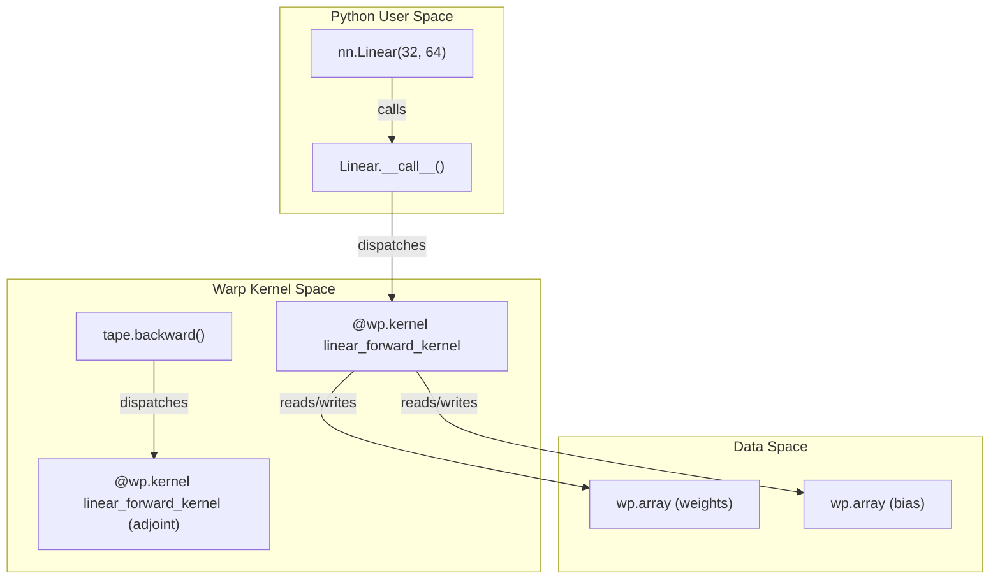
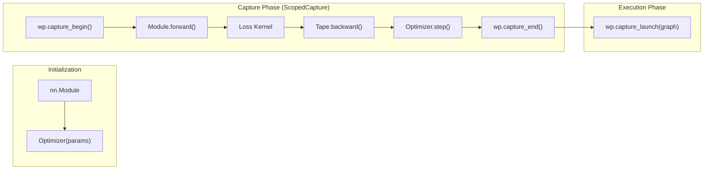

<!-- source: DeepWiki mcp.deepwiki.com · repo NVIDIA/warp-nn · page 1.2 Design Philosophy and Architecture · fetched 2026-10-26 -->

# Design Philosophy and Architecture

Relevant source files

The following files were used as context for generating this wiki page:

- [README.md](README.md)
- [docs/guide/basics.rst](docs/guide/basics.rst)
- [docs/index.rst](docs/index.rst)
- [pyproject.toml](pyproject.toml)

`warp-nn` is a neural network library built specifically for the [NVIDIA Warp](https://github.com/NVIDIA/warp) ecosystem. Its primary purpose is to provide compact, differentiable neural network components that can reside directly within simulation loops and robotics control pipelines without leaving the Warp kernel execution environment.

## Warp-Native Execution

Unlike general-purpose machine learning frameworks such as PyTorch or JAX, `warp-nn` is designed to be "Warp-native." This means every layer, activation function, and optimizer is implemented as a collection of Warp kernels (`@wp.kernel`).

### The Warp Ecosystem Integration
In Physical AI workflows, simulation states (positions, velocities, contact forces) are often stored in `wp.array` objects on the GPU. By using `warp-nn`, practitioners can pass these simulation tensors directly into neural network modules without the overhead of host-side synchronization or data conversion between frameworks.

### Implementation Pattern
The library follows a strict modular structure where high-level Python classes (subclasses of `warp_nn.modules.module.Module`) manage the state and dispatch to specialized kernels.

**Natural Language to Code Entity: Module Dispatch**

**Sources:**
- [docs/index.rst:4-14]()
- [docs/guide/basics.rst:21-31]()
- [pyproject.toml:36-38]()

## CUDA Graph Compatibility

A core design pillar of `warp-nn` is compatibility with CUDA Graphs. In high-frequency robotics control or large-scale parallel simulations (e.g., NVIDIA Isaac Sim), the overhead of launching thousands of small kernels from Python can become a bottleneck.

### Scoped Capture
`warp-nn` utilizes a utility called `ScopedCapture` to wrap Warp's native capture mechanisms (`wp.capture_begin()` and `wp.capture_end()`). This allows entire forward passes, loss computations, and optimizer updates to be baked into a single GPU executable graph.

### Graphable Optimizers
Standard optimizers often involve scalar updates (like incrementing a timestep) that typically require CPU-GPU synchronization. `warp-nn` optimizers, such as `Adam`, are implemented using tiled kernels that handle these updates entirely on the GPU, ensuring the `Optimizer.step()` remains graphable.

**Natural Language to Code Entity: Graph Execution Flow**

**Sources:**
- [docs/index.rst:22-27]()
- [README.md:4-11]()

## Design Trade-offs: Graphability vs. Peak TFLOPS

`warp-nn` makes specific engineering trade-offs to prioritize integration over raw throughput for large models.

| Feature | `warp-nn` Approach | Reason |
| :--- | :--- | :--- |
| **Kernel Backend** | Pure Warp Kernels | Enables differentiability via `wp.Tape` and avoids external dependencies like cuBLAS/cuDNN. |
| **Memory Access** | Tiled/Coalesced Access | Optimized for the Warp programming model rather than specific tensor core hardware instructions. |
| **Performance** | High for "Small" Networks | Lower latency for MLP/RNN controllers used in RL compared to framework-hopping. |
| **Scalability** | Limited for LLMs | Not intended for multi-billion parameter models where cuDNN/NCCL optimizations are mandatory. |

As noted in the documentation, while `warp-nn` strives for high performance, it may not always outperform solutions using `cuBLAS` or `cuDNN` for standard deep learning benchmarks [docs/index.rst:16-20]().

**Sources:**
- [docs/index.rst:4-20]()
- [README.md:8-11]()

## Physical AI and Isaac Sim Workflows

The library is maintained by members of the NVIDIA Isaac Sim team, reflecting its architectural alignment with robotics simulation.

1.  **Differentiable Simulation**: Because `warp-nn` uses `wp.Tape` for autodiff [docs/guide/basics.rst:72-79](), it can be used to compute gradients through both the neural network and the physical simulator (if the simulator is also written in Warp).
2.  **In-Kernel Inference**: Modules can be used to define policies that are evaluated directly inside a simulation step kernel, minimizing data movement.
3.  **Deployment**: The `onnx` runtime support allows for lightweight inference of pre-trained models within the same Warp pipeline without requiring a full `onnxruntime` installation [pyproject.toml:46-51]().

**Sources:**
- [README.md:13-17]()
- [docs/index.rst:9-15]()
- [pyproject.toml:46-51]()

---

