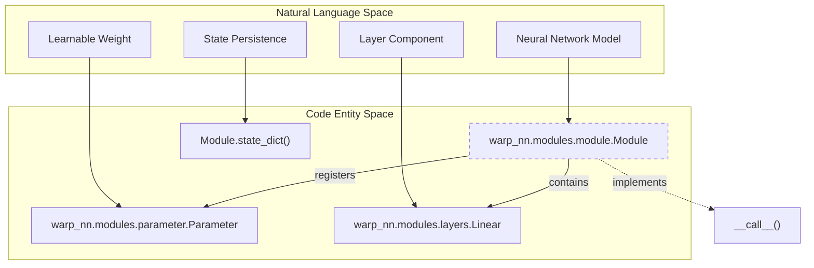
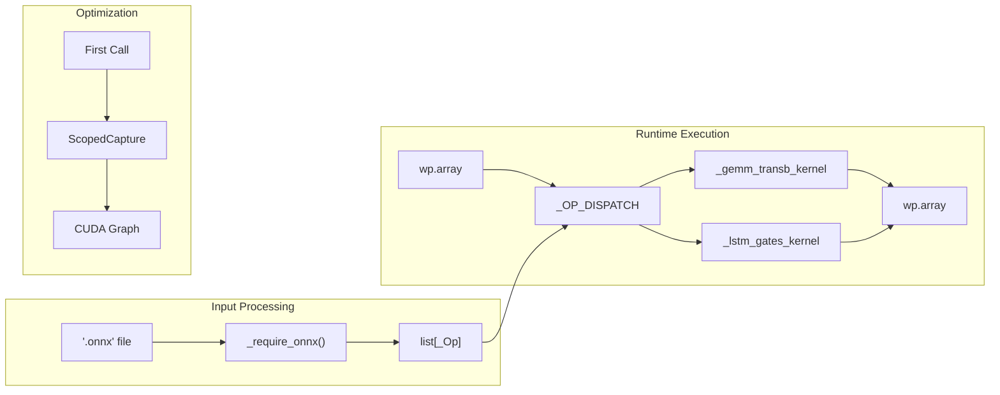

<!-- source: DeepWiki mcp.deepwiki.com · repo NVIDIA/warp-nn · page 10 Glossary · fetched 2026-10-26 -->

# Glossary

Relevant source files

The following files were used as context for generating this wiki page:

- [CHANGELOG.md](CHANGELOG.md)
- [README.md](README.md)
- [docs/guide/basics.rst](docs/guide/basics.rst)
- [docs/index.rst](docs/index.rst)
- [pyproject.toml](pyproject.toml)
- [warp_nn/nn.py](warp_nn/nn.py)
- [warp_nn/runtime/onnx_runtime.py](warp_nn/runtime/onnx_runtime.py)

This glossary provides technical definitions and implementation details for core concepts, terms, and components within the `warp-nn` codebase. It serves as a reference for onboarding engineers to understand the relationship between domain concepts and their specific implementations in code.

## Core System Concepts

### CUDA Graphability
The ability of a sequence of CUDA kernels to be captured into a single executable graph, reducing host-side overhead. In `warp-nn`, this is achieved through `ScopedCapture` [warp_nn/utils/capture.py:21-25](), which wraps `wp.capture_begin()` and `wp.capture_end()`. The `OnnxRuntime` and `Optimizer` classes use this to enable high-performance inference and training loops [warp_nn/runtime/onnx_runtime.py:200-208]().

### Warp-Native Execution
Refers to neural network operations implemented directly as `wp.kernel` functions rather than relying on external libraries like cuBLAS or cuDNN. This allows for seamless integration with physical simulations where data resides in Warp arrays on the GPU [README.md:8-11]().

### Physical AI Workflows
The primary domain for `warp-nn`, involving differentiable simulation, robotics control, and reinforcement learning where neural networks (policies) must interact directly with physical state variables managed by NVIDIA Warp [docs/index.rst:4-7]().

---

## Code Entity Mapping: Modules and State

The following diagram maps natural language concepts of neural network components to their specific class implementations and lifecycle methods.

**Neural Network Entity Mapping**

**Sources:** [warp_nn/nn.py:16-19](), [warp_nn/modules/module.py:21-25](), [warp_nn/modules/parameter.py:21-25]()

---

## Technical Definitions

### Module Lifecycle
The operational sequence of a `warp_nn.modules.module.Module`.
1.  **Initialization**: Sub-modules and `Parameter` objects are assigned as attributes.
2.  **Registration**: `__post_init__()` must be called to crawl the attribute tree and register parameters [docs/guide/basics.rst:24-28]().
3.  **Forward Pass**: Executed via the `__call__()` method, which typically invokes internal `wp.launch()` calls [docs/guide/basics.rst:21-23]().

### OnnxRuntime Inference Path
A lightweight inference engine that avoids `onnxruntime` or `torch` dependencies by parsing ONNX protobufs and dispatching to specialized Warp kernels.

**Inference Execution Flow**

**Sources:** [warp_nn/runtime/onnx_runtime.py:16-47](), [warp_nn/runtime/onnx_runtime.py:200-220](), [warp_nn/runtime/onnx_runtime.py:61-72]()

### Tiled Kernels vs. Simple Kernels
*   **Tiled Kernels**: Used in training modules (e.g., `warp_nn.modules.layers.Linear`). These use `KernelConfig` [warp_nn/utils/config.py:21-25]() to optimize shared memory usage and thread occupancy for large batches.
*   **Simple Kernels**: Used in `OnnxRuntime` (e.g., `_gemm_transb_kernel` [warp_nn/runtime/onnx_runtime.py:84-92]()). These are optimized for tiny policy networks (batch=1, hidden size <= 128) to minimize compilation time and host overhead [warp_nn/runtime/onnx_runtime.py:24-29]().

### Autodiff Integration
The mechanism for computing gradients using `wp.Tape`. 
*   **Tape Recording**: The forward pass is wrapped in `with wp.Tape() as tape:` [docs/guide/basics.rst:72-75]().
*   **Gradient Propagation**: `tape.backward(loss)` propagates derivatives through the recorded kernels [docs/guide/basics.rst:73-74]().
*   **Parameter Update**: `optimizer.step()` applies gradients to `Parameter` data [docs/guide/basics.rst:80-82]().

---

## Abbreviations & Terms

| Term | Definition | Code Pointer |
| :--- | :--- | :--- |
| **ELBO** | Evidence Lower Bound, used as the loss objective in Variational Autoencoders. | `examples/vae/` |
| **Fan-in/Fan-out** | The number of input and output units in a layer, used for weight initialization scaling. | [warp_nn/initializers/kaiming.py:25-30]() |
| **Gemm** | General Matrix Multiplication. In `OnnxRuntime`, implemented with `transB=1`. | [warp_nn/runtime/onnx_runtime.py:32-32]() |
| **Requires Grad** | A flag on `wp.array` or `Parameter` indicating that gradients should be allocated and computed. | [warp_nn/modules/parameter.py:35-40]() |
| **ScopedCapture** | Context manager for handling CUDA Graph capture logic. | [warp_nn/utils/capture.py:21-25]() |
| **Sequential** | A container module that executes sub-modules in the order they were passed. | [warp_nn/modules/layers/sequential.py:21-25]() |

**Sources:** [pyproject.toml:16-38](), [CHANGELOG.md:1-18](), [warp_nn/nn.py:1-20](), [docs/guide/basics.rst:1-87](), [warp_nn/runtime/onnx_runtime.py:1-162]()