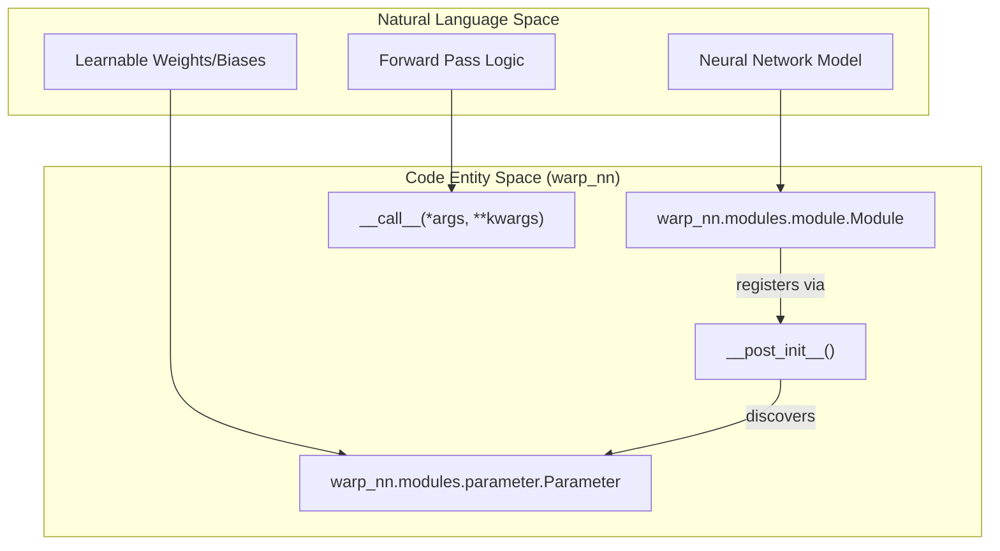
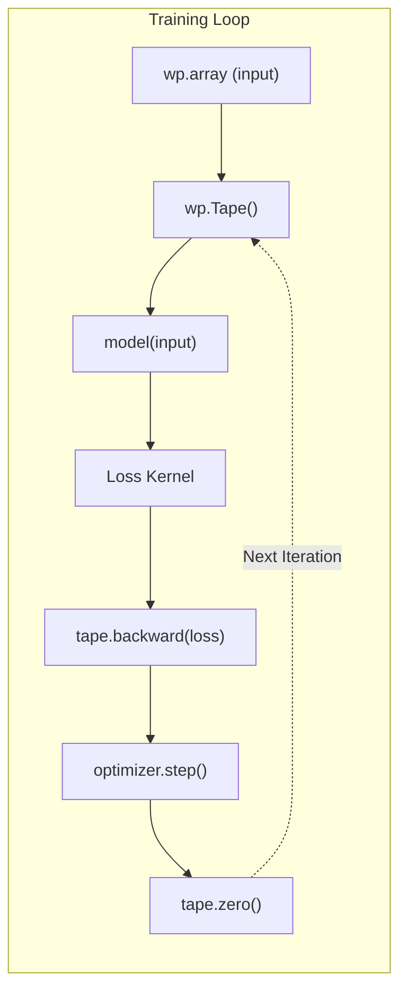

<!-- source: DeepWiki mcp.deepwiki.com · repo NVIDIA/warp-nn · page 2 Core Module System · fetched 2026-10-26 -->

# Core Module System

Relevant source files

The following files were used as context for generating this wiki page:

- [docs/guide/basics.rst](docs/guide/basics.rst)
- [docs/snippets/basics.py](docs/snippets/basics.py)
- [warp_nn/nn.py](warp_nn/nn.py)

The `warp_nn.modules` package provides the fundamental building blocks for constructing neural networks within the NVIDIA Warp ecosystem. It is designed to mirror the ergonomics of modern deep learning frameworks while ensuring that every operation remains compatible with Warp's kernel execution and autodiff systems.

The core of the system relies on a hierarchical module tree where `Module` instances containerize other modules and `Parameter` instances, facilitating automated gradient management and device placement.

### System Architecture Overview

The following diagram illustrates the relationship between the core classes and how they map to user-defined model code.

**Entity Mapping: Module Hierarchy**

**Sources:** [warp_nn/nn.py:16-20](), [docs/guide/basics.rst:21-31]()

---

### The Module Base Class

The `Module` class is the base for all neural network components in `warp-nn`. It tracks sub-modules and parameters assigned as attributes, allowing for recursive operations like moving a whole model to a specific GPU or collecting all gradients for an optimizer.

Key characteristics include:
*   **Registration:** Users must call `super().__post_init__()` at the end of their `__init__` method to trigger the internal discovery and registration of parameters and sub-modules [docs/guide/basics.rst:24-27]().
*   **Forward Pass:** The forward logic is defined by implementing the `__call__` method [docs/guide/basics.rst:22-22]().
*   **Device Management:** The `.to(device)` method recursively moves all underlying `Parameter` data to the specified Warp device [docs/snippets/basics.py:48-51]().

For a deep dive into the registration lifecycle and state management, see **[Module Base Class and Parameter](#2.1)**.

---

### Parameters and Tensors

`Parameter` is a thin wrapper around `wp.array` that signifies a tensor is a learnable part of the model. By default, parameters are initialized with `requires_grad=True`, ensuring that `wp.Tape` records operations involving them for backpropagation.

**Sources:** [warp_nn/nn.py:19-19](), [docs/snippets/basics.py:67-69]()

---

### Component Categories

The module system is divided into several specialized categories that work together to form a complete network.

| Category | Description | Key Entities |
| :--- | :--- | :--- |
| **Layers** | Structural blocks that transform input shapes and maintain weights. | `Linear`, `Conv2D`, `LSTMCell`, `Sequential` |
| **Activations** | Non-linear functions applied to layer outputs. | `ReLU`, `Sigmoid`, `Tanh`, `LeakyReLU` |
| **Containers** | Modules designed to hold and execute other modules. | `Sequential` |

#### Layers
Built-in layers handle the complexities of kernel dispatch and weight initialization. For example, `nn.Linear` manages weight and bias arrays and dispatches to high-performance GEMM-like kernels.
For a full reference of available layers, see **[Layers](#2.2)**.

#### Activation Functions
Activations in `warp-nn` are implemented as modules that wrap Warp kernels. They support multiple dimensions (1D, 2D, 3D) via kernel overloading patterns.
For implementation details and integration with `wp.Tape`, see **[Activation Functions](#2.3)**.

---

### Integration with Autodiff and Training

The module system is designed to work seamlessly with `wp.Tape` for automatic differentiation. When a module's `__call__` is invoked inside a tape context, all underlying Warp kernels are recorded.

**Data Flow: Training Lifecycle**

For a step-by-step guide on implementing training loops and handling gradients, see **[Training Loop and Autodiff](#2.4)**.

**Sources:** [docs/guide/basics.rst:72-86](), [docs/snippets/basics.py:74-94]()

---

