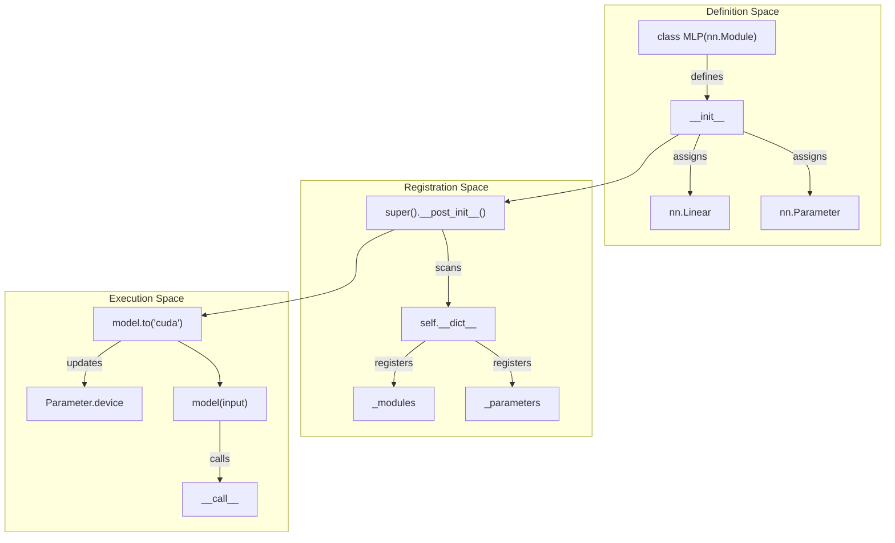
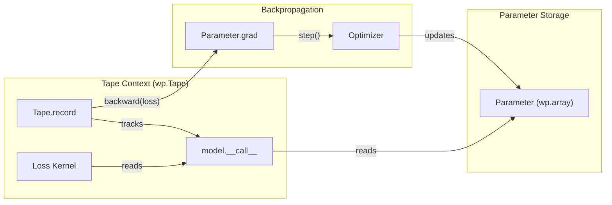

<!-- source: DeepWiki mcp.deepwiki.com · repo NVIDIA/warp-nn · page 2.1 Module Base Class and Parameter · fetched 2026-10-26 -->

# Module Base Class and Parameter

Relevant source files

The following files were used as context for generating this wiki page:

- [docs/guide/basics.rst](docs/guide/basics.rst)
- [docs/snippets/basics.py](docs/snippets/basics.py)
- [warp_nn/nn.py](warp_nn/nn.py)

The `warp-nn` library provides a structured approach to defining neural network architectures through the `Module` and `Parameter` classes. These components are designed to integrate seamlessly with NVIDIA Warp's kernel execution and autodiff system (`wp.Tape`), while offering a familiar interface for developers coming from other deep learning frameworks.

## Module Class

The `warp_nn.modules.module.Module` class serves as the base for all neural network components [warp_nn/nn.py:18-18](). It manages the lifecycle of layers, handles device placement, and provides mechanisms for state serialization.

### Registration Lifecycle and `__post_init__`

Unlike frameworks that use metaclasses for automatic attribute tracking, `warp-nn` requires a specific lifecycle call to register sub-modules and parameters.

1.  **Initialization**: During `__init__`, sub-modules (e.g., `nn.Linear`) and `nn.Parameter` objects are assigned as attributes [docs/snippets/basics.py:35-40]().
2.  **Registration**: The user must call `super().__post_init__()` at the very end of the `__init__` method [docs/guide/basics.rst:24-27]().
3.  **Discovery**: The `__post_init__` call triggers a traversal of the object's `__dict__`. It identifies all attributes that are instances of `Module` or `Parameter` and registers them into the module's internal tracking structures [docs/snippets/basics.py:41-41]().

### Device Placement with `.to()`

The `.to(device)` method is the primary way to manage memory location for a module's parameters. When called, the module recursively traverses its hierarchy and moves every underlying `wp.array` within its `Parameter` objects to the specified Warp device (e.g., `"cuda"` or `"cpu"`) [docs/snippets/basics.py:48-51]().

### State Management

Modules support state serialization through two primary methods:
*   **`state_dict()`**: Returns a dictionary mapping parameter names to their underlying `wp.array` data.
*   **`load_state_dict(state_dict)`**: Updates the module's parameters using values from the provided dictionary.

### Module Lifecycle Flow
The following diagram illustrates the transition from definition to a ready-to-train state.

**Entity Mapping: Module Setup**

Sources: [docs/guide/basics.rst:21-35](), [docs/snippets/basics.py:34-51](), [warp_nn/nn.py:16-19]()

---

## Parameter Class

The `warp_nn.modules.parameter.Parameter` class is a thin wrapper around a `wp.array` [warp_nn/nn.py:19-19](). It designates a specific array as a learnable weight or bias that should be tracked by optimizers and the module's registration system.

### The `requires_grad` Contract

Parameters are central to the `warp-nn` autodiff contract:
*   **Gradient Tracking**: By default, `Parameter` objects are initialized with `requires_grad=True`. This ensures that when the module is used inside a `wp.Tape()` context, Warp allocates gradient buffers for these arrays [docs/guide/basics.rst:64-66]().
*   **Optimization**: Only attributes registered as `Parameter` (or contained within registered `Module`s) are returned by the `model.parameters()` generator, which is passed to optimizers like `Adam` or `SGD` [docs/snippets/basics.py:70-72]().

### Parameter and Tape Interaction
The relationship between parameters, the forward pass, and the gradient tape is critical for training.

**Entity Mapping: Data and Gradient Flow**

Sources: [docs/guide/basics.rst:72-87](), [docs/snippets/basics.py:70-94]()

---

## Summary of Key Functions

| Entity | Location | Role |
| :--- | :--- | :--- |
| `Module` | `warp_nn.modules.module` | Base class for all network components; manages sub-modules and parameters [warp_nn/nn.py:18-18](). |
| `Parameter` | `warp_nn.modules.parameter` | Wrapper for `wp.array` that signals learnable weights to the system [warp_nn/nn.py:19-19](). |
| `__post_init__` | `Module` | Required call to register attributes after assignment in `__init__` [docs/guide/basics.rst:24-27](). |
| `to(device)` | `Module` | Recursively moves all parameters to the target Warp device [docs/snippets/basics.py:48-51](). |
| `parameters()` | `Module` | Generator yielding all `Parameter` objects in the module tree [docs/snippets/basics.py:70-72](). |

Sources: [warp_nn/nn.py:16-20](), [docs/guide/basics.rst:21-35](), [docs/snippets/basics.py:34-51]()

---

