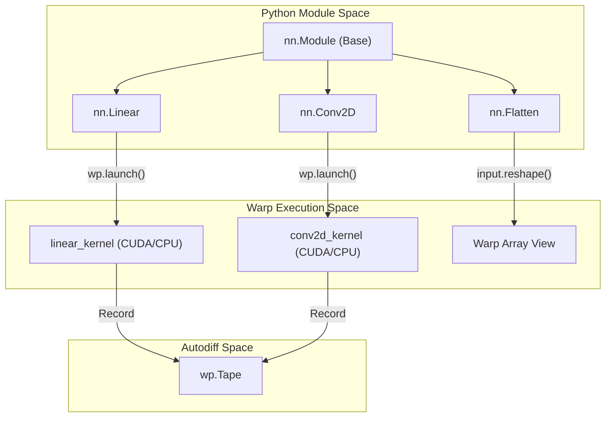
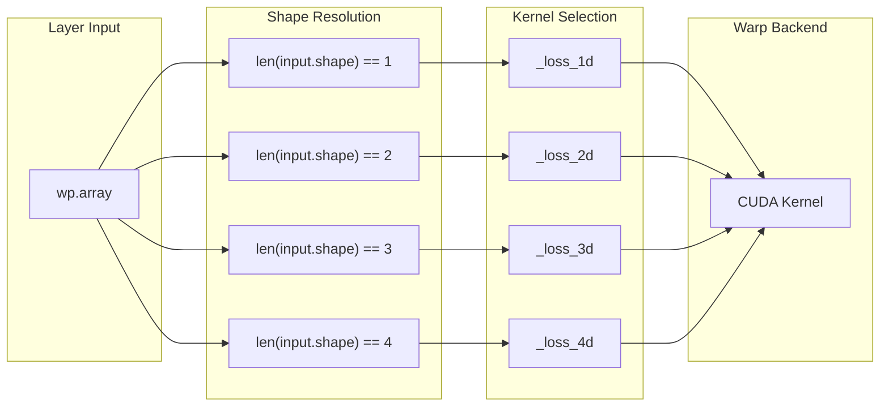

<!-- source: DeepWiki mcp.deepwiki.com · repo NVIDIA/warp-nn · page 2.2 Layers · fetched 2026-10-26 -->

# Layers

<details>
<summary>Relevant source files</summary>

The following files were used as context for generating this wiki page:

- [docs/api/layers.rst](docs/api/layers.rst)
- [docs/api/layers/flatten.rst](docs/api/layers/flatten.rst)
- [tests/modules/layers/common.py](tests/modules/layers/common.py)
- [tests/modules/layers/test_flatten.py](tests/modules/layers/test_flatten.py)
- [warp_nn/modules/layers/__init__.py](warp_nn/modules/layers/__init__.py)
- [warp_nn/modules/layers/flatten.py](warp_nn/modules/layers/flatten.py)

</details>


The `warp_nn.modules.layers` package provides a collection of built-in neural network building blocks. These layers are designed to be compatible with NVIDIA Warp's kernel execution model and `wp.Tape` for automatic differentiation. Unlike standard deep learning frameworks, `warp-nn` layers focus on being graph-capturable and efficient within Physical AI simulations.

Sources: [docs/api/layers.rst:1-47](), [warp_nn/modules/layers/__init__.py:16-23]()

## Module Overview

The library implements standard layer types including linear transformations, convolutions, recurrent cells, and structural utilities.

| Category | Classes |
| :--- | :--- |
| **Linear** | `Linear`, `LazyLinear` |
| **Convolutional** | `Conv1D`, `Conv2D` |
| **Recurrent** | `RNNCell`, `LSTMCell`, `GRUCell` |
| **Structural** | `Flatten`, `Sequential` |

Sources: [warp_nn/modules/layers/__init__.py:16-23](), [docs/api/layers.rst:35-47]()

### Layer Execution Pattern

The following diagram illustrates the relationship between the Python layer classes and the underlying Warp execution mechanism.

**Layer Dispatch and Data Flow**

Sources: [warp_nn/modules/layers/flatten.py:23-53](), [tests/modules/layers/common.py:134-151]()

---

## Structural Layers

### Flatten
The `Flatten` layer collapses a contiguous range of dimensions into a single dimension. It is typically used to transition from convolutional layers to linear layers.

*   **Constructor**: `Flatten(start_dim=1, end_dim=-1)` [warp_nn/modules/layers/flatten.py:24-36]()
*   **Logic**: The layer calculates the target shape using `math.prod` on the specified dimension range and returns a reshaped view of the input array [warp_nn/modules/layers/flatten.py:47-53]().
*   **Constraint**: The `start_dim` must be less than or equal to `end_dim` [warp_nn/modules/layers/flatten.py:50-51]().

### Sequential
A container module that executes a list of modules in the order they were passed to the constructor. It simplifies the definition of feed-forward architectures by chaining the output of one module to the input of the next.

Sources: [warp_nn/modules/layers/sequential.py:23]() (referenced via [warp_nn/modules/layers/__init__.py:23]())

---

## Linear Layers

### Linear
Applies a linear transformation to the incoming data: $y = xA^T + b$.
*   **Weights**: Typically stored as a `Parameter` with shape `(out_features, in_features)`.
*   **Bias**: Optional parameter with shape `(out_features,)`.

### LazyLinear
A variant of the `Linear` layer where `in_features` is inferred at runtime during the first forward pass. This allows users to define models without explicitly calculating the output size of preceding layers (e.g., after a series of convolutions).

Sources: [warp_nn/modules/layers/linear.py:20]() (referenced via [warp_nn/modules/layers/__init__.py:20]())

---

## Recurrent Layers

Recurrent cells in `warp-nn` are designed to process a single time step. To process sequences, these cells are typically called within a Python loop or a Warp-specific sequence wrapper.

### RNNCell
A basic Elman RNN cell that applies:
$h' = \tanh(W_{ih}x + b_{ih} + W_{hh}h + b_{hh})$

### LSTMCell
A Long Short-Term Memory (LSTM) cell. It maintains a hidden state $h$ and a cell state $c$. The implementation includes gates for input, forget, cell, and output.
*   **Input**: `(input, (h_0, c_0))`
*   **Output**: `(h_1, c_1)`

### GRUCell
A Gated Recurrent Unit (GRU) cell. It combines the forget and input gates into a single "update gate" and merges the cell state and hidden state.

Sources: [warp_nn/modules/layers/rnn_cell.py:22](), [warp_nn/modules/layers/lstm_cell.py:21](), [warp_nn/modules/layers/gru_cell.py:19]() (referenced via [warp_nn/modules/layers/__init__.py:19-22]())

---

## Implementation Details

### Kernel Dispatch and Shapes
Unlike PyTorch, which uses high-level C++ dispatch, `warp-nn` layers often use specific kernels optimized for the dimensionality of the input. In testing and validation, `wp.launch` is used to trigger kernels based on the rank of the output array.

**Internal Tensor Handling**

Sources: [tests/modules/layers/common.py:25-48](), [tests/modules/layers/common.py:144-150]()

### Output Caching and Autodiff
For recurrent cells, state management is critical for backpropagation. When training, the `wp.Tape` records every operation. Because recurrent cells are often used in loops, `wp.clone()` is frequently used to ensure that the hidden states for each timestep are preserved in the tape's history rather than being overwritten in-place.

**RNN Forward Loop with Tape**
```python
# Example of sequence processing with LSTMCell
for i in range(seq_length):
    # warp_module is nn.LSTMCell
    warp_output = warp_module(warp_input[i], (warp_hidden, warp_cell))
    # Clone is required to prevent overwriting states needed for backward pass
    warp_hidden, warp_cell = wp.clone(warp_output[0]), wp.clone(warp_output[1])
```
Sources: [tests/modules/layers/common.py:108-113]()

### Validation Strategy
All layers are validated against PyTorch reference implementations. The `check_forward` and `check_gradients` utilities ensure that:
1.  **Forward Pass**: `warp_module(input)` produces results within `rtol` and `atol` of `torch_module(input)` [tests/modules/layers/common.py:49-64]().
2.  **Gradients**: `tape.backward()` produces parameter and input gradients identical to PyTorch's `loss.backward()` [tests/modules/layers/common.py:123-161]().

Sources: [tests/modules/layers/common.py:49-161](), [tests/modules/layers/test_flatten.py:45-72]()

---

