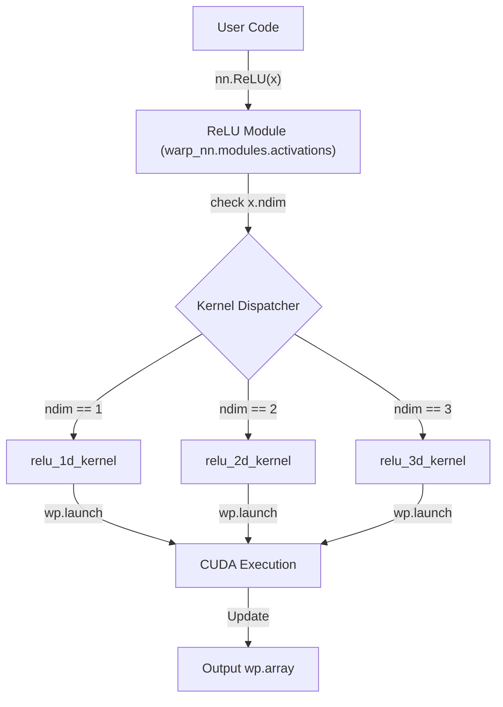
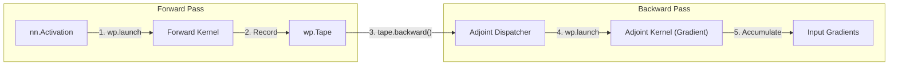

<!-- source: DeepWiki mcp.deepwiki.com · repo NVIDIA/warp-nn · page 2.3 Activation Functions · fetched 2026-10-26 -->

# Activation Functions

<details>
<summary>Relevant source files</summary>

The following files were used as context for generating this wiki page:

- [docs/api/index.rst](docs/api/index.rst)
- [warp_nn/nn.py](warp_nn/nn.py)

</details>


Activation functions in `warp-nn` are implemented as specialized `Module` subclasses that apply non-linear transformations to input tensors. These modules are designed to be compatible with NVIDIA Warp's kernel execution model, supporting multi-dimensional dispatch (1D, 2D, and 3D) and full integration with `wp.Tape` for automatic differentiation.

All activation modules are exported through the `warp_nn.nn` namespace for ease of use [warp_nn/nn.py:16-16]().

## Implementation Pattern: overload_kernels

The library utilizes a standardized pattern for dispatching activation kernels across different tensor ranks. Each activation module (e.g., `ReLU`, `Sigmoid`) does not implement the logic directly in Python but instead wraps a set of Warp kernels optimized for specific input dimensions.

### Data Flow and Dispatch
When `forward(x)` is called on an activation module, the library determines the dimensionality of the input `wp.array` and dispatches to the corresponding kernel.

1.  **Rank Detection**: The module inspects `x.ndim`.
2.  **Kernel Selection**: The module selects from a set of pre-defined kernels (e.g., `relu_1d_kernel`, `relu_2d_kernel`).
3.  **Grid Launch**: The kernel is launched with a grid size matching the input shape, ensuring one thread (or tile) per element.

### System Entity Map: Activation Dispatch
The following diagram illustrates how a call to an activation module flows from the Python API to the underlying Warp kernels.

**Activation Kernel Dispatch Flow**

Sources: [warp_nn/nn.py:16-16](), [docs/api/index.rst:28-39]()

## Supported Activation Modules

The following activation functions are available in `warp_nn.modules.activations` and aliased in `warp_nn.nn`.

| Module | Description | Implementation Details |
| :--- | :--- | :--- |
| `ReLU` | Rectified Linear Unit | $f(x) = \max(0, x)$ |
| `LeakyReLU` | Leaky Rectified Linear Unit | $f(x) = \max(0, x) + \text{negative\_slope} \cdot \min(0, x)$ |
| `ELU` | Exponential Linear Unit | $f(x) = \max(0, x) + \min(0, \alpha(\exp(x) - 1))$ |
| `SELU` | Scaled Exponential Linear Unit | Scaled version of ELU for self-normalizing networks |
| `Sigmoid` | Sigmoid Function | $f(x) = \frac{1}{1 + \exp(-x)}$ |
| `Tanh` | Hyperbolic Tangent | $f(x) = \tanh(x)$ |
| `SoftPlus` | SoftPlus Function | $f(x) = \frac{1}{\beta} \cdot \log(1 + \exp(\beta \cdot x))$ |
| `SoftSign` | SoftSign Function | $f(x) = \frac{x}{1 + |x|}$ |

Sources: [warp_nn/nn.py:16-16](), [docs/api/index.rst:32-39]()

## Integration with wp.Tape

Because `warp-nn` activations are built using native Warp kernels, they are fully compatible with `wp.Tape` for gradient computation. When an activation is called within a `wp.Tape` context, the forward kernel launch is recorded. During `tape.backward()`, Warp automatically dispatches the corresponding adjoint (gradient) kernels.

### Autodiff Entity Mapping
This diagram shows the relationship between the Activation Module, the Tape, and the generated Adjoint kernels.

**Autodiff Lifecycle for Activations**

Sources: [warp_nn/nn.py:16-16](), [docs/api/index.rst:28-39]()

## Usage Example

Activation functions can be used as standalone modules or within a `Sequential` container.

```python
import warp as wp
import warp_nn as nn

# Standalone usage
relu = nn.ReLU()
x = wp.zeros(shape=(1024,), dtype=wp.float32, device="cuda")
y = relu(x)

# Within a model
model = nn.Sequential(
    nn.Linear(128, 64),
    nn.ReLU(),
    nn.Linear(64, 10),
    nn.Sigmoid()
)
```
Sources: [warp_nn/nn.py:16-17](), [docs/api/index.rst:57-68]()

---

