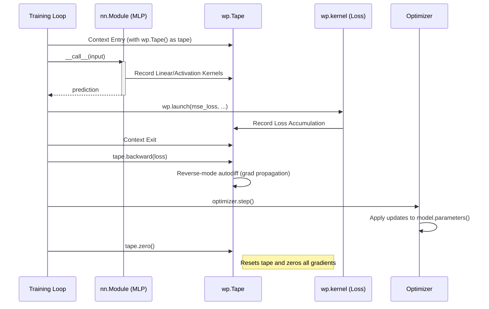
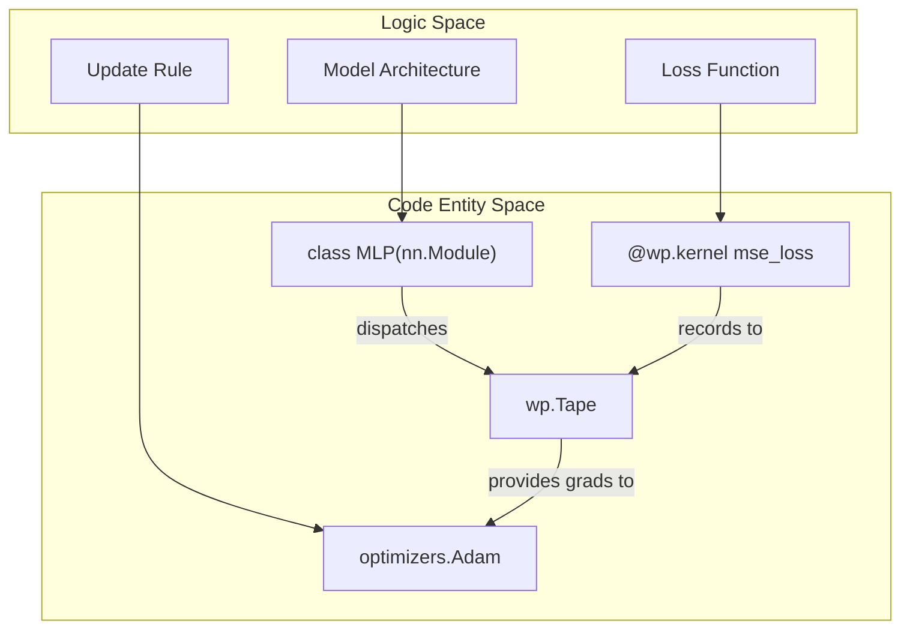

<!-- source: DeepWiki mcp.deepwiki.com · repo NVIDIA/warp-nn · page 2.4 Training Loop and Autodiff · fetched 2026-10-26 -->

# Training Loop and Autodiff

Relevant source files

The following files were used as context for generating this wiki page:

- [docs/guide/basics.rst](docs/guide/basics.rst)
- [docs/snippets/basics.py](docs/snippets/basics.py)

This page provides a technical deep dive into the training lifecycle of a `warp-nn` model. The framework leverages NVIDIA Warp's native automatic differentiation (autodiff) capabilities, specifically through the use of `wp.Tape`, to propagate gradients through modular neural network layers and custom loss kernels.

## Training Lifecycle Overview

The training process in `warp-nn` follows a structured sequence of recording operations, computing scalar losses, backpropagating gradients, and updating parameters via an optimizer. Unlike traditional deep learning frameworks that use a global computation graph, `warp-nn` relies on explicit tape recording of kernel launches.

### Lifecycle Sequence Diagram

The following diagram illustrates the interaction between the user-defined training loop, the `nn.Module` hierarchy, the `wp.Tape` recorder, and the `Optimizer`.

**Training Iteration Flow**

Sources: [docs/guide/basics.rst:72-86](), [docs/snippets/basics.py:78-94]()

## 1. Recording with `wp.Tape`

The `wp.Tape` class is the central mechanism for autodiff in Warp. When a block of code is executed within a `with wp.Tape() as tape:` context, Warp records every kernel launch and its associated metadata (inputs, outputs, and shapes).

*   **Model Forward Pass**: When a `nn.Module` is called [docs/snippets/basics.py:81](), it dispatches internal kernels (e.g., matrix multiplications for `nn.Linear`). If a tape is active, these are automatically recorded.
*   **Input Requirements**: For gradients to flow back to the model parameters, the input `wp.array` objects must be initialized with `requires_grad=True` [docs/guide/basics.rst:64-66]().

Sources: [docs/guide/basics.rst:72-78](), [docs/snippets/basics.py:78-89]()

## 2. Computing Loss via `@wp.kernel`

In `warp-nn`, loss functions are implemented as standard Warp kernels. This allows for highly performant, customized loss logic that executes directly on the GPU.

### Implementation Pattern
A typical loss kernel computes a per-element difference and uses `wp.atomic_add` to aggregate the result into a scalar loss array. The loss array itself must be created with `requires_grad=True` to serve as the root for backpropagation.

| Component | Entity in Code | Role |
| :--- | :--- | :--- |
| **Kernel Definition** | `@wp.kernel def mse_loss(...)` | Defines the math for the loss function [docs/snippets/basics.py:55-64](). |
| **Loss Storage** | `loss = wp.zeros((1,), ...)` | A 1D array of size 1 to hold the scalar loss value [docs/snippets/basics.py:68](). |
| **Aggregation** | `wp.atomic_add(loss, 0, diff * diff)` | Safely sums gradients from multiple threads [docs/snippets/basics.py:63](). |

Sources: [docs/guide/basics.rst:40-47](), [docs/snippets/basics.py:54-69]()

## 3. Backpropagation and Optimization

Once the forward pass and loss computation are recorded, the gradients are calculated and applied to the parameters.

### `tape.backward(loss)`
Calling `tape.backward(loss)` triggers the reverse-mode differentiation. Warp traverses the recorded operations in reverse order, executing the generated adjoint kernels to compute gradients for all parameters that were part of the recorded computation [docs/snippets/basics.py:91]().

### `optimizer.step()`
The optimizer (e.g., `optimizers.Adam`) iterates through the `model.parameters()` collection. It uses the `.grad` attribute of each parameter's underlying `wp.array` to update the parameter values based on the specific optimization algorithm [docs/snippets/basics.py:71](), [docs/snippets/basics.py:92]().

### `tape.zero()`
This function performs two critical cleanup tasks:
1.  **Clears the Tape**: Deletes the history of recorded kernel launches to prepare for the next iteration.
2.  **Zeros Gradients**: Resets the `.grad` arrays of all parameters to zero, preventing gradient accumulation across iterations [docs/guide/basics.rst:80-82]().

Sources: [docs/guide/basics.rst:80-86](), [docs/snippets/basics.py:90-94]()

## Code-to-System Mapping

The following diagram maps the high-level autodiff concepts to the specific entities defined in the `basics.py` snippet.

**Autodiff Entity Mapping**

Sources: [docs/snippets/basics.py:35-45](), [docs/snippets/basics.py:55-64](), [docs/snippets/basics.py:71](), [docs/snippets/basics.py:80-94]()

## Summary of the Training Loop

A standard training iteration in `warp-nn` consists of these five steps:

1.  **Reset State**: Call `loss.zero_()` and ensure the tape is ready [docs/snippets/basics.py:79]().
2.  **Record**: Wrap the forward pass and loss kernel launch in a `wp.Tape` context [docs/snippets/basics.py:80-89]().
3.  **Differentiate**: Execute `tape.backward(loss)` to populate `.grad` buffers [docs/snippets/basics.py:91]().
4.  **Update**: Call `optimizer.step()` to modify `model.parameters()` [docs/snippets/basics.py:92]().
5.  **Clean**: Call `tape.zero()` to clear recorded ops and reset gradients [docs/snippets/basics.py:93]().

Sources: [docs/guide/basics.rst:69-87](), [docs/snippets/basics.py:75-94]()

---

