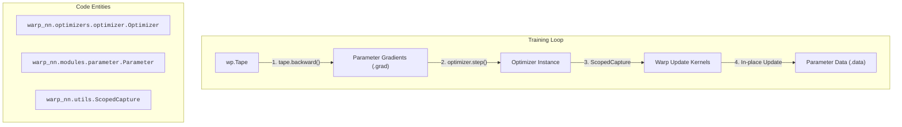

<!-- source: DeepWiki mcp.deepwiki.com · repo NVIDIA/warp-nn · page 3 Optimizers · fetched 2026-10-26 -->

# Optimizers

Relevant source files

The following files were used as context for generating this wiki page:

- [docs/api/index.rst](docs/api/index.rst)
- [warp_nn/nn.py](warp_nn/nn.py)

The `warp_nn.optimizers` package provides high-performance, CUDA-graph compatible optimization algorithms designed to work seamlessly with Warp arrays and the `wp.Tape` autodiff system. Unlike standard deep learning frameworks, these optimizers are implemented using Warp kernels to ensure that the entire training step—from forward pass to weight update—can remain on the GPU without CPU synchronization.

### The Optimizer Base Class

All optimizers in `warp-nn` inherit from the `Optimizer` abstract base class. This base class establishes a consistent interface for managing model parameters, handling gradient clipping, and executing the optimization step.

Key responsibilities of the optimizer include:
*   **Parameter Management**: Tracking a list of `warp_nn.modules.parameter.Parameter` objects to be updated.
*   **Gradient Clipping**: Implementing global norm clipping to prevent exploding gradients during training.
*   **CUDA Graph Capture**: Utilizing `warp_nn.utils.ScopedCapture` to allow the `step()` function to be recorded into a CUDA graph for accelerated execution in simulation loops.

### System Architecture

The following diagram illustrates how the `Optimizer` interacts with the `Module` parameters and the Warp `Tape` during a training iteration.

**Optimizer Execution Flow**

**Sources:** [warp_nn/nn.py:16-20](), [docs/api/index.rst:70-79]()

---

### Gradient Clipping

The `Optimizer` base class supports gradient clipping via the `max_norm` parameter. When `max_norm` is provided, the optimizer calculates the global norm of all gradients and scales them down if they exceed the threshold. This is particularly useful in Reinforcement Learning and physical simulations where loss spikes are common.

For implementation details on how clipping is applied within specific optimizers, see the [Adam Optimizer](#3.1) and [SGD Optimizer](#3.2) child pages.

---

### CUDA Graph Integration

A primary design goal of `warp-nn` is to eliminate CPU-GPU overhead. The optimizers use a `ScopedCapture` utility to wrap their update logic. When `disable_graph=False` (the default), the first call to `step()` captures the kernel launches into a CUDA graph. Subsequent calls replay the graph, significantly reducing the latency of the optimization step.

| Feature | Description |
| :--- | :--- |
| **ScopedCapture** | A context manager that handles `wp.capture_begin()` and `wp.capture_end()`. |
| **Tiled Kernels** | Updates are performed using tiled Warp kernels for maximum throughput. |
| **Zero-Sync** | The `step()` function avoids host-side synchronization points. |

**Sources:** [docs/api/index.rst:70-79](), [warp_nn/nn.py:1-20]()

---

### Available Optimizers

The library currently provides two primary optimization algorithms, accessible via the `warp_nn.nn` entry point or the `warp_nn.optimizers` package.

#### [Adam Optimizer](#3.1)
The `Adam` optimizer is a tiled implementation of the Adam algorithm. It maintains first and second moment buffers (`m1` and `m2`) for every parameter. It is the recommended choice for most deep learning tasks and complex physical regressions.
*   **Key Features**: Adaptive learning rates, bias correction, and CUDA graph support.
*   **Reference**: [Adam Optimizer](#3.1)

#### [SGD Optimizer](#3.2)
The `SGD` (Stochastic Gradient Descent) optimizer provides a lightweight alternative with optional momentum. It is often preferred in scenarios where memory overhead must be minimized or where the simplicity of SGD leads to better generalization in specific physical solvers.
*   **Key Features**: Momentum support, low memory footprint, and gradient clipping.
*   **Reference**: [SGD Optimizer](#3.2)

**Sources:** [docs/api/index.rst:70-79](), [warp_nn/nn.py:16-20]()

---

