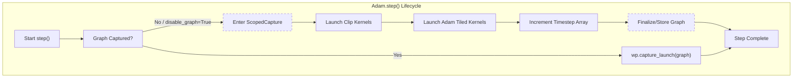
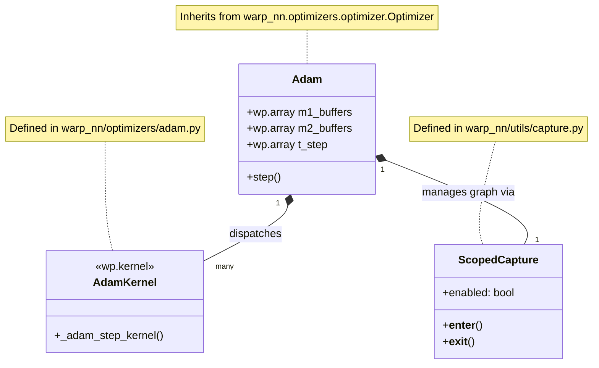

<!-- source: DeepWiki mcp.deepwiki.com · repo NVIDIA/warp-nn · page 3.1 Adam Optimizer · fetched 2026-10-26 -->

# Adam Optimizer

Relevant source files

The following files were used as context for generating this wiki page:

- [docs/api/index.rst](docs/api/index.rst)
- [warp_nn/nn.py](warp_nn/nn.py)

The `Adam` optimizer in `warp-nn` is a high-performance implementation of the Adam (Adaptive Moment Estimation) algorithm, designed to work seamlessly with NVIDIA Warp's kernel execution model and CUDA Graph system. It implements the standard Adam update rule with support for gradient clipping and automated graph capture for optimized training loops.

### Optimizer Constructor and Parameters

The `Adam` optimizer is initialized with hyperparameters that control the adaptive learning rate logic and graph capture behavior.

| Parameter | Type | Default | Description |
| :--- | :--- | :--- | :--- |
| `params` | `Iterable[Parameter]` | - | A collection of `warp_nn.Parameter` objects to optimize. |
| `lr` | `float` | `1e-3` | The learning rate ($\alpha$). |
| `betas` | `Tuple[float, float]` | `(0.9, 0.999)` | Coefficients used for computing running averages of gradient and its square ($\beta_1, \beta_2$). |
| `eps` | `float` | `1e-8` | Term added to the denominator to improve numerical stability ($\epsilon$). |
| `max_norm` | `Optional[float]` | `None` | If provided, gradients are clipped such that their L2 norm does not exceed this value. |
| `disable_graph` | `bool` | `False` | If `True`, disables CUDA graph capture for the `step()` function. |

**Sources:**
- `warp_nn/optimizers/adam.py:25-68` (Class definition and `__init__`)
- `docs/api/index.rst:77-77` (API Reference)

---

### Implementation Details

The `Adam` optimizer manages internal state buffers to track moments and timesteps across training iterations.

#### Moment Buffers (m1/m2)
For every parameter registered in the optimizer, two additional `wp.array` buffers are allocated on the same device as the parameter:
1.  **`m1` (First Moment):** Stores the exponential moving average of the gradients.
2.  **`m2` (Second Moment):** Stores the exponential moving average of the squared gradients.

These buffers are initialized to zero and match the shape and data type of their corresponding parameter [warp_nn/optimizers/adam.py:70-85]().

#### Timestep Tracking
To perform bias correction, the optimizer maintains a `t` (timestep) counter. In `warp-nn`, this is stored as a `wp.array` of size 1 to ensure it resides on the GPU, allowing the entire update logic—including the increment of $t$—to be captured within a CUDA graph without CPU-GPU synchronization [warp_nn/optimizers/adam.py:87-89]().

#### Tiled Kernel Implementation
The core update logic is implemented in a Warp kernel that uses a tiled execution pattern. This ensures that parameter updates are parallelized across the GPU threads efficiently. The kernel applies the following logic per element:

1.  **Gradient Clipping:** If `max_norm` is set, the gradient is scaled by $\min(1, \text{max\_norm} / \|\text{grad}\|_2)$ [warp_nn/optimizers/adam.py:165-180]().
2.  **Moment Update:** 
    $m_1 = \beta_1 \cdot m_1 + (1 - \beta_1) \cdot g$
    $m_2 = \beta_2 \cdot m_2 + (1 - \beta_2) \cdot g^2$
3.  **Bias Correction:**
    $\hat{m}_1 = m_1 / (1 - \beta_1^t)$
    $\hat{m}_2 = m_2 / (1 - \beta_2^t)$
4.  **Parameter Update:**
    $\theta = \theta - \alpha \cdot \hat{m}_1 / (\sqrt{\hat{m}_2} + \epsilon)$

**Sources:**
- `warp_nn/optimizers/adam.py:145-210` (Adam kernel implementation)
- `warp_nn/optimizers/adam.py:70-95` (State initialization)

---

### CUDA Graph Capture via ScopedCapture

The `Adam.step()` function is designed to be fully "graphable." By default, the optimizer uses the `ScopedCapture` utility to record the kernel launches into a CUDA graph during the first invocation.

#### Execution Flow
1.  **First Call:** The optimizer enters a `ScopedCapture` block. It records the gradient clipping kernels (if applicable), the Adam update kernels for all parameters, and the timestep increment kernel [warp_nn/optimizers/adam.py:110-135]().
2.  **Subsequent Calls:** The optimizer replays the captured CUDA graph. This significantly reduces CPU overhead by avoiding the cost of launching multiple individual kernels from Python [warp_nn/utils/capture.py:20-45]().

#### Diagram: Adam Step Execution Logic

**Sources:**
- `warp_nn/optimizers/adam.py:105-140` (`step` method and graph logic)
- `warp_nn/utils/capture.py:15-50` (`ScopedCapture` implementation)

---

### Code Entity Mapping

The following diagram bridges the mathematical components of the Adam optimizer to their specific identifiers and file locations within the `warp-nn` codebase.

**Sources:**
- `warp_nn/optimizers/adam.py:25-210` (Adam and kernel definitions)
- `warp_nn/nn.py:1-20` (Module exports)
- `warp_nn/utils/capture.py:1-50` (Capture utility)

---

