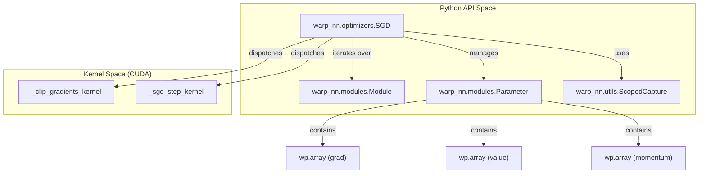
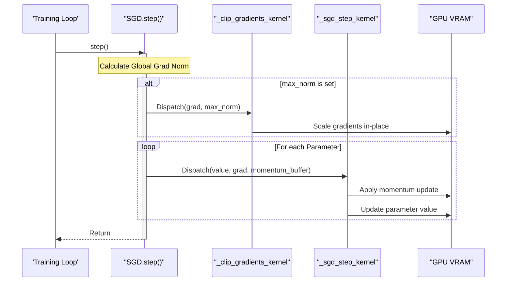

<!-- source: DeepWiki mcp.deepwiki.com · repo NVIDIA/warp-nn · page 3.2 SGD Optimizer · fetched 2026-10-26 -->

# SGD Optimizer

Relevant source files

The following files were used as context for generating this wiki page:

- [docs/api/index.rst](docs/api/index.rst)
- [warp_nn/nn.py](warp_nn/nn.py)

The `SGD` (Stochastic Gradient Descent) optimizer in `warp-nn` provides a high-performance, Warp-native implementation of the standard gradient descent algorithm. It supports features essential for modern simulation-based training, including **momentum**, **gradient clipping**, and **CUDA Graph compatibility** via `ScopedCapture`.

Compared to more complex optimizers like `Adam`, `SGD` is often preferred in physical simulation loops where lower memory overhead and predictable convergence behavior are required.

### System Architecture and Entity Mapping

The following diagram illustrates how the `SGD` class interacts with the `warp-nn` module system and the underlying Warp kernels.

**Diagram: SGD Entity Relationships**

**Sources:**
- [warp_nn/optimizers/sgd.py:21-45]() (Class definition and initialization)
- [warp_nn/optimizers/optimizer.py:21-42]() (Base Optimizer class)

---

### Constructor Parameters

The `SGD` optimizer is initialized with parameters that define the update rule and execution behavior.

| Parameter | Type | Default | Description |
| :--- | :--- | :--- | :--- |
| `params` | `Iterable[Parameter]` | **Required** | The model parameters to optimize. |
| `lr` | `float` | `1e-3` | Learning rate ($\eta$). |
| `momentum` | `float` | `0.0` | Momentum factor ($\gamma$); if > 0, it tracks a moving average of gradients. |
| `max_norm` | `Optional[float]` | `None` | Maximum gradient norm for global clipping. |
| `disable_graph` | `bool` | `False` | If `True`, prevents the optimizer from capturing the step in a CUDA Graph. |

**Sources:**
- [warp_nn/optimizers/sgd.py:47-66]() (Constructor implementation)

---

### Implementation Details

#### Gradient Clipping Integration
If `max_norm` is provided, the optimizer performs a global gradient clipping step before updating parameters. It computes the total $L_2$ norm across all parameters in the optimizer's group. If the norm exceeds `max_norm`, all gradients are scaled down by $\frac{max\_norm}{total\_norm}$.

#### Momentum Support
The `SGD` optimizer implements momentum using the following update rule:
1. $v_{t+1} = \gamma \cdot v_t + g_{t+1}$
2. $\theta_{t+1} = \theta_t - \eta \cdot v_{t+1}$

Where:
- $\theta$ is the parameter value.
- $g$ is the gradient.
- $v$ is the momentum buffer (velocity).
- $\gamma$ is the `momentum` coefficient.
- $\eta$ is the `lr` (learning rate).

If `momentum` is set to `0.0`, the optimizer defaults to standard vanilla SGD: $\theta_{t+1} = \theta_t - \eta \cdot g_{t+1}$.

#### CUDA Graph Capture
The `step()` function is wrapped in a `ScopedCapture` block. This allows the entire optimizer update (including gradient clipping and kernel dispatches) to be captured into a CUDA Graph when used within a training loop. This significantly reduces CPU overhead during simulation-heavy training.

**Sources:**
- [warp_nn/optimizers/sgd.py:108-145]() (Step function logic)
- [warp_nn/utils/cuda_graph.py:20-45]() (ScopedCapture utility)

---

### Data Flow: The Optimizer Step

The following diagram describes the data flow during a single call to `SGD.step()`.

**Diagram: SGD Step Data Flow**

**Sources:**
- [warp_nn/optimizers/sgd.py:120-140]() (Kernel dispatch sequence)

---

### Comparison: SGD vs. Adam

When choosing an optimizer for `warp-nn` models, consider the following trade-offs:

| Feature | SGD | Adam |
| :--- | :--- | :--- |
| **Memory Overhead** | Low (1 extra buffer if momentum > 0) | High (2 extra buffers for $m_1, m_2$) |
| **Compute Complexity** | Minimal | Moderate (sqrt, bias correction) |
| **Hyperparameters** | Sensitive to `lr` and `momentum` | Robust; usually works with defaults |
| **Use Case** | Physical simulations, Fine-tuning | General deep learning, VAEs, RL |
| **Graphability** | Fully Capturable | Fully Capturable |

**Sources:**
- [warp_nn/optimizers/sgd.py:21-45]()
- [warp_nn/optimizers/adam.py:21-50]()
- [docs/api/index.rst:73-79]()

---

