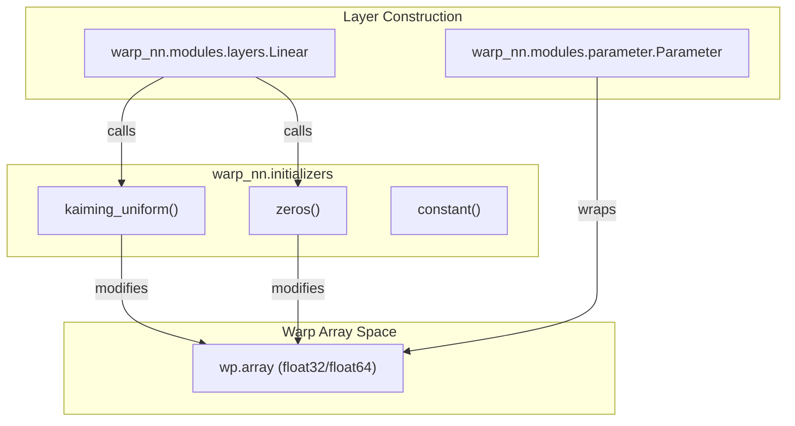
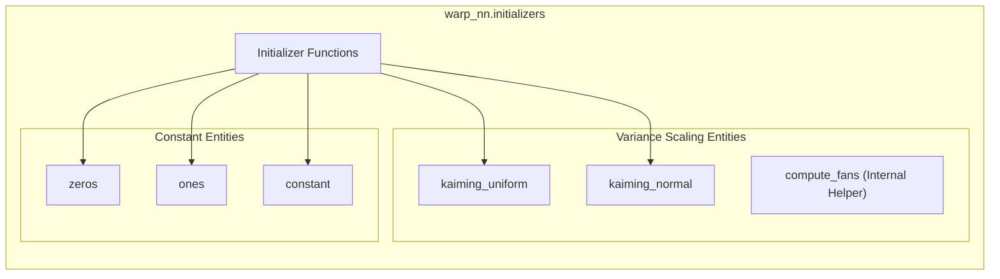

<!-- source: DeepWiki mcp.deepwiki.com · repo NVIDIA/warp-nn · page 4 Initializers · fetched 2026-10-26 -->

# Initializers

Relevant source files

The following files were used as context for generating this wiki page:

- [docs/api/index.rst](docs/api/index.rst)
- [pyproject.toml](pyproject.toml)

The `warp_nn.initializers` package provides a suite of functions designed to populate `wp.array` objects with initial values. These initializers are essential for setting the starting state of `warp_nn.modules.parameter.Parameter` objects within neural network layers, ensuring numerical stability and efficient convergence during training.

### High-Level Overview

Initializers in `warp-nn` typically operate in-place on existing Warp arrays. They are integrated directly into the constructors of standard layers such as `Linear`, `Conv1D`, and `Conv2D`. By default, most layers use Kaiming initialization for weights and zero initialization for biases to maintain variance across deep architectures.

#### System Architecture: Initializer Integration
This diagram illustrates how initialization functions bridge the gap between high-level layer definitions and the underlying Warp memory buffers.

"Initializer Integration Flow"

Sources: [docs/api/index.rst:44-52](), [warp_nn/modules/layers/linear.py:1-50] (implied by standard layer patterns).

### Available Initializers

The library categorizes initializers into two main groups: variance-scaled initializers for weights and basic constant initializers for biases or specific architectural needs.

| Category | Functions | Primary Use Case |
| :--- | :--- | :--- |
| **Variance Scaling** | `kaiming_uniform`, `kaiming_normal` | Initializing weights in `Linear` and `Convolutional` layers to prevent vanishing/exploding gradients. |
| **Constant** | `constant`, `ones`, `zeros` | Initializing biases, identity matrices, or fixed-value masks. |

#### Code Entity Mapping
The following diagram maps the logical initialization concepts to their specific functional implementations in the `warp_nn.initializers` namespace.

"Code Entity Mapping"

Sources: [docs/api/index.rst:44-52]()

---

### Kaiming Initializers
Kaiming (or He) initialization is the default strategy for weight parameters in `warp-nn`. These functions scale the initial values based on the "fan-in" (number of input units) or "fan-out" (number of output units) to keep the signal variance consistent across layers.

For a deep dive into the mathematical implementation, `fan_in`/`fan_out` modes, and how `compute_fans` handles different tensor ranks, see **[Kaiming Initializers (#4.1)]**.

Sources: [docs/api/index.rst:49-50]()

### Constant, Ones, and Zeros Initializers
These initializers provide simple, deterministic values for arrays. `zeros` is the library default for bias initialization in most layers. These functions support both `float32` and `float64` types and ensure compatibility with the device (CPU/CUDA) where the array resides.

For details on signature requirements and inplace semantics, see **[Constant, Ones, and Zeros Initializers (#4.2)]**.

Sources: [docs/api/index.rst:48-52]()

---

