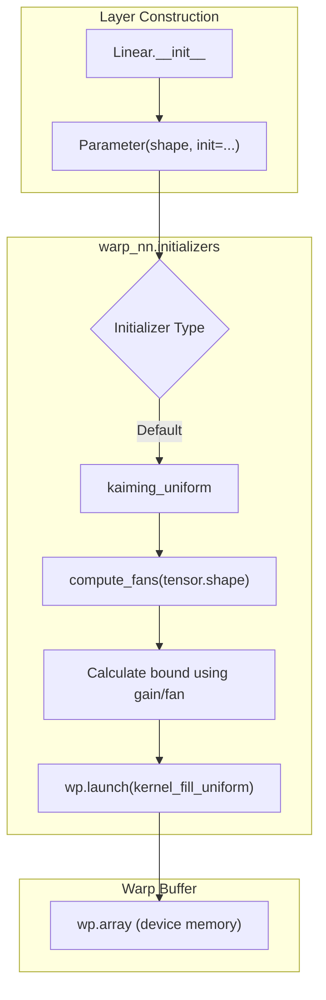
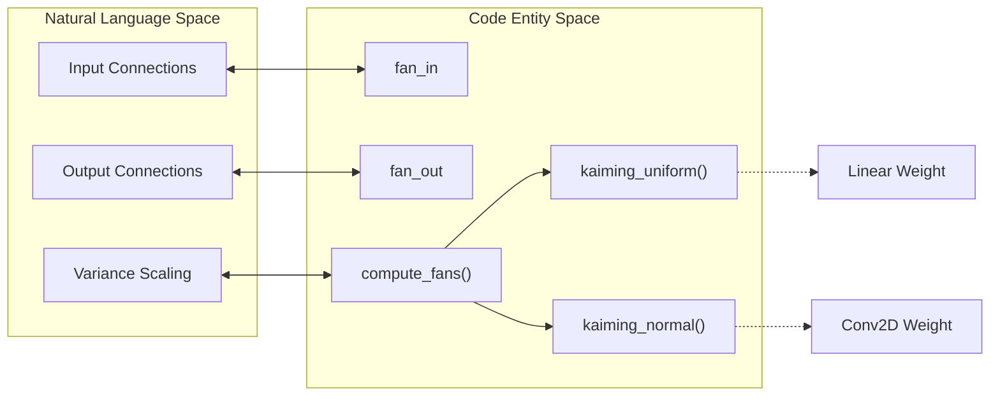

<!-- source: DeepWiki mcp.deepwiki.com · repo NVIDIA/warp-nn · page 4.1 Kaiming Initializers · fetched 2026-10-26 -->

# Kaiming Initializers

Relevant source files

The following files were used as context for generating this wiki page:

- [docs/api/index.rst](docs/api/index.rst)
- [warp_nn/nn.py](warp_nn/nn.py)

Kaiming initialization (also known as He initialization) is a specialized weight initialization strategy designed to maintain the variance of activations and backpropagated gradients in deep neural networks, particularly those utilizing non-linear activation functions like ReLU. In `warp-nn`, these initializers are implemented to operate directly on `wp.array` objects and serve as the default initialization strategy for core layers such as `Linear` and `Conv2D`.

Sources: [docs/api/index.rst:41-52](), [warp_nn/nn.py:17-19]()

## Implementation Overview

The Kaiming initializers are located in the `warp_nn.initializers` module. They provide two primary distribution types: uniform and normal. Both functions rely on a helper utility, `compute_fans`, to determine the scaling factor based on the dimensions of the weight tensor.

### Core Functions

| Function | Description |
| :--- | :--- |
| `kaiming_uniform` | Fills the input `wp.array` with values drawn from $\mathcal{U}(-\text{bound}, \text{bound})$. |
| `kaiming_normal` | Fills the input `wp.array` with values drawn from $\mathcal{N}(0, \text{std}^2)$. |
| `compute_fans` | Internal utility to calculate `fan_in` and `fan_out` for a given tensor shape. |

Sources: [docs/api/index.rst:44-50]()

## Mathematical Foundations

The goal of Kaiming initialization is to scale the weights $W$ such that the variance of the outputs remains constant across layers. The scaling depends on the "fan" (number of input or output units) and a gain factor $\text{gain}$ determined by the activation function.

### Fan Calculation (`compute_fans`)
The calculation of `fan_in` and `fan_out` depends on the dimensionality of the weight tensor:
*   **Linear Layers (2D):** For a weight matrix of shape `(out_features, in_features)`, `fan_in` is `in_features` and `fan_out` is `out_features`.
*   **Convolutional Layers (nD):** For a kernel of shape `(out_channels, in_channels, k1, k2, ...)`, the `receptive_field_size` is the product of all spatial dimensions ($k_1 \times k_2 \times ...$).
    *   `fan_in = in_channels * receptive_field_size`
    *   `fan_out = out_channels * receptive_field_size`

### Scaling Modes
Users can choose which "fan" to preserve via the `mode` parameter:
*   **`fan_in`**: Preserves the magnitude of the variance of the weights in the forward pass.
*   **`fan_out`**: Preserves the magnitudes in the backward pass.

### Distribution Formulas
Given a `gain` and the chosen `fan` (based on `mode`):

1.  **Kaiming Uniform**:
    $$\text{std} = \frac{\text{gain}}{\sqrt{\text{fan}}}$$
    $$\text{bound} = \sqrt{3} \times \text{std}$$
    Values are sampled from $\mathcal{U}(-\text{bound}, \text{bound})$.

2.  **Kaiming Normal**:
    $$\text{std} = \frac{\text{gain}}{\sqrt{\text{fan}}}$$
    Values are sampled from $\mathcal{N}(0, \text{std}^2)$.

Sources: [docs/api/index.rst:49-50]()

## Data Flow and Entity Mapping

The following diagrams illustrate how the initialization logic flows from the high-level `Module` construction down to the `wp.array` manipulation.

### Initialization Dispatch Process
This diagram shows how a `Linear` layer uses the initializers during its `__init__` phase.

Sources: [warp_nn/nn.py:17-19](), [docs/api/index.rst:44-52]()

### Entity Relationship: Initializers to Layers
This diagram maps the natural language concepts of "Fans" and "Scaling" to the code entities that implement them.

Sources: [docs/api/index.rst:49-50](), [warp_nn/nn.py:17-18]()

## Usage in Layers

Kaiming initializers are the default for weight parameters in `warp-nn` layers. While the user can override them, the library follows the standard PyTorch-like defaults for deep learning.

### Linear Layer Defaults
In `warp_nn.modules.layers.Linear`, the weights are typically initialized using `kaiming_uniform` with `a=math.sqrt(5)` (the gain for LeakyReLU).

### Convolutional Layer Defaults
In `warp_nn.modules.layers.Conv2D`, `compute_fans` correctly accounts for the kernel size (width $\times$ height) to ensure the `fan_in` represents the total number of inputs per output neuron.

| Layer | Parameter | Default Initializer | Mode |
| :--- | :--- | :--- | :--- |
| `Linear` | `weight` | `kaiming_uniform` | `fan_in` |
| `Conv1D` | `weight` | `kaiming_uniform` | `fan_in` |
| `Conv2D` | `weight` | `kaiming_uniform` | `fan_in` |

Sources: [warp_nn/nn.py:17](), [docs/api/index.rst:57-68]()

---

