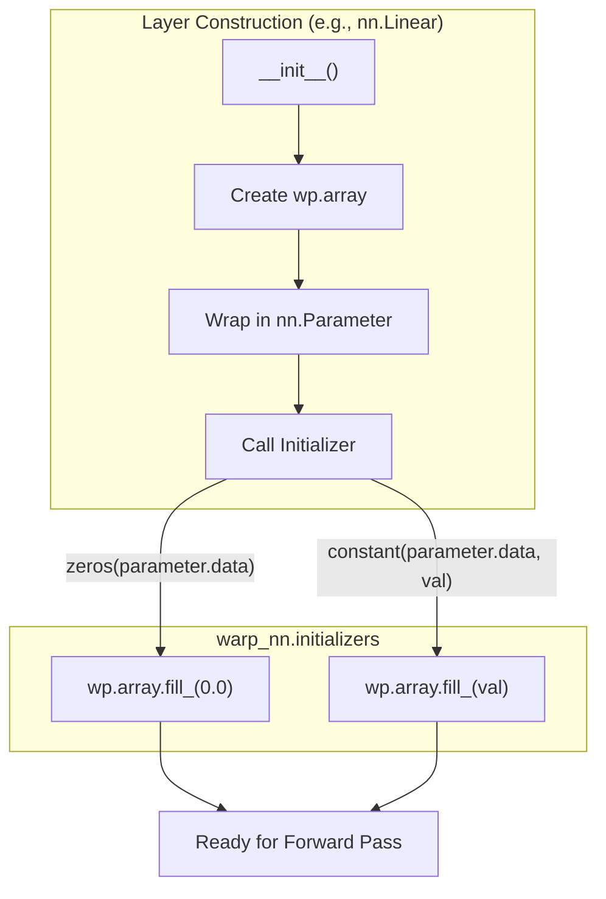

<!-- source: DeepWiki mcp.deepwiki.com · repo NVIDIA/warp-nn · page 4.2 Constant, Ones, and Zeros Initializers · fetched 2026-10-26 -->

# Constant, Ones, and Zeros Initializers

Relevant source files

The following files were used as context for generating this wiki page:

- [docs/api/index.rst](docs/api/index.rst)
- [warp_nn/nn.py](warp_nn/nn.py)

The `warp_nn.initializers` module provides a set of basic initialization functions used to populate `wp.array` objects with fixed values. While complex layers like `Linear` and `Conv2D` typically default to Kaiming initialization for weights, constant initializers are the standard for biases and specific architectural components where a known starting state is required.

## Overview and Implementation

These initializers operate directly on NVIDIA Warp arrays (`wp.array`). Unlike Kaiming initializers which involve stochastic distribution sampling, the constant, ones, and zeros initializers utilize Warp's built-in array filling capabilities or simple value assignments.

### Data Flow and Semantics

Initializers in `warp-nn` typically follow an **in-place** semantics pattern. They receive an existing `wp.array` (often the `.data` attribute of a `warp_nn.modules.parameter.Parameter`) and modify its contents.

| Initializer | Function Name | Purpose | Typical Use Case |
| :--- | :--- | :--- | :--- |
| **Constant** | `constant` | Fills array with a user-defined scalar | Custom bias offsets, fixed embedding scales |
| **Ones** | `ones` | Fills array with `1.0` | Batch normalization scales, gating mechanisms |
| **Zeros** | `zeros` | Fills array with `0.0` | Bias initialization, LSTM/GRU hidden state resets |

**Sources:**
- `docs/api/index.rst:41-52` ()
- `warp_nn/nn.py:1-20` ()

## Functional Signatures

The initializers are registered under the `warp_nn.initializers` namespace.

### `constant(arr, val)`
Fills the target array `arr` with the specified value `val`.
- **arr**: The `wp.array` to be initialized.
- **val**: The scalar value (int or float) to broadcast across the array.

### `ones(arr)`
Fills the target array `arr` with `1.0`. This is a specialized version of `constant(arr, 1.0)`.

### `zeros(arr)`
Fills the target array `arr` with `0.0`. This is the most common initializer for additive biases in neural network layers.

**Sources:**
- `docs/api/index.rst:48-52` ()

## Integration with Layers

Constant initializers are frequently used as default arguments in the constructors of core layers. For example, in the `Linear` layer, the bias is initialized to zero by default.

### Initialization Workflow Diagram

The following diagram illustrates how a `Module` uses these initializers during the construction phase to set up its `Parameter` data.

**Layer Parameter Initialization Flow**

**Sources:**
- `warp_nn/nn.py:17-19` ()
- `docs/api/index.rst:54-69` ()

## Typical Use Cases

### Bias Initialization
In almost all built-in layers (`Linear`, `Conv1D`, `Conv2D`), the bias parameter is initialized using `zeros`. This ensures that at the start of training, the layer's output is purely a function of the weighted input before any learned offsets are applied.

### Gating in Recurrent Units
In modules like `LSTMCell` and `GRUCell`, specific gates (like the forget gate in an LSTM) are sometimes initialized to `ones` to prevent vanishing gradients at the beginning of training, ensuring information flow through the cell state.

### Entity Mapping

| System Concept | Code Entity | File Reference |
| :--- | :--- | :--- |
| **Base Module** | `warp_nn.modules.module.Module` | [warp_nn/nn.py:18-18]() |
| **Parameter Wrapper** | `warp_nn.modules.parameter.Parameter` | [warp_nn/nn.py:19-19]() |
| **Initializer Namespace** | `warp_nn.initializers` | [docs/api/index.rst:44-44]() |
| **Linear Layer** | `warp_nn.modules.layers.Linear` | [warp_nn/nn.py:17-17]() |

**Sources:**
- `warp_nn/nn.py:16-20` ()
- `docs/api/index.rst:41-79` ()

---

