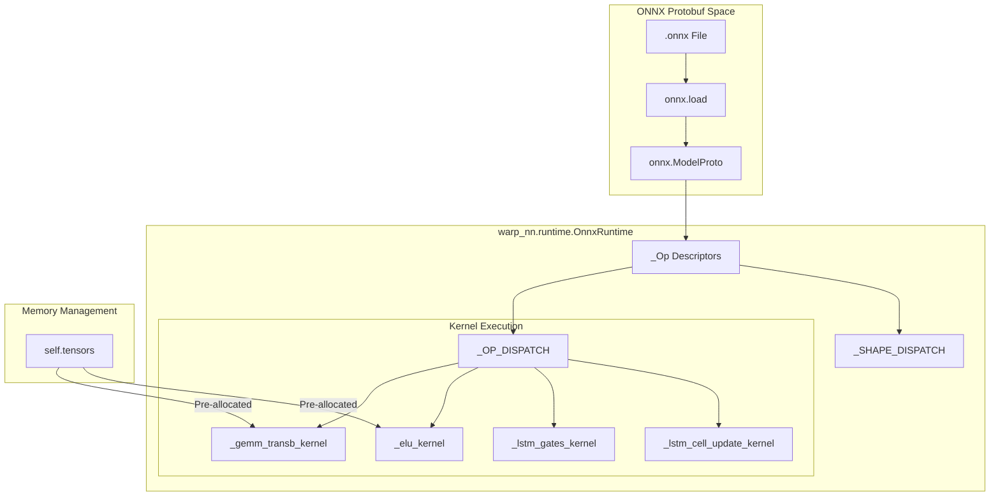
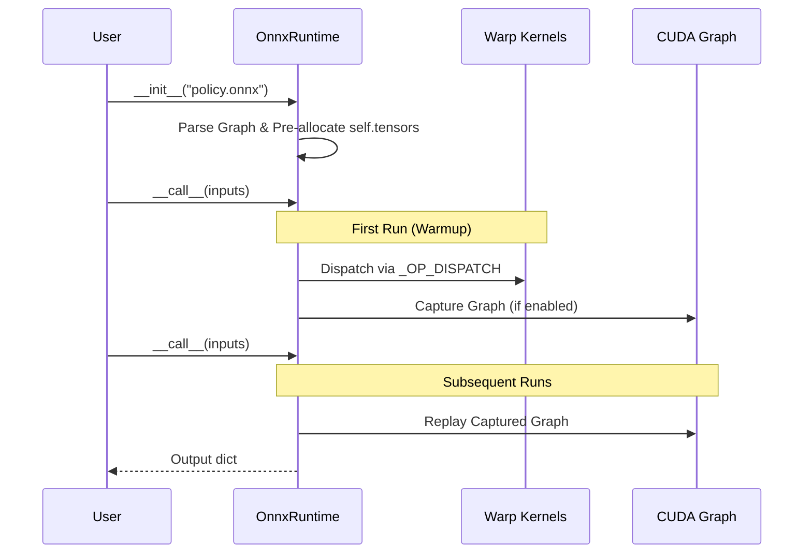

<!-- source: DeepWiki mcp.deepwiki.com · repo NVIDIA/warp-nn · page 5 ONNX Runtime · fetched 2026-10-26 -->

# ONNX Runtime

Relevant source files

The following files were used as context for generating this wiki page:

- [CHANGELOG.md](CHANGELOG.md)
- [warp_nn/runtime/__init__.py](warp_nn/runtime/__init__.py)
- [warp_nn/runtime/onnx_runtime.py](warp_nn/runtime/onnx_runtime.py)

The `warp_nn.runtime` package provides a lightweight, graph-capturable inference engine for ONNX models, specifically optimized for Physical AI policy networks. Unlike standard inference engines, this runtime is designed to run entirely within NVIDIA Warp's ecosystem, avoiding host-device round-trips and memory allocations during the execution loop [warp_nn/runtime/onnx_runtime.py:16-22]().

## Purpose and Scope

The `OnnxRuntime` class [warp_nn/runtime/onnx_runtime.py:200-207]() is intended for small-to-medium policy networks (e.g., batch size 1, hidden dimensions $\le$ 128) where overhead from complex tiled kernels or external library calls would dominate execution time [warp_nn/runtime/onnx_runtime.py:24-29]().

Key features include:
* **Zero Dependencies**: Only the pure-protobuf `onnx` package is required for parsing; `onnxruntime` or `torch` are not needed for execution [warp_nn/runtime/onnx_runtime.py:18-19]().
* **CUDA Graph Compatibility**: After a single "warmup" pass, the entire inference graph can be captured and replayed [warp_nn/runtime/onnx_runtime.py:30-30]().
* **Gradient Support**: The runtime includes opt-in support for gradient propagation, allowing ONNX-defined policies to be integrated into end-to-end differentiable simulations [CHANGELOG.md:3-5]().

### System Architecture

The following diagram illustrates how the `OnnxRuntime` bridges the ONNX protobuf representation to Warp's kernel execution space.

**ONNX Runtime Component Mapping**

**Sources:** [warp_nn/runtime/onnx_runtime.py:78-162](), [warp_nn/runtime/onnx_runtime.py:175-182](), [warp_nn/runtime/onnx_runtime.py:200-210]()

## Supported Operators

The runtime implements a focused subset of ONNX operators using specialized Warp kernels. These kernels are simplified "one thread per output element" implementations to minimize compilation pressure and maximize performance for small policy dimensions [warp_nn/runtime/onnx_runtime.py:78-80]().

| Operator | Implementation Details | Kernel Reference |
| :--- | :--- | :--- |
| **Gemm** | Performs `C = alpha * A @ B.T + beta * bias` with `transB=1`. | `_gemm_transb_kernel` |
| **Elu** | Element-wise activation. | `_elu_kernel` |
| **Squeeze** | Memory-alias passthrough; no data copy performed. | N/A (Alias) |
| **LSTM** | Single-direction, single-layer, `seq_length=1`. | `_lstm_gates_kernel`, `_lstm_cell_update_kernel` |

**Sources:** [warp_nn/runtime/onnx_runtime.py:30-39](), [warp_nn/runtime/onnx_runtime.py:83-162]()

## Detailed Sub-Pages

### [OnnxRuntime Implementation](#5.1)
This page provides a deep dive into the internal mechanics of `warp_nn/runtime/onnx_runtime.py`. It covers:
* The initialization process and how `_np_to_warp` [warp_nn/runtime/onnx_runtime.py:195-197]() handles weight loading.
* The structure of the `_Op` dataclass [warp_nn/runtime/onnx_runtime.py:175-182]().
* How the `_OP_DISPATCH` and `_SHAPE_DISPATCH` tables map ONNX nodes to Warp kernels.
* Details on the execution lifecycle, including graph capture and the `requires_grad` contract for gradient propagation.

For details, see [OnnxRuntime Implementation](#5.1).

### [OnnxRuntime Testing and Validation](#5.2)
This page documents the validation suite located in `tests/runtime/test_onnx_runtime.py`. It explains:
* How the runtime is verified against PyTorch reference implementations for MLP and LSTM architectures.
* The use of finite-difference checks to verify gradient accuracy.
* Tests for CUDA graph capture and replay consistency.
* Error handling for unsupported ONNX operators.

For details, see [OnnxRuntime Testing and Validation](#5.2).

## Data Flow and Execution

The `OnnxRuntime` operates by parsing the ONNX graph once during initialization and pre-allocating all necessary intermediate buffers (`self.tensors`) [warp_nn/runtime/onnx_runtime.py:20-22]().

**Inference Execution Flow**

**Sources:** [warp_nn/runtime/onnx_runtime.py:16-47](), [warp_nn/runtime/onnx_runtime.py:200-210]()

---

