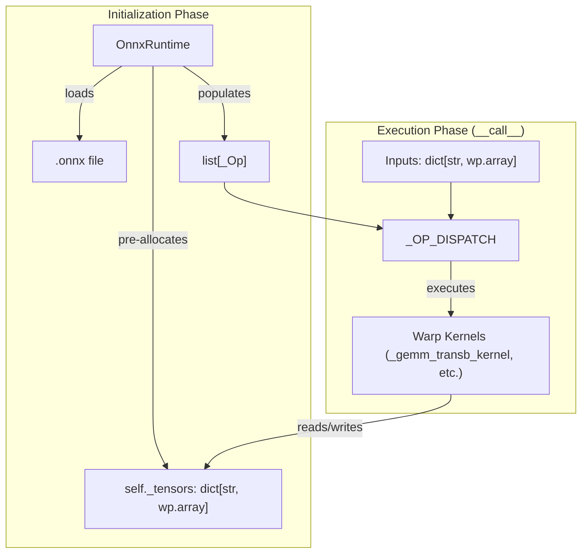
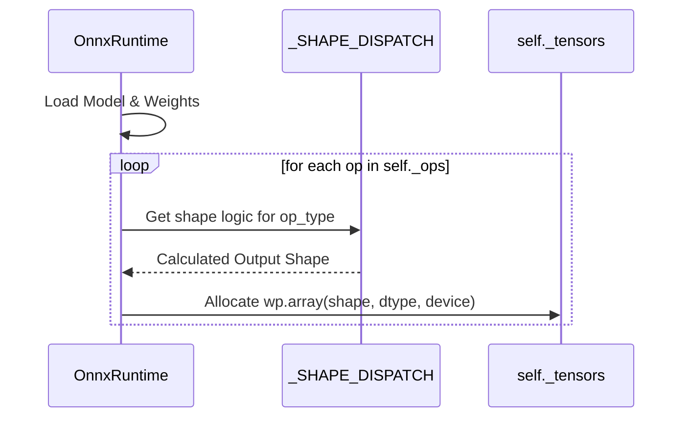

<!-- source: DeepWiki mcp.deepwiki.com · repo NVIDIA/warp-nn · page 5.1 OnnxRuntime Implementation · fetched 2026-10-26 -->

# OnnxRuntime Implementation

Relevant source files

The following files were used as context for generating this wiki page:

- [warp_nn/runtime/__init__.py](warp_nn/runtime/__init__.py)
- [warp_nn/runtime/onnx_runtime.py](warp_nn/runtime/onnx_runtime.py)

The `OnnxRuntime` is a lightweight, graph-capturable inference engine designed for executing ONNX policy networks directly within NVIDIA Warp. Unlike standard runtimes, it requires only the pure-protobuf `onnx` package for parsing and does not depend on `onnxruntime` or `torch` [warp_nn/runtime/onnx_runtime.py:16-22](). 

It is specifically optimized for small policy networks (e.g., batch size 1, hidden dimension $\le$ 128) typically found in Physical AI and reinforcement learning workflows. By using simplified kernels, it minimizes compilation pressure and ensures the entire execution lifecycle is compatible with CUDA Graph capture [warp_nn/runtime/onnx_runtime.py:24-29]().

## Architecture and Data Flow

The `OnnxRuntime` operates by parsing an ONNX model into a linear sequence of `_Op` descriptors. During initialization, it pre-allocates all necessary intermediate buffers on the target Warp device, ensuring that the `__call__` execution path involves zero device-side allocations or host-to-device round-trips [warp_nn/runtime/onnx_runtime.py:200-220]().

### Code Entity Relationship
The following diagram illustrates how the `OnnxRuntime` class organizes ONNX nodes into executable operations and manages memory.

**OnnxRuntime Structure**

Sources: [warp_nn/runtime/onnx_runtime.py:175-182](), [warp_nn/runtime/onnx_runtime.py:200-230](), [warp_nn/runtime/onnx_runtime.py:382-397]()

## Core Data Structures

### The `_Op` Dataclass
The `_Op` dataclass is the internal representation of a single ONNX node. It stores the operation type, input/output names, and decoded attributes [warp_nn/runtime/onnx_runtime.py:175-182]().

### Dispatch Tables
The runtime uses two primary dispatch tables to handle the lifecycle of an operation:
1.  **`_SHAPE_DISPATCH`**: A mapping of `op_type` to functions that calculate the output shapes of an operation and register intermediate tensors in the `self._tensors` map [warp_nn/runtime/onnx_runtime.py:448-454]().
2.  **`_OP_DISPATCH`**: A mapping of `op_type` to functions that launch the corresponding Warp kernels during the forward pass [warp_nn/runtime/onnx_runtime.py:456-462]().

## Supported Operators

The runtime implements a subset of ONNX operators required for common MLP and LSTM policies.

| Operator | Implementation Details | Kernel / Logic |
| :--- | :--- | :--- |
| **Gemm** | Performs `C = alpha * A @ B.T + beta * bias`. Specifically handles `transB=1`. | `_gemm_transb_kernel` [warp_nn/runtime/onnx_runtime.py:84-101]() |
| **Elu** | Element-wise Exponential Linear Unit activation. | `_elu_kernel` [warp_nn/runtime/onnx_runtime.py:104-112]() |
| **LSTM** | Supports single-direction, single-layer LSTMs with `seq_length=1`. | `_lstm_gates_kernel` & `_lstm_cell_update_kernel` [warp_nn/runtime/onnx_runtime.py:115-161]() |
| **Squeeze** | A passthrough alias; the output array shares memory with the input. | `_squeeze_shape` [warp_nn/runtime/onnx_runtime.py:334-343]() |

### LSTM Execution Lifecycle
The LSTM implementation is split into two kernels to optimize memory access and parallelization for small batches.
1.  **Gate Kernel**: Computes the linear projection of inputs and previous hidden states: `gates = x @ W.T + h_prev @ R.T` [warp_nn/runtime/onnx_runtime.py:115-134]().
2.  **Cell Update Kernel**: Applies sigmoid and tanh activations to compute the new cell state `c_out` and hidden state `h_out` [warp_nn/runtime/onnx_runtime.py:137-161]().

## Memory Pre-allocation and Shape Inference

During `__init__`, the runtime performs a "dry run" of shape inference. It iterates through the `_Op` list and calls the corresponding function in `_SHAPE_DISPATCH` [warp_nn/runtime/onnx_runtime.py:236-253]().

**Shape Inference and Allocation Logic**

Sources: [warp_nn/runtime/onnx_runtime.py:236-253](), [warp_nn/runtime/onnx_runtime.py:313-332]()

## Execution and Gradient Propagation

### The `__call__` Method
The execution entry point is `__call__(self, inputs)`. It maps the provided input `wp.array` objects to the internal tensor registry and iterates through the `_ops` list, invoking the kernels defined in `_OP_DISPATCH` [warp_nn/runtime/onnx_runtime.py:382-397]().

### Gradient Support
While primarily an inference runtime, `OnnxRuntime` supports gradient propagation if `requires_grad=True` is passed during initialization [warp_nn/runtime/onnx_runtime.py:209](). When enabled:
1.  Weights and intermediate tensors are allocated with `requires_grad=True` [warp_nn/runtime/onnx_runtime.py:195-197]().
2.  The kernel launches are recorded by `wp.Tape` if one is active during the `__call__` execution.

### CUDA Graph Capture
The runtime is designed to be fully capturable after a single "warmup" call. Because all memory is pre-allocated and kernel launch parameters (like array pointers) remain constant, users can wrap the `__call__` in a `wp.capture_begin()` / `wp.capture_end()` block (or use `warp_nn.utils.ScopedCapture`) to eliminate Python overhead during the simulation loop [warp_nn/runtime/onnx_runtime.py:27-29]().

Sources: [warp_nn/runtime/onnx_runtime.py:1-400]()

---

