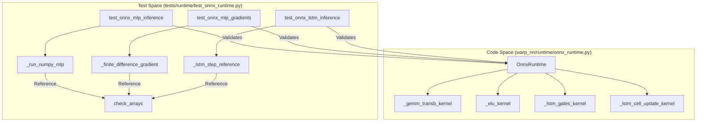
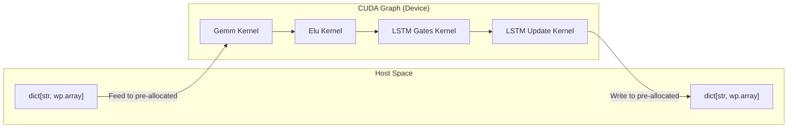

<!-- source: DeepWiki mcp.deepwiki.com · repo NVIDIA/warp-nn · page 5.2 OnnxRuntime Testing and Validation · fetched 2026-10-26 -->

# OnnxRuntime Testing and Validation

<details>
<summary>Relevant source files</summary>

The following files were used as context for generating this wiki page:

- [tests/runtime/test_onnx_runtime.py](tests/runtime/test_onnx_runtime.py)
- [warp_nn/runtime/onnx_runtime.py](warp_nn/runtime/onnx_runtime.py)

</details>


The `OnnxRuntime` testing suite ensures that the lightweight inference engine correctly executes ONNX graphs while maintaining compatibility with Warp's autodiff and CUDA graph capture systems. The tests verify numerical parity against reference NumPy implementations, gradient accuracy via finite differences, and the robustness of the graph-replay mechanism.

### Test Architecture Overview

The testing infrastructure in `tests/runtime/test_onnx_runtime.py` is designed to validate the runtime across three primary axes:
1.  **Numerical Correctness**: Comparing `OnnxRuntime` outputs against pure NumPy reference implementations of MLP and LSTM logic.
2.  **Autodiff Integrity**: Verifying that `wp.Tape` correctly propagates gradients through the runtime kernels using finite-difference checks.
3.  **System Integration**: Ensuring that the runtime can be captured into a CUDA Graph and replayed without overhead or device re-allocations.

#### Entity Relationship: Test to Code
This diagram illustrates how the test utility functions map to the core `OnnxRuntime` implementation.


**Sources:** [tests/runtime/test_onnx_runtime.py:44-103](), [warp_nn/runtime/onnx_runtime.py:83-162]()

---

### Reference Implementations

To ensure validation is independent of the `onnxruntime` C++ library, the test suite includes pure Python/NumPy reference implementations of the supported operators.

#### MLP Reference (`_run_numpy_mlp`)
The `_run_numpy_mlp` function iterates through an `onnx.ModelProto`, manually performing matrix multiplications and activations [tests/runtime/test_onnx_runtime.py:44-66]().
*   **Gemm**: Implements `alpha * (A @ B.T) + beta * bias` specifically for the `transB=1` case used by policy networks [tests/runtime/test_onnx_runtime.py:50-58]().
*   **Elu**: Implements the element-wise exponential linear unit: `x if x >= 0 else alpha * (exp(x) - 1)` [tests/runtime/test_onnx_runtime.py:59-62]().

#### LSTM Reference (`_lstm_step_reference`)
Validates the single-step LSTM logic used in recurrent policies. It computes the four gates (input, output, forget, cell) and updates the hidden and cell states [tests/runtime/test_onnx_runtime.py:147-164]().

**Sources:** [tests/runtime/test_onnx_runtime.py:44-66](), [tests/runtime/test_onnx_runtime.py:147-164]()

---

### Gradient Verification

The runtime supports gradient propagation via `wp.Tape`, which is critical for workflows where a policy is embedded inside a larger differentiable simulation.

The `test_onnx_mlp_gradients` test uses the `_finite_difference_gradient` helper to calculate numerical gradients by perturbing inputs by `eps` [tests/runtime/test_onnx_runtime.py:69-80](). These are compared against the analytical gradients produced by the `OnnxRuntime` kernels when recorded on a tape:

```python
# From _runtime_input_gradient
tape = wp.Tape()
with tape:
    out = rt(inputs)[output_name]
tape.backward(grads={out: seed_wp})
return inputs[input_name].grad.numpy()
```
[tests/runtime/test_onnx_runtime.py:97-102]()

**Sources:** [tests/runtime/test_onnx_runtime.py:69-80](), [tests/runtime/test_onnx_runtime.py:82-103]()

---

### CUDA Graph Capture and Replay

A core requirement for `OnnxRuntime` is that it must be "warmable" for CUDA Graph capture. The `test_onnx_mlp_graph_capture` function verifies this lifecycle:

1.  **Warmup**: Executes `rt(inputs)` once to trigger JIT compilation of kernels and internal memory allocation [tests/runtime/test_onnx_runtime.py:270-271]().
2.  **Capture**: Uses `wp.capture_begin()` and `wp.capture_end()` to record the kernel launches into a `wp.Graph` [tests/runtime/test_onnx_runtime.py:273-276]().
3.  **Replay**: Executes `wp.capture_launch(graph)` and compares the result against a standard call to ensure consistency [tests/runtime/test_onnx_runtime.py:278-281]().

#### Graph Execution Data Flow
This diagram shows how the `OnnxRuntime` handles data during a captured graph execution.


**Sources:** [warp_nn/runtime/onnx_runtime.py:30-39](), [tests/runtime/test_onnx_runtime.py:265-285]()

---

### Error Handling and Rejection

The test suite also validates that the runtime correctly rejects unsupported ONNX features to prevent silent failures.
*   **Unsupported Operators**: `test_onnx_unsupported_op` builds a graph containing a `Relu` node (which is currently not in the `_OP_DISPATCH` table) and verifies that `OnnxRuntime` raises a `NotImplementedError` during initialization [tests/runtime/test_onnx_runtime.py:288-305]().
*   **Attribute Validation**: Ensures that operators like `Gemm` are only accepted if they match the supported configuration (e.g., `transB=1`) [warp_nn/runtime/onnx_runtime.py:32]().

| Test Function | Feature Validated | Key Logic |
| :--- | :--- | :--- |
| `test_onnx_mlp_inference` | MLP Forward Pass | Compares against `_run_numpy_mlp` |
| `test_onnx_lstm_inference` | LSTM Forward Pass | Compares against `_lstm_step_reference` |
| `test_onnx_mlp_gradients` | Autodiff | Finite-difference vs `wp.Tape` |
| `test_onnx_mlp_graph_capture` | CUDA Graphs | `wp.capture_launch` vs Eager execution |
| `test_onnx_unsupported_op` | Robustness | Catching `NotImplementedError` |

**Sources:** [tests/runtime/test_onnx_runtime.py:186-305](), [warp_nn/runtime/onnx_runtime.py:440-442]()

---

