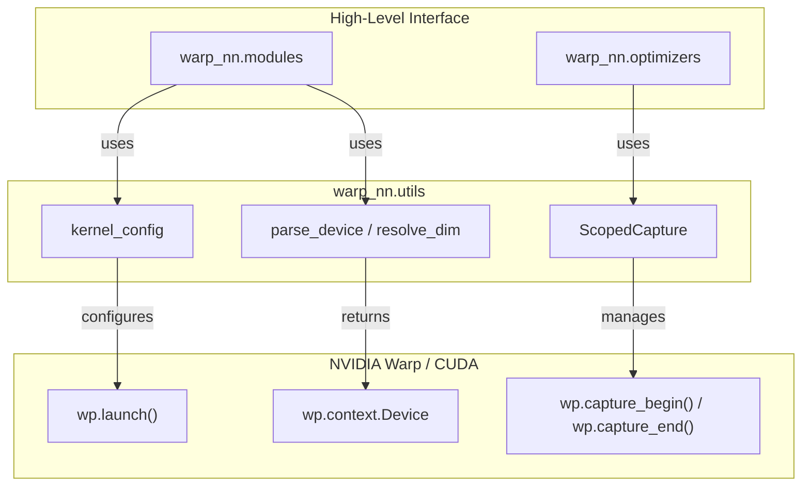
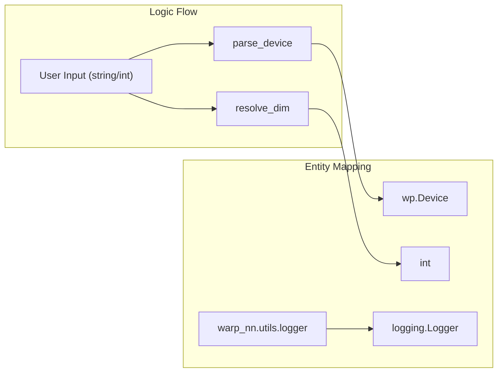

<!-- source: DeepWiki mcp.deepwiki.com · repo NVIDIA/warp-nn · page 6 Utilities · fetched 2026-10-26 -->

# Utilities

Relevant source files

The following files were used as context for generating this wiki page:

- [docs/api/index.rst](docs/api/index.rst)
- [warp_nn/nn.py](warp_nn/nn.py)

The `warp_nn.utils` package provides the foundational infrastructure required for efficient kernel execution and CUDA graph management within the library. These utilities standardize how `warp-nn` handles device placement, dimension resolution, and thread-block configurations, ensuring consistent behavior across diverse hardware and workloads.

The utilities are designed to support the library's "graph-first" philosophy, providing mechanisms to capture operations into replayable CUDA graphs and manage global state through context managers.

### System Architecture Overview

The following diagram illustrates how the utility classes interface between high-level modules and the underlying NVIDIA Warp execution engine.

**Utility Integration Flow**

**Sources:**
- `warp_nn/utils/config.py`
- `warp_nn/utils/capture.py`

---

### Kernel Configuration

Kernel execution in `warp-nn` is governed by the `KernelConfig` class and the `kernel_config()` context manager. This system allows the library to manage thread-block dimensions and tiling strategies dynamically. It is particularly critical for optimizing performance across different GPU architectures without hardcoding magic numbers into every kernel launch.

The utility provides default tiling strategies for 1D, 2D, 3D, and 4D workloads, which are used by layers like `Linear` and `Conv2D` to determine grid dimensions.

For details, see [Kernel Configuration](#6.1).

**Sources:**
- `warp_nn/utils/config.py`

---

### CUDA Graph Management

To achieve low-latency execution in simulation environments like NVIDIA Isaac Sim, `warp-nn` relies heavily on CUDA Graphs. The `ScopedCapture` utility provides a robust wrapper around Warp's native capture primitives. It handles the lifecycle of graph recording, ensuring that captures are correctly closed even if exceptions occur, and provides an `enabled` flag to toggle capture behavior conditionally.

This utility is extensively used in the `Adam` and `SGD` optimizers to capture the parameter update step, as well as in the `OnnxRuntime` for capturing inference passes.

For details, see [CUDA Graph Utilities](#6.2).

**Sources:**
- `warp_nn/utils/capture.py`

---

### Core Utility Functions

Beyond configuration and graphs, `warp-nn` includes several functional utilities to handle common logic:

| Utility | Role | Code Entity |
|:---|:---|:---|
| **Device Parsing** | Normalizes strings (e.g., "cuda:0") or `torch.device` objects into `wp.context.Device`. | `parse_device` |
| **Dimension Resolution** | Handles dynamic shape inference, particularly for "lazy" layers where input dimensions are not known at construction. | `resolve_dim` |
| **Logging** | Provides a standardized library-wide logger for debugging kernel launches and graph captures. | `logger` |

**Code Entity Mapping**

**Sources:**
- `warp_nn/utils/device.py`
- `warp_nn/utils/common.py`

---

## Child Pages

*   **[Kernel Configuration](#6.1)** — Detailed reference for `KernelConfig` and the `kernel_config()` context manager: block dimensions, tiling defaults, and thread-local storage patterns.
*   **[CUDA Graph Utilities](#6.2)** — Documents `ScopedCapture`: how it wraps `wp.capture_begin`/`capture_end` and how optimizers use it to build replayable graphs.

---

