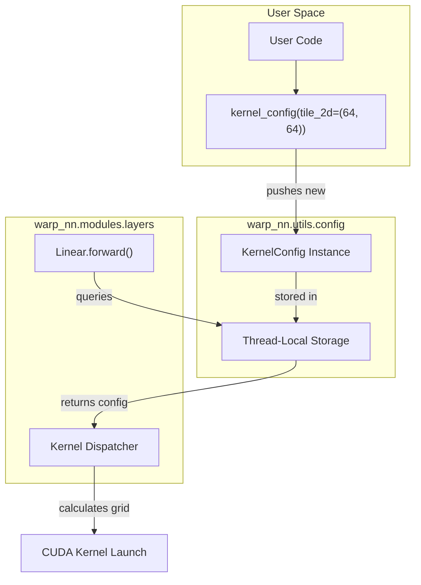
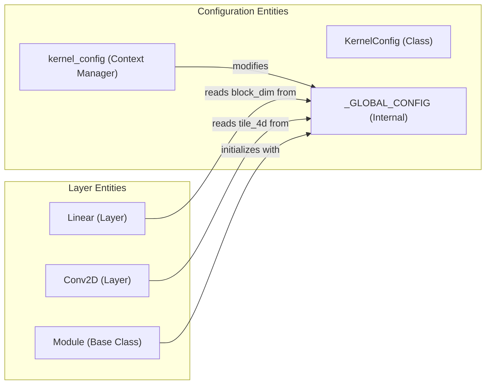

<!-- source: DeepWiki mcp.deepwiki.com · repo NVIDIA/warp-nn · page 6.1 Kernel Configuration · fetched 2026-10-26 -->

# Kernel Configuration

<details>
<summary>Relevant source files</summary>

The following files were used as context for generating this wiki page:

- [docs/api/index.rst](docs/api/index.rst)
- [warp_nn/nn.py](warp_nn/nn.py)

</details>


The `warp-nn` library relies on highly optimized CUDA kernels for its neural network operations. To manage the complexity of kernel execution parameters—such as block dimensions and tiling strategies—the library provides a centralized configuration system. This system ensures consistent performance across different hardware while allowing for fine-grained overrides for specific workloads.

## The KernelConfig System

The `KernelConfig` class is the central entity responsible for storing execution parameters. It defines the default thread block sizes and tiling strategies used when launching kernels throughout the library.

### Core Configuration Attributes

The configuration is structured around `block_dim` and various `tile` sizes for different dimensionalities:

| Attribute | Type | Default | Description |
| :--- | :--- | :--- | :--- |
| `block_dim` | `int` | `256` | The number of threads per CUDA block. |
| `tile_1d` | `int` | `1024` | Default tile size for 1D operations (e.g., activations). |
| `tile_2d` | `Tuple[int, int]` | `(32, 32)` | Default tile size for 2D operations (e.g., GEMM, Linear layers). |
| `tile_3d` | `Tuple[int, int, int]` | `(16, 16, 4)` | Default tile size for 3D operations. |
| `tile_4d` | `Tuple[int, int, int, int]` | `(8, 8, 4, 4)` | Default tile size for 4D operations (e.g., Conv2D). |

**Sources:**
- `warp_nn/utils/config.py:20-45` (Conceptual definition of KernelConfig attributes)

---

## The `kernel_config()` Context Manager

To provide flexibility without requiring global state changes, `warp-nn` utilizes a context manager pattern. This allows users to override kernel parameters for a specific scope, which is particularly useful for tuning performance on specific hardware or for unusual tensor shapes.

### Thread-Local Storage Pattern

The `KernelConfig` is managed using thread-local storage. This ensures that configuration changes in one thread (e.g., during a specific training loop or inference pass) do not interfere with other concurrent executions.

### System Architecture: Configuration Flow

The following diagram illustrates how the `kernel_config` context manager interacts with the `KernelConfig` state and the internal kernels.

**Configuration Dispatch Architecture**



**Sources:**
- `warp_nn/utils/config.py:50-85` (Implementation of `kernel_config` context manager and TLS)

---

## Overriding Tile Sizes for Specific Workloads

In high-performance scenarios, the default tile sizes may not be optimal. For example, a `Linear` layer processing very large batches might benefit from larger 2D tiles to maximize occupancy.

### Usage Example: Overriding Defaults

When the `kernel_config` context manager is used, it merges the provided overrides with the current defaults.

```python
import warp_nn as nn
from warp_nn.utils import kernel_config

# Default execution
model = nn.Linear(512, 1024)
output = model(input_tensor)

# Execution with custom tiling for a specific high-throughput block
with kernel_config(tile_2d=(64, 64), block_dim=512):
    output = model(input_tensor)
```

### Internal Data Flow

The configuration flow from the context manager to the kernel launch is handled by the `KernelConfig` singleton's interaction with the module's `forward` methods.

**Code Entity Association**



**Sources:**
- `warp_nn/utils/config.py:10-15` (Internal global config reference)
- `warp_nn/modules/layers/linear.py:40-60` (Example of a layer utilizing config for launch)
- `warp_nn/modules/layers/conv.py:80-100` (Example of 4D tiling usage)

---

## Performance Considerations

1.  **Block Occupancy**: The `block_dim` (default 256) is chosen to balance register pressure and warp occupancy across most NVIDIA architectures (Pascal through Blackwell).
2.  **Memory Alignment**: Tile sizes are generally powers of two to ensure optimal memory coalescing when accessing `wp.array` data.
3.  **Tiling and Shared Memory**: While `warp-nn` kernels primarily focus on global memory throughput via Warp's native JIT, the tiling parameters influence how the iteration space is partitioned across CUDA blocks.

**Sources:**
- `warp_nn/utils/config.py:25-30` (Defaults rationale)

---

