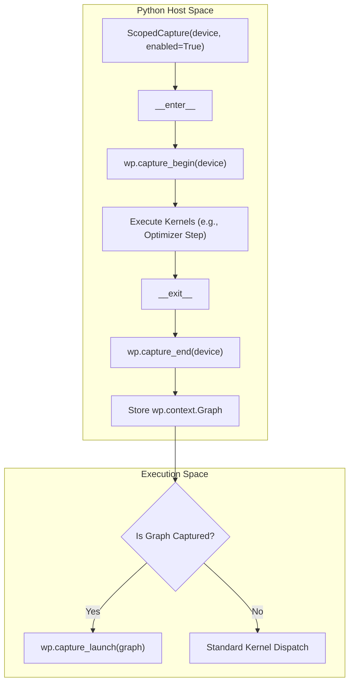
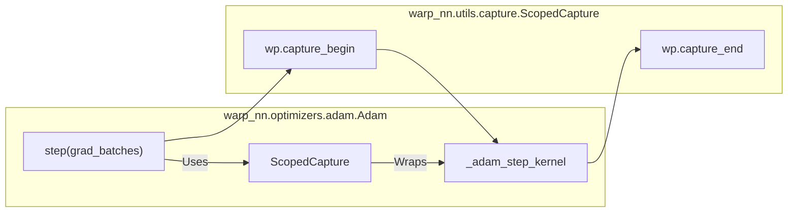
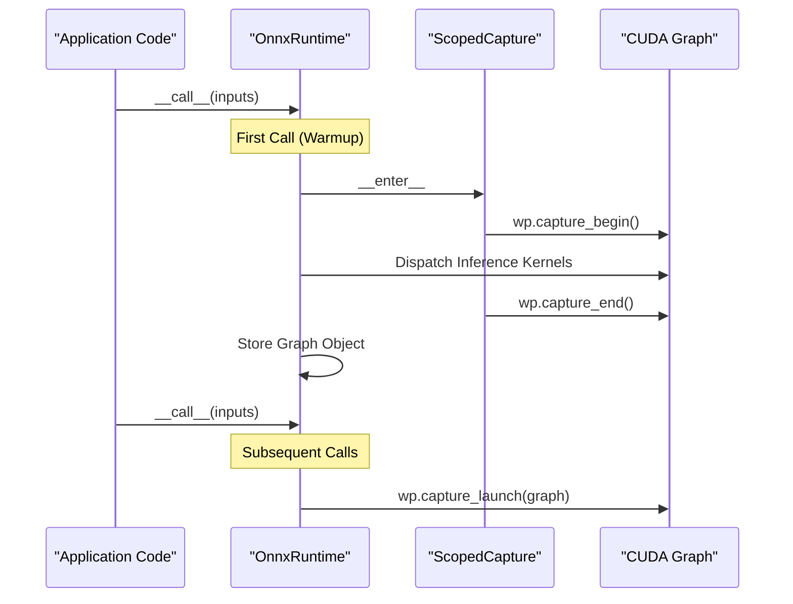

<!-- source: DeepWiki mcp.deepwiki.com · repo NVIDIA/warp-nn · page 6.2 CUDA Graph Utilities · fetched 2026-10-26 -->

# CUDA Graph Utilities

Relevant source files

The following files were used as context for generating this wiki page:

- [warp_nn/nn.py](warp_nn/nn.py)
- [warp_nn/runtime/onnx_runtime.py](warp_nn/runtime/onnx_runtime.py)

The CUDA Graph Utilities in `warp-nn` provide a structured way to manage CUDA Graph capture and replay. The primary mechanism for this is the `ScopedCapture` context manager, which abstracts the low-level `wp.capture_begin()` and `wp.capture_end()` calls. This utility is central to achieving high-performance execution in `warp-nn` by allowing complex sequences of kernels—such as optimizer updates or ONNX model inference—to be recorded once and replayed with minimal host overhead.

### ScopedCapture Implementation

The `ScopedCapture` class, defined in `warp_nn/utils/capture.py`, manages the lifecycle of a CUDA Graph capture session. It is designed to be used as a context manager, ensuring that the capture state is correctly finalized even if exceptions occur during the recording phase.

Key features include:
*   **Conditional Capture**: The `enabled` flag allows for logic that only captures graphs when specific conditions are met (e.g., after a warmup period).
*   **Warp Integration**: It wraps the native NVIDIA Warp capture API [warp_nn/utils/capture.py:38-46]().
*   **Resource Management**: It stores the resulting `wp.context.Graph` object, which can then be launched using `wp.capture_launch()`.

#### Data Flow: Graph Recording and Replay

The following diagram illustrates how `ScopedCapture` bridges the gap between Python-level logic and the CUDA Graph hardware acceleration.

**CUDA Graph Lifecycle with ScopedCapture**

**Sources:** [warp_nn/utils/capture.py:23-64]()

---

### Use Case: Optimizers

Optimizers in `warp-nn`, such as `Adam` and `SGD`, utilize `ScopedCapture` to record the weight update step. Because the update logic (gradient clipping, moment updates, and weight application) involves multiple kernel launches that remain structurally identical across training iterations, capturing them into a graph significantly reduces host-to-device latency.

In the `Adam` optimizer, the capture is managed within the `step()` method. The first call typically acts as a "warmup" or recording phase, while subsequent calls replay the captured graph.

| Entity | Role in Capture |
| :--- | :--- |
| `Adam.step()` | Entry point that invokes the capture context. |
| `Adam.disable_graph` | Flag to bypass graph capture for debugging. |
| `ScopedCapture` | Manages the `wp.capture_begin` / `wp.capture_end` block. |
| `_adam_step_kernel` | The actual computation recorded into the graph. |

**Optimizer Graph Integration**

**Sources:** [warp_nn/optimizers/adam.py:168-185](), [warp_nn/optimizers/optimizer.py:35-45]()

---

### Use Case: OnnxRuntime

The `OnnxRuntime` is specifically designed for high-frequency inference (e.g., policy networks in robotics) where host overhead is the primary bottleneck. It uses `ScopedCapture` to record the entire inference pipeline, including GEMM operations and activations.

1.  **Warmup**: On the first execution of `OnnxRuntime.__call__`, the runtime identifies the input shapes and prepares the internal `wp.array` buffers [warp_nn/runtime/onnx_runtime.py:280-300]().
2.  **Capture**: The `ScopedCapture` context records the sequence of kernel dispatches defined in the ONNX graph [warp_nn/runtime/onnx_runtime.py:327-335]().
3.  **Replay**: For all subsequent calls with the same batch size, the runtime simply updates the input buffer and launches the graph [warp_nn/runtime/onnx_runtime.py:338-340]().

**OnnxRuntime Execution Flow**

**Sources:** [warp_nn/runtime/onnx_runtime.py:309-342]()

---

### Key API Reference

#### `ScopedCapture`
*   **File**: `warp_nn/utils/capture.py`
*   **Constructor**: `ScopedCapture(device, enabled=True)` [warp_nn/utils/capture.py:32]()
*   **Properties**:
    *   `graph`: The `wp.context.Graph` instance created after the context exits [warp_nn/utils/capture.py:62]().

#### `wp.capture_begin` / `wp.capture_end`
*   These are the underlying Warp primitives called by the utility to signal the start and end of a stream recording [warp_nn/utils/capture.py:44-55]().

**Sources:** [warp_nn/utils/capture.py:1-64]()

---

