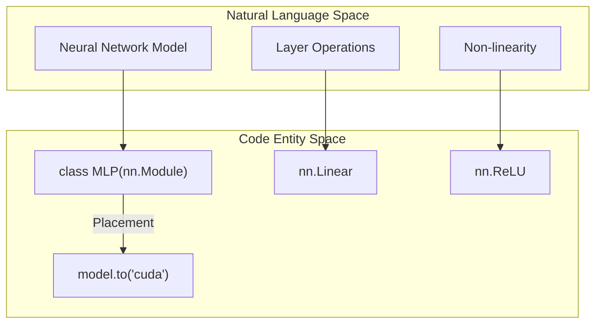
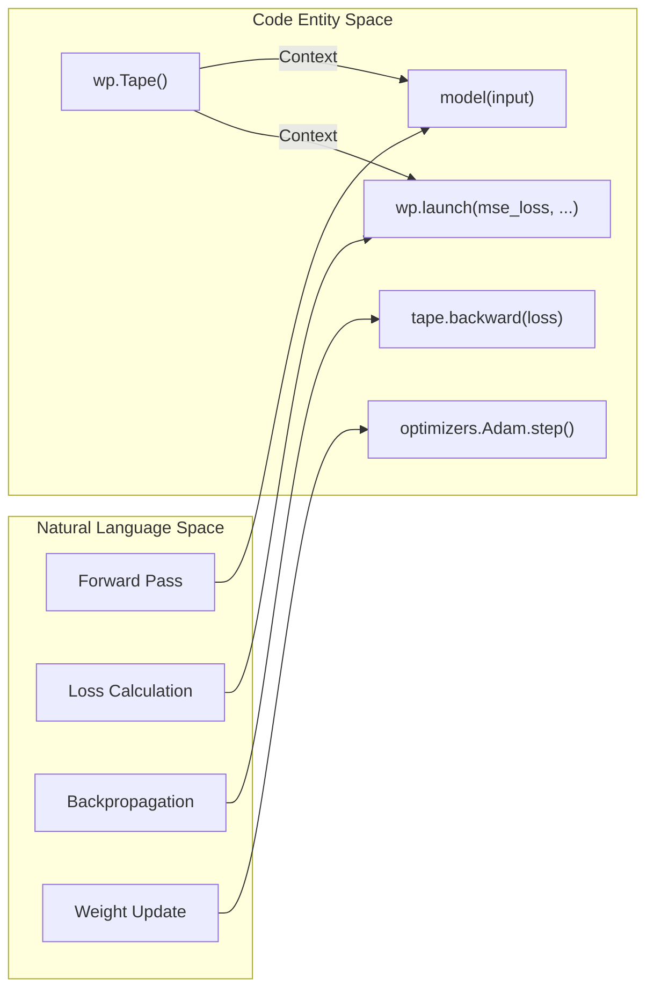

<!-- source: DeepWiki mcp.deepwiki.com · repo NVIDIA/warp-nn · page 7 Examples · fetched 2026-10-26 -->

# Examples

Relevant source files

The following files were used as context for generating this wiki page:

- [README.md](README.md)
- [docs/index.rst](docs/index.rst)
- [docs/snippets/basics.py](docs/snippets/basics.py)

The `warp-nn` library provides practical examples to demonstrate how its native Warp modules, optimizers, and kernel-based loss functions integrate into complete Physical AI workflows. These examples highlight the library's ability to run neural network components directly within CUDA-accelerated simulation pipelines.

The primary example provided is a **Variational Autoencoder (VAE)**, which showcases advanced features such as custom modules for stochastic operations and complex loss functions involving `wp.atomic_add`.

### Example Overview

The examples are designed to show the end-to-end lifecycle of a `warp-nn` model, from definition to training.

| Feature | Demonstrated In | Code Entities |
| :--- | :--- | :--- |
| **Custom Modules** | VAE | `nn.Module` [docs/snippets/basics.py:35-41](), `super().__post_init__()` [docs/snippets/basics.py:41-41]() |
| **Layer Composition** | MLP / VAE | `nn.Linear` [docs/snippets/basics.py:38-40](), `nn.ReLU` [docs/snippets/basics.py:39-39]() |
| **Loss Kernels** | Basics / VAE | `@wp.kernel` [docs/snippets/basics.py:55-55](), `wp.atomic_add` [docs/snippets/basics.py:63-63]() |
| **Training Loop** | Basics / VAE | `wp.Tape` [docs/snippets/basics.py:80-89](), `optimizer.step()` [docs/snippets/basics.py:92-92]() |

Sources: [docs/snippets/basics.py:35-94](), [README.md:8-11]()

### Conceptual to Code Mapping

The following diagrams illustrate how high-level machine learning concepts are mapped to specific `warp-nn` and `warp` code entities within the provided examples.

**Model Definition and Execution Flow**
This diagram bridges the gap between the conceptual layers and the specific classes used in `warp-nn` examples.

Sources: [docs/snippets/basics.py:35-50]()

**Differentiable Training Lifecycle**
This diagram maps the standard training loop steps to the specific `warp` and `warp-nn` API calls used in the examples.

Sources: [docs/snippets/basics.py:70-94]()

### Variational Autoencoder (VAE) on MNIST

The VAE example demonstrates a generative model architecture applied to the MNIST dataset. It serves as a comprehensive reference for:
*   Defining an **Encoder** and **Decoder** using `nn.Sequential` and `nn.Linear`.
*   Implementing a **Reparameterize** module to handle the latent space sampling.
*   Writing a custom **ELBO (Evidence Lower Bound)** loss kernel.
*   Managing the training loop with the **Adam** optimizer.

For a detailed walkthrough of the implementation and how to run it, see **[Variational Autoencoder (VAE) on MNIST](#7.1)**.

Sources: [README.md:8-10](), [docs/index.rst:4-7]()

---

