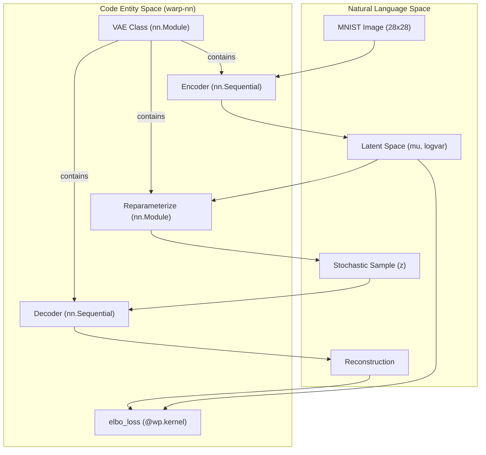
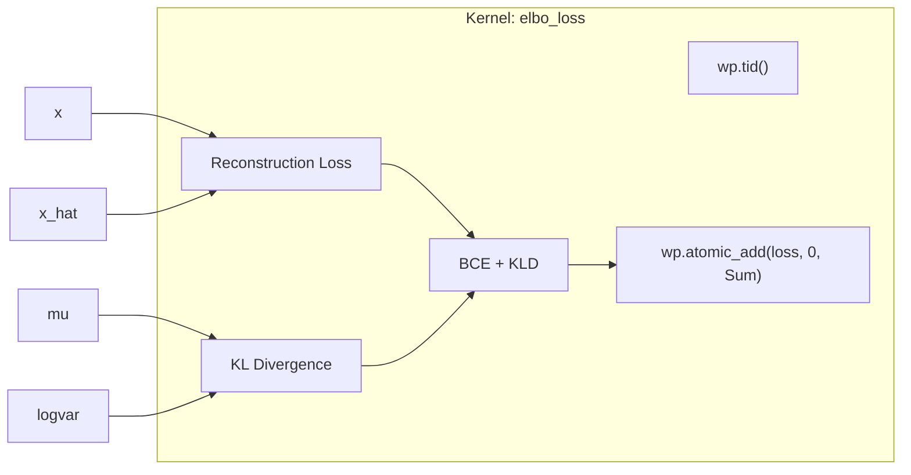

<!-- source: DeepWiki mcp.deepwiki.com · repo NVIDIA/warp-nn · page 7.1 Variational Autoencoder (VAE) on MNIST · fetched 2026-10-26 -->

# Variational Autoencoder (VAE) on MNIST

Relevant source files

The following files were used as context for generating this wiki page:

- [README.md](README.md)
- [docs/guide/basics.rst](docs/guide/basics.rst)
- [docs/index.rst](docs/index.rst)
- [docs/snippets/basics.py](docs/snippets/basics.py)

This page provides a technical walkthrough of the Variational Autoencoder (VAE) implementation located in `examples/vae/`. The example demonstrates how to build a generative model using `warp-nn` modules, implement custom reparameterization logic, and define a custom Evidence Lower Bound (ELBO) loss kernel using Warp's atomic operations.

## Architecture Overview

The VAE consists of an encoder that maps input images to a latent distribution, and a decoder that reconstructs the image from a sampled latent vector. The implementation uses standard `nn.Linear` and `nn.ReLU` layers, alongside a custom `Reparameterize` module to handle the stochastic sampling process.

### Data Flow and Code Entities

The following diagram illustrates the relationship between the natural language concepts of a VAE and the specific code entities implemented in the `examples/vae/` directory.

**VAE System Mapping**

**Sources:** `docs/guide/basics.rst:34-45` (), `docs/snippets/basics.py:34-45` ()

## Implementation Details

### The Reparameterize Module
In a VAE, the sampling step $z = \mu + \sigma \odot \epsilon$ must be differentiable. While Warp handles the autodiff via `wp.Tape`, the sampling logic is encapsulated in a custom `nn.Module`.

*   **Encoder Output**: The encoder produces two vectors: $\mu$ (mean) and $\log \sigma^2$ (log-variance).
*   **Sampling**: The module generates a random epsilon $\epsilon \sim \mathcal{N}(0, 1)$ and computes the latent vector $z$.

### VAE Model Structure
The VAE is built by subclassing `nn.Module` and calling `super().__post_init__()` to ensure all sub-modules and parameters are registered for the optimizer.

| Component | Layer Type | Configuration |
| :--- | :--- | :--- |
| **Encoder** | `nn.Linear` + `nn.ReLU` | 784 $\to$ 400 $\to$ 20 (mu) / 20 (logvar) |
| **Bottleneck** | `Reparameterize` | Custom Module |
| **Decoder** | `nn.Linear` + `nn.ReLU` | 20 $\to$ 400 $\to$ 784 |

**Sources:** `docs/guide/basics.rst:21-31` (), `docs/snippets/basics.py:34-45` ()

## Training and Loss Function

### ELBO Loss Kernel
The loss function for a VAE is the Evidence Lower Bound (ELBO), which combines a reconstruction loss (Binary Cross Entropy or MSE) and a Kullback-Leibler (KL) divergence term. In `warp-nn`, this is implemented as a `@wp.kernel`.

The kernel uses `wp.atomic_add` to accumulate the total loss across the batch into a single-element scalar array.

**ELBO Implementation Logic**

**Sources:** `docs/guide/basics.rst:42-47` (), `docs/snippets/basics.py:54-64` ()

### Training Loop
The training loop utilizes `wp.Tape` to record the forward pass and the loss kernel launch. The `Adam` optimizer then updates the model parameters.

1.  **Initialize**: Instantiate the `VAE` and `optimizers.Adam`.
2.  **Forward Pass**: Run `model(input)` inside a `wp.Tape` context.
3.  **Loss**: Launch the `elbo_loss` kernel within the same tape context.
4.  **Backward**: Call `tape.backward(loss)` to propagate gradients.
5.  **Step**: Call `optimizer.step()` to update weights.
6.  **Reset**: Call `tape.zero()` to clear gradients and recorded operations for the next iteration.

**Sources:** `docs/guide/basics.rst:64-94` (), `docs/snippets/basics.py:70-94` ()

## Running the Example

To run the MNIST VAE example, navigate to the `examples/vae/` directory and execute the script. The example typically performs the following:
1.  Downloads/Loads the MNIST dataset into `wp.array` format.
2.  Initializes the VAE model on the specified `device` (e.g., `"cuda"`).
3.  Trains for a set number of epochs, logging the ELBO loss.
4.  Generates sample images by passing random noise through the decoder.

### Interpreting Results
*   **Loss Convergence**: The ELBO loss should steadily decrease as the reconstruction improves and the latent space organizes.
*   **Reconstruction**: Visualizing the output of the decoder vs. the input image shows how well the bottleneck (latent space) captures the essential features of the digits.
*   **Manifold Traversal**: By interpolating between points in the 20-dimensional latent space, you can observe smooth transitions between different digit shapes.

**Sources:** `README.md:8-11` (), `docs/index.rst:4-7` ()

---

