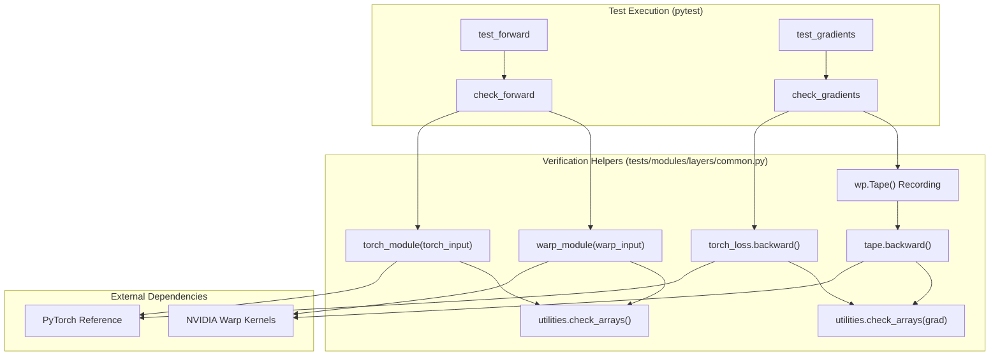
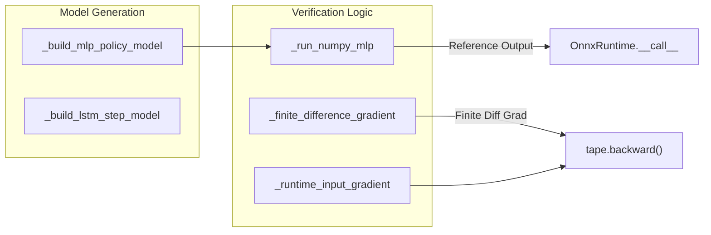

<!-- source: DeepWiki mcp.deepwiki.com · repo NVIDIA/warp-nn · page 8 Testing Infrastructure · fetched 2026-10-26 -->

# Testing Infrastructure

Relevant source files

The following files were used as context for generating this wiki page:

- [tests/modules/layers/common.py](tests/modules/layers/common.py)
- [tests/modules/layers/test_flatten.py](tests/modules/layers/test_flatten.py)
- [tests/runtime/test_onnx_runtime.py](tests/runtime/test_onnx_runtime.py)

The `warp-nn` test suite is designed to ensure mathematical correctness and performance parity with established deep learning frameworks, primarily PyTorch. The infrastructure leverages `pytest` for orchestration and `wp.Tape` for gradient verification. Testing is split between module-level functional tests, runtime validation for ONNX models, and property-based tests for initializers.

## Test Suite Layout

The test directory is organized to mirror the library structure, facilitating easy navigation between implementation and verification.

*   `tests/modules/`: Contains functional tests for layers and activations. It uses a common set of helpers to compare `warp-nn` outputs against PyTorch references.
*   `tests/runtime/`: Validates the `OnnxRuntime` by comparing inference and gradients against NumPy-based reference implementations and ONNX models.
*   `tests/initializers/`: Uses `hypothesis` for property-based testing of weight initialization distributions.
*   `tests/utilities.py`: Provides shared logic for device availability checks, array comparison, and parameter synchronization.

### Test Architecture

The following diagram illustrates how the testing infrastructure bridges the gap between `warp-nn` modules and PyTorch reference implementations.

**Test Verification Flow**

Sources: [tests/modules/layers/common.py:49-65](), [tests/modules/layers/common.py:123-160](), [tests/modules/layers/test_flatten.py:42-56]()

## Core Testing Helpers

The library utilizes standardized helpers to ensure consistency across different layer types. These helpers automate the process of moving modules to devices, synchronizing weights, and performing numerical comparisons.

| Helper | Purpose | Code Entity |
| :--- | :--- | :--- |
| **Forward Validation** | Compares `warp-nn` output vs. PyTorch given identical inputs and weights. | `check_forward` |
| **Gradient Validation** | Compares `wp.Tape` gradients vs. PyTorch autograd gradients. | `check_gradients` |
| **RNN Validation** | Specialized version of `check_forward` for stateful cells (LSTM/GRU). | `check_forward_rnn_cell` |
| **Array Comparison** | Handles `wp.array`, `torch.Tensor`, and `np.ndarray` comparisons with tolerance. | `utilities.check_arrays` |

### Gradient Verification Logic
For gradient checks, the infrastructure creates a synthetic loss by summing the output of the module. It then triggers `tape.backward()` for Warp and `loss.backward()` for PyTorch, comparing the resulting gradients on both the input arrays and the module parameters [tests/modules/layers/common.py:123-160]().

Sources: [tests/modules/layers/common.py:49-161](), [tests/runtime/test_onnx_runtime.py:30-31]()

## ONNX Runtime Testing

The `OnnxRuntime` is tested by building small, representative ONNX models (e.g., MLPs or LSTM steps) and comparing their execution against NumPy reference implementations.

**ONNX Runtime Test Entities**

Sources: [tests/runtime/test_onnx_runtime.py:44-67](), [tests/runtime/test_onnx_runtime.py:69-79](), [tests/runtime/test_onnx_runtime.py:82-103]()

## Continuous Integration (CI)

The project uses GitHub Actions to automate testing across a matrix of environments.

*   **tests.yml**: Executes the full `pytest` suite. It tests multiple versions of Python and Warp, covering both CPU and CUDA execution providers. It also handles code coverage reporting.
*   **pre-commit.yml**: Ensures code quality via `black` (formatting), `isort` (import sorting), and `codespell` (typo detection).
*   **docs.yml**: Validates that the Sphinx documentation builds correctly and deploys it to GitHub Pages.

For details, see [CI/CD Pipelines](#8.2).

## Child Pages
- [Module and Layer Tests](#8.1) — Detailed look at `check_forward`, `check_gradients`, and parametrization.
- [CI/CD Pipelines](#8.2) — Documentation of GitHub Actions workflows and coverage reporting.

---

