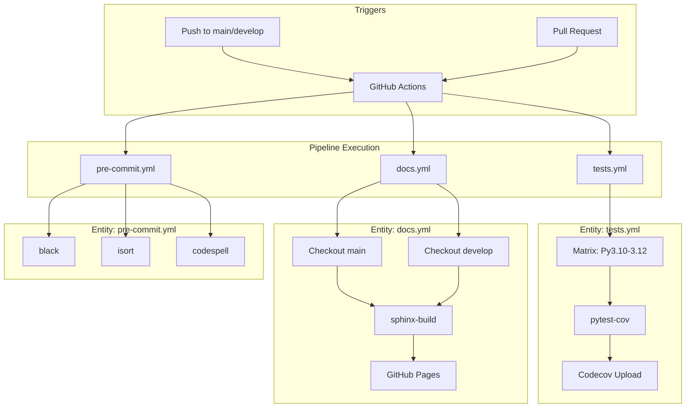
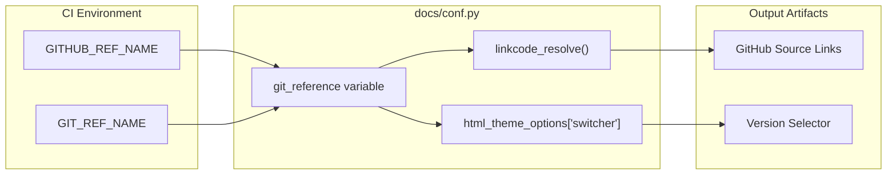

<!-- source: DeepWiki mcp.deepwiki.com · repo NVIDIA/warp-nn · page 8.2 CI/CD Pipelines · fetched 2026-10-26 -->

# CI/CD Pipelines

Relevant source files

The following files were used as context for generating this wiki page:

- [.github/workflows/docs.yml](.github/workflows/docs.yml)
- [docs/conf.py](docs/conf.py)
- [pyproject.toml](pyproject.toml)

The `warp-nn` repository utilizes GitHub Actions to automate testing, documentation deployment, and code quality enforcement. These pipelines ensure that the library remains compatible with its dependencies (specifically NVIDIA Warp), maintains high code coverage, and provides up-to-date API references for both stable and development branches.

## Workflow Overview

The CI/CD infrastructure is defined across three primary workflow files:
1.  **Tests (`tests.yml`)**: Executes the test suite across a matrix of environments and uploads coverage data.
2.  **Documentation (`docs.yml`)**: Performs a dual-branch Sphinx build to support versioned documentation on GitHub Pages.
3.  **Pre-commit (`pre-commit.yml`)**: Enforces style guidelines and static analysis using Black, isort, and codespell.

### Data Flow: Code to Deployment

The following diagram illustrates how code changes trigger different parts of the CI/CD pipeline and result in published artifacts.

**CI/CD Process Flow**

**Sources:** [.github/workflows/docs.yml:18-21](), [pyproject.toml:73-115]()

---

## Documentation Pipeline (`docs.yml`)

The documentation pipeline is designed to maintain two versions of the site: `latest` (pointing to the `main` branch) and `develop`. It utilizes `sphinx-build` to generate HTML and deploys the result to GitHub Pages.

### Implementation Details
The workflow runs on every push to `main` or `develop` [.github/workflows/docs.yml:18-21](). It performs the following steps:
1.  **Dual Checkout**: It checks out both the `main` and `develop` branches into separate directories (`checkout-main` and `checkout-develop`) [.github/workflows/docs.yml:38-47]().
2.  **Environment Setup**: Uses Python 3.12 and installs dependencies defined in the `[project.optional-dependencies] docs` section of `pyproject.toml` [.github/workflows/docs.yml:51-57](), [pyproject.toml:59-64]().
3.  **Sphinx Build**: 
    *   Builds the `main` branch documentation into `site/latest/` [.github/workflows/docs.yml:61]().
    *   Builds the `develop` branch documentation into `site/develop/` [.github/workflows/docs.yml:73]().
    *   Injects the `GIT_REF_NAME` environment variable, which `docs/conf.py` uses to resolve source code links via `linkcode_resolve` [.github/workflows/docs.yml:63](), [docs/conf.py:129-148]().
4.  **Root Assets**: Copies `switcher.json` and a root `index.html` to the site root to enable the version switcher functionality [.github/workflows/docs.yml:79-80]().
5.  **Deployment**: Uploads the `site/` directory as an artifact and triggers the `actions/deploy-pages` action [.github/workflows/docs.yml:86-104]().

**Sources:** [.github/workflows/docs.yml:29-105](), [docs/conf.py:34-39](), [pyproject.toml:59-64]()

---

## Testing Infrastructure

The testing pipeline ensures functional correctness across different Python versions and tracks code coverage.

### Requirements Matrix
The library defines its test dependencies in `pyproject.toml` under the `tests` extra [.pyproject.toml:52-58](). Key dependencies include:
*   `hypothesis`: For property-based testing of initializers.
*   `pytest-cov`: For generating coverage reports.
*   `torch`: Used as a reference for verifying forward passes and gradients.

### Coverage and Reporting
Tests are executed using `pytest`. The pipeline typically uploads coverage results to an external provider like Codecov. The project configuration in `pyproject.toml` excludes the `docs` directory from coverage and formatting checks to focus on the core `warp_nn` logic [.pyproject.toml:75-79]().

**Sources:** [pyproject.toml:52-58](), [pyproject.toml:73-79]()

---

## Linting and Formatting (`pre-commit.yml`)

The project enforces strict coding standards to maintain readability and reduce merge conflicts. These tools are configured within `pyproject.toml`.

### Tool Configuration

| Tool | Purpose | Key Configuration |
| :--- | :--- | :--- |
| **Black** | Code Formatting | `line-length = 120`, excludes `/docs` [.pyproject.toml:73-79]() |
| **isort** | Import Sorting | Profile `black`, custom sections: `FUTURE`, `ANNOTATION`, `TEST`, `STDLIB`, `THIRDPARTY`, `FRAMEWORK`, `FIRSTPARTY`, `LOCALFOLDER` [.pyproject.toml:89-112]() |
| **codespell** | Spell Checking | Skips `_static`, `_build`, and `pyproject.toml` [.pyproject.toml:82-87]() |

### Import Organization
The `isort` configuration is specifically tuned for the `warp-nn` ecosystem, separating standard libraries from frameworks like `numpy` and `warp` [.pyproject.toml:99-102]().

**Sources:** [pyproject.toml:73-115]()

---

## Integration with Documentation Configuration

The `docs/conf.py` script acts as a bridge between the CI environment and the generated documentation.

**Documentation Logic Mapping**

The `linkcode_resolve` function uses `inspect.getsourcefile` and `inspect.getsourcelines` to map Python objects to their specific lines on GitHub, ensuring that the "Source" links in the API reference always point to the correct branch based on the CI build context [docs/conf.py:129-148]().

**Sources:** [docs/conf.py:34-39](), [docs/conf.py:129-148](), [docs/conf.py:188-191]()

---

