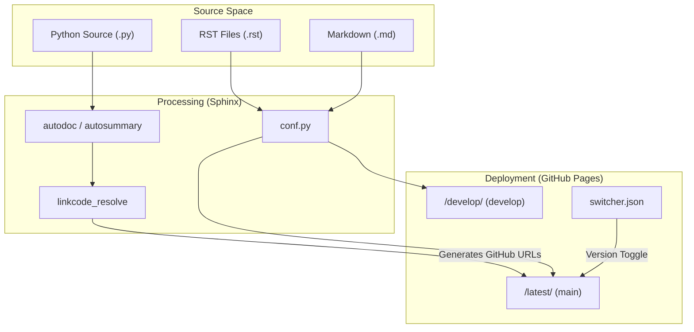
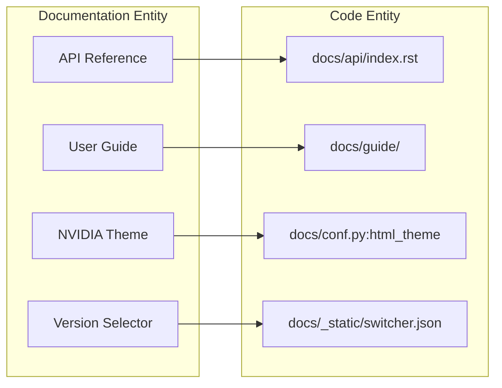

<!-- source: DeepWiki mcp.deepwiki.com · repo NVIDIA/warp-nn · page 9 Documentation Infrastructure · fetched 2026-10-26 -->

# Documentation Infrastructure

Relevant source files

The following files were used as context for generating this wiki page:

- [.github/workflows/docs.yml](.github/workflows/docs.yml)
- [docs/_static/css/custom.css](docs/_static/css/custom.css)
- [docs/_static/index.html](docs/_static/index.html)
- [docs/_static/switcher.json](docs/_static/switcher.json)
- [docs/api/index.rst](docs/api/index.rst)
- [docs/conf.py](docs/conf.py)

The documentation infrastructure for `warp-nn` is built on Sphinx, utilizing a suite of extensions to bridge Python source code with a searchable, versioned web interface. It is designed to provide high-level conceptual guides alongside detailed API references that link directly back to the GitHub source code.

## Sphinx Configuration and Extensions

The documentation behavior is governed by `docs/conf.py`, which integrates several standard and third-party Sphinx extensions to handle diverse content types [docs/conf.py:55-64]().

### Key Extensions
*   **`sphinx.ext.autodoc` & `autosummary`**: Automatically extract documentation from Python docstrings to generate API reference pages [docs/conf.py:56-57]().
*   **`myst_parser`**: Enables the use of MyST (Markedly Structured Text) for writing documentation in Markdown while maintaining compatibility with Sphinx directives [docs/conf.py:62]().
*   **`sphinx.ext.intersphinx`**: Resolves references to external projects, specifically mapping to Python, NumPy, and the core NVIDIA Warp documentation [docs/conf.py:67-71]().
*   **`sphinx.ext.linkcode`**: Provides a custom `linkcode_resolve` function that generates URLs pointing to the exact lines of code on GitHub for any documented object [docs/conf.py:129-147]().

### Source Code Link Resolution
The `linkcode_resolve` function uses the `inspect` module to find the source file and line numbers for Python objects. It then constructs a URL using the `git_reference` (determined from CI environment variables like `GITHUB_REF_NAME`) to ensure links point to the correct branch or tag [docs/conf.py:34-39, 129-147]().

## Theme and Visuals

The project uses the `nvidia_sphinx_theme`, which provides a standardized NVIDIA look and feel, including support for dark/light modes via Pygments styles `tango` and `zenburn` [docs/conf.py:73-74, 154]().

### Customization
*   **Layout**: Custom CSS in `docs/_static/css/custom.css` adjusts sidebar widths and ensures math containers handle overflow correctly [docs/_static/css/custom.css:1-21]().
*   **Version Switcher**: A `switcher.json` file defines the available documentation versions (e.g., `latest` for the `main` branch and `develop`), allowing users to toggle between them in the navigation bar [docs/_static/switcher.json:1-13]().

### Documentation Build Pipeline

Sources: [docs/conf.py:55-64](), [docs/conf.py:129-147](), [docs/_static/switcher.json:1-13](), [.github/workflows/docs.yml:59-75]()

## Deployment and Versioning

Documentation is automatically built and deployed via GitHub Actions. The workflow `docs.yml` performs a dual-branch build:
1.  **Main Branch**: Built into the `/latest/` directory [ .github/workflows/docs.yml:61]().
2.  **Develop Branch**: Built into the `/develop/` directory [ .github/workflows/docs.yml:73]().

A root `index.html` provides an immediate redirect to the `/latest/` documentation [docs/_static/index.html:5]().

### Entity Mapping: Documentation to Code
The following diagram maps documentation components to their underlying implementation files.

Sources: [docs/api/index.rst:1-12](), [docs/conf.py:154](), [docs/_static/switcher.json:1-13](), [.github/workflows/docs.yml:79-80]()

## Child Pages

For detailed information on specific documentation sub-systems, refer to the following pages:

*   **[API Reference Structure](#9.1)**: Explains the organization of `docs/api/`, including the use of `autosummary` for activations, layers, and optimizers.
*   **[User Guide and Snippets](#9.2)**: Details how the conceptual guides in `docs/guide/` are linked to executable code snippets in `docs/snippets/`.

Sources: [docs/api/index.rst:4-11](), [docs/conf.py:25-27]()

---

