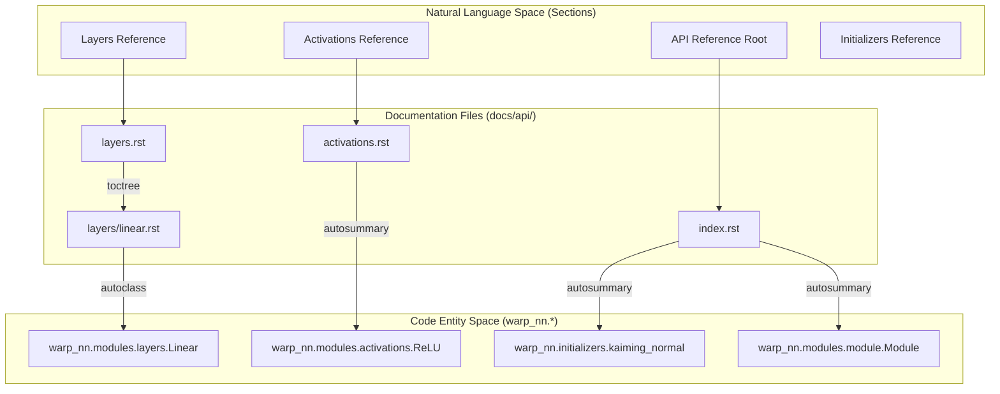
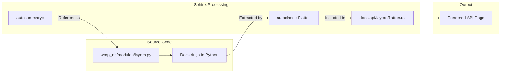

<!-- source: DeepWiki mcp.deepwiki.com · repo NVIDIA/warp-nn · page 9.1 API Reference Structure · fetched 2026-10-26 -->

# API Reference Structure

<details>
<summary>Relevant source files</summary>

The following files were used as context for generating this wiki page:

- [docs/api/index.rst](docs/api/index.rst)
- [docs/api/layers.rst](docs/api/layers.rst)
- [docs/api/layers/flatten.rst](docs/api/layers/flatten.rst)

</details>


The API reference documentation for `warp-nn` is organized to provide a clear, hierarchical view of the library's components. It leverages Sphinx's `autodoc` and `autosummary` extensions to generate documentation directly from the Python source code, ensuring that the documentation stays in sync with the implementation.

## Documentation Hierarchy

The `docs/api/` directory serves as the root for all technical API specifications. The structure follows the logical separation of neural network components: activations, initializers, layers, optimizers, and general utilities.

### Root Entry Point
The primary entry point is `docs/api/index.rst`, which provides a high-level summary of the entire library using the `autosummary` directive [docs/api/index.rst:1-80](). It groups entities into:
*   **Core Modules**: `Module` and `Parameter`.
*   **Activations**: Standard non-linearities (e.g., ReLU, Tanh).
*   **Initializers**: Weight initialization functions (e.g., Kaiming).
*   **Layers**: Structural building blocks (e.g., Linear, Conv2D).
*   **Optimizers**: Training algorithms (e.g., Adam, SGD).

### Sub-Module Organization
Each major category has its own dedicated `.rst` file in `docs/api/` (e.g., `layers.rst`, `activations.rst`) which further organizes the specific classes and functions within that sub-package [docs/api/index.rst:4-11]().

**Entity-to-File Mapping Diagram**

This diagram illustrates how Natural Language concepts (Documentation Sections) map to specific Code Entities and their corresponding documentation files.


Sources: [docs/api/index.rst:1-80](), [docs/api/layers.rst:1-47](), [docs/api/layers/flatten.rst:1-12]()

---

## Component Implementation

### 1. Layers and Modules
The layers documentation is split into a summary page (`docs/api/layers.rst`) and individual leaf pages for each layer (e.g., `docs/api/layers/linear.rst`). 

The summary page uses a `toctree` with the `:hidden:` flag to manage the sidebar navigation while using `autosummary` to present a clean table of available layers to the user [docs/api/layers.rst:17-47](). Each leaf page uses the `autoclass` directive to pull in docstrings, including special members like `__call__` and inherited members from the `Module` base class [docs/api/layers/flatten.rst:7-11]().

### 2. Activations and Initializers
These modules are typically documented directly within the `index.rst` or dedicated category pages using `autosummary` [docs/api/index.rst:28-53](). Since many activations are implemented as simple functional wrappers or classes with minimal state, they do not always require individual leaf pages unless they contain complex kernel dispatch logic.

### 3. Documentation Data Flow
The following diagram shows how source code docstrings are transformed into the final rendered wiki/HTML pages.


Sources: [docs/api/layers.rst:35-47](), [docs/api/layers/flatten.rst:1-12]()

---

## Adding Documentation for a New Module

To add a new module (e.g., a new layer `NewLayer`) to the API reference, follow these steps:

1.  **Create Leaf Page**: Create `docs/api/layers/new_layer.rst`.
    ```rst
    NewLayer
    ========

    .. autoclass:: warp_nn.modules.layers.NewLayer
        :members:
        :show-inheritance:
        :special-members: __call__
    ```
2.  **Update Category Index**: Add the new file to the `toctree` in `docs/api/layers.rst` [docs/api/layers.rst:20-29]().
3.  **Update Summary Table**: Add the class name to the `autosummary` list in both `docs/api/layers.rst` [docs/api/layers.rst:39-46]() and `docs/api/index.rst` [docs/api/index.rst:61-68]().

## Key Directives Used

| Directive | Purpose | Usage in `warp-nn` |
| :--- | :--- | :--- |
| `.. autosummary::` | Generates a table of functions/classes with brief descriptions. | Used in `index.rst` for a quick overview of all modules [docs/api/index.rst:19](). |
| `.. autoclass::` | Document a class, including its methods and attributes. | Used in leaf files like `flatten.rst` to provide full technical detail [docs/api/layers/flatten.rst:7](). |
| `.. currentmodule::` | Sets the Python module prefix for subsequent directives. | Used to avoid repeating `warp_nn.modules.layers` for every entry [docs/api/layers.rst:35](). |
| `:nosignatures: ` | Removes the full path/arguments from the summary table. | Used in `index.rst` to keep the summary tables clean and readable [docs/api/index.rst:20](). |

Sources: [docs/api/index.rst:1-80](), [docs/api/layers.rst:1-47](), [docs/api/layers/flatten.rst:1-12]()

---

