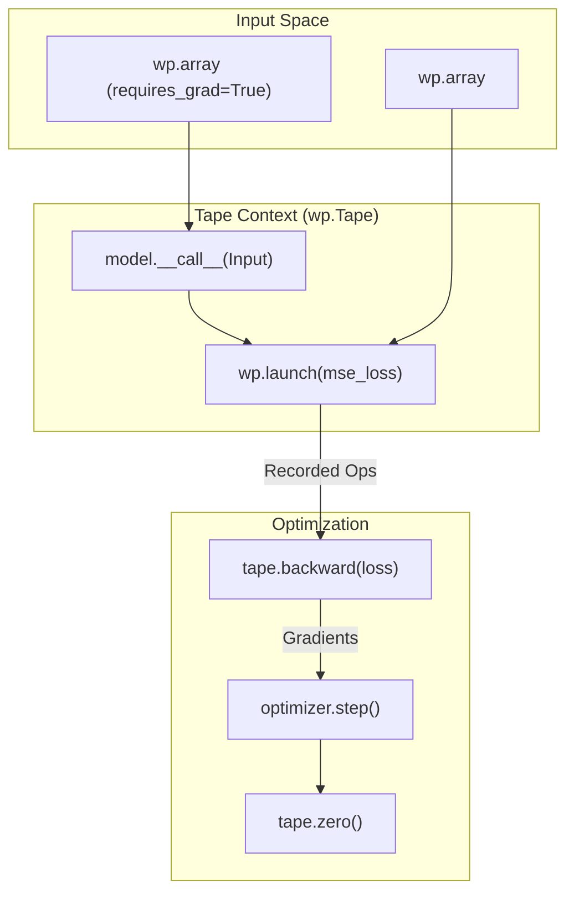
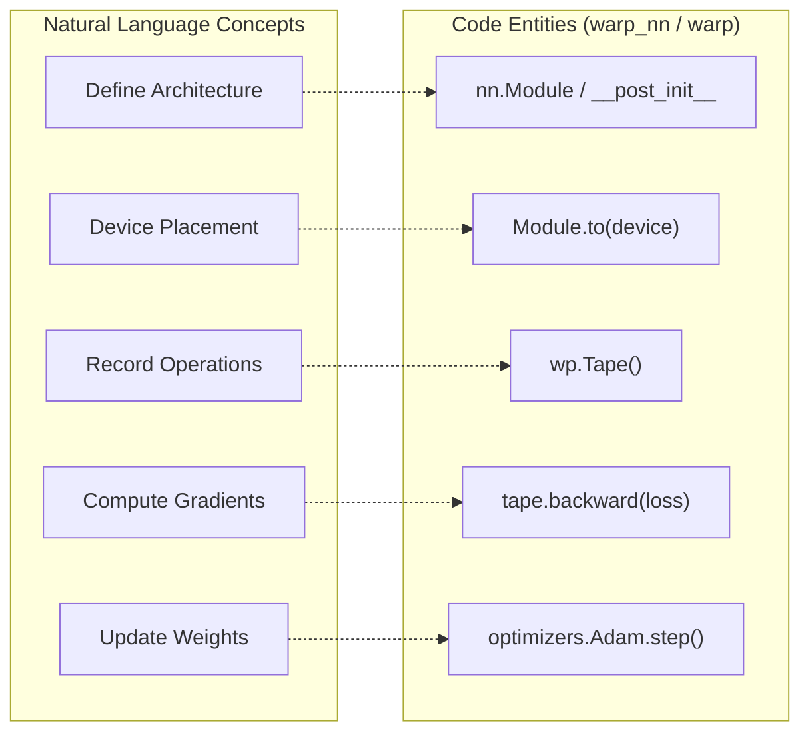

<!-- source: DeepWiki mcp.deepwiki.com · repo NVIDIA/warp-nn · page 9.2 User Guide and Snippets · fetched 2026-10-26 -->

# User Guide and Snippets

Relevant source files

The following files were used as context for generating this wiki page:

- [docs/guide/basics.rst](docs/guide/basics.rst)
- [docs/snippets/basics.py](docs/snippets/basics.py)

This page details the structural organization of the `warp-nn` user guide and provides a technical breakdown of the annotated training loop snippets. It covers how to define models, implement loss functions, and manage the autodiff lifecycle using NVIDIA Warp's `wp.Tape`.

## Guide Structure and Documentation Flow

The documentation for `warp-nn` is organized into a progressive learning path located in `docs/guide/`. The primary entry point is the "Basics" guide, which transitions from high-level model definition to low-level kernel execution and optimization [docs/guide/basics.rst:1-6]().

The guide follows a specific sequence:
1.  **Model Definition**: Subclassing `nn.Module` and managing parameter registration.
2.  **Loss Function Implementation**: Defining Warp kernels for scalar objective functions.
3.  **Differentiation Lifecycle**: Managing `wp.Tape` contexts for recording and backpropagation.
4.  **Optimization**: Applying updates to model parameters using captured gradients.

### Adding New Guide Pages
New guide pages are added as `.rst` files in `docs/guide/`. To maintain consistency, code examples should not be written inline within the RST files. Instead, they should be implemented in `docs/snippets/` and referenced using the `.. literalinclude::` directive with `start-after` and `end-before` markers [docs/guide/basics.rst:17-21]().

---

## Annotated Training Lifecycle

The core of the `warp-nn` workflow is demonstrated in `docs/snippets/basics.py`. This snippet serves as the reference implementation for a standard training loop.

### 1. Model Definition and Registration
Models are defined by subclassing `warp_nn.modules.module.Module`. A critical requirement is the invocation of `super().__post_init__()` at the end of the `__init__` method. This call triggers the automatic registration of all `Module` and `Parameter` attributes assigned to the instance [docs/guide/basics.rst:24-27](), [docs/snippets/basics.py:35-41]().

### 2. Loss Function as a Warp Kernel
Unlike frameworks that rely on built-in loss objects, `warp-nn` encourages defining loss functions as standard Warp kernels. This allows for high-performance, parallelized reduction directly on the GPU.

In the provided snippet, the `mse_loss` kernel uses `wp.atomic_add` to accumulate the squared difference into a single-element array [docs/snippets/basics.py:55-64](). The target loss array must be initialized with `requires_grad=True` to allow `wp.Tape` to propagate gradients from the loss back to the model parameters [docs/guide/basics.rst:42-43](), [docs/snippets/basics.py:68]().

### 3. The Forward-Backward-Step Cycle
The training loop utilizes `wp.Tape` to record operations. The interaction between the model, the tape, and the optimizer is illustrated below:

**Training Data Flow**

**Sources:** [docs/snippets/basics.py:75-94](), [docs/guide/basics.rst:72-86]()

---

## Technical Implementation Details

### Mapping Natural Language to Code Entities

The following diagram bridges the conceptual steps of training to the specific code entities used in `warp-nn`.

**Code Entity Mapping**

**Sources:** [docs/snippets/basics.py:35-94](), [docs/guide/basics.rst:21-86]()

### Key Functions and Lifecycle Methods

| Lifecycle Phase | Code Reference | Description |
| :--- | :--- | :--- |
| **Registration** | `__post_init__` | Automatically collects all `nn.Parameter` and `nn.Module` attributes into the internal tracking structures [docs/snippets/basics.py:41](). |
| **Placement** | `model.to(device)` | Recursively moves all parameters and sub-module buffers to the specified Warp device [docs/snippets/basics.py:50](). |
| **Recording** | `with wp.Tape()` | Captures kernel launches (e.g., `nn.Linear` internal kernels and custom loss kernels) for later differentiation [docs/snippets/basics.py:80-89](). |
| **Backpropagation** | `tape.backward(loss)` | Traverses the recorded operation stack in reverse to compute gradients for all parameters with `requires_grad=True` [docs/snippets/basics.py:91](). |
| **Cleanup** | `tape.zero()` | Resets the tape's operation stack and zeros out all accumulated gradients in the parameters [docs/snippets/basics.py:93](). |

### Kernel Dispatch in the Training Loop
The training loop explicitly launches the loss kernel using `wp.launch`. This allows the user to specify the execution dimension (`dim`), which in the MSE example corresponds to the shape of the prediction array [docs/snippets/basics.py:82-88]().

**Sources:**
- `docs/guide/basics.rst` [1-87]()
- `docs/snippets/basics.py` [1-95]()

---

