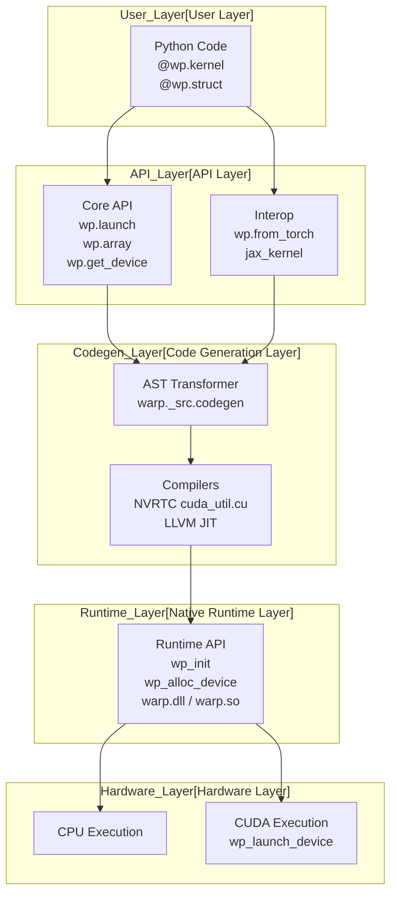
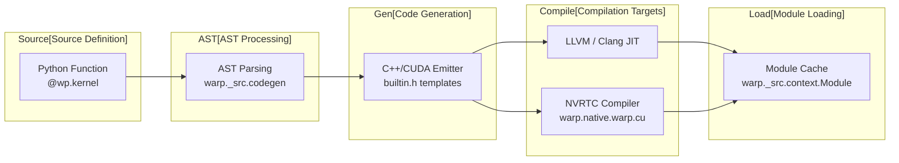

<!-- source: DeepWiki mcp.deepwiki.com · repo NVIDIA/warp · page 1 Overview · fetched 2026-10-26 -->

# Overview

Relevant source files

The following files were used as context for generating this wiki page:

- [PUBLICATIONS.md](PUBLICATIONS.md)
- [README.md](README.md)
- [docs/api_reference/warp.rst](docs/api_reference/warp.rst)
- [docs/index.rst](docs/index.rst)
- [warp/__init__.py](warp/__init__.py)
- [warp/native/cuda_util.cpp](warp/native/cuda_util.cpp)
- [warp/native/cuda_util.h](warp/native/cuda_util.h)
- [warp/native/warp.cpp](warp/native/warp.cpp)
- [warp/native/warp.cu](warp/native/warp.cu)
- [warp/native/warp.h](warp/native/warp.h)
- [warp/tests/test_examples.py](warp/tests/test_examples.py)

## Purpose and Scope

This document introduces NVIDIA Warp, a Python framework for high-performance GPU-accelerated simulation, robotics, and machine learning [README.md:12-14](). Warp compiles regular Python functions into efficient kernel code at runtime via Just-In-Time (JIT) compilation, executing seamlessly on CPUs or NVIDIA CUDA GPUs [README.md:12-14]().

For detailed instructions and deep-dives into foundational topics, refer to the child pages:
- **Installation and Setup**: For installation via `pip`, optional dependencies, and platform-specific configuration, see [Installation and Setup](#1.1).
- **Basic Concepts**: For core abstractions including `@wp.kernel`, `wp.array`, `wp.Device`, and the compilation model, see [Basic Concepts](#1.2).
- **Quickstart Guide**: For minimal working examples, array creation, and kernel launching, see [Quickstart Guide](#1.3).

Sources: [README.md:12-14](), [docs/index.rst:4-9]()

## What is Warp?

Warp is designed to bridge the gap between high-level Python prototyping and low-level GPU performance. By taking decorated functions (`@wp.kernel`, `@wp.func`) [warp/__init__.py:5-7](), Warp inspects the Python Abstract Syntax Tree (AST), infers types [warp/_src/codegen.py:188-192](), generates optimized C++/CUDA code [warp/_src/codegen.py:39-58](), and compiles it using LLVM or NVRTC [warp/config.py:164-174]().

### Core Capabilities
- **Spatial Computing Primitives**: Built-in support for vectors (`vec2`, `vec3`, `vec4`), matrices (`mat22`, `mat33`, `mat44`), quaternions (`quat`), transformations (`transform`), and spatial acceleration structures (`Bvh`, `Mesh`, `Volume`, `HashGrid`) [docs/api_reference/warp.rst:76-236]().
- **Automatic Differentiation**: Forward and backward mode gradient recording via `wp.Tape` for gradient-based optimization and physics simulation [warp/_src/tape.py:121]().
- **Multi-Device Execution**: Unified memory model and explicit device targeting across CPU and CUDA devices (`wp.Device`, `wp.get_device()`) [warp/_src/context.py:122]().
- **Framework Interoperability**: Zero-copy data exchange with PyTorch (`wp.from_torch`), JAX (`jax_kernel`), NumPy, and CuPy via DLPack and CUDA array interfaces [warp/tests/unittest_suites.py:132-134]().

Sources: [README.md:12-17](), [docs/api_reference/warp.rst:76-236](), [warp/_src/tape.py:121]()

## System Architecture

### Layered Design
Warp is structured into distinct functional layers, bridging high-level Python user code down to hardware primitives.

Diagram: Architecture Layer Mapping to Code Entities

| Layer | Code Entities / Components | Role |
|-------|---------------------------|------|
| **User** | `@wp.kernel`, `@wp.func`, `@wp.struct` [warp/__init__.py:5-7]() | User-facing kernel and data structure declarations |
| **API** | `wp.launch()`, `wp.array()`, `wp.Device` [docs/api_reference/warp.rst:184-327]() | High-level orchestration, memory allocation, and device context |
| **Codegen** | `warp._src.codegen`, NVRTC, LLVM [warp/_src/codegen.py:1-50](), [warp/config.py:164-174]() | Source-to-source translation and JIT compilation |
| **Runtime** | `wp_init()`, `wp_alloc_device()`, `warp.native` [warp/native/warp.h:42-74]() | Native execution engine, memory management, and primitive operations |
| **Hardware** | CPU thread pools, CUDA streams/kernels [warp/native/cuda_util.h:23-44]() | Execution on physical compute devices |

Sources: [warp/_src/context.py:1-115](), [warp/_src/codegen.py:1-90](), [warp/native/warp.h:42-74]()

### Compilation Pipeline
The compilation pipeline translates Python functions into native machine code or PTX.

Diagram: Compilation Pipeline Mapping

| Stage | Key Components | Description |
|-------|                |-------------|
| **Parsing** | `warp._src.codegen` [warp/_src/codegen.py:188-192]() | Inspects Python AST and performs type inference. |
| **Code Generation** | `builtin.h` [warp/native/builtin.h:1-20]() | Emits corresponding C++ or CUDA source strings. |
| **Compilation** | NVRTC [warp/native/warp.cu:39](), LLVM [warp/config.py:164-174]() | Compiles generated code into PTX or object files. |
| **Caching & Loading** | `warp._src.context.Module` | Caches compiled libraries to disk for fast subsequent loads. |

Sources: [warp/_src/codegen.py:1-200](), [warp/config.py:153-174](), [warp/native/warp.cu:39]()

### Runtime Execution Model
Warp manages execution boundaries between Python hosts and target devices (`wp.Device`).

- **Native Library Entrypoints**: Core runtime functions are exposed via `wp_init()` and executed through compiled dynamic libraries (`warp.dll` or `warp.so`) [warp/native/warp.h:42-74]().
- **Kernel Dispatch**: `wp.launch()` marshals array parameters and dispatches execution to CPU threads or CUDA streams [warp/_src/context.py:115-118]().
- **Asynchronous Execution**: Supports CUDA streams (`wp.Stream`), events (`wp.Event`), and CUDA graph capture (`wp.capture_begin`) [warp/native/cuda_util.h:23-44]().

Sources: [warp/_src/context.py:1-140](), [warp/native/warp.h:42-74]()

## Type System

Warp provides a rich type system tailored for numerical simulation and spatial computing [docs/api_reference/warp.rst:44-236]().

- **Scalars**: `int8`-`int64`, `uint8`-`uint64`, `float16`, `bfloat16`, `float32`, `float64`, `bool` [docs/api_reference/warp.rst:54-67]().
- **Vectors & Matrices**: Fixed-size linear algebra types including `vec2`/`vec3`/`vec4`, `mat22`/`mat33`/`mat44`, and quaternions `quat` [docs/api_reference/warp.rst:76-146]().
- **Arrays**: Multi-dimensional memory containers (`wp.array`, `wp.array1d`, `wp.array2d`, `wp.array3d`, `wp.array4d`) supporting strides and device placement [docs/api_reference/warp.rst:184-203]().
- **Structures**: Custom data aggregations defined via `@wp.struct` [docs/api_reference/warp.rst:291]().

Sources: [warp/_src/types.py:1-260](), [docs/api_reference/warp.rst:44-236]()

## Kernel Programming Model

Kernels represent parallel computation workloads defined in Python and executed across index spaces [README.md:12-14]().

- **Kernel Definition**: Decorated with `@wp.kernel`, using `wp.tid()` to retrieve the unique thread index [README.md:35-38]().
- **Kernel Launch**: Executed via `wp.launch(kernel, dim, inputs)` or block-level tiled execution via `wp.launch_tiled()` [README.md:51](), [docs/api_reference/warp.rst:307-308]().

Sources: [README.md:28-52](), [docs/api_reference/warp.rst:282-308]()

## Key Features

- **Automatic Differentiation**: `wp.Tape` records kernel executions to generate backward-pass gradients automatically [warp/_src/tape.py:121](), [docs/api_reference/warp.rst:318]().
- **Tile-Based Computing**: Block-level register and shared memory optimizations via `wp.launch_tiled()` and tile primitives (`tile_load`, `tile_matmul`) [warp/native/tile.h:74-142](), [docs/api_reference/warp.rst:190-191]().
- **Framework Bridges**: Zero-copy interoperation with PyTorch and JAX [warp/tests/unittest_suites.py:132-134]().

Sources: [warp/_src/tape.py:121](), [warp/native/tile.h:74-142](), [warp/tests/unittest_suites.py:132-134]()

## Next Steps

To dive deeper into specific components, proceed to the child documentation pages:
- Installation: See [Installation and Setup](#1.1).
- Core Concepts: See [Basic Concepts](#1.2).
- Quickstart Guide: See [Quickstart Guide](#1.3).

Sources: [docs/index.rst:1-150](), [README.md:1-100]()

---

