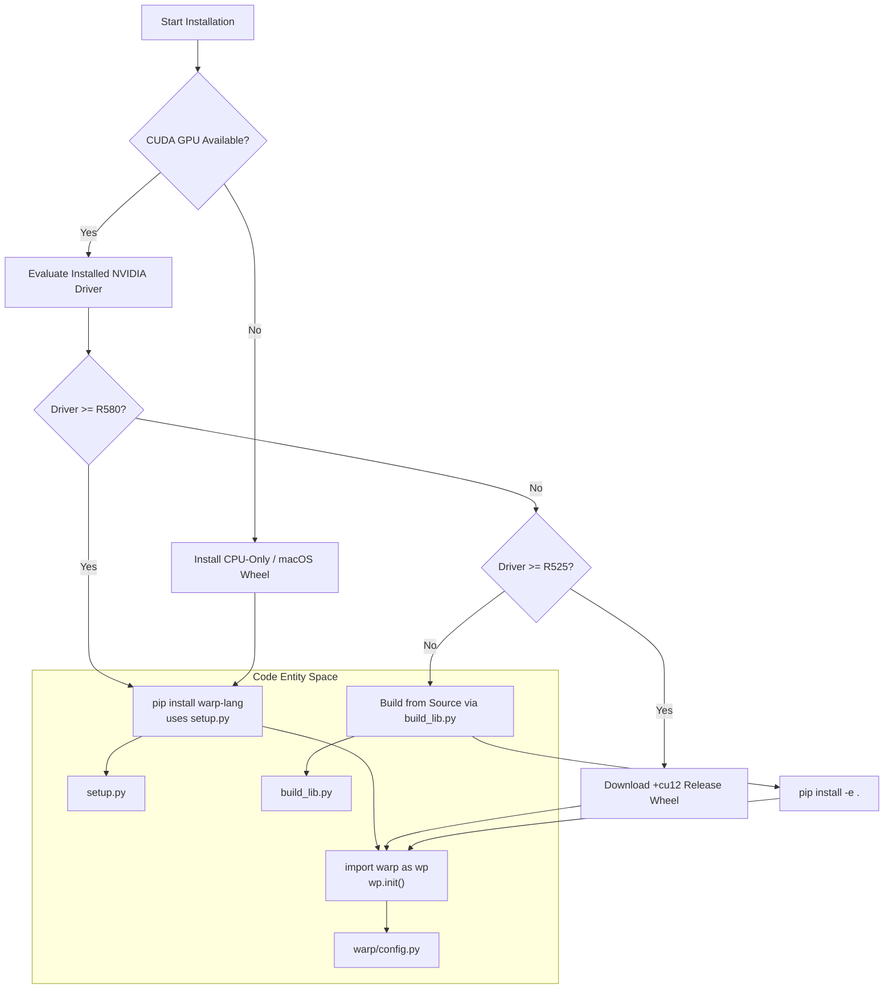
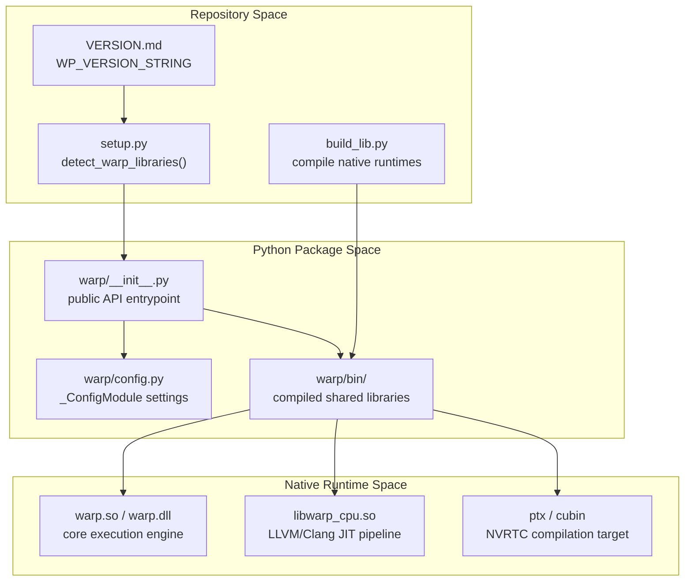

<!-- source: DeepWiki mcp.deepwiki.com · repo NVIDIA/warp · page 1.1 Installation and Setup · fetched 2026-10-26 -->

# Installation and Setup

<details>
<summary>Relevant source files</summary>

The following files were used as context for generating this wiki page:

- [VERSION.md](VERSION.md)
- [changelog/2078.fixed.md](changelog/2078.fixed.md)
- [docs/conf.py](docs/conf.py)
- [docs/user_guide/basics.rst](docs/user_guide/basics.rst)
- [docs/user_guide/compatibility.rst](docs/user_guide/compatibility.rst)
- [docs/user_guide/debugging.rst](docs/user_guide/debugging.rst)
- [docs/user_guide/faq.rst](docs/user_guide/faq.rst)
- [docs/user_guide/installation.rst](docs/user_guide/installation.rst)
- [docs/user_guide/limitations.rst](docs/user_guide/limitations.rst)
- [setup.py](setup.py)
- [warp/_src/coloring.py](warp/_src/coloring.py)
- [warp/config.py](warp/config.py)
- [warp/examples/optim/example_fluid_checkpoint.py](warp/examples/optim/example_fluid_checkpoint.py)
- [warp/examples/optim/example_fluid_checkpoint_custom_backward.py](warp/examples/optim/example_fluid_checkpoint_custom_backward.py)
- [warp/native/coloring.cpp](warp/native/coloring.cpp)
- [warp/native/version.h](warp/native/version.h)
- [warp/tests/test_coloring.py](warp/tests/test_coloring.py)

</details>


## Purpose and Scope

This document provides a comprehensive guide to installing NVIDIA Warp (`warp-lang`), covering standard PyPI installations, nightly builds, Conda packages, and building from source. It details system requirements, the platform compatibility matrix, runtime GPU/driver constraints, package dependencies, and global environment setup via `warp.config` [warp/config.py:4-15](), [docs/user_guide/installation.rst:1-12](), [docs/user_guide/compatibility.rst:10-21]().

---

## Quick Installation & Package Variants

The simplest way to install Warp is by fetching pre-built binaries from PyPI [docs/user_guide/installation.rst:13-17]():

```bash
pip install warp-lang
```

### Nightly Builds

Nightly builds from the `main` branch are published on the NVIDIA Package Index [docs/user_guide/installation.rst:21-25]():

```bash
pip install -U --pre warp-lang --extra-index-url=https://pypi.nvidia.com/
```

To configure `pip` permanently for nightly packages, set the environment variable [docs/user_guide/installation.rst:35-40]():

```bash
export PIP_EXTRA_INDEX_URL="https://pypi.nvidia.com"
```

### Conda Installation

Conda packages are available via `conda-forge` [docs/user_guide/installation.rst:44-48]():

```bash
conda install conda-forge::warp-lang
```

Variants like CPU-only or specific CUDA toolkits can be selected using build string filters [docs/user_guide/installation.rst:54-62]():

```bash
# CPU-only variant
conda install conda-forge::warp-lang=*=*cpu*

# CUDA 12.9 variant
conda install conda-forge::warp-lang=*=*cuda129*
```

Sources: [docs/user_guide/installation.rst:1-66]()

---

## Platform Compatibility and Runtime Requirements

Warp requires **Python 3.10 or newer** [docs/user_guide/installation.rst:4](), [docs/user_guide/compatibility.rst:49](). The table below summarizes platform support:

| Operating System | Architecture | Platform / Device | Platform Support | Accelerator Support |
|------------------|--------------|-------------------|------------------|---------------------|
| **Windows** 10/11 | `x86-64` | PC | Supported ✅ | CUDA [docs/user_guide/compatibility.rst:28]() |
| **Windows** 11 | `arm64` | PC | Experimental | CUDA 13.4+ [docs/user_guide/compatibility.rst:30]() |
| **Linux** | `x86-64` | PC / Server | Supported ✅ | CUDA [docs/user_guide/compatibility.rst:32]() |
| **Linux** | `aarch64` | Jetson / Server | Supported ✅ | CUDA [docs/user_guide/compatibility.rst:34]() |
| **macOS** | `arm64` | Apple Silicon | Supported ✅ | CPU Only [docs/user_guide/compatibility.rst:36]() |
| **macOS** | `x86-64` | Intel Mac | Discontinued | None [docs/user_guide/compatibility.rst:38]() |

### GPU Compute Capability and Driver Requirements

- **Default PyPI and Nightly Wheels:** Built with CUDA Toolkit 13.4. They require an NVIDIA **R580-series or newer driver** and a **Turing (`sm_75`) or newer GPU** [docs/user_guide/installation.rst:8-9](), [docs/user_guide/compatibility.rst:60-62]().
- **CUDA 12 Wheels (`+cu12`):** Available via GitHub Releases or source builds; require an NVIDIA **R525-series or newer driver** and a **Maxwell (`sm_52`) or newer GPU** [docs/user_guide/installation.rst:10-11](), [docs/user_guide/compatibility.rst:62-75]().

Sources: [docs/user_guide/installation.rst:4-11](), [docs/user_guide/compatibility.rst:16-95]()

---

## Installation Flow Decision Tree

The following diagram maps high-level installation pathways to the underlying code configuration modules (`setup.py`, `build_lib.py`, and runtime loader scripts):



Sources: [setup.py:25-42](), [build_lib.py:1-21](), [warp/config.py:4-15](), [docs/user_guide/installation.rst:1-12]()

---

## Package Dependencies

- **NumPy:** Mandatory for all array creation and interop [docs/user_guide/installation.rst:151]().
- **Optional Extras:**
  - `usd-core` / `usd-exchange`: Required for `wp.render.UsdRenderer`.
  - `pyglet`: Required for `wp.render.OpenGLRenderer`.
  - `jax` / `torch` / `paddle`: Required for zero-copy array interoperability and automatic differentiation bridging.

Sources: [docs/user_guide/installation.rst:146-152](), [docs/user_guide/compatibility.rst:49-52]()

---

## Package Structure and Binary Layout

Warp packages compiled artifacts and Python scripts into a structured module layout:



Sources: [setup.py:80-108](), [warp/config.py:25-38](), [warp/native/version.h:4-9]()

---

## Building From Source

To build Warp from source, ensure your environment satisfies the toolchain requirements:
- **Compilers:** MSVC 2019+ (Windows), GCC 9.4+ (Linux), Xcode Command Line Tools (macOS) [docs/user_guide/compatibility.rst:101-106]().
- **Core Tools:** Python 3.10+, Git LFS, NumPy [docs/user_guide/compatibility.rst:107-112]().
- **CUDA Toolkit:** Minimum 12.0 (13.4 for Windows on Arm) [docs/user_guide/compatibility.rst:115-118]().

Run the build script and perform an editable install [docs/user_guide/compatibility.rst:129-132]():

```bash
python build_lib.py
pip install -e .
```

Sources: [docs/user_guide/compatibility.rst:96-136]()

---

## Initial Configuration Through `warp.config`

The global settings governing execution behavior are housed in `warp.config` [warp/config.py:4-15]():

- `version`: Exposes the version string [warp/config.py:86-87]().
- `mode`: Controls kernel compilation mode (`"release"` or `"debug"`) [warp/config.py:117-126]().
- `optimization_level`: Sets optimization thresholds (0-3 or `None`) [warp/config.py:128-138]().
- `verify_cuda`: Toggles post-launch CUDA error checking [warp/config.py:97-103]().
- `launch_array_access_mode`: Verifies cross-device array arguments (`RELAXED`, `CHECKED`, `STRICT`) [warp/config.py:40-83]().
- `deterministic`: Controls deterministic execution behavior for atomics [warp/config.py:53-64]().

Sources: [warp/config.py:4-187]()

---

## Troubleshooting

### Insufficient CUDA Driver Warnings

If Warp detects an incompatible driver version during initialization, it logs a warning [docs/user_guide/installation.rst:111-120]():
```text
Warp UserWarning:
   Insufficient CUDA driver version.
   The minimum required CUDA driver version is 13.0, but the installed CUDA driver version is 12.9.
```
To resolve this, update the driver, install a matching `+cu12` wheel, or build from source against the active toolkit [docs/user_guide/installation.rst:122-127]().

Sources: [docs/user_guide/installation.rst:91-128]()

---

