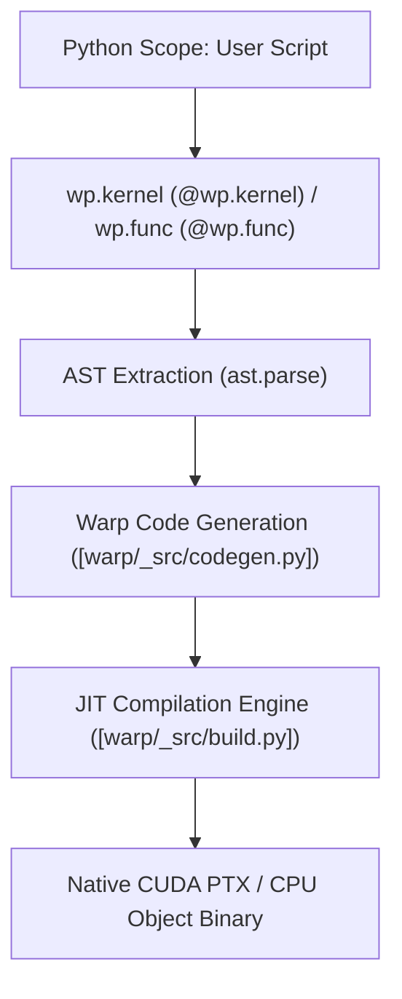
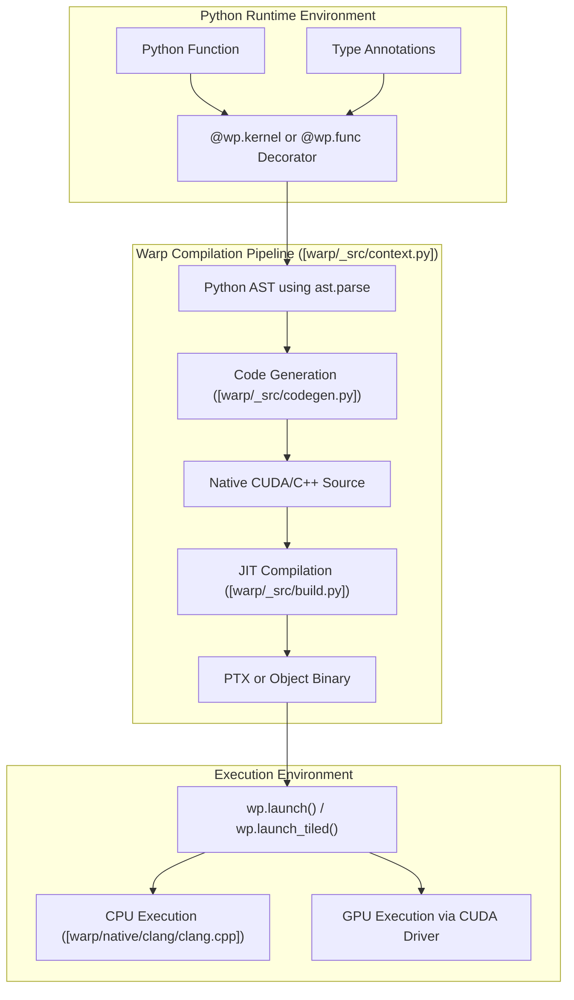
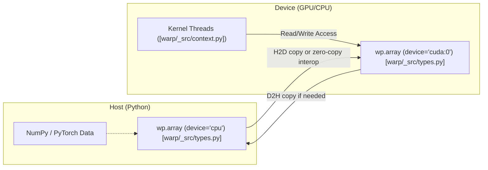

<!-- source: DeepWiki mcp.deepwiki.com · repo NVIDIA/warp · page 1.2 Basic Concepts · fetched 2026-10-26 -->

# Basic Concepts

<details>
<summary>Relevant source files</summary>

The following files were used as context for generating this wiki page:

- [CHANGELOG.md](CHANGELOG.md)
- [docs/language_reference/builtins.rst](docs/language_reference/builtins.rst)
- [docs/user_guide/basics.rst](docs/user_guide/basics.rst)
- [docs/user_guide/compatibility.rst](docs/user_guide/compatibility.rst)
- [docs/user_guide/debugging.rst](docs/user_guide/debugging.rst)
- [docs/user_guide/faq.rst](docs/user_guide/faq.rst)
- [docs/user_guide/installation.rst](docs/user_guide/installation.rst)
- [docs/user_guide/limitations.rst](docs/user_guide/limitations.rst)
- [warp/__init__.pyi](warp/__init__.pyi)
- [warp/_src/builtins.py](warp/_src/builtins.py)
- [warp/_src/codegen.py](warp/_src/codegen.py)
- [warp/_src/context.py](warp/_src/context.py)
- [warp/_src/types.py](warp/_src/types.py)
- [warp/examples/optim/example_fluid_checkpoint.py](warp/examples/optim/example_fluid_checkpoint.py)
- [warp/examples/optim/example_fluid_checkpoint_custom_backward.py](warp/examples/optim/example_fluid_checkpoint_custom_backward.py)
- [warp/native/tile.h](warp/native/tile.h)
- [warp/tests/test_conditional.py](warp/tests/test_conditional.py)
- [warp/tests/unittest_suites.py](warp/tests/unittest_suites.py)

</details>


This page introduces the fundamental concepts of Warp, including kernels, arrays, devices, and the compilation model. These building blocks allow Warp to provide a powerful, high-performance parallel programming environment for GPU-accelerated simulation and graphics.

---

## Programming Model

Warp adopts a kernel-based parallel programming model. Users write compute kernels in Python, decorated with Warp-specific decorators, which Warp JIT compiles into highly optimized native code (CUDA or CPU). The kernels execute on data residing on specific devices with explicit memory management support.

### Kernels and Functions

- **Kernels**: Entry points for parallel computation, decorated with `@wp.kernel` (`[warp/_src/context.py]()`). Kernels run multiple threads specified at launch and do not return values — results are communicated via output arguments (arrays or references) (`[warp/_src/context.py:78-81]()`).
- **Functions**: Reusable, strongly typed subroutines called from kernels or other functions, decorated with `@wp.func` (`[warp/_src/context.py]()`). Functions can return values and support overloading and generics.

The decorator transforms the Python function's AST and triggers code generation and JIT compilation. Kernels rely on an implicit thread index accessible via `wp.tid()` to identify their current work item.

```python
@wp.kernel
def example_kernel(a: wp.array[int]):
    i = wp.tid()  # Get thread index
    a[i] = a[i] * 2
```

Kernels and functions require complete type annotations for all arguments. Kernels must not return values; output is passed by argument references (`[warp/_src/context.py:78-81]()`, `[warp/_src/context.py:141-148]()`).

Diagram: Kernel Definition to Code Generation Pipeline

Sources: `[warp/_src/context.py:75-148]()`, `[warp/_src/codegen.py:1-100]()`, `[warp/_src/build.py:1-50]()`

### Host and Kernel Execution Boundary

Warp separates the host (Python execution environment) from kernel execution. Python code runs on the host, while kernels and functions execute on targeted devices like CPU or CUDA GPU.

The host creates and manages arrays, compiles kernels on demand via a JIT compilation pipeline, and launches kernels asynchronously. Data transfer between host and device arrays is explicit or implicit under device-aware array references (`[warp/_src/context.py:89-95]()`).

### Warp JIT Compilation Workflow

Warp compiles kernels at runtime using a multi-stage JIT compilation pipeline:

1. **Python AST Extraction**: Warp parses the Python function decorated as a kernel/func into an AST (`[warp/_src/codegen.py]()`).
2. **Code Generation**: The AST is transformed into Warp’s intermediate representation and native CUDA or C++ source code is generated (`[warp/_src/codegen.py]()`).
3. **Native Compilation**: The native code is compiled using NVRTC (for CUDA) or Clang/LLVM (for CPU), producing binary (PTX or object files) (`[warp/_src/build.py]()`).
4. **Module Caching and Linking**: Binary modules are cached to avoid recompilation and linked with Warp's runtime (`[warp/_src/context.py]()`).
5. **Kernel Launch**: The compiled kernel module is launched on the selected device with the provided parameters (`[warp/_src/context.py:119-120]()`).

Diagram: JIT Compilation Workflow Architecture

Sources: `[warp/_src/context.py:692-738]()`, `[warp/_src/codegen.py:1-100]`, `[warp/_src/build.py:1-50]()`

---

## Types and Arrays

Warp utilizes a strong, explicit type system for efficient native code generation, consisting of scalar types, vector and matrix types, arrays, and structs (`[warp/_src/types.py:61-120]()`).

### Scalar Types

Warp provides primitive scalar types mapping directly to native C/C++/CUDA types (`[warp/_src/types.py]()`). These include:

| Warp Type          | Native Mapping    | Size (bytes) |
|--------------------|-------------------|--------------|
| `wp.bool`          | `ctypes.c_bool`   | 1            |
| `wp.int8` / `uint8`| `int8_t`/`uint8_t`| 1            |
| `wp.int16`/`uint16`| `int16_t`/`uint16_t`| 2          |
| `wp.int32`/`uint32`| `int32_t`/`uint32_t`| 4          |
| `wp.int64`/`uint64`| `int64_t`/`uint64_t`| 8          |
| `wp.float16`       | `half` (FP16)     | 2            |
| `wp.bfloat16`      | `bfloat16`        | 2            |
| `wp.float32`       | `float` (FP32)    | 4            |
| `wp.float64`       | `double` (FP64)   | 8            |

These are implemented as classes with overloaded arithmetic operators mirroring Warp built-ins (`[warp/_src/types.py:66-130]()`) and native `warp/native/builtin.h` type definitions.

Sources: `[warp/_src/types.py:61-130]()`

### Vector and Matrix Types

Warp defines fixed-size vector and matrix types built on scalar types (`[warp/_src/types.py]()`):

- **Vectors**: `vec2`, `vec3`, `vec4` — 2D, 3D, and 4D vectors with component types `float32` or `int32` (`[warp/_src/types.py:31-43]()`).
- **Matrices**: `mat22`, `mat33`, `mat44` — 2x2, 3x3, and 4x4 matrices respectively (`[warp/_src/types.py:34-36]()`).
- **Quaternions**: `quat` for representing rotations (`[warp/_src/types.py:39]()`).
- **Transformations**: `transform` structures for affine transformations (`[warp/_src/types.py:40]()`).

These types support component-wise arithmetic, linear algebra operations, and are recognized by the Warp compiler (`[warp/_src/types.py:1-100]`, `[warp/_src/builtins.py:1-50]()`).

Sources: `[warp/_src/types.py:31-48]()`, `[warp/_src/builtins.py:1-50]()`

### Arrays

Arrays are the primary runtime memory abstraction in Warp (`[warp/_src/types.py]()`). They represent contiguous blocks of memory on a given device, supporting up to 4 dimensions (`array`, `array1d`, `array2d`, `array3d`, `array4d`) (`[warp/_src/types.py:48-52]()`).

- Arrays store data of uniform Warp types (scalar, vector, or structs).
- They have properties `shape`, `dtype`, `device`, and raw pointers.
- Can be created from NumPy/PyTorch arrays or allocated directly.
- Support efficient indexing and slicing within kernels.
- Arrays manage their own memory lifecycle, including on host and device.

Example creating an array on a CUDA device:

```python
arr = wp.zeros(shape=1024, dtype=wp.vec3, device="cuda:0")
```

Warp arrays interoperate zero-copy with host frameworks supporting the CUDA array interface or DLPack (`[warp/tests/test_array.py]()`).

Diagram: Array Memory Model & Data Flow

Sources: `[warp/_src/context.py:89-95]`, `[warp/_src/types.py:48-65]()`, `[warp/tests/test_array.py:1-50]()`

---

## Devices

Warp abstracts hardware devices through the `wp.Device` API representing CPUs and CUDA GPUs (`[warp/_src/context.py:125]()`).

- Devices are queried and selected explicitly via functions like `get_cuda_devices()`, `get_preferred_device()` (`[warp/_src/context.py:128-132]()`).
- Kernels and arrays are bound to devices, dictating allocation and execution context.
- Device synchronization, streams, and events are managed under the hood and exposed for advanced control (`[warp/_src/context.py:123]()`).

Sources: `[warp/_src/context.py:123-132]()`

---

## Kernel Launch

Warp provides launch functions to execute kernels on devices (`[warp/_src/context.py:119-120]()`):

- `wp.launch(kernel, dim, inputs, device)`: Launches kernel with given global thread dimension (1D-4D).
- `wp.launch_tiled(kernel, dim, tile_dim, inputs, device)`: Launches tile-based kernels for fine-grained parallelism (`[warp/_src/context.py:120]()`).

At launch, Warp binds input arrays and parameters, preparing device memory and transferring data if needed. The kernel executes asynchronously on the device. Thread indices are accessible via `wp.tid()` inside kernels.

Example:

```python
wp.launch(simple_kernel, dim=1024, inputs=[arr], device="cuda:0")
```

Diagram: Kernel Execution Data Flow
```mermaid
flowchart LR
  Host["Host Execution (Python) [warp/_src/context.py]"] -->|wp.launch()| KernelExec["Kernel Execution"]
  KernelExec -->|executes on| Device["Device Target (wp.Device)"]
  Device -->|reads/writes| DeviceArray["Device Arrays (wp.array)"]
  DeviceArray <--> HostArray["Host Data Structures"]
```
Sources: `[warp/_src/context.py:89-140]()`, `[warp/_src/codegen.py:1-50]()`

---

## Python-Scope vs Kernel-Scope

Warp distinguishes between Python-scope operations and kernel-scope operations:

- **Python-scope:** Host code running sequentially on the CPU. It manages arrays, compiles modules, launches kernels, and interacts with host frameworks.
- **Kernel-scope:** Code inside a `@wp.kernel` or `@wp.func` executing on the target device in parallel threads. It is restricted to Warp's strict type system and supported built-in functions.

The JIT compiler enforces type safety and disallows arbitrary Python runtime features inside kernels (such as dynamic typing or standard library allocations).

Sources: `[warp/_src/context.py:78-148]`, `[warp/_src/codegen.py:90-130]()`

---

## Summary of Key Concepts

| Concept           | Description                                                     | Code Entities / Functions      |
|-------------------|-----------------------------------------------------------------|-------------------------------|
| Kernel            | Decorated Python function (`@wp.kernel`) executing in parallel  | `@wp.kernel`, `wp.launch`     |
| Function          | Typed helper function (`@wp.func`) callable from kernels        | `@wp.func`, `Function` class  |
| Types             | Scalars, vectors, matrices, quaternions, arrays                 | `bool`, `int32`, `vec3`, etc.|
| Arrays            | Multi-dimensional typed buffers on devices                      | `wp.array`, `array1d`, ...    |
| Devices           | CPU or GPU hardware target                                      | `wp.Device`, `get_devices()`  |
| Compilation Model | Converts Python AST to native CUDA/CPU code and launches        | `warp/_src/context.py`, JIT   |

Sources: `[warp/_src/context.py:1-200]()`, `[warp/_src/types.py:1-300]`, `[warp/tests/test_array.py:1-200]()`

---

