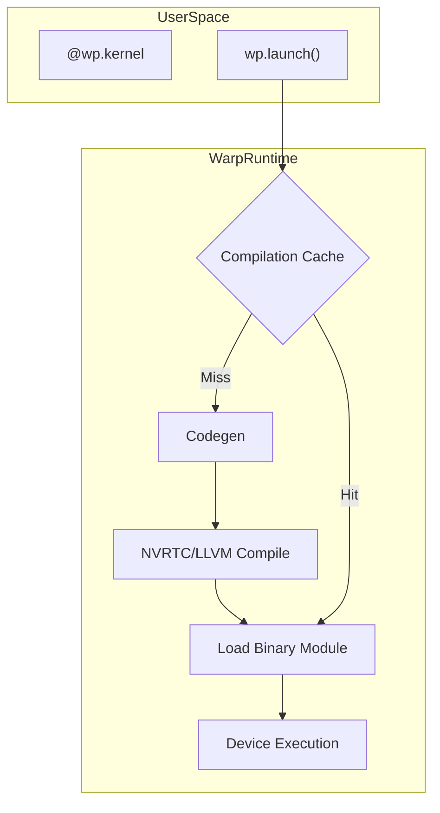
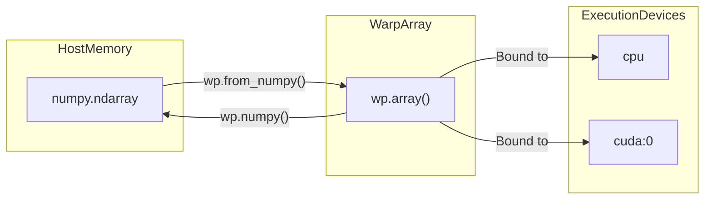

<!-- source: DeepWiki mcp.deepwiki.com · repo NVIDIA/warp · page 1.3 Quickstart Guide · fetched 2026-10-26 -->

# Quickstart Guide

<details>
<summary>Relevant source files</summary>

The following files were used as context for generating this wiki page:

- [README.md](README.md)
- [docs/index.rst](docs/index.rst)
- [warp/examples/core/example_dem.py](warp/examples/core/example_dem.py)
- [warp/examples/core/example_mesh.py](warp/examples/core/example_mesh.py)
- [warp/examples/core/example_mesh_intersect.py](warp/examples/core/example_mesh_intersect.py)
- [warp/examples/core/example_nvdb.py](warp/examples/core/example_nvdb.py)
- [warp/examples/core/example_sph.py](warp/examples/core/example_sph.py)
- [warp/examples/core/example_wave.py](warp/examples/core/example_wave.py)
- [warp/examples/optim/example_diffray.py](warp/examples/optim/example_diffray.py)
- [warp/tests/test_examples.py](warp/tests/test_examples.py)

</details>


This guide provides a minimal and practical introduction to authoring and launching Warp kernels. It covers key steps from kernel definition to array creation and execution, aimed at helping you get started quickly with Warp’s GPU-accelerated compute framework.

---

## Your First Warp Kernel: Minimal Example

Below is an example demonstrating the core Warp workflow:

```python
import warp as wp
import numpy as np

# Define a Warp kernel that doubles each element in an input array
@wp.kernel
def double_values(input: wp.array(dtype=float), output: wp.array(dtype=float)):
    tid = wp.tid()            # Get unique thread index
    output[tid] = input[tid] * 2.0

# Create input data and output array on the default device
data = wp.array([1.0, 2.0, 3.0, 4.0, 5.0], dtype=float)
result = wp.zeros(5, dtype=float)

# Launch the kernel with 5 threads - one per element
wp.launch(kernel=double_values, dim=5, inputs=[data, result])

# Transfer result back to host CPU and print it
print(result.numpy())  # Expected output: [2. 4. 6. 8. 10.]
```

### Explanation

- **Kernel Definition - `@wp.kernel`**  
  The `@wp.kernel` decorator compiles the Python function into a Warp kernel runnable on CPU or GPU devices. The kernel’s input parameters must all have explicit types like `wp.array[dtype]` [README.md:36-37]().

- **Thread Indices - `wp.tid()`**  
  Inside the kernel, `wp.tid()` returns the unique index of the current thread executing the kernel. This enables data-parallel operations over arrays, similar to CUDA thread indexing [README.md:38]().  

- **Warp Arrays - `wp.array`**  
  Warp arrays allocate memory accessible on the device. Creating `wp.array` from a NumPy array automatically uploads the data to the selected device (default CPU or GPU). `wp.zeros` conveniently allocates a zero-initialized array [README.md:46-48]().

- **Kernel Launch - `wp.launch()`**  
  The launch function runs the compiled kernel with the specified number of threads (`dim=5`) passing the input arrays. Warp's runtime handles compilation caching and device execution transparently [README.md:51]().

Sources: `[README.md:28-54]()`

---

## Warp JIT Compilation and Execution Flow

Warp uses a Just-In-Time (JIT) compilation model. When a kernel is launched, Warp performs compilation and module loading:

Title: Warp JIT Compilation Pipeline

Sources: `[README.md:12-17]()`

- The `@wp.kernel` decorator marks the function for JIT compilation.
- `wp.launch()` initiates the kernel invocation:
   - If a compiled kernel exists for the given argument types and device, it reuses the binary.
   - Otherwise, Warp generates device-specific source code (C++ or CUDA) and compiles it via LLVM or NVRTC.
- The resulting binary is executed on the specified device using the Warp runtime.

Sources: `[README.md:12-17]()`

---

## Array Types and Mathematical Data Structures

Warp supports a variety of built-in numerical types optimized for simulation and graphics:

| Warp Type        | Description                        | Code Symbol          |
|------------------|----------------------------------|----------------------|
| `wp.float32`     | 32-bit floating point scalar     | `float` in Python    |
| `wp.vec2`, `vec3`, `vec4` | 2D, 3D, and 4D float vectors | e.g. `wp.vec3`        |
| `wp.mat33`, `mat44` | 3x3 and 4x4 float matrices       | `wp.mat33` etc.      |
| `wp.quat`        | Quaternion rotation type          | `wp.quat`            |
| `wp.bool`        | Boolean scalar                   | `wp.bool`            |

**Example of physics vector math in a kernel:**

```python
@wp.kernel
def gravity_step(pos: wp.array(dtype=wp.vec3), vel: wp.array(dtype=wp.vec3)):
    i = wp.tid()
    dt = 0.01
    dist_sq = wp.length_sq(pos[i]) + 0.01
    acc = -1000.0 / dist_sq * wp.normalize(pos[i])
    vel[i] = vel[i] + acc * dt
    pos[i] = pos[i] + vel[i] * dt
```

Warp provides built-in vector operations like `wp.length_sq()` and `wp.normalize()` to simplify spatial computations [README.md:36-43]().

Sources: `[README.md:36-43]()`

---

## Devices and Memory Management

Warp tightly couples arrays to devices, which can be CPU or CUDA GPUs. You can specify the device when creating or copying arrays and when launching kernels.

- **Creating arrays on devices:**

```python
points = wp.zeros(100, dtype=wp.vec3, device="cuda")
```

- **Launching kernels on specific devices:**

```python
wp.launch(my_kernel, dim=100, inputs=[points], device=points.device)
```

- **Data transfer:**

```python
host_data = points.numpy()  # Copy data back to CPU
```

Title: Device and Array Interaction

Sources: `[README.md:46-52](), [warp/examples/core/example_dem.py:221-227]()`

Warp automatically manages data transfers and synchronization between CPU and GPU devices, abstracting low-level CUDA details.

Sources: `[README.md:46-52](), [warp/examples/core/example_dem.py:221-227]()`

---

## Multi-Dimensional Thread Grids

Warp kernels can execute over multi-dimensional grids for use cases like image and volume processing.

- **Launch example with 1D/2D grid:**

```python
@wp.kernel
def process_grid(grid: wp.array2d(dtype=float)):
    i, j = wp.tid()
    grid[i, j] = float(i + j)

grid_data = wp.zeros((1024, 1024), dtype=float)
wp.launch(process_grid, dim=(1024, 1024), inputs=[grid_data])
```

The `wp.tid()` function supports unpacking multiple indices matching the launch grid shape for kernel thread indexing.

Sources: `[warp/examples/core/example_wave.py:36-64]()`

---

## Configuration and Debugging Tips

Warp provides a global `warp.config` configuration module to tune behavior at runtime:

- `warp.config.deterministic` controls atomic execution determinism for reproducible results.
- `warp.config.print_launches` enables verbose kernel launch logging.
- `warp.config.verify_cuda` enables runtime CUDA error checking.

Example:

```python
import warp as wp

wp.config.deterministic = wp.DeterministicMode.RUN_TO_RUN
wp.config.print_launches = True

wp.init()
```

Sources: `[README.md:28-54]()`

---

## FAQ and Limitations Pointers

- **For frequently asked questions (FAQ) and common usage queries**, see the [Warp FAQ page](https://nvidia.github.io/warp/stable/user_guide/faq.html).
- **For limitations and unsupported features**, refer to the [Warp limitations page](https://nvidia.github.io/warp/stable/user_guide/limitations.html). Key points include:
  - No support for dynamic structures like lists or dicts inside kernels.
  - Kernel parameters require explicit static typing.
  - Warp arrays are limited to a maximum of 4 dimensions.
  - Warp enforces 32-bit signed integer limits on thread grid dimensions.

Sources: `[README.md:56-74]()`

---

