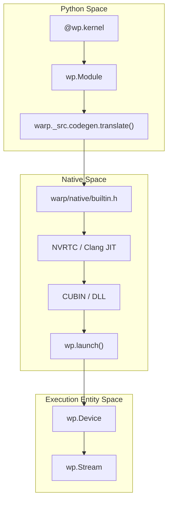
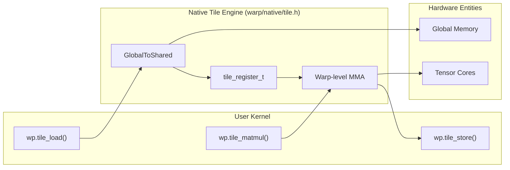

<!-- source: DeepWiki mcp.deepwiki.com · repo NVIDIA/warp · page 10 Glossary · fetched 2026-10-26 -->

# Glossary

Relevant source files

The following files were used as context for generating this wiki page:

- [CHANGELOG.md](CHANGELOG.md)
- [VERSION.md](VERSION.md)
- [changelog/2078.fixed.md](changelog/2078.fixed.md)
- [docs/conf.py](docs/conf.py)
- [docs/language_reference/builtins.rst](docs/language_reference/builtins.rst)
- [setup.py](setup.py)
- [warp/__init__.pyi](warp/__init__.pyi)
- [warp/_src/builtins.py](warp/_src/builtins.py)
- [warp/_src/codegen.py](warp/_src/codegen.py)
- [warp/_src/coloring.py](warp/_src/coloring.py)
- [warp/_src/context.py](warp/_src/context.py)
- [warp/_src/types.py](warp/_src/types.py)
- [warp/config.py](warp/config.py)
- [warp/native/array.h](warp/native/array.h)
- [warp/native/builtin.h](warp/native/builtin.h)
- [warp/native/bvh.cpp](warp/native/bvh.cpp)
- [warp/native/bvh.cu](warp/native/bvh.cu)
- [warp/native/bvh.h](warp/native/bvh.h)
- [warp/native/coloring.cpp](warp/native/coloring.cpp)
- [warp/native/intersect.h](warp/native/intersect.h)
- [warp/native/mesh.cpp](warp/native/mesh.cpp)
- [warp/native/mesh.cu](warp/native/mesh.cu)
- [warp/native/mesh.h](warp/native/mesh.h)
- [warp/native/tile.h](warp/native/tile.h)
- [warp/native/version.h](warp/native/version.h)
- [warp/tests/geometry/test_mesh.py](warp/tests/geometry/test_mesh.py)
- [warp/tests/geometry/test_mesh_query_point.py](warp/tests/geometry/test_mesh_query_point.py)
- [warp/tests/geometry/test_mesh_query_ray.py](warp/tests/geometry/test_mesh_query_ray.py)
- [warp/tests/test_array.py](warp/tests/test_array.py)
- [warp/tests/test_coloring.py](warp/tests/test_coloring.py)
- [warp/tests/test_conditional.py](warp/tests/test_conditional.py)
- [warp/tests/unittest_suites.py](warp/tests/unittest_suites.py)
- [warp/types.py](warp/types.py)

This page provides a comprehensive reference for the terminology, jargon, and domain-specific concepts used within the Warp codebase. It serves as a technical bridge for onboarding engineers to understand how high-level simulation concepts map to specific implementation entities.

## Core Framework Concepts

### Kernel
A parallel function decorated with `@wp.kernel` [warp/_src/context.py:107]() that executes across a domain of threads. Kernels are the primary unit of computation in Warp. They are translated from Python AST to native C++/CUDA code by the codegen system [warp/_src/codegen.py:84-125]().

### Function (wp.func)
A reusable snippet of code decorated with `@wp.func` [warp/_src/context.py:102]() that can be called from within kernels or other Warp functions. Unlike kernels, they cannot be launched directly from the host. Warp also supports specialized variants:
*   `@wp.func_grad`: Defines a custom adjoint for a function [warp/_src/context.py:103]().
*   `@wp.func_replay`: Defines a custom forward replay for backward passes [warp/_src/context.py:104]().
*   `@wp.func_native`: Allows inlining raw C++/CUDA code strings [warp/_src/context.py:105]().

### Module
A container class `wp.Module` [warp/_src/context.py:117]() that manages a collection of kernels, functions, and structs. It handles the JIT compilation lifecycle and maintains the link to the generated native library.

### Tape
A record of operations used for automatic differentiation. The `wp.Tape` [warp/_src/tape.py:121]() class captures kernel launches and provides a `backward()` method to propagate gradients using the adjoint method.

### Diagram: Kernel Execution Flow
This diagram illustrates the relationship between the Python-side kernel definition and the native execution entities.

**Sources:** [warp/_src/context.py:102-117](), [warp/_src/codegen.py:84-125](), [warp/native/builtin.h:1-20]()

---

## Type System and Memory

| Term | Definition | Code Reference |
| :--- | :--- | :--- |
| **Scalar** | Fundamental numeric types: `float16`, `float32`, `float64`, `int8` through `int64`. | [warp/_src/types.py:60-254]() |
| **Composite** | Types built from multiple components, such as `vec3`, `mat44`, or `quat`. | [warp/_src/types.py:31-45]() |
| **Struct** | User-defined data structures decorated with `@wp.struct`. | [warp/_src/context.py:108]() |
| **Array** | Multi-dimensional memory buffers (`wp.array`) with support for gradients. | [warp/_src/types.py:48]() |
| **FabricArray** | A specialized array type for distributed or non-contiguous memory layouts. | [warp/_src/types.py:53]() |
| **Pluggable Allocator** | Interface allowing Warp to use external memory managers (e.g., PyTorch, RMM). | [warp/tests/test_allocator.py:147-152]() |

**Sources:** [warp/_src/types.py:31-254](), [warp/_src/context.py:108](), [warp/tests/test_allocator.py:147-152]()

---

## Tile Computing and Advanced Math

Tile computing is a programming model in Warp designed for high-performance linear algebra and Tensor Core operations.

*   **Tile**: A fixed-size multidimensional block of data processed as a single unit in registers or shared memory.
*   **launch_tiled**: A specialized launch mechanism `wp.launch_tiled()` [warp/_src/context.py:120]() that organizes threads into blocks matching tile dimensions.
*   **Shared vs Register Tiles**: Tiles can reside in GPU registers (`tile_register_t`) or Shared Memory (`tile_shared_t`) [warp/native/tile.h:201-210]().
*   **MathDx**: Integration with NVIDIA MathDx (cuBLASDx, cuFFTDx, cuSolverDx) for performing optimized BLAS/FFT/Linear Algebra operations directly inside kernels [warp/native/warp.cu:19-25]().

### Diagram: Tile Data Flow
Mapping tile operations to the underlying native implementation.

**Sources:** [warp/native/tile.h:74-210](), [warp/native/warp.cu:19-25](), [warp/_src/context.py:120]()

---

## Spatial and Simulation Terms

### BVH (Bounding Volume Hierarchy)
A tree structure used for accelerating spatial queries like ray-casting or overlap tests. Warp supports:
*   **LBVH**: Linear Bounding Volume Hierarchy, a fast construction method using Morton codes.
*   **Bvh.refit()**: Updates a BVH's bounds without changing its topology [warp/native/bvh.h:101]().

### HashGrid
A uniform spatial grid used for fast point-neighbor lookups. Defined as `wp.HashGrid` [warp/_src/types.py:71](). Now supports grouped queries for multi-environment workloads [CHANGELOG.md:14-17]().

### NanoVDB
A sparse voxel representation integrated into Warp via `wp.Volume` [warp/_src/types.py:72](). Warp supports rebuildable volumes through `allocate_by_tiles()` [CHANGELOG.md:39-40]().

### FEM (Finite Element Method)
A module for solving partial differential equations. Key terms:
*   **Function Space**: Defines how fields are interpolated (e.g., polynomial basis). [warp/_src/fem/space/__init__.py]()
*   **Integrand**: A function decorated with `@integrand` used for numerical integration over elements. [warp/_src/fem/integrate.py]()
*   **Geometry Partitioning**: Partitioning of FEM domains for multi-GPU or distributed workflows [warp/_src/fem/space/partition.py]().

**Sources:** [warp/native/bvh.h:101](), [warp/_src/types.py:71-72](), [CHANGELOG.md:14-17](), [CHANGELOG.md:39-40](), [warp/_src/fem/space/__init__.py](), [warp/_src/fem/integrate.py]()

---

## Distributed and System Terms

*   **APIC**: Affine Particle-In-Cell. In Warp, this also refers to a specialized capture/replay system for CPU and CUDA utility algorithms like `array_sum()` [CHANGELOG.md:32-35]().
*   **DeterministicMode**: A module-level setting that ensures floating-point operations (like atomic additions) produce bit-identical results across runs [warp/config.py:54-63]().
*   **JITLink / RTDyld**: LLVM-based dynamic linkers used by the Warp CPU JIT to resolve symbols and load object code into memory [warp/native/clang/clang.cpp:31-41]().
*   **cuBQL**: CUDA Bounding Query Library, an optimized library for spatial queries integrated into Warp [warp/_src/context.py:91]().
*   **BSR Matrix**: Block Sparse Row format used for sparse linear algebra [warp/_src/sparse.py:49-50]().
*   **packman**: A dependency management tool used in the Warp build system [warp/_src/build.py:100]().
*   **towncrier**: A release note management tool used to generate the `CHANGELOG.md` [CHANGELOG.md:3]().
*   **ASV**: Airspeed Velocity, a benchmarking framework used for performance testing [warp/tests/unittest_suites.py:101]().

### Abbreviations
*   **AD**: Automatic Differentiation.
*   **BSR**: Block Sparse Row (sparse matrix format).
*   **DOF**: Degree of Freedom.
*   **LTO**: Link Time Optimization. [warp/_src/build.py:100]()
*   **UVA**: Unified Virtual Addressing [warp/native/warp.cu:150]().

**Sources:** [CHANGELOG.md:3](), [CHANGELOG.md:32-35](), [warp/config.py:54-63](), [warp/native/clang/clang.cpp:31-41](), [warp/_src/context.py:91](), [warp/_src/sparse.py:49-50](), [warp/_src/build.py:100](), [warp/tests/unittest_suites.py:101](), [warp/native/warp.cu:150]()