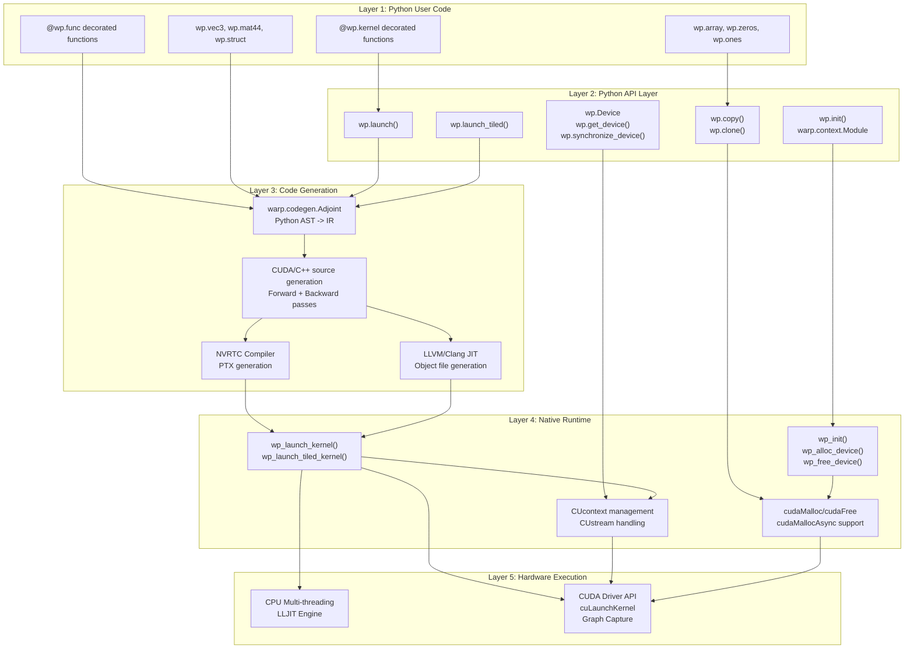
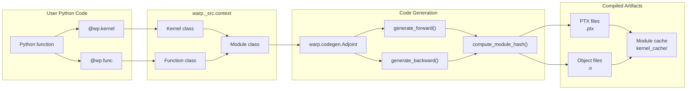
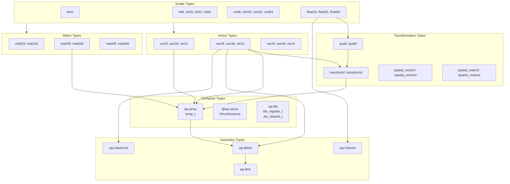

<!-- source: DeepWiki mcp.deepwiki.com · repo NVIDIA/warp · page 2 Core Architecture · fetched 2026-10-26 -->

# Core Architecture

Relevant source files

The following files were used as context for generating this wiki page:

- [CHANGELOG.md](CHANGELOG.md)
- [docs/api_reference/warp.rst](docs/api_reference/warp.rst)
- [docs/language_reference/builtins.rst](docs/language_reference/builtins.rst)
- [warp/__init__.py](warp/__init__.py)
- [warp/__init__.pyi](warp/__init__.pyi)
- [warp/_src/builtins.py](warp/_src/builtins.py)
- [warp/_src/codegen.py](warp/_src/codegen.py)
- [warp/_src/context.py](warp/_src/context.py)
- [warp/_src/types.py](warp/_src/types.py)
- [warp/native/cuda_util.cpp](warp/native/cuda_util.cpp)
- [warp/native/cuda_util.h](warp/native/cuda_util.h)
- [warp/native/tile.h](warp/native/tile.h)
- [warp/native/warp.cpp](warp/native/warp.cpp)
- [warp/native/warp.cu](warp/native/warp.cu)
- [warp/native/warp.h](warp/native/warp.h)
- [warp/tests/test_conditional.py](warp/tests/test_conditional.py)
- [warp/tests/unittest_suites.py](warp/tests/unittest_suites.py)

## Purpose and Scope

This document provides an overview of Warp's foundational architectural components. It describes the system layers, key abstractions, compilation pipeline, and runtime execution model that enable high-performance GPU-accelerated simulation and graphics programming from Python.

This is a parent page. For detailed technical information on specific subsystems, see the following child pages:
- Kernel and function definitions: see [Kernel and Function System](#2.1)
- Data types and their operations: see [Type System](#2.2)
- Array memory management: see [Array System](#2.3)
- Custom data structures: see [Struct Types](#2.4)
- Device and stream management: see [Context and Device Management](#2.5)
- Compilation internals: see [JIT Compilation System](#2.6)

---

## Layered System Architecture

Warp implements a five-layer architecture that transforms Python code into optimized native execution on CPUs and GPUs.

- **Layer 1 (User Code)**: Python functions decorated with `@wp.kernel` or `@wp.func` define computational kernels. Users create arrays and work with built-in types like `wp.vec3` and `wp.mat44`.
- **Layer 2 (Python API)**: The `wp.launch()` function executes kernels [warp/_src/context.py:117](), while `wp.Device` manages hardware contexts and streams [warp/_src/context.py:122](). Memory operations like `wp.copy()` handle data movement between devices [warp/_src/context.py:63]().
- **Layer 3 (Code Generation)**: The code generation logic transforms Python AST into an intermediate representation, then generates C++/CUDA source code for both forward and backward (adjoint) passes [warp/_src/codegen.py:1-150](). NVRTC compiles CUDA code to PTX for GPUs [warp/native/warp.cu:18](), while LLVM/Clang JIT compiles C++ for CPUs.
- **Layer 4 (Native Runtime)**: The C++/CUDA runtime library provides kernel launching, memory allocation via `wp_alloc_device()` [warp/native/warp.h:71](), and device context management via the CUDA driver API. The runtime is initialized using `wp_init()` [warp/native/warp.h:42]().
- **Layer 5 (Hardware Execution)**: Compiled kernels execute on CPU threads via the LLVM JIT engine or on CUDA devices via `cuLaunchKernel()`. CUDA graph capture is supported to optimize replay of GPU workloads [warp/native/warp.cu:175-195]().

Sources:
- [warp/__init__.py:1-180]()
- [warp/_src/context.py:1-136]()
- [warp/native/warp.h:1-100]()
- [warp/native/warp.cu:1-100]()
- [CHANGELOG.md:1-100]()

---

## Decorator and Module System

Warp's programming model centers on decorators that transform Python functions into executable kernels and device functions. For full details on the kernel and function subsystems, see [Kernel and Function System](#2.1).

- **Decorator Registration**: When `@wp.kernel` [warp/_src/context.py:107]() or `@wp.func` [warp/_src/context.py:102]() decorates a function, it instantiates a `Kernel` [warp/_src/context.py:114]() or `Function` [warp/_src/context.py:115]() object. These are associated with a `Module` [warp/_src/context.py:117]().
- **Module Management**: The `Module` class groups related kernels and functions. Each module generates a unique hash based on its source and compilation options to manage the JIT lifecycle.
- **Code Generation**: The code generation system analyzes the Python AST of decorated functions and generates C++/CUDA source code, including adjoint code for gradients.
- **Caching**: Compiled modules are cached on disk to avoid recompilation when the source has not changed. Cache management is available via functions like `clear_kernel_cache()` [warp/_src/build.py:93]().

Sources:
- [warp/_src/context.py:100-210]()
- [warp/_src/codegen.py:1-100]()
- [warp/_src/builtins.py:1-50]()

---

## Type System Hierarchy

Warp provides a rich type system that bridges Python and C++/CUDA, enabling high-performance computations while maintaining type safety and expressiveness. For comprehensive documentation on scalars, vectors, matrices, quaternions, and spatial types, see [Type System](#2.2).

- **Scalar Types**: Basic numeric types (`int8` to `int64`, unsigned variants, `float16`/`float32`/`float64`, and `bool`) map directly to C/CUDA primitives with Warp wrappers supporting operations and type traits [warp/_src/types.py:66-130]().
- **Vector and Matrix Types**: Fixed-size vectors (`vec2`, `vec3`, `vec4`) and matrices (`mat22`, `mat33`, `mat44`) with element types like float or int provide high-level math abstractions [warp/__init__.py:31-70]().
- **Transformation Types**: Quaternions (`quat`) and transforms represent 3D rotation and rigid body pose data, with associated spatial vectors/matrices for multi-body dynamics [warp/__init__.py:39-47]().
- **Container Types**: `wp.array` wraps device memory with shape, strides, and type metadata (see [Array System](#2.3)). The `@wp.struct` decorator enables user-defined custom data structures that can nest types [warp/_src/context.py:108](), [warp/_src/types.py:70-110]() (see [Struct Types](#2.4)). Tile types expose block-level register/shared memory abstractions to implement tiled computations [warp/native/tile.h:60-78]().
- **Geometry Types**: Meshes, BVHs, HashGrids, and Volumes provide spatial indexing and acceleration structures for geometry processing and ray tracing [warp/_src/types.py:69-72]().

Sources:
- [warp/_src/types.py:1-273]()
- [warp/__init__.py:22-180]()
- [warp/native/tile.h:60-90]()

---

## JIT Compilation System

Warp transforms Python kernel code into optimized native executables through a multi-stage compilation pipeline including AST transformation, NVRTC for CUDA, and LLVM/Clang for CPU execution.

For detailed information on the AST parser, code generation rules, caching mechanisms, and ahead-of-time compilation, see [JIT Compilation System](#2.6).

Sources:
- [warp/_src/codegen.py:1-150]()
- [warp/native/warp.cu:82-127]()
- [warp/native/warp.h:1-50]()

---

## Context and Device Management

Warp's runtime system manages kernel execution, device contexts, memory allocations, and synchronization across CPU and multi-GPU environments.

For comprehensive documentation on `wp.Device`, `wp.Stream`, `wp.Event`, CUDA memory pools, and allocator plug-ins, see [Context and Device Management](#2.5).

Sources:
- [warp/_src/context.py:115-136]()
- [warp/native/warp.h:61-90]()
- [warp/native/warp.cu:139-224]()

---

## Summary

Warp's core architecture implements a layered system that transforms Python source code into high-performance native execution runtimes:

1. **User Layer**: Defines kernels and device functions via Python decorators `@wp.kernel` and `@wp.func`.
2. **API Layer**: Manages kernel launches, memory, and devices with primitives like `wp.launch()`, `wp.Device`, and `wp.array`.
3. **Compilation Layer**: Performs AST transformation, code generation, and just-in-time compilation with NVRTC for CUDA and LLVM for CPU.
4. **Runtime Layer**: Handles kernel dispatch, memory management, device contexts, and synchronization.
5. **Hardware Layer**: Executes optimized kernels on CPUs or CUDA GPUs leveraging native driver APIs and multi-threading.

For a detailed technical deep dive and code examples, reference the child pages covering each subsystem:
- [Kernel and Function System](#2.1)
- [Type System](#2.2)
- [Array System](#2.3)
- [Struct Types](#2.4)
- [Context and Device Management](#2.5)
- [JIT Compilation System](#2.6)

Sources:  
- [warp/__init__.py:1-180]()  
- [warp/_src/context.py:1-210]()  
- [warp/_src/codegen.py:1-150]()  
- [warp/_src/builtins.py:1-50]()  
- [warp/_src/types.py:1-273]()  
- [warp/native/tile.h:60-90]()  
- [warp/native/warp.h:1-100]()  
- [warp/native/warp.cu:1-224]()  
- [CHANGELOG.md:1-100]()

---

