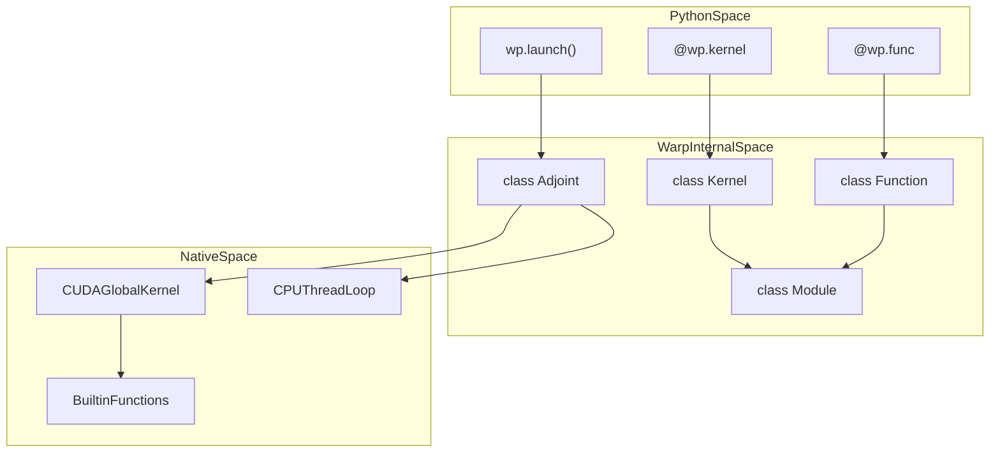
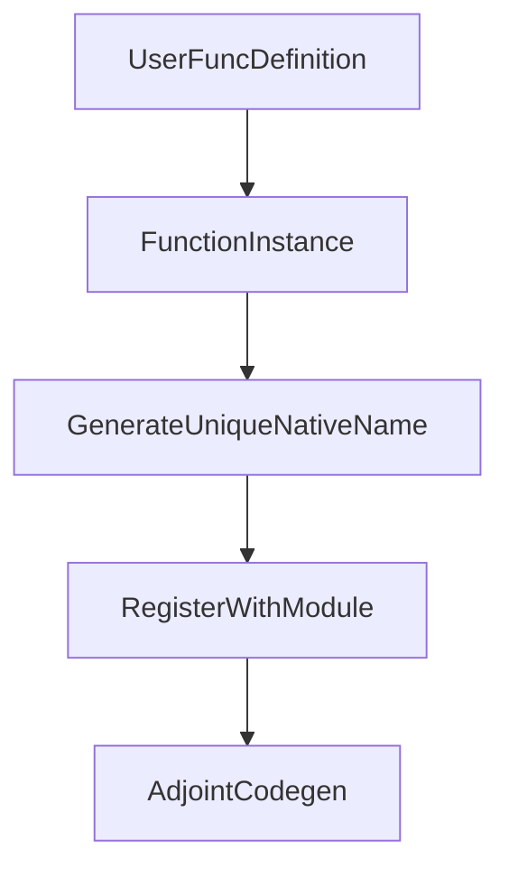
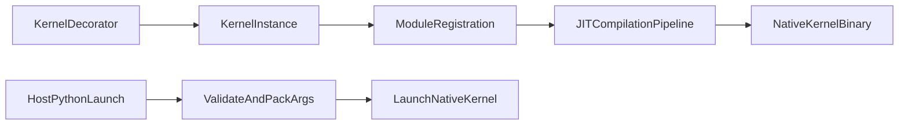
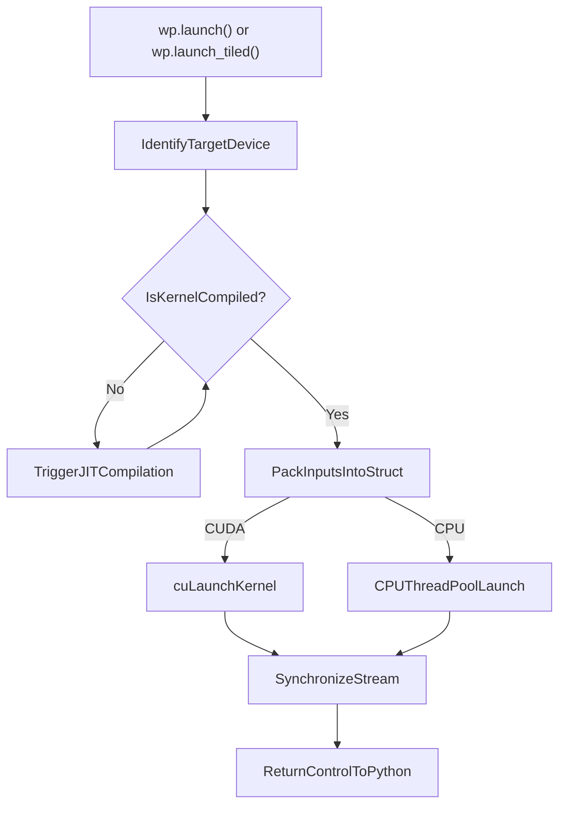

<!-- source: DeepWiki mcp.deepwiki.com · repo NVIDIA/warp · page 2.1 Kernel and Function System · fetched 2026-10-26 -->

# Kernel and Function System

<details>
<summary>Relevant source files</summary>

The following files were used as context for generating this wiki page:

- [CHANGELOG.md](CHANGELOG.md)
- [changelog/2023.fixed.md](changelog/2023.fixed.md)
- [design/hardware-coherent-memory-access.md](design/hardware-coherent-memory-access.md)
- [docs/language_reference/builtins.rst](docs/language_reference/builtins.rst)
- [warp/__init__.pyi](warp/__init__.pyi)
- [warp/_src/builtins.py](warp/_src/builtins.py)
- [warp/_src/codegen.py](warp/_src/codegen.py)
- [warp/_src/context.py](warp/_src/context.py)
- [warp/_src/types.py](warp/_src/types.py)
- [warp/native/tile.h](warp/native/tile.h)
- [warp/tests/cuda/test_unified_memory.py](warp/tests/cuda/test_unified_memory.py)
- [warp/tests/test_compile_consts.py](warp/tests/test_compile_consts.py)
- [warp/tests/test_conditional.py](warp/tests/test_conditional.py)
- [warp/tests/test_func.py](warp/tests/test_func.py)
- [warp/tests/test_graph.py](warp/tests/test_graph.py)
- [warp/tests/test_launch.py](warp/tests/test_launch.py)
- [warp/tests/test_map.py](warp/tests/test_map.py)
- [warp/tests/test_reload.py](warp/tests/test_reload.py)
- [warp/tests/unittest_suites.py](warp/tests/unittest_suites.py)

</details>


This document provides comprehensive technical documentation of Warp's kernel and function system. It covers the `@wp.kernel` and `@wp.func` decorators, kernel parameters, launch mechanisms (`wp.launch` and `wp.launch_tiled`), the execution model, generics via `typing.Any`, overloads, and the runtime creation of kernels.

---

## Overview of the Execution Model

Warp compiles user-defined Python functions into high-performance device-specific code via a JIT compilation pipeline. This pipeline leverages LLVM/Clang for CPU and NVRTC for CUDA compilation, producing native kernels that execute in parallel on GPUs or CPUs.

The system organizes code into these key entities:

- **Kernels (`@wp.kernel`)**: Parallel entry points representing GPU kernels or CPU parallel loops.
- **Functions (`@wp.func`)**: Reusable computational logic, callable within kernels or other functions, supporting overloading and automatic differentiation.
- **Launch Systems (`wp.launch`, `wp.launch_tiled`)**: Host-side APIs to schedule kernel execution across threads and thread blocks.
- **Modules (`Module` class)**: Containers for kernels and functions, managing compilation, caching, and device-specific binaries.

The following diagram illustrates the mapping from natural language Python-space constructs into Warp internal representations and native binaries:



Sources: `[warp/_src/context.py:205-209]()`, `[warp/_src/context.py:689-693]()`, `[warp/_src/context.py:1117-1120]()`, `[warp/_src/codegen.py:1-43]()`

---

## User Functions (`@wp.func`)

### Definition and Purpose

The `@wp.func` decorator marks a Python function as a Warp device function. These functions compile into device-callable code and can be invoked from kernels or other functions. They augment performance by enabling code reuse on devices and integrate into Warp's automatic differentiation system.

### Key Features

- **Type Annotations Are Required**: All parameters and return types must be annotated to enable Warp's type system to map Python types to Warp types `[warp/_src/context.py:141-149]()`.
- **Support for Overloads**: Multiple `@wp.func` definitions with the same name but different signatures are supported. Warp resolves the correct overload during compilation `[warp/tests/test_func.py:38-50]()`.
- **Generics with `typing.Any`**: Warp supports generic functions by allowing `Any` as a type annotation to indicate type-agnostic parameters `[warp/tests/test_func.py:221-226]()`.
- **Pass-by-Reference**: Parameters annotated with `wp.ref[T]` enable mutability within functions, allowing for outputs via references `[warp/__init__.pyi:16]()`.
- **Inline Parameter Control**: The `inline` parameter on `@wp.func` balances function-call overhead against generated code size (`True` inlines the body, `False` preserves a separate function, `None` delegates to the compiler) `[CHANGELOG.md:28-31]`.
- **Automatic Differentiation Support**: Functions decorated with `@wp.func` are differentiable by default. Warp generates adjoint versions automatically for use in backward passes `[warp/_src/context.py:102-105]()`.

### Internal Registration and Identifiers

Each `@wp.func` is internally tracked as an instance of the `Function` class `[warp/_src/context.py:115]()`. When a function is decorated, a globally unique identifier is generated via `generate_unique_function_identifier` to avoid name collisions during native code generation `[warp/_src/context.py:193-207]()`.



Sources: `[warp/_src/context.py:175-202]`, `[warp/tests/test_func.py:25-58]`, `[CHANGELOG.md:13-21]`

---

## Kernels (`@wp.kernel`)

### Definition and Execution Entry Point

Kernels are Warp's fundamental parallel execution units, marked by the `@wp.kernel` decorator `[warp/_src/context.py:107]()`. Kernels act as entry points from Python to device code and execute over a grid of threads or thread-blocks.

### Parameter Types and Type Checking

- Kernels accept only explicitly typed parameters, supported types include:
  - **Scalars**: Warp scalar types such as `wp.int32`, `float`, `bool`, etc. `[warp/_src/types.py:66-130]()`.
  - **Arrays**: Warp arrays with strict dtype and dimension annotations, e.g., `wp.array1d[wp.float32]` `[warp/_src/types.py:48-52]()`.
  - **Structs**: Custom types decorated with `@wp.struct` `[warp/_src/context.py:108]()`.
- Warp enforces strict type checking on launch arguments against kernel parameters `[warp/_src/context.py:720-760]()`.

### Compilation Pipeline and Kernel Features

When first launched or redefined, kernels trigger a JIT compilation pipeline involving:

1. Parsing the decorated Python function into an Abstract Syntax Tree (AST) `[warp/_src/context.py:6-7]()`.
2. Checking semantics and type correctness `[warp/_src/codegen.py:90-130]()`.
3. Optionally disabling grid-stride loops (`grid_stride=False`) to reduce register pressure.
4. Supporting CUDA thread block clusters with `cluster_dim` if specified.
5. Compiling optimized native code caches per device and module `[warp/_src/context.py:1117-1150]()`.

### Return Values

Kernels are not allowed to return values `[warp/_src/context.py:78-81]()`. Outputs should be written to arrays or output parameters passed by reference. Returning a value from a kernel raises a compile-time error.



Sources: `[warp/_src/context.py:689-780]`, `[warp/_src/codegen.py:1-40]`, `[CHANGELOG.md:7-12]`

---

## Launch Mechanisms

Warp exposes two primary launch functions to execute kernels:

### Standard Launch: `wp.launch`

- Launches kernels over 1D, 2D, or 3D thread grids `[warp/_src/context.py:1119]()`.
- Accepts:
  - Kernel object decorated by `@wp.kernel`.
  - Dimension tuple or integer (`dim`).
  - Input argument list matching kernel parameters (`inputs`).
  - Execution device (`device`) CPU or CUDA.
  - Optional flags, e.g., `record_cmd` for CUDA graph capture `[warp/tests/test_reload.py:81]()`.
- Internally:
  - Checks kernel compilation status for the device `[warp/_src/context.py:1125-1135]()`.
  - Compiles if necessary.
  - Packs inputs into a native struct per kernel parameter types `[warp/_src/context.py:1140-1150]()`.
  - Launches kernel on CUDA or thread pool on CPU.
  - Optionally synchronizes streams `[warp/tests/test_reload.py:114]()`.

| Parameter   | Description                                   |
|-------------|-----------------------------------------------|
| `kernel`    | Kernel instance to launch                      |
| `dim`       | Launch dimensions (int or tuple)               |
| `inputs`    | List of parameters for the kernel              |
| `device`    | Execution device (CPU/CUDA)                     |
| `record_cmd`| Whether to record launch as a command for graphs|

### Tiled Launch: `wp.launch_tiled`

- Specialized launch for tile-based thread-block computations `[warp/_src/context.py:120]()`.
- Executes kernels emphasizing shared or register tile memory `[warp/native/tile.h:125-130]()`.
- Dimension arguments specify tile counts rather than thread counts.
- Requires kernel to use tile-specific APIs (`wp.tile_load`, `wp.tile_store`) `[warp/native/tile.h:143]()`.
- Provides optimized collective tile operations `[warp/native/tile.h:130-195]()`.

**Kernel Launch Logic Flow:**



Sources: `[warp/_src/context.py:1117-1150]`, `[warp/_src/build.py:104-108]`, `[warp/native/tile.h:74-130]`

---

## Generics and Overloads

Warp supports **generic functions and kernels** through Python type hints:

- Using `typing.Any` for parameter types declares them as generic (any supported Warp type) `[warp/tests/test_func.py:222]()`.
- Warp specializes generic kernels/functions at launch time with actual types `[warp/_src/context.py:134-160]()`.
- Multiple overloads can be registered with `@wp.func` or `@wp.kernel` of the same name but different type signatures `[warp/tests/test_func.py:38-50]()`.
- Warp dispatches to the correct overload based on argument types.

Example:

```python
@wp.func
def foo(x: typing.Any):
    return x

@wp.func
def foo(x: int):
    return x * 2
```

When called with an integer argument, Warp uses the `int` version; otherwise, it defaults to the generic. Overloads must be defined before launching kernels to avoid recompilation overhead.

Sources: `[warp/_src/context.py:134-160]`, `[warp/tests/test_func.py:221-247]`

---

## Runtime Kernel Creation and Launch API Details

The `Kernel` and `Function` classes represent compiled or JIT-compiled Warp code objects `[warp/_src/context.py:114-115]()`. Users can create `Kernel` instances from Python functions manually or implicitly via decorators.

### Kernel Class

- Stores the decorated Python function `[warp/_src/context.py:689-720]()`.
- Holds internal metadata: kernel parameters, typed arguments, compiled binaries.
- Supports explicit launch through `Kernel.launch()`.
- Manages module registration and device compilation states `[warp/_src/context.py:721-760]()`.

### Launch API

Typical usage involves:

```python
import warp as wp

@wp.kernel
def my_kernel(x: wp.array(dtype=float)):
    tid = wp.tid()
    x[tid] *= 2.0

x = wp.array([1.0, 2.0, 3.0], dtype=float, device='cuda')

wp.launch(my_kernel, dim=x.size, inputs=[x], device=x.device)
```

Or equivalently:

```python
k = wp.Kernel(my_kernel)
k.launch(dim=x.size, inputs=[x], device=x.device)
```

Launch arguments are strictly checked against kernel parameter types and shapes before packing `[warp/_src/context.py:1117-1150]()`.

**Special Note on Recording Commands**

The optional `record_cmd` flag in `wp.launch` enables the launch to be recorded as a command to support CUDA graph capture and replay `[warp/tests/test_reload.py:81]()`. Recorded commands can be launched multiple times efficiently without recompilation or argument repacking overhead.

Sources: `[warp/_src/context.py:689-780]`, `[warp/_src/context.py:1117-1150]`, `[warp/tests/test_func.py:90-130]`

---

## Summary Table of Decorators and Functions

| Decorator / API   | Purpose                                                   | Source File / Lines                     |
|------------------|-----------------------------------------------------------|---------------------------------------|
| `@wp.kernel`     | Define a parallel device kernel                            | `[warp/_src/context.py:689-780]()`       |
| `@wp.func`       | Define reusable device functions callable by kernels      | `[warp/_src/context.py:205-246]()`       |
| `wp.launch`      | Launch a kernel over a 1D/2D/3D thread grid                | `[warp/_src/context.py:1117-1150]()`     |
| `wp.launch_tiled`| Launch a tile-based kernel with shared/register tiles      | `[warp/_src/context.py:1117-1150]()`, `[warp/native/tile.h:74-130]()` |
| Function overloading | Resolve multiple @wp.func with differing arg types     | `[warp/_src/context.py:134-160]()`, `[warp/tests/test_func.py:221-247]()` |
| Runtime kernel creation | Creating `Kernel` instances from arbitrary Python functions | `[warp/_src/context.py:689-780]()`       |

Sources: `[warp/_src/context.py:689-1150]()`, `[warp/tests/test_func.py:38-50]()`

---

## Additional Notes

- **Strict Parameter Annotations**: Kernels and functions require full type annotations on parameters and return types `[warp/_src/context.py:141-149]()`.
- **No Kernel Return Values**: Kernels cannot return values; write results to output arguments or arrays `[warp/_src/context.py:78-81]()`.
- **Generics**: Generic kernels/functions use `Any` and are instantiated with concrete types on first launch `[warp/tests/test_func.py:221-226]()`.
- **Overload Selection**: Warp selects the best matching overload at codegen time, supporting both exact and generic match fallbacks `[warp/_src/context.py:134-160]()`.
- **Cached Compilation**: Modules cache compiled binaries per device to minimize recompilation latency `[warp/_src/context.py:1117-1135]()`.
- **Thread Block Clusters and Tiling**: Advanced kernel launch options include clusters and tiled memory to enhance performance `[warp/native/tile.h:125-130]()`.

Sources: `[warp/_src/context.py:78-160]()`, `[warp/native/tile.h:125-130]()`

---

