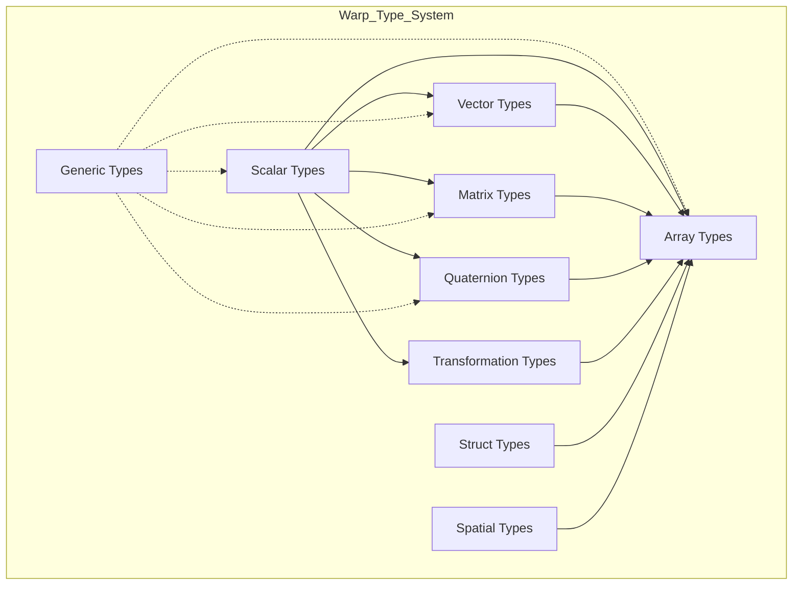
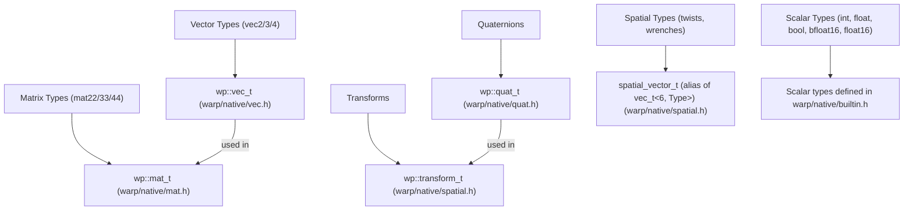
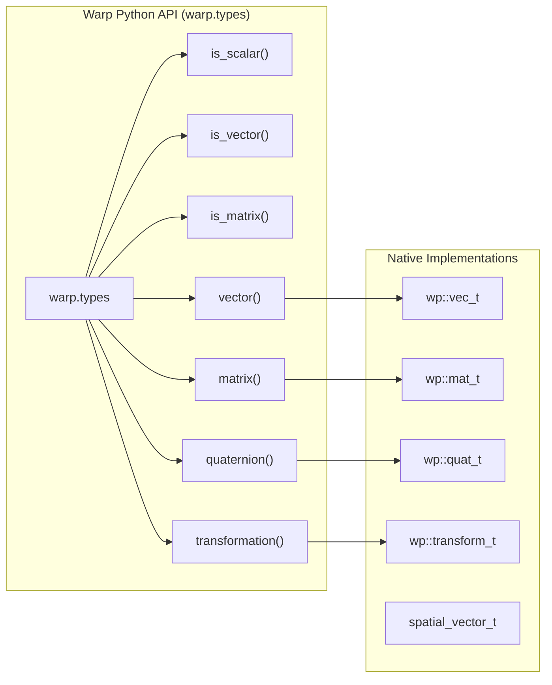

<!-- source: DeepWiki mcp.deepwiki.com · repo NVIDIA/warp · page 2.2 Type System · fetched 2026-10-26 -->

# Type System

<details>
<summary>Relevant source files</summary>

The following files were used as context for generating this wiki page:

- [changelog/2010.fixed.md](changelog/2010.fixed.md)
- [changelog/2038.added.md](changelog/2038.added.md)
- [docs/user_guide/interoperability.rst](docs/user_guide/interoperability.rst)
- [warp/native/crt.cpp](warp/native/crt.cpp)
- [warp/native/crt.h](warp/native/crt.h)
- [warp/native/exports.h](warp/native/exports.h)
- [warp/native/mat.h](warp/native/mat.h)
- [warp/native/quat.h](warp/native/quat.h)
- [warp/native/spatial.h](warp/native/spatial.h)
- [warp/native/svd.h](warp/native/svd.h)
- [warp/native/vec.h](warp/native/vec.h)
- [warp/tests/matrix/__init__.py](warp/tests/matrix/__init__.py)
- [warp/tests/matrix/test_mat.py](warp/tests/matrix/test_mat.py)
- [warp/tests/matrix/test_mat_assign_copy.py](warp/tests/matrix/test_mat_assign_copy.py)
- [warp/tests/matrix/test_mat_basics.py](warp/tests/matrix/test_mat_basics.py)
- [warp/tests/matrix/test_mat_constructors.py](warp/tests/matrix/test_mat_constructors.py)
- [warp/tests/matrix/test_mat_elementwise_ops.py](warp/tests/matrix/test_mat_elementwise_ops.py)
- [warp/tests/matrix/test_mat_linalg.py](warp/tests/matrix/test_mat_linalg.py)
- [warp/tests/matrix/test_mat_lite.py](warp/tests/matrix/test_mat_lite.py)
- [warp/tests/matrix/utils.py](warp/tests/matrix/utils.py)
- [warp/tests/test_assert.py](warp/tests/test_assert.py)
- [warp/tests/test_builtins_resolution.py](warp/tests/test_builtins_resolution.py)
- [warp/tests/test_enum.py](warp/tests/test_enum.py)
- [warp/tests/test_func_parameter_targets.py](warp/tests/test_func_parameter_targets.py)
- [warp/tests/test_operators.py](warp/tests/test_operators.py)
- [warp/tests/test_quat.py](warp/tests/test_quat.py)
- [warp/tests/test_spatial.py](warp/tests/test_spatial.py)
- [warp/tests/test_types.py](warp/tests/test_types.py)
- [warp/tests/test_vec.py](warp/tests/test_vec.py)

</details>


Warp provides a comprehensive type system that forms the foundation for efficient parallel computation on CPUs and GPUs. This page documents the core types available in Warp, their relationships, and how they can be used in kernels and functions, including precision types (`bfloat16`, `float16`), type annotations, vectors, matrices, quaternions, transforms, and spatial types.

The type system is designed to provide strong typing guarantees while maintaining flexibility for use in diverse computational contexts. For information about memory management of arrays, see [2.3 Array System]().

## Overview of Warp Types

The Warp type system consists of several categories of types, ranging from basic scalars to complex spatial structures used in physics simulation.



Sources: [warp/types.py:12-44](), [warp/native/builtin.h:72-92]()

## Scalar Types and Precision Options

Warp provides a set of primitive scalar types mapped to corresponding native C/C++ types. These types are used as building blocks for all other types in the system.

| Warp Type  | Description                | Size (bytes) | Native C Type       |
|------------|----------------------------|--------------|---------------------|
| `bool`     | Boolean                    | 1            | `bool`              |
| `int8`     | Signed 8-bit integer       | 1            | `int8_t`            |
| `uint8`    | Unsigned 8-bit integer     | 1            | `uint8_t`           |
| `int16`    | Signed 16-bit integer      | 2            | `int16_t`           |
| `uint16`   | Unsigned 16-bit integer    | 2            | `uint16_t`          |
| `int32`    | Signed 32-bit integer      | 4            | `int32_t`           |
| `uint32`   | Unsigned 32-bit integer    | 4            | `uint32_t`          |
| `int64`    | Signed 64-bit integer      | 8            | `int64_t`           |
| `uint64`   | Unsigned 64-bit integer    | 8            | `uint64_t`          |
| `float16`  | Half-precision float       | 2            | `wp::half`          |
| `bfloat16` | Brain floating point       | 2            | `wp::wp_bfloat16`   |
| `float32`  | Single-precision float     | 4            | `float`             |
| `float64`  | Double-precision float     | 8            | `double`            |

The half-precision float type (`float16`) and brain floating point type (`bfloat16`) provide reduced-precision floating point formats optimized for GPU throughput and memory bandwidth efficiency. Note that `bfloat16` does not have dedicated named vector or matrix types in Python-side operator dispatch tables, but is fully supported inside compiled kernels and arrays [warp/tests/test_types.py:145-146]().

Sources: [warp/native/builtin.h:75-170](), [warp/native/builtin.h:174-215](), [warp/types.py:14-18](), [warp/tests/test_types.py:145-146]()

## Vector Types

Vector types represent fixed-length arrays of scalar elements. In the native runtime, these are implemented as the `wp::vec_t<Length, Type>` template, which stores components in a fixed-size C array [warp/native/vec.h:10-86]().

### Vector Construction and Access

Vectors can be constructed from a single scalar to fill all components, or from individual component values [warp/native/vec.h:18-55](). Common 2D, 3D, and 4D vector constructors are provided with explicit typed component parameters.

Vectors support operator overloading including negation and arithmetic operations, component-wise multiplication (`cw_mul`), indexing, and comparisons [warp/native/vec.h:142-248]().

Example of construction and access in Warp kernel code:
```python
v = wp.vec3(1.0, 2.0, 3.0)
x = v[0]  # Index access
y = v.y   # Attribute access (x, y, z, w)
```

Predefined vector type aliases include:
- `vecNb`: Signed 8-bit integer vectors (`vec2b`, `vec3b`, `vec4b`) [warp/native/vec.h:98-100]()
- `vecNi`: Signed 32-bit integer vectors (`vec2i`, `vec3i`, `vec4i`) [warp/native/vec.h:112-114]()
- `vecNh`: Half-precision float vectors (`vec2h`, `vec3h`, `vec4h`) [warp/native/vec.h:126-128]()
- `vecNf`: Single-precision float vectors (`vec2f`, `vec3f`, `vec4f`) [warp/native/vec.h:134-136]()
- `vecNd`: Double-precision float vectors (`vec2d`, `vec3d`, `vec4d`) [warp/native/vec.h:138-140]()

Sources: [warp/native/vec.h:88-140](), [warp/native/vec.h:142-248](), [warp/tests/test_vec.py:65-190](), [warp/tests/test_types.py:73-108]()

## Matrix Types

Matrix types represent two-dimensional arrays of scalar values and are primarily used for linear algebra applications such as transformations and stress tensors. They are implemented as the templated struct `wp::mat_t<Rows, Cols, Type>`, storing data in **row-major order**, which is compatible with libraries like PyTorch and NumPy [warp/native/mat.h:14-237]().

### Memory Layout and Access

The matrix contains a two-dimensional fixed-size C array `data[Rows][Cols]`. You can access rows and columns via `get_row()`, `set_row()`, `row_ref()`, `element_ref()`, `get_col()`, and `set_col()` [warp/native/mat.h:192-234]().

```mermaid
classDiagram
    class "mat_t<Rows, Cols, Type>" {
        +Type data[Rows][Cols]
        +get_row(int index) vec_t
        +get_col(int index) vec_t
        +set_row(int index, vec_t)
        +set_col(int index, vec_t)
        +row_ref(int index) vec_t&
        +element_ref(int row, int col) Type&
    }
```

### Constructors

Matrices can be constructed element-wise, column-wise (from vectors), or from initializer lists for common sizes (`mat22`, `mat33`, `mat44`) [warp/native/mat.h:20-151]().

### Common Matrix Operations

Warp supports standard matrix operations including transposition, inversion, and determinants, alongside specialized factorizations such as Singular Value Decomposition (`svd.h`) for 3x3 matrices [warp/native/svd.h:36-119]().

Sources: [warp/native/mat.h:14-237](), [warp/native/svd.h:36-119](), [warp/native/exports.h:11-58]()

## Quaternions and Transforms

Warp provides quaternion and transform types to represent 3D orientations and rigid body transformations.

### Quaternions (`quat_t`)

Quaternions are stored as a four-component struct with components `x`, `y`, `z` (imaginary part) and `w` (real part) [warp/native/quat.h:10-49]().
- **Constructors**: Component-wise, vector plus scalar, casting constructors, and initializer arrays [warp/native/quat.h:12-41]().
- **Operations**: `dot`, `tensordot`, `length`, `length_sq`, `normalize`, `quat_inverse`, `quat_from_axis_angle`, `quat_to_axis_angle`, and `quat_rpy` (roll-pitch-yaw) [warp/native/quat.h:165-224]().

### Transforms (`transform_t`)

Transform encapsulates a rigid body transform consisting of a position vector (`p`) and a rotation quaternion (`q`) [warp/native/spatial.h:130-132]().
- **Constructors**: Default, scalar fill constructor, casting constructor, and 7-element initializer array [warp/native/spatial.h:134-156]().
- **Operations**: `transform_identity()`, negation, and equality comparisons [warp/native/spatial.h:189-216]().

Sources: [warp/native/quat.h:10-94](), [warp/native/quat.h:165-231](), [warp/native/spatial.h:130-216]()

## Spatial Types

Spatial types encapsulate six-dimensional quantities used in rigid body dynamics, combining angular and linear components.

### Spatial Vector (`spatial_vector_t`)

Defined as an alias for `vec_t<6, Type>` representing twists or wrenches in $se(3)$ or $se(3)^*$ [warp/native/spatial.h:10]().
- **Accessors**: `w_vec()` and `v_vec()` access the angular and linear 3D vectors respectively with reference semantics [warp/native/spatial.h:18-38]().
- **Operations**: `spatial_dot`, `spatial_cross` (Lie bracket), and `spatial_cross_dual` [warp/native/spatial.h:13-58]().

Sources: [warp/native/spatial.h:10-125]()

## Type Annotations and Introspection

Warp kernels and functions rely on Python type annotations for argument checking and JIT specialization. Types can be referenced directly (e.g., `wp.float32`, `wp.vec3`, `wp.array[float]`, `typing.Any` for generics).

Warp provides runtime introspection utilities in the `warp.types` module to query type metadata:
- `is_scalar(t)`, `is_vector(t)`, `is_matrix(t)`, `is_quaternion(t)`, `is_transformation(t)` [warp/tests/test_types.py:194-201]()
- `type_size_in_bytes(t)` and `types_equal(t1, t2)`

Sources: [warp/types.py:12-44](), [warp/tests/test_types.py:177-201]()

---

## Summary Diagrams

# Natural Language Concepts to Code Entities


Sources: [warp/native/vec.h:10-140](), [warp/native/mat.h:14-237](), [warp/native/quat.h:10-94](), [warp/native/spatial.h:10-187]()

# Warp Type API and Native Implementation


Sources: [warp/types.py:12-44](), [warp/native/vec.h:10-140](), [warp/native/mat.h:14-237](), [warp/native/quat.h:10-94](), [warp/native/spatial.h:10-187]()

---

Sources:
- [warp/types.py:1-44]()
- [warp/native/builtin.h:72-215]()
- [warp/native/vec.h:10-248]()
- [warp/native/mat.h:14-237]()
- [warp/native/quat.h:10-231]()
- [warp/native/spatial.h:10-216]()
- [warp/native/svd.h:36-119]()
- [warp/tests/test_types.py:145-201]()

---

