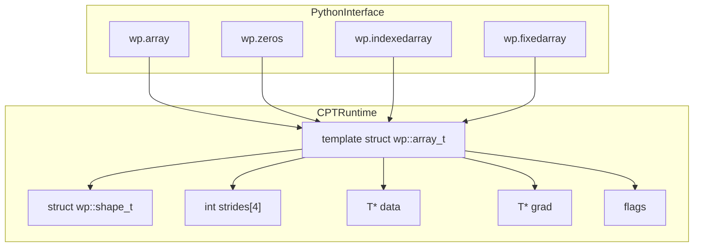
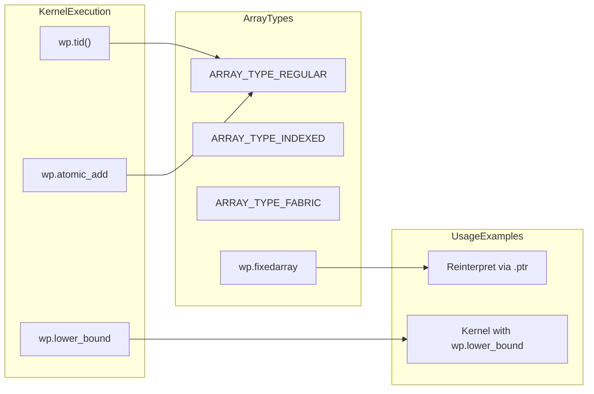

<!-- source: DeepWiki mcp.deepwiki.com · repo NVIDIA/warp · page 2.3 Array System · fetched 2026-10-26 -->

# Array System

<details>
<summary>Relevant source files</summary>

The following files were used as context for generating this wiki page:

- [warp/native/array.h](warp/native/array.h)
- [warp/native/builtin.h](warp/native/builtin.h)
- [warp/tests/test_apic_utility_algorithms.py](warp/tests/test_apic_utility_algorithms.py)
- [warp/tests/test_array.py](warp/tests/test_array.py)
- [warp/tests/test_atomic_bitwise.py](warp/tests/test_atomic_bitwise.py)
- [warp/tests/test_atomic_cas.py](warp/tests/test_atomic_cas.py)
- [warp/tests/test_copy.py](warp/tests/test_copy.py)
- [warp/tests/test_factory_style_array_annotations.py](warp/tests/test_factory_style_array_annotations.py)
- [warp/tests/test_fixedarray.py](warp/tests/test_fixedarray.py)
- [warp/tests/test_iter.py](warp/tests/test_iter.py)
- [warp/tests/test_lvalue.py](warp/tests/test_lvalue.py)
- [warp/tests/test_module_contamination.py](warp/tests/test_module_contamination.py)
- [warp/tests/test_snippet.py](warp/tests/test_snippet.py)
- [warp/types.py](warp/types.py)

</details>


Warp’s Array System is the foundational data structure layer for efficient multi-dimensional data storage and manipulation on CPU and CUDA devices. It provides the `wp.array` class and its specialized variants (`array1d/2d/3d/4d`, `indexedarray`, `fixedarray`, `fabricarray`) with flexible memory layouts, device-aware allocation, gradient support for automatic differentiation, and efficient copy semantics.

This page details the array system’s architecture, data flow, and key functions/classes, explaining how arrays are represented, accessed, and integrated with Warp’s kernel and autograd systems.

---

## Core Array Architecture

At the core, Warp arrays bridge Python interfaces and a C++ runtime implementation. Each array instance is metadata built around a pointer to memory holding primal values and optionally gradients.

### Internal Representation

- The core C++ struct template is `wp::array_t<T>`, templated on element type `T` [warp/native/array.h:173]().  
- Arrays support up to 4 dimensions (`ARRAY_MAX_DIMS = 4`) [warp/native/array.h:130]().  
- Metadata includes shape (dimension sizes), strides (byte offsets for each dimension), flags, and pointers to both primal data (`data`) and gradients (`grad`) [warp/native/array.h:173-199]().  
- Memory layout supports contiguous and strided arrays for advanced slicing and transpose views.

| Property       | Description                                   | Code Reference                    |
|----------------|-----------------------------------------------|---------------------------------|
| `data`         | Pointer to primal (value) array memory       | [warp/native/array.h:173-199]()  |
| `grad`         | Pointer to gradient (adjoint) array memory   | [warp/native/array.h:173-199]()  |
| `shape`        | Fixed-size array of up to 4 dimension sizes  | [warp/native/array.h:140-159]()  |
| `strides`      | Byte strides for each dimension               | [warp/native/array.h:173-199]()  |
| `ndim`         | Number of active dimensions (1 to 4)          | [warp/native/array.h:179-180]()  |
| `flags`        | Bitmask flags (e.g., gradient retention)     | [warp/native/array.h:138]()      |

### Diagram: Natural Language to Code Entity Space: Core Array



Sources: [warp/native/array.h:130-253](), [warp/__init__.py:4-16](), [warp/types.py:12-44](), [warp/tests/test_array.py:29-35]()

---

## Array Variants and Specialized Types

Warp provides several array variants optimized for different use cases:

### 1. Regular Arrays (`wp.array` and `array1d/2d/3d/4d`)

- Base arrays with contiguous or strided storage supporting up to 4 dimensions.  
- Specialized factory functions and type annotations exist for dimension-restricted arrays (e.g., `wp.array2d[int]`) [warp/tests/test_array.py:43-55]().  
- Support indexing with multiple indices and slicing [warp/tests/test_fixedarray.py:41-48]().  

Example test kernels demonstrate indexing for 1D to 4D arrays and expectations on shape and content [warp/tests/test_array.py:14-160]().

### 2. Indexed Arrays (`wp.indexedarray`)

- Support indirect access via an index buffer, useful for sparse/fabric-like memory layouts [warp/tests/test_factory_style_array_annotations.py:30]().  
- Internally marked with `ARRAY_TYPE_INDEXED` (value 1) to differentiate memory layout and access semantics [warp/native/array.h:133-136]().  
- Enable flexible memory referencing patterns with efficient lookup.  

### 3. Fixed Arrays (`wp.fixedarray`)

- Small, fixed-size arrays with compile-time known shapes [warp/tests/test_fixedarray.py:89]().  
- Typically utilized for local storage inside kernels or functions, stored on-stack or within shared memory.  
- Can be reinterpreted as other array types using `.ptr` with modified dtype and shape [warp/tests/test_fixedarray.py:215-230]().

### 4. Fabric Arrays

- Specialized backend arrays (`ARRAY_TYPE_FABRIC` and `ARRAY_TYPE_FABRIC_INDEXED`) supporting alternative memory models [warp/native/array.h:135-136]().

---

### Diagram: Natural Language to Code Entity Space: Array Variants


Sources: [warp/native/array.h:130-137](), [warp/tests/test_fixedarray.py:213-229](), [warp/tests/test_array.py:180-185]()

---

## Memory Layout and Strides

Warp arrays store shape and strides explicitly to enable flexible data views without data copies:

- Strides specify the byte offset to jump for each index increment in each dimension.  
- For contiguous arrays, strides follow a row-major layout: the stride for dimension `d` equals the product of sizes of dimensions after `d`, multiplied by `sizeof(T)` [warp/native/array.h:227-230]().  
- Non-contiguous arrays arise from slicing or transposing, where strides can be irregular or reordered.

Example: 3D contiguous strides for shape `(dim0, dim1, dim2)` with dtype size `sizeof(T)` [warp/native/array.h:227-230]():

```text
strides[2] = sizeof(T)
strides[1] = dim2 * sizeof(T)
strides[0] = dim1 * dim2 * sizeof(T)
```
Sources: [warp/native/array.h:227-230]()

### Non-Contiguous Views Example

Warp supports non-contiguous arrays created by slicing or transpose views. For instance, a manually created transposed 4D array has strides reordered from the base array to reflect non-contiguity [warp/tests/test_array.py:161-170]():

```python
arr_T = wp.array(
    dtype=arr.dtype,
    shape=a_T.shape,
    strides=a_T.__array_interface__["strides"],
    capacity=arr.capacity,
    ptr=arr.ptr,
    requires_grad=arr.requires_grad,
    device=device,
)
```

Reflection in tests confirms `arr_T.is_contiguous == False` [warp/tests/test_array.py:171]()

Sources: [warp/tests/test_array.py:158-176](), [warp/tests/test_copy.py:81-84]()

---

## Device Placement and Gradient Support

Arrays are allocated and bound to a specific device (`wp.Device`) on construction:

- Device placement is explicit; arrays reside either on CPU or CUDA devices.  
- Underlying memory allocation is managed by the device context.

### Gradient Support

- Arrays can be created with `requires_grad=True`, allocating an associated gradient buffer of the same shape and dtype [warp/tests/test_copy.py:137]() [warp/tests/test_lvalue.py:86]().  
- Gradient buffer pointers are stored in `grad` within `wp::array_t` [warp/native/array.h:173-199]().  
- The flag `ARRAY_FLAG_RETAIN_GRAD` indicates gradient retention [warp/native/array.h:138]().

The autograd system (`wp.Tape`) uses these gradient buffers to accumulate gradients during backward passes [warp/tests/test_array.py:163-180](), [warp/tests/test_snippet.py:57-63]().

Sources: [warp/native/array.h:138-199](), [warp/tests/test_snippet.py:57-63]()

---

## Copy Semantics and Memory Operations

Warp arrays support efficient copying and data synchronization between host and device:

- Copying can handle both contiguous and non-contiguous arrays gracefully [warp/tests/test_copy.py:81-120]().  
- Tests verify copies between strided, transposed, and indexed arrays maintain correctness [warp/tests/test_copy.py:50-210]().  
- Warp kernels can perform element-wise operations and atomic updates on arrays of all variants [warp/tests/test_array.py:22](), [warp/tests/test_atomic_cas.py:26-38]().

Copying uses device synchronization primitives to ensure data integrity across devices [warp/tests/test_copy.py:92-115]().

Sources: [warp/tests/test_copy.py:50-210]()

---

## Kernel Integration and Access Semantics

Warp kernels interact with arrays using their Python-encoded types and kernel annotations:

- Arrays are passed as kernel arguments with type annotations such as `wp.array1d[int]` or factory-style annotations `wp.array(dtype=float, ndim=2)` [warp/tests/test_array.py:16](), [warp/tests/test_factory_style_array_annotations.py:45]().  
- Array element accesses in kernels are via standard indexing syntax `a[i, j]` or `a[i][j]`, transparently compiled to native offset calculations using strides [warp/tests/test_array.py:47-48]().  
- Atomic operations are supported on arrays with Warp’s `wp.atomic_add` and related functions for safe concurrent updates [warp/tests/test_array.py:22](), [warp/tests/test_atomic_cas.py:26-36]().  
- Bounds checking and floating-point verification can be enabled via `FP_CHECK` for debugging [warp/native/array.h:10-53]().

Sources: [warp/tests/test_array.py:16-48](), [warp/native/array.h:10-53]()

---

# Summary of Key APIs

| API                        | Description                                         | Example/Test Reference                   |
|----------------------------|-----------------------------------------------------|-----------------------------------------|
| `wp.array(data, dtype, shape, strides, device)`  | Create a regular multi-dimensional array         | [warp/tests/test_array.py:26-133]()    |
| `wp.indexedarray(data, indices, dtype)`         | Create an indexed array overlay                    | [warp/tests/test_factory_style_array_annotations.py:30]() |
| `wp.fixedarray(shape, dtype)`                    | Create a fixed-size array with static dimensions   | [warp/tests/test_fixedarray.py:14-70]() |
| `.ptr` property                                   | Reinterpret array data pointer with new type/shape | [warp/tests/test_fixedarray.py:215-230]() |
| `wp.copy(dst, src)`                               | Copy data between arrays (supporting strides, devices) | [warp/tests/test_copy.py:50-210]()     |
| `wp.atomic_add(arr, index, value)`               | Perform atomic addition on array element            | [warp/tests/test_array.py:14-24]()      |

Sources: [warp/tests/test_array.py:26-133](), [warp/tests/test_factory_style_array_annotations.py:30](), [warp/tests/test_fixedarray.py:14-230](), [warp/tests/test_copy.py:50-210]()

---

# References

- `warp/native/array.h` lines 130-253: core C++ array structure and flags  
- `warp/__init__.py` lines 4-16: Python interface mapping  
- `warp/tests/test_array.py` lines 14-180: array usage tests for 1D-4D arrays, contiguity, and strides  
- `warp/tests/test_fixedarray.py` lines 10-70: tests and usage of fixedarray variant  
- `warp/tests/test_copy.py` lines 50-210: copy semantics and non-contiguous array tests  
- `warp/native/builtin.h` lines 10-53: floating-point check macros relevant for debugging arrays  
- `warp/tests/test_factory_style_array_annotations.py` lines 20-100: examples of factory-style array type annotations and kernel usage  

Sources: [warp/native/array.h:130-253](), [warp/__init__.py:4-16](), [warp/tests/test_array.py:14-180](), [warp/tests/test_fixedarray.py:10-70](), [warp/tests/test_copy.py:50-210](), [warp/tests/test_factory_style_array_annotations.py:20-100](), [warp/native/builtin.h:10-53]()

---

