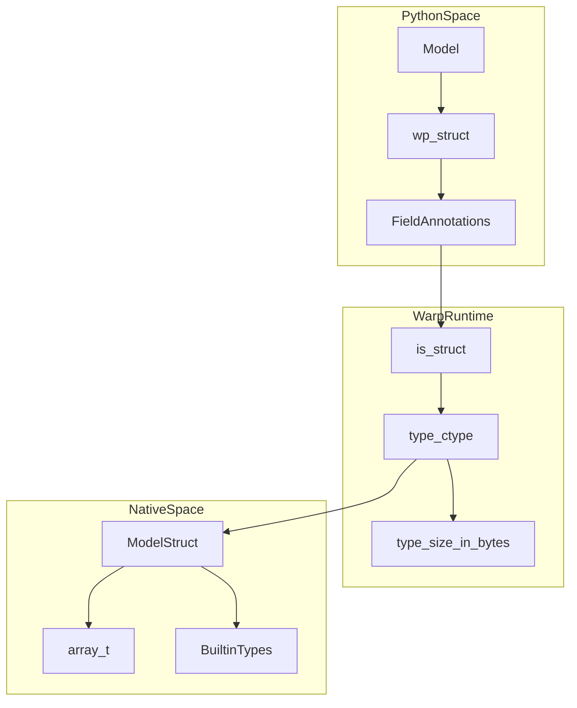
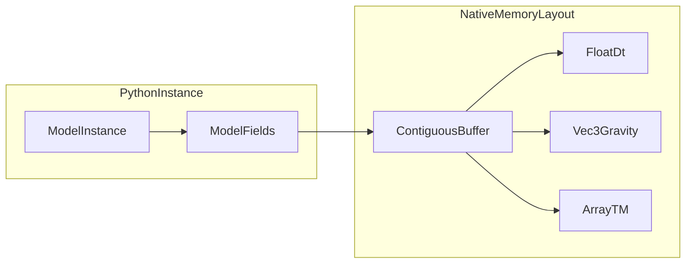

<!-- source: DeepWiki mcp.deepwiki.com · repo NVIDIA/warp · page 2.4 Struct Types · fetched 2026-10-26 -->

# Struct Types

<details>
<summary>Relevant source files</summary>

The following files were used as context for generating this wiki page:

- [warp/tests/test_codegen.py](warp/tests/test_codegen.py)
- [warp/tests/test_constant_precision.py](warp/tests/test_constant_precision.py)
- [warp/tests/test_ctypes.py](warp/tests/test_ctypes.py)
- [warp/tests/test_fabricarray.py](warp/tests/test_fabricarray.py)
- [warp/tests/test_generics.py](warp/tests/test_generics.py)
- [warp/tests/test_struct.py](warp/tests/test_struct.py)
- [warp/tests/test_vec_constructors.py](warp/tests/test_vec_constructors.py)
- [warp/tests/tile/test_tile_construction.py](warp/tests/tile/test_tile_construction.py)
- [warp/tests/tile/test_tile_struct.py](warp/tests/tile/test_tile_struct.py)

</details>


## Purpose and Scope

This page documents Warp's struct type system, which allows users to define custom composite data structures for use in kernels. Struct types are created using the `@wp.struct` decorator and can contain scalar fields, vector/matrix types, arrays, and nested structs. Structs integrate with Python's `ctypes` system for memory layout and can be stored in arrays or passed as kernel or function parameters.

Structs are a core part of Warp's type system, enabling hierarchical data organization while maintaining high-performance native execution [warp/tests/test_struct.py:20-31]().

Sources: `[warp/tests/test_struct.py:20-31]()`

---

## Defining Struct Types

Struct types are defined by applying the `@wp.struct` decorator to a Python class. The decorator inspects the class annotations to determine the struct's fields, their types, and their memory offsets.

```python
@wp.struct
class Model:
    dt: float
    gravity: wp.vec3
    m: wp.array[float]
```

The `@wp.struct` decorator transforms the annotated class into a Warp struct type. Each field must have a type annotation using Warp-compatible types such as scalars (`float`, `int`), vectors (`wp.vec3`), or arrays (`wp.array`). Structs can also be empty [warp/tests/test_struct.py:157-159]().

Structs are Python classes that become ctypes-compatible structures under the hood, enabling predictable binary layout and interfacing with native code [warp/tests/test_struct.py:16-31]() [warp/tests/test_struct.py:153-155]().

Sources: `[warp/tests/test_struct.py:16-31]()`, `[warp/tests/test_struct.py:153-159]()`

---

## Struct Definition and Type System Integration

Warp transforms a Python class decorated with `@wp.struct` into a native-compatible structure representation embedded in the Warp runtime. This involves:

1. Inspecting Python class annotations to define field names and types.
2. Mapping Warp types (scalars, vectors, arrays, nested structs) to native equivalents.
3. Producing a ctypes `Structure` subclass with corresponding fields and offsets for usage in kernels and array storage.

### Struct Transformation Pipeline

Sources: `[warp/tests/test_struct.py:16-31]()`

---

## Supported Field Types

Struct fields can contain the following categories of Warp types:

| Field Type Category | Examples | Notes |
|---------------------|----------|-------|
| **Scalars** | `float`, `int`, `wp.int8`, `wp.uint32` | Mapped to native scalar types like `float32`, `int32`. |
| **Vectors / Matrices** | `wp.vec3`, `wp.mat44` | Fixed-size geometric types with contiguous memory layout. |
| **Arrays** | `wp.array[float]`, `wp.array[wp.vec3]` | Represented as native `array_t<T>` struct containing data pointer, shape, strides, and grad pointers. |
| **Nested Structs** | Other `@wp.struct` classes | Enable hierarchical data structures within a kernel. |

### Example Nested Structs

```python
@wp.struct
class Baz:
    data: wp.array[int]
    z: wp.vec3

@wp.struct
class Bar:
    baz: Baz
    y: float

@wp.struct
class Foo:
    bar: Bar
    x: int
```

Nested structs compose naturally, allowing fields themselves to be structs with their own typed fields [warp/tests/test_struct.py:178-193]().

Sources: `[warp/tests/test_struct.py:178-193]()`

---

## Memory Layout and Native Representation

Warp structs are implemented as subclasses of `ctypes.Structure`. This ensures that:

- Field order is preserved as declared in the Python class.
- Each field’s low-level type corresponds to a fixed-size native type (e.g., `float32` for `float`).
- Arrays within structs use native array views (`array_t<T>`) with pointers to data and metadata.
- Complex fields (like vectors and matrices) are represented as contiguous C-like structs.

### Struct Memory Mapping

Sources: `[warp/tests/test_struct.py:52-90]()`

---

## Using Structs in Kernels

Warp struct instances can be passed as kernel inputs or outputs. Inside kernels, fields are accessed with dot notation. Array fields inside structs can be indexed normally.

### Kernel Parameters and Access

```python
@wp.kernel
def kernel_step(state_in: State, state_out: State, model: Model):
    i = wp.tid()
    # Access array fields and perform computation
    state_out.v[i] = state_in.v[i] + model.gravity / model.m[i] * model.dt
```

### Struct Construction in Kernels

Structs can be constructed inside kernels using constructor syntax, enabling local copies or rescaling of values.

```python
@wp.kernel
def kernel_step_with_copy(state_in: State, state_out: State, model: Model):
    i = wp.tid()
    # Create a local copy with modified gravity scaled by per-element mass and dt
    model_rescaled = Model(1.0, model.gravity / model.m[i] * model.dt, model.m)
    # Use model_rescaled for computations
    state_out.v[i] = state_in.v[i] + model_rescaled.gravity
```

Sources: `[warp/tests/test_struct.py:33-51]()`

---

## Gradient Support and Autodiff

Warp structs integrate seamlessly with the automatic differentiation system using `wp.Tape`. Gradient propagation works if the struct fields include arrays with `requires_grad=True`.

- Tape records kernel launches with struct inputs and outputs.
- Gradients are propagated through all differentiable fields inside structs recursively.
- Users can access the gradients via the `.grad` attribute on array fields inside structs.

Example of gradient tracking with struct containing arrays:

```python
tape = wp.Tape()
with tape:
    wp.launch(step_kernel, dim=dim, inputs=[state_in, state_out, model], device=device)

tape.backward(loss)

# Gradients accessible via struct fields
grad_m = model.m.grad.numpy()
```

Sources: `[warp/tests/test_struct.py:98-155]()`

---

## Technical Limitations

- **Inheritance**: Structs do **not** support Python inheritance for kernel execution logic.
- **Uninitialized Fields**: Accessing uninitialized struct fields (especially arrays) in kernels is undefined and may cause crashes [warp/tests/test_struct.py:167-176]().
- **Attribute Errors**: Accessing unknown attributes on structs inside kernels raises `AttributeError` during JIT compilation.

Sources: `[warp/tests/test_struct.py:167-176]()`

---

## Summary of Key Entities

| Entity           | Location                     | Description                                                |
|------------------|------------------------------|------------------------------------------------------------|
| `@wp.struct`     | `warp/tests/test_struct.py`  | Decorator to define a Warp-compatible structure.           |
| `Tape`           | `warp/tests/test_struct.py`  | Records kernel launches and gradients involving structs.   |
| `test_struct.py` | `warp/tests/test_struct.py`  | Extensive tests for nested structs, arrays, and kernels.   |

Sources: `[warp/tests/test_struct.py:1-200]()`

---

