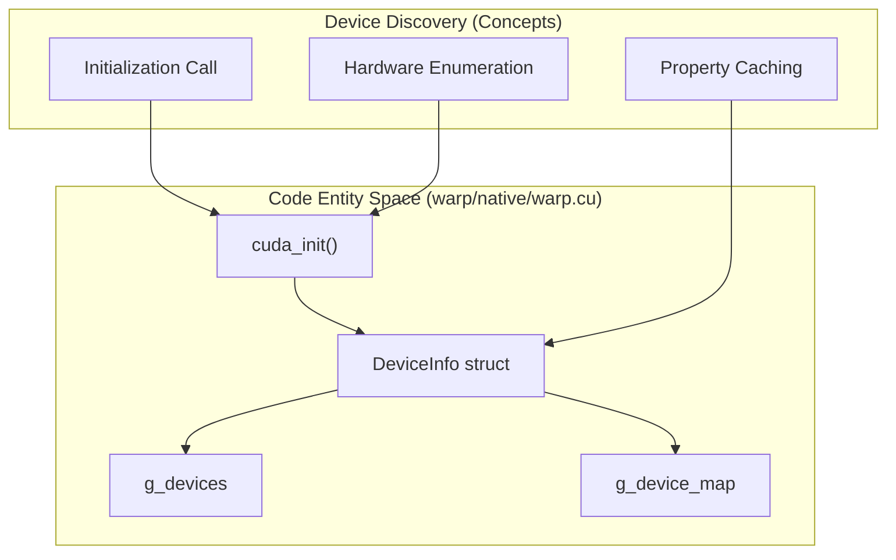
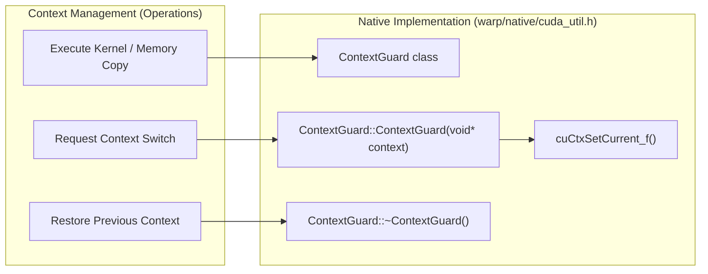
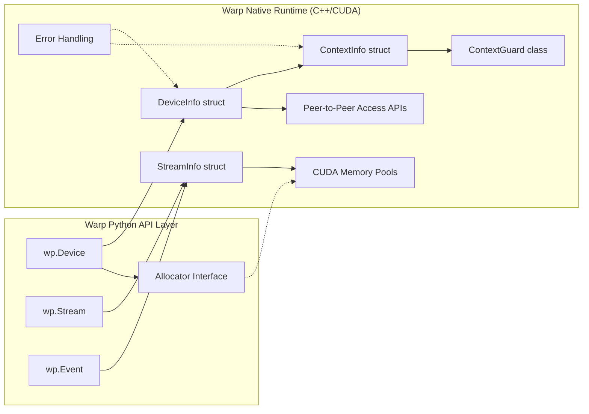

<!-- source: DeepWiki mcp.deepwiki.com · repo NVIDIA/warp · page 2.5 Context and Device Management · fetched 2026-10-26 -->

# Context and Device Management

Relevant source files

The following files were used as context for generating this wiki page:

- [CODE_OF_CONDUCT.md](CODE_OF_CONDUCT.md)
- [design/pluggable-allocators.md](design/pluggable-allocators.md)
- [docs/api_reference/warp.rst](docs/api_reference/warp.rst)
- [docs/domain_modules/render.rst](docs/domain_modules/render.rst)
- [docs/user_guide/execution_and_performance/memory_management.rst](docs/user_guide/execution_and_performance/memory_management.rst)
- [docs/user_guide/execution_and_performance/profiling.rst](docs/user_guide/execution_and_performance/profiling.rst)
- [licenses/usd-LICENSE.txt](licenses/usd-LICENSE.txt)
- [warp/__init__.py](warp/__init__.py)
- [warp/_src/rmm_allocator.py](warp/_src/rmm_allocator.py)
- [warp/native/cuda_util.cpp](warp/native/cuda_util.cpp)
- [warp/native/cuda_util.h](warp/native/cuda_util.h)
- [warp/native/warp.cpp](warp/native/warp.cpp)
- [warp/native/warp.cu](warp/native/warp.cu)
- [warp/native/warp.h](warp/native/warp.h)
- [warp/tests/cuda/__init__.py](warp/tests/cuda/__init__.py)
- [warp/tests/cuda/test_async.py](warp/tests/cuda/test_async.py)
- [warp/tests/cuda/test_conditional_captures.py](warp/tests/cuda/test_conditional_captures.py)
- [warp/tests/cuda/test_cuda_arch_suffix.py](warp/tests/cuda/test_cuda_arch_suffix.py)
- [warp/tests/cuda/test_ipc.py](warp/tests/cuda/test_ipc.py)
- [warp/tests/cuda/test_multigpu.py](warp/tests/cuda/test_multigpu.py)
- [warp/tests/cuda/test_pinned.py](warp/tests/cuda/test_pinned.py)
- [warp/tests/cuda/test_streams.py](warp/tests/cuda/test_streams.py)
- [warp/tests/geometry/__init__.py](warp/tests/geometry/__init__.py)

This page documents Warp's device and context management subsystem, which underpins the framework's execution environment for GPU-accelerated kernels. It covers the abstractions `wp.Device`, `wp.Stream`, `wp.Event`, CUDA context management strategies, multi-GPU support, synchronization mechanisms, memory pools, and the pluggable allocator interface enabling seamless memory management integration.

---

## Device Management Architecture

Warp maintains a global device registry that abstracts CUDA and CPU devices, exposing their capabilities, memory properties, and compute architectures. Device enumeration and initialization occur during Warp's global `init()` call, relying on native CUDA driver APIs to detect available devices, cache their properties, and manage their runtime state [warp/native/warp.cpp:118-139]().

### DeviceInfo Structure and Discovery

Each device is represented by a `DeviceInfo` struct in the native runtime, which encapsulates data critical for device selection, memory management, and execution configuration [warp/native/warp.cu:139-161]().

| Field                 | Description                                   | Source Line Range               |
|-----------------------|-----------------------------------------------|-----------------------------|
| `device`              | CUDA device handle (`CUdevice`)               | [warp/native/warp.cu:142]()  |
| `arch`                | Compute capability architecture (`sm_xx`)      | [warp/native/warp.cu:149]()  |
| `is_mempool_supported`| CUDA stream-ordered memory pool support flag | [warp/native/warp.cu:156]()  |
| `primary_context`     | Persistent primary CUDA context (`CUcontext`)   | [warp/native/warp.cu:160]()  |
| `is_uva`              | Unified Virtual Addressing support            | [warp/native/warp.cu:150]()  |

The native function `cuda_init()` performs enumeration and populates global registries such as `g_devices` and device maps [warp/native/warp.cpp:118-139]().

#### Device Discovery — Natural Language to Code Entity Mapping

Sources: [warp/native/warp.cu:139-161](), [warp/native/warp.cpp:118-139]()

---

## CUDA Context Management

Warp manages CUDA contexts to ensure correct lifecycle management, synchronization, and resource allocation across threads. The CUDA context system includes:

- `ContextInfo` structures maintaining context state and linking to device info [warp/native/warp.cu:163-171]().
- Context association with streams and graph modules for efficient kernel launching.
- Automated context switching when executing kernels on different GPUs.

The runtime tracks the active context on each thread, and the RAII-style `ContextGuard` class manages safe context activation and restoration [warp/native/warp.cu:163-171](), [warp/native/cuda_util.h:184-214]().

### Context Management as RAII

Sources: [warp/native/warp.cu:163-171](), [warp/native/cuda_util.h:184-214]()

---

## Stream and Event Management

Warp exposes `wp.Stream` and `wp.Event` abstractions corresponding to CUDA streams and events, representing asynchronous execution queues and synchronization points respectively. Each CUDA context tracks a current stream pointer manipulated via Python using `wp.set_stream()` [warp/tests/cuda/test_streams.py:35-51]().

### Stream State Tracking

The native runtime maintains stream state via internal structures tracking the underlying `CUstream`, cached events for efficient synchronization, and capture metadata for CUDA graphs [warp/native/warp.cu:166-171]().

| Warp Primitive | Native Entity     | Description                                    |
|----------------|-------------------|------------------------------------------------|
| `Stream`       | `CUstream`        | Asynchronous execution queue                    |
| `Event`        | `CUevent`         | Marker for synchronizing kernels and memory   |
| CurrentStream  | `WP_CURRENT_STREAM` | Special constant (`0xFFFFFFFFFFFFFFFF`) representing the stream currently active in Warp's context [warp/native/warp.h:15]() |

Sources: [warp/native/warp.cu:166-171](), [warp/native/warp.h:15](), [warp/tests/cuda/test_streams.py:35-51]()

---

## Synchronization Primitives and Utilities

Warp provides multiple synchronization primitives to coordinate GPU kernels and host execution:

1. **Stream Synchronization**: Functions like `wp.synchronize_stream(stream)` block the host until the specified stream's queued work completes [warp/tests/cuda/test_streams.py:120]().
2. **Event Recording**: `stream.record_event(event)` enqueues an event on a stream to capture completion milestones [warp/tests/cuda/test_streams.py:145]().
3. **Cross-Stream Waiting**: `stream.wait_event(event)` and `stream.wait_stream(other_stream)` allow streams to wait asynchronously without blocking the host CPU [warp/tests/cuda/test_streams.py:148-149]().
4. **Scoped Resource Management**: Context managers such as `wp.ScopedStream` and `wp.ScopedDevice` handle implicit synchronization and automatically restore stream and device state upon exiting context blocks [warp/tests/cuda/test_streams.py:86-94]().

Sources: [warp/tests/cuda/test_streams.py:52-193](), [warp/native/cuda_util.h:88-109]()

---

## Multi-GPU and Peer Access Support

Warp supports multi-GPU scaling through device ordinal identifiers (e.g., `"cuda:0"`, `"cuda:1"`). Devices are queried via `wp.get_device()` or listed with `wp.get_cuda_devices()`.

### Peer-to-Peer Memory Access

Peer-to-peer (P2P) access enables direct GPU-to-GPU memory transfers and reads without staging through host memory:
- Native queries use `cuDeviceCanAccessPeer_f` to check compatibility and `cuCtxEnablePeerAccess_f` to enable device context access [warp/native/cuda_util.h:59-84]().
- Device objects expose properties indicating support for peer memory access, unified addressing, and managed memory migration [warp/native/warp.cu:139-161]().

Sources: [warp/native/cuda_util.h:59-84](), [warp/native/warp.cu:139-161](), [warp/tests/cuda/test_streams.py:35-51]()

---

## Memory Pools and Pluggable Allocators

Warp leverages CUDA stream-ordered memory pools (`cudaMallocAsync`) by default on supported devices to accelerate allocations and enable memory allocation within CUDA Graph captures [docs/user_guide/execution_and_performance/memory_management.rst:62-96]().

### Mempool Allocators

- Enabled automatically during `wp.init()` on compatible devices [docs/user_guide/execution_and_performance/memory_management.rst:111-133]().
- Allocations via `wp_alloc_device_async` are tied to CUDA streams and backed by the stream-ordered memory pool [warp/native/warp.h:73-74]().

### Pluggable Allocator Interface

Developers can define custom allocation strategies by implementing the `Allocator` interface, routing memory allocations through external frameworks like PyTorch or RMM.

| Method        | Description                     |
|---------------|---------------------------------|
| `allocate(size, alignment, device)` | Allocate a memory block          |
| `deallocate(ptr, size, alignment, device)` | Free the allocated memory    |

Sources: [docs/user_guide/execution_and_performance/memory_management.rst:62-133](), [warp/native/warp.h:71-76]()

---

## Error Handling and CUDA Driver Initialization

Warp dynamically loads the CUDA driver API to maintain compatibility without statically linking against the CUDA Toolkit.

- During initialization (`wp_init`), Warp checks version compatibility between the compiled native library and runtime expectations [warp/native/warp.cpp:118-139]().
- Driver entry points are resolved dynamically using platform-specific dynamic loading functions (`dlopen`/`LoadLibrary`) [warp/native/cuda_util.cpp:50-128]().
- `wp_get_error_string()` exposes descriptive error messages for driver failures, NVRTC compilation errors, and internal runtime faults [warp/native/warp.h:45-46]().

Sources: [warp/native/warp.cpp:118-139](), [warp/native/cuda_util.cpp:50-157](), [warp/native/warp.h:45-46]()

---

## Summary Diagram: Warp Context and Device Management Components

Sources: [warp/native/warp.cu:139-171](), [warp/native/warp.h:15-76](), [warp/native/warp.cpp:118-139](), [warp/native/cuda_util.h:59-109]()

---

---

