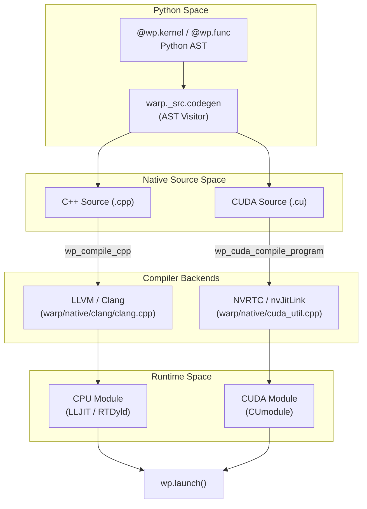
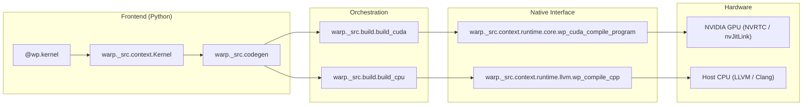

<!-- source: DeepWiki mcp.deepwiki.com · repo NVIDIA/warp · page 2.6 JIT Compilation System · fetched 2026-10-26 -->

# JIT Compilation System

Relevant source files

The following files were used as context for generating this wiki page:

- [build_lib.py](build_lib.py)
- [build_llvm.py](build_llvm.py)
- [changelog/2000.fixed.md](changelog/2000.fixed.md)
- [changelog/2004.added.md](changelog/2004.added.md)
- [changelog/2014.fixed.md](changelog/2014.fixed.md)
- [design/cpu-llvm-compiler-options.md](design/cpu-llvm-compiler-options.md)
- [docs/user_guide/configuration.rst](docs/user_guide/configuration.rst)
- [warp/_src/build.py](warp/_src/build.py)
- [warp/_src/build_dll.py](warp/_src/build_dll.py)
- [warp/native/clang/clang.cpp](warp/native/clang/clang.cpp)
- [warp/tests/aot/__init__.py](warp/tests/aot/__init__.py)
- [warp/tests/aot/aux_test_generic_multiple_overloads.py](warp/tests/aot/aux_test_generic_multiple_overloads.py)
- [warp/tests/aot/aux_test_generic_no_overloads.py](warp/tests/aot/aux_test_generic_no_overloads.py)
- [warp/tests/aot/aux_test_generic_one_overload.py](warp/tests/aot/aux_test_generic_one_overload.py)
- [warp/tests/aot/aux_test_hash_reload.py](warp/tests/aot/aux_test_hash_reload.py)
- [warp/tests/aot/aux_test_mixed_generic_kernels.py](warp/tests/aot/aux_test_mixed_generic_kernels.py)
- [warp/tests/aot/aux_test_mixed_regular_and_generic.py](warp/tests/aot/aux_test_mixed_regular_and_generic.py)
- [warp/tests/aot/aux_test_strip_hash_option.py](warp/tests/aot/aux_test_strip_hash_option.py)
- [warp/tests/aot/test_module_aot.py](warp/tests/aot/test_module_aot.py)
- [warp/tests/test_codegen.py](warp/tests/test_codegen.py)
- [warp/tests/test_constant_precision.py](warp/tests/test_constant_precision.py)
- [warp/tests/test_cpu_precompiled_headers.py](warp/tests/test_cpu_precompiled_headers.py)
- [warp/tests/test_fabricarray.py](warp/tests/test_fabricarray.py)
- [warp/tests/test_generics.py](warp/tests/test_generics.py)
- [warp/tests/test_kernel_cache.py](warp/tests/test_kernel_cache.py)
- [warp/tests/test_module_hashing.py](warp/tests/test_module_hashing.py)
- [warp/tests/test_options.py](warp/tests/test_options.py)
- [warp/tests/test_static.py](warp/tests/test_static.py)
- [warp/tests/test_struct.py](warp/tests/test_struct.py)
- [warp/tests/test_vec_constructors.py](warp/tests/test_vec_constructors.py)
- [warp/tests/tile/test_tile_construction.py](warp/tests/tile/test_tile_construction.py)
- [warp/tests/tile/test_tile_struct.py](warp/tests/tile/test_tile_struct.py)

The JIT (Just-In-Time) Compilation System is the core engine that transforms Python source code into high-performance native machine code. It manages the lifecycle of Warp kernels from initial AST transformation to final execution on CPU or GPU devices. The system includes a sophisticated caching layer to avoid redundant compilation and provides specialized optimization paths for math-heavy operations and tile-based computing.

Sources: [build_lib.py:1-734](), [warp/tests/test_codegen.py:1-330](), [warp/native/clang/clang.cpp:1-185](), [build_llvm.py:1-159]()

## JIT Compilation Pipeline

The compilation pipeline converts `@wp.kernel` and `@wp.func` decorated functions into executable binaries. This involves transforming Python code into an intermediate C++ or CUDA representation, compiling that representation using platform-specific backends, and loading the resulting modules into the runtime environment.

### Compilation Flow

Sources: [warp/_src/build.py:38-107](), [warp/_src/build.py:120-163](), [warp/native/clang/clang.cpp:162-210]()

### Pipeline Stages

1.  **AST Transformation**: Warp parses the Python function's source code into an Abstract Syntax Tree (AST) using the `ast` module.
2.  **Code Generation**: The `warp._src.codegen` module traverses the AST to generate equivalent C++ or CUDA C++ code [warp/tests/test_codegen.py:1-40](). This includes handling complex control flow such as `while` loops, `break`, and `continue` [warp/tests/test_codegen.py:207-330]().
3.  **CPU Backend (LLVM/Clang)**: For CPU targets, `build_cpu()` calls the native `wp_compile_cpp` interface [warp/_src/build.py:154-201](). The backend uses `clang::CompilerInstance` to generate optimized object code [warp/native/clang/clang.cpp:7-32]()
4.  **GPU Backend (NVRTC)**: For CUDA targets, `build_cuda()` utilizes `wp_cuda_compile_program` [warp/_src/build.py:64-143](). This leverages NVRTC for runtime compilation and supports `nvJitLink` for linking LTO IR and fatbins [warp/_src/build.py:21-23]().
5.  **Module Loading**: Compiled artifacts are loaded into memory. CPU kernels are managed by LLVM's `LLJIT` or `RTDyldObjectLinkingLayer` [warp/native/clang/clang.cpp:43-45](), while GPU kernels are loaded as `CUmodule` objects via `wp_cuda_load_module` [warp/_src/build.py:146-151]().

Sources: [warp/_src/build.py:64-201](), [warp/native/clang/clang.cpp:7-45]()

## Kernel Cache System

Warp implements a persistent disk-based cache to minimize startup overhead. Every kernel and its associated compilation settings (including optimization levels and compiler flags) are hashed to create a unique identifier.

### Cache Directory Discovery

The cache location is established via configuration and environment lookups [docs/user_guide/configuration.rst:15-32]():
1.  **Explicit Path**: `warp.config.kernel_cache_dir` if set by the user [docs/user_guide/configuration.rst:28-29]().
2.  **Environment Variable**: `WARP_CACHE_PATH`.
3.  **Default**: OS-specific user cache directory appended with the Warp version.

### Cache Integrity and Hashing

To ensure correctness, Warp uses a comprehensive hashing strategy. Changing global configuration options or kernel definitions results in a different module hash, forcing a recompile [warp/tests/test_options.py:193-216](), [warp/tests/test_module_hashing.py:184-216]().

| Feature | Implementation Detail | Reference |
| :--- | :--- | :--- |
| **LTO Cache** | Uses truncated SHA-256 (16 hex chars) for compact filenames. | [warp/_src/build.py:26-30]() |
| **Atomic Writes** | Uses file system renames to prevent partial writes during concurrent compilation. | [warp/_src/build.py:1-50]() |
| **Cleaning** | Cache clearing utilities remove stale artifacts. | [build_lib.py:1-40]() |

Sources: [warp/_src/build.py:26-30](), [warp/tests/test_options.py:193-216](), [warp/tests/test_module_hashing.py:184-216]()

## Backend Implementations

### NVRTC (CUDA)
The CUDA backend supports advanced features like Link-Time Optimization (LTO). It can accept various input types including `cubin`, `ptx`, `ltoir`, and `fatbin` [warp/_src/build.py:21-23]().

*   **JIT Linking**: Uses `nvJitLink` to combine multiple LTO IR modules at runtime [warp/_src/build.py:101-113]().
*   **Arch Targeting**: Compiles to specific compute capabilities (defaulting to `sm_75`) to ensure the output runs on all supported GPUs [warp/native/clang/clang.cpp:115-115]().

### LLVM/Clang (CPU)
The CPU backend provides a full compilation environment using Clang libraries embedded in Warp [warp/native/clang/clang.cpp:7-32]().
*   **Host Feature Detection**: Automatically detects host CPU features (like AVX2, FMA) using `llvm::sys::getHostCPUFeatures` to tune code generation [warp/native/clang/clang.cpp:130-168]().
*   **Target Triple**: Overrides Windows defaults to use `x86_64-pc-windows-elf` to support DWARF debug info while maintaining Microsoft calling conventions [warp/native/clang/clang.cpp:90-103]().
*   **Optimization**: Supports levels O0 through O3 via `get_effective_optimization_level()` [warp/native/clang/clang.cpp:170-184]().

Sources: [warp/_src/build.py:21-113](), [warp/native/clang/clang.cpp:7-184]()

## Generics and Specialization

Warp supports generic programming through the `Any` type [warp/tests/test_generics.py:16-19](). When a kernel is defined with generic arguments, Warp generates specialized versions (overloads) based on the types of the arguments provided at launch [warp/tests/test_generics.py:133-170]().

*   **Specialization**: The `wp.overload()` function registers specific type signatures for generic kernels [warp/tests/test_generics.py:141-143]().
*   **Identifier Generation**: Unique function identifiers are generated to prevent conflicts between different closures or redefined functions [warp/tests/test_codegen.py:1-30]().

Sources: [warp/tests/test_generics.py:16-170](), [warp/tests/test_codegen.py:1-30]()

## Code Entity Map

The following diagram maps the logical compilation steps to the specific code entities responsible for them.

Sources: [warp/_src/build.py:64-201](), [warp/native/clang/clang.cpp:7-45](), [warp/tests/test_codegen.py:1-40]()

---

