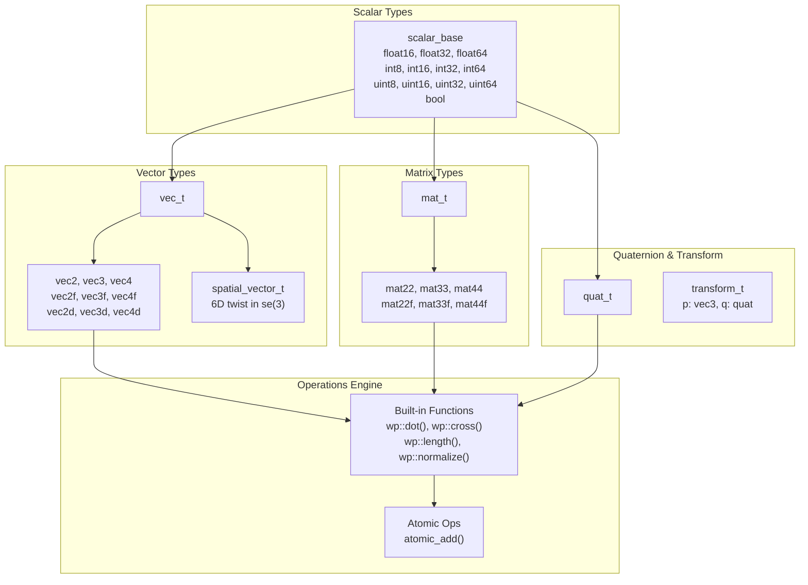
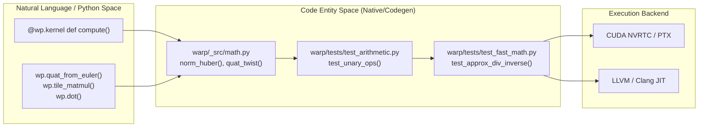

<!-- source: DeepWiki mcp.deepwiki.com · repo NVIDIA/warp · page 3 Mathematics and Computing · fetched 2026-10-26 -->

# Mathematics and Computing

Relevant source files

The following files were used as context for generating this wiki page:

- [changelog/1985.fixed.md](changelog/1985.fixed.md)
- [warp/_src/fem/linalg.py](warp/_src/fem/linalg.py)
- [warp/_src/fem/types.py](warp/_src/fem/types.py)
- [warp/_src/math.py](warp/_src/math.py)
- [warp/tests/fem/test_fem_linalg.py](warp/tests/fem/test_fem_linalg.py)
- [warp/tests/test_arithmetic.py](warp/tests/test_arithmetic.py)
- [warp/tests/test_atomic.py](warp/tests/test_atomic.py)
- [warp/tests/test_fast_math.py](warp/tests/test_fast_math.py)
- [warp/tests/test_fp16.py](warp/tests/test_fp16.py)
- [warp/tests/test_lerp.py](warp/tests/test_lerp.py)
- [warp/tests/test_math.py](warp/tests/test_math.py)
- [warp/tests/test_rounding.py](warp/tests/test_rounding.py)
- [warp/tests/test_smoothstep.py](warp/tests/test_smoothstep.py)
- [warp/tests/test_vec_scalar_ops.py](warp/tests/test_vec_scalar_ops.py)

This section covers Warp's comprehensive mathematical computing capabilities, including built-in mathematical data types, specialized computation patterns like Tile Computing, and advanced spatial data structures. Warp provides a rich set of mathematical types such as vectors, matrices, and quaternions, all with full GPU acceleration and automatic differentiation support.

For details on the foundational types, see [Mathematical Operations](#3.1). For high-performance Tensor Core operations, see [Tile Computing](#3.2). For spatial queries and ray tracing, see [Spatial Data Structures](#3.3). For volumetric data, see [Volume Processing](#3.4). For large-scale linear systems, see [Sparse Linear Algebra](#3.5).

## Mathematical Type System Architecture

Warp's mathematical computing is built around a templated type system that supports multiple precisions and automatic differentiation. The core mathematical types form the foundation for all computational operations in Warp.

### Core Mathematical Types Hierarchy

Sources: [warp/_src/types.py:56-300](), [warp/tests/test_arithmetic.py:1-40](), [warp/tests/test_atomic.py:14-30]()

### Mathematical Operations Integration

Sources: [warp/_src/math.py:13-32](), [warp/tests/test_arithmetic.py:51-88](), [warp/tests/test_fast_math.py:76-88]()

## Mathematical Operations

Warp provides a comprehensive library of scalar, vector, matrix, and quaternion functions. These are implemented as built-ins that are recognized by the Warp compiler and translated to optimized native code, with full support for forward and backward automatic differentiation.

Functions include standard scalar math (`abs`, `sin`, `sqrt`, `clamp`), vector norms (`norm_l1`, `norm_l2`, `norm_huber`, `norm_pseudo_huber`), quaternion conversions (`quat_from_euler`, `quat_to_rpy`, `quat_twist`), and spatial algebra utilities.

For details, see [Mathematical Operations](#3.1).

Sources: [warp/_src/math.py:35-150](), [warp/tests/test_math.py:100-143](), [warp/tests/test_arithmetic.py:119-146]()

## Tile Computing

Tile computing introduces a block-based programming model allowing threads within a block to cooperate on structured data tiles stored in registers or shared memory.

Kernels use `wp.launch_tiled` to coordinate cooperative execution patterns and leverage Tensor Cores through specialized operations such as `tile_matmul`, `tile_fft`, and `tile_cholesky`.

For details, see [Tile Computing](#3.2).

Sources: [warp/tests/test_atomic.py:14-30]()

## Spatial Data Structures

Warp offers high-performance spatial data structures designed to execute collision detection, ray tracing, and spatial queries directly inside JIT-compiled kernels.

Key structures include `Mesh` with Bounding Volume Hierarchies (`BVH`) supporting live refitting and rebuilding, and `HashGrid` for efficient point-based neighbor queries.

For details, see [Spatial Data Structures](#3.3).

Sources: [warp/tests/test_math.py:1-20]()

## Volume Processing

Volumetric simulation and rendering are supported via `wp.Volume` with NanoVDB integration, providing sparse voxel grids, HDDA ray traversal, and tile-based dynamic allocation.

For details, see [Volume Processing](#3.4).

Sources: [warp/tests/test_fp16.py:1-25]()

## Sparse Linear Algebra

For large-scale systems and matrix-free or sparse solvers, Warp provides Block Sparse Row (`BSR`) matrix structures, parallel sorting primitives (`tile_sort`), prefix sums (`scan`), and iterative Krylov solvers.

For details, see [Sparse Linear Algebra](#3.5).

Sources: [warp/tests/fem/test_fem_linalg.py:1-30]()

---

