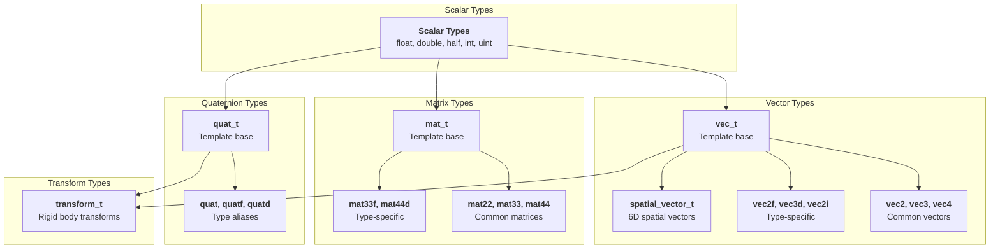
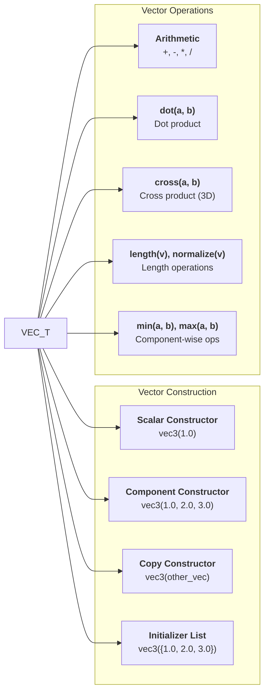

<!-- source: DeepWiki mcp.deepwiki.com · repo NVIDIA/warp · page 3.1 Mathematical Operations · fetched 2026-10-26 -->

# Mathematical Operations

Relevant source files

The following files were used as context for generating this wiki page:

- [changelog/1985.fixed.md](changelog/1985.fixed.md)
- [changelog/2010.fixed.md](changelog/2010.fixed.md)
- [warp/_src/fem/linalg.py](warp/_src/fem/linalg.py)
- [warp/_src/fem/types.py](warp/_src/fem/types.py)
- [warp/_src/math.py](warp/_src/math.py)
- [warp/native/matnn.h](warp/native/matnn.h)
- [warp/native/noise.h](warp/native/noise.h)
- [warp/native/rand.h](warp/native/rand.h)
- [warp/native/svd.h](warp/native/svd.h)
- [warp/tests/assets/curlnoise_golden.npy](warp/tests/assets/curlnoise_golden.npy)
- [warp/tests/assets/mlp_golden.npy](warp/tests/assets/mlp_golden.npy)
- [warp/tests/assets/pnoise_golden.npy](warp/tests/assets/pnoise_golden.npy)
- [warp/tests/fem/test_fem_linalg.py](warp/tests/fem/test_fem_linalg.py)
- [warp/tests/matrix/__init__.py](warp/tests/matrix/__init__.py)
- [warp/tests/matrix/test_mat.py](warp/tests/matrix/test_mat.py)
- [warp/tests/matrix/test_mat_assign_copy.py](warp/tests/matrix/test_mat_assign_copy.py)
- [warp/tests/matrix/test_mat_basics.py](warp/tests/matrix/test_mat_basics.py)
- [warp/tests/matrix/test_mat_constructors.py](warp/tests/matrix/test_mat_constructors.py)
- [warp/tests/matrix/test_mat_elementwise_ops.py](warp/tests/matrix/test_mat_elementwise_ops.py)
- [warp/tests/matrix/test_mat_linalg.py](warp/tests/matrix/test_mat_linalg.py)
- [warp/tests/matrix/test_mat_lite.py](warp/tests/matrix/test_mat_lite.py)
- [warp/tests/matrix/utils.py](warp/tests/matrix/utils.py)
- [warp/tests/test_arithmetic.py](warp/tests/test_arithmetic.py)
- [warp/tests/test_atomic.py](warp/tests/test_atomic.py)
- [warp/tests/test_devices.py](warp/tests/test_devices.py)
- [warp/tests/test_fast_math.py](warp/tests/test_fast_math.py)
- [warp/tests/test_fp16.py](warp/tests/test_fp16.py)
- [warp/tests/test_large.py](warp/tests/test_large.py)
- [warp/tests/test_lerp.py](warp/tests/test_lerp.py)
- [warp/tests/test_math.py](warp/tests/test_math.py)
- [warp/tests/test_noise.py](warp/tests/test_noise.py)
- [warp/tests/test_operators.py](warp/tests/test_operators.py)
- [warp/tests/test_rand.py](warp/tests/test_rand.py)
- [warp/tests/test_rounding.py](warp/tests/test_rounding.py)
- [warp/tests/test_smoothstep.py](warp/tests/test_smoothstep.py)
- [warp/tests/test_vec_scalar_ops.py](warp/tests/test_vec_scalar_ops.py)

This page documents Warp's mathematical computing capabilities, covering vectors, matrices, quaternions, transforms, and their operations with automatic differentiation support. These mathematical types form the foundation for physics simulation, graphics, and scientific computing applications in Warp.

## Mathematical Type System

Warp provides a comprehensive set of mathematical types built on templated C++ implementations that support multiple precision levels and automatic differentiation. The system is designed to provide high-performance operations that map directly to GPU hardware primitives.

### Core Mathematical Types Hierarchy

Sources: [warp/native/vec.h:10-86](), [warp/native/mat.h:14-190](), [warp/native/quat.h:10-84](), [warp/native/spatial.h:10-11](), [warp/native/spatial.h:130-166]()

---

## Vector Types and Operations

### Vector Type Definition

Vectors in Warp are defined using the `vec_t<Length, Type>` template. They support component-wise initialization for dimensions 2, 3, and 4, as well as specialized screw vector construction for spatial vectors.

Sources: [warp/native/vec.h:10-86]()

### Key Vector Operations

| Operation | Function | Description |
|-----------|----------|-------------|
| Dot Product | `dot(a, b)` | Returns scalar dot product [warp/native/vec.h:312-321]() |
| Cross Product | `cross(a, b)` | 3D cross product (vec3 only) [warp/native/vec.h:345-352]() |
| Length | `length(v)` | Euclidean norm [warp/native/vec.h:373-373]() |
| Length Squared | `length_sq(v)` | Squared length (faster) [warp/native/vec.h:375-375]() |
| Normalize | `normalize(v)` | Unit vector [warp/native/vec.h:377-388]() |
| Component Access | `v[index]` | Element access [warp/native/vec.h:75-85]() |
| Component-wise Mul | `cw_mul(a, b)` | Element-wise multiplication [warp/native/vec.h:231-238]() |
| L1 Norm | `norm_l1(v)` | L1 norm of a vector [warp/_src/math.py:35-50]() |
| L2 Norm | `norm_l2(v)` | L2 norm of a vector [warp/_src/math.py:53-65]() |
| Huber Norm | `norm_huber(v, delta)` | Huber norm with threshold delta [warp/_src/math.py:68-89]() |
| Pseudo-Huber Norm | `norm_pseudo_huber(v, delta)` | Pseudo-Huber smooth norm [warp/_src/math.py:92-110]() |
| Smooth Normalize | `smooth_normalize(v, delta)` | Normalization using pseudo-Huber norm [warp/_src/math.py:112-128]() |

Sources: [warp/native/vec.h:192-388](), [warp/_src/math.py:35-128](), [warp/tests/test_vec.py:65-186]()

---

## Matrix Types and Operations

### Matrix Type Definition

```mermaid
graph TB
    subgraph "Matrix Construction Methods"
        SCALAR_MAT["`**Scalar Constructor**
        mat33(1.0) - diagonal`"]
        ELEMENT_MAT["`**Element Constructor**
        mat33(m00, m01, ...)`"]
        COLUMN_MAT["`**Column Constructor**
        mat33(col0, col1, col2)`"]
        ROW_MAT["`**Row Constructor**
        matrix_from_rows(...)`"]
        IDENTITY_MAT["`**Identity Matrix**
        mat_identity<3>()`"]
    end
    
    subgraph "Matrix Operations"
        MATMUL["`**Matrix Multiplication**
        A @ B, mul(A, B)`"]
        TRANSPOSE["`**transpose(M)**
        Matrix transpose`"]
        DETERMINANT["`**determinant(M)**
        Matrix determinant`"]
        INVERSE["`**inverse(M)**
        Matrix inverse`"]
        SVD_OP["`**svd(A, U, sigma, V)**
        Singular Value Decomposition`"]
        ACCESS["`**M[i, j]**
        Element access`"]
    end
    
    MAT_T --> SCALAR_MAT
    MAT_T --> ELEMENT_MAT
    MAT_T --> COLUMN_MAT
    MAT_T --> ROW_MAT
    MAT_T --> IDENTITY_MAT
    
    MAT_T --> MATMUL
    MAT_T --> TRANSPOSE
    MAT_T --> DETERMINANT
    MAT_T --> INVERSE
    MAT_T --> SVD_OP
    MAT_T --> ACCESS
```

Matrices use the `mat_t<Rows, Cols, Type>` template. Storage is row-major. They can be constructed from scalars, elements, or column vectors.

Sources: [warp/native/mat.h:14-190](), [warp/native/svd.h:36-445]()

### Matrix Operations API

| Operation | Function | Description |
|-----------|----------|-------------|
| Matrix Multiplication | `mul(A, B)` | Standard matrix multiplication [warp/native/mat.h:394-404]() |
| Element Access | `data[i][j]` | Access matrix element [warp/native/mat.h:189]() |
| Row/Column Access | `get_row(i)`, `get_col(j)` | Extract row/column as vector [warp/native/mat.h:162-186]() |
| Transpose | `transpose(M)` | Matrix transpose [warp/native/mat.h:558-569]() |
| Determinant | `determinant(M)` | Matrix determinant [warp/native/mat.h:605-645]() |
| Inverse | `inverse(M)` | Matrix inverse [warp/native/mat.h:743-818]() |
| SVD | `svd(A, U, sigma, V)` | Singular Value Decomposition (3x3 via `_svd_config`) [warp/native/svd.h:36-46]() |

Sources: [warp/native/mat.h:14-818](), [warp/native/svd.h:36-445]()

---

## Quaternion Types and Operations

### Quaternion Representation

```mermaid
graph TB
    subgraph "Quaternion Construction"
        COMPONENT_QUAT["`**Component Constructor**
        quat(x, y, z, w)`"]
        VECTOR_QUAT["`**Vector Constructor**
        quat(vec3(x,y,z), w)`"]
        AXIS_ANGLE["`**quat_from_axis_angle**
        From axis and angle`"]
        RPY["`**quat_rpy**
        From roll, pitch, yaw`"]
    end
    
    subgraph "Quaternion Operations"
        QUAT_MUL["`**quat * quat**
        Quaternion multiplication`"]
        QUAT_INV["`**quat_inverse**
        Quaternion inverse`"]
        QUAT_ROT["`**quat_rotate**
        Rotate vector by quat`"]
        QUAT_NORM["`**normalize**
        Unit quaternion`"]
        QUAT_TWIST["`**quat_twist**
        Swing-twist decomposition`"]
        TO_AXIS_ANGLE["`**quat_to_axis_angle**
        Convert to axis-angle`"]
    end
    
    QUAT_T --> COMPONENT_QUAT
    QUAT_T --> VECTOR_QUAT
    QUAT_T --> AXIS_ANGLE
    QUAT_T --> RPY
    
    QUAT_T --> QUAT_MUL
    QUAT_T --> QUAT_INV
    QUAT_T --> QUAT_ROT
    QUAT_T --> QUAT_NORM
    QUAT_T --> QUAT_TWIST
    QUAT_T --> TO_AXIS_ANGLE
```

Quaternions in Warp use the `quat_t<Type>` template with `(x, y, z, w)` layout where `x, y, z` are the imaginary parts and `w` is the real part.

Sources: [warp/native/quat.h:12-49](), [warp/_src/math.py:151-168]()

### Key Quaternion Operations

| Operation | Function | Description |
|-----------|----------|-------------|
| Multiplication | `mul(q1, q2)` | Compose rotations [warp/native/quat.h:258-269]() |
| Inverse | `quat_inverse(q)` | Conjugate for unit quaternions [warp/native/quat.h:192-195]() |
| Vector Rotation | `quat_rotate(q, v)` | Rotate vector by quaternion [warp/native/quat.h:331-340]() |
| Slerp | `quat_slerp(q0, q1, t)` | Spherical linear interpolation [warp/native/quat.h:425-457]() |
| Axis-Angle | `quat_from_axis_angle(v, a)` | Construct from axis and angle [warp/native/quat.h:155-164]() |
| Twist Decomposition | `quat_twist(axis, q)` | Extract twist quaternion around axis [warp/_src/math.py:151-168]() |
| Twist Angle | `quat_twist_angle(axis, q)` | Unsigned twist magnitude in radians [warp/_src/math.py:171-194]() |
| Signed Twist Angle | `quat_twist_angle_signed(axis, q)` | Signed twist angle in radians [warp/_src/math.py:196-218]() |
| Roll-Pitch-Yaw | `quat_to_rpy(q)` | Convert quaternion to RPY (ZYX) angles [warp/_src/math.py:220-236]() |

Sources: [warp/native/quat.h:12-457](), [warp/_src/math.py:151-236](), [warp/tests/test_quat.py:16-50]()

---

## Transform Types and Spatial Mathematics

### Transform Type Definition

The `transform_t<Type>` struct represents rigid body transformations with translation `p` (vec3) and rotation `q` (quat).

### Spatial Vector Operations

Spatial vectors (`spatial_vector_t<Type>`) are 6D vectors representing twists in se(3).

| Operation | Function | Description |
|-----------|----------|-------------|
| Spatial Cross | `spatial_cross(a, b)` | Adjoint cross product [warp/native/spatial.h:41-48]() |
| Spatial Cross Dual | `spatial_cross_dual(a, b)` | Dual adjoint cross product [warp/native/spatial.h:51-58]() |
| Angular Part | `w_vec(sv)` | Extract angular part [warp/native/spatial.h:18-21]() |
| Linear Part | `v_vec(sv)` | Extract linear part [warp/native/spatial.h:23-26]() |
| Transform Point | `transform_point(t, p)` | Apply transform to position [warp/native/spatial.h:265-271]() |
| Velocity at Point | `velocity_at_point(qd, r)` | Linear velocity of offset point on rigid body [warp/_src/math.py:131-149]() |

Sources: [warp/native/spatial.h:9-271](), [warp/_src/math.py:131-149](), [warp/tests/test_spatial.py:37-80]()

---

## Random and Noise Operations

Warp includes high-performance pseudo-random number generators and noise functions for kernels.

### Random Number Generation
Warp uses a PCG-based hash for random state (`rand_pcg`).
- `rand_init(seed)` / `rand_init(seed, offset)`: Initialize RNG state [warp/native/rand.h:36-40]().
- `randi(state)` / `randi(state, min, max)`: Uniform integer generation [warp/native/rand.h:42-51]().
- `randu(state)` / `randu(state, min, max)`: Uniform unsigned integer generation [warp/native/rand.h:53-62]().
- `randf(state)` / `randf(state, min, max)`: Uniform float in range [0, 1) or [min, max] [warp/native/rand.h:75-80]().
- `randn(state)`: Normally distributed float via Box-Muller method [warp/native/rand.h:83-86]().
- `sample_cdf(state, cdf)`: Sample from a cumulative distribution function using binary search [warp/native/rand.h:88-92]().
- `sample_triangle(state)`: Uniform sampling inside a triangle [warp/native/rand.h:97-103]().
- `sample_unit_ring(state)` / `sample_unit_disk(state)`: Uniform ring and disk sampling [warp/native/rand.h:105-120]().
- `sample_unit_sphere_surface(state)` / `sample_unit_sphere(state)`: Sphere and surface sampling [warp/native/rand.h:122-141]().
- `sample_unit_hemisphere_surface(state)` / `sample_unit_hemisphere(state)`: Hemisphere sampling [warp/native/rand.h:143-162]().
- `sample_unit_square(state)` / `sample_unit_cube(state)` / `sample_unit_hypercube(state)`: Hypercube sampling [warp/native/rand.h:164-186]().

Sources: [warp/native/rand.h:29-186](), [warp/tests/test_rand.py:12-202]()

### Noise Functions
Perlin-style noise and gradient functions are provided in 1D, 2D, 3D, and 4D variants using smootherstep interpolation and hash gradients.
- `smootherstep(t)`: C2 continuous interpolation function $6t^5 - 15t^4 + 10t^3$ [warp/native/noise.h:12]().
- `smootherstep_gradient(t)`: First derivative of smootherstep [warp/native/noise.h:14]().
- `smootherstep_hessian(t)`: Second derivative of smootherstep [warp/native/noise.h:16-18]().
- `smoothstep(t)`: Smoothstep interpolation $3t^2 - 2t^3$ [warp/native/noise.h:20]().
- `noise_1d` / `noise_2d` / `noise_3d`: Value and gradient noise evaluation [warp/native/noise.h:115-190]().
- `random_gradient_1d` / `2d` / `3d` / `4d`: Procedural random gradient generation [warp/native/noise.h:53-88]().

Sources: [warp/native/noise.h:12-200](), [warp/tests/test_noise.py:12-176]()

---

## Automatic Differentiation Support

All mathematical operations in Warp support automatic differentiation through adjoint functions that compute gradients.

### Adjoint Function Pattern

Every forward function like `quat_rotate` has a corresponding adjoint function (e.g. `adj_quat_rotate`) that backpropagates gradients.

| Forward | Adjoint |
|---------|---------|
| `dot(a, b)` | `adj_dot(a, b, adj_a, adj_b, adj_ret)` [warp/native/vec.h:885-893]() |
| `normalize(v)` | `adj_normalize(v, adj_v, adj_ret)` [warp/native/vec.h:964-984]() |
| `inverse(m)` | `adj_inverse(m, adj_m, adj_ret)` [warp/native/mat.h:1664-1681]() |
| `quat_t(...)` | `adj_quat_t(...)` [warp/native/quat.h:123-151]() |

Sources: [warp/native/vec.h:885-1280](), [warp/native/mat.h:1280-1850](), [warp/native/quat.h:123-151](), [warp/native/quat.h:686-1125]()

---

