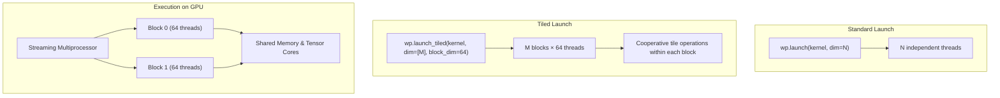
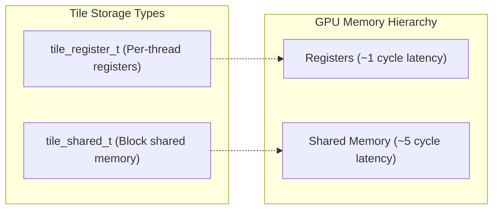
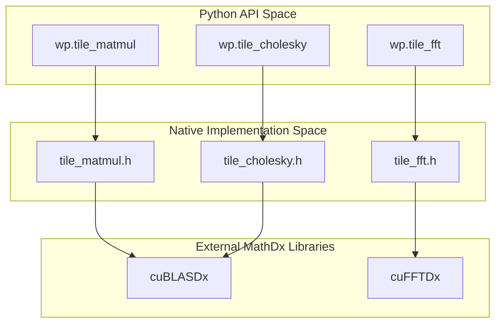

<!-- source: DeepWiki mcp.deepwiki.com · repo NVIDIA/warp · page 3.2 Tile Computing · fetched 2026-10-26 -->

# Tile Computing

<details>
<summary>Relevant source files</summary>

The following files were used as context for generating this wiki page:

- [.github/workflows/pr.yml](.github/workflows/pr.yml)
- [changelog/1968.fixed.md](changelog/1968.fixed.md)
- [deps/libmathdx-deps.packman.xml](deps/libmathdx-deps.packman.xml)
- [tools/cmake/WarpDependencies.cmake](tools/cmake/WarpDependencies.cmake)
- [warp/examples/tile/example_tile_cholesky.py](warp/examples/tile/example_tile_cholesky.py)
- [warp/examples/tile/example_tile_convolution.py](warp/examples/tile/example_tile_convolution.py)
- [warp/examples/tile/example_tile_fft.py](warp/examples/tile/example_tile_fft.py)
- [warp/examples/tile/example_tile_filtering.py](warp/examples/tile/example_tile_filtering.py)
- [warp/examples/tile/example_tile_matmul.py](warp/examples/tile/example_tile_matmul.py)
- [warp/examples/tile/example_tile_mlp.py](warp/examples/tile/example_tile_mlp.py)
- [warp/native/cpu_fiber.cpp](warp/native/cpu_fiber.cpp)
- [warp/native/cuda_crt.h](warp/native/cuda_crt.h)
- [warp/native/fabric.h](warp/native/fabric.h)
- [warp/native/range.h](warp/native/range.h)
- [warp/native/tile_bvh.h](warp/native/tile_bvh.h)
- [warp/native/tile_cholesky.h](warp/native/tile_cholesky.h)
- [warp/native/tile_matmul.h](warp/native/tile_matmul.h)
- [warp/native/tile_mesh.h](warp/native/tile_mesh.h)
- [warp/native/tile_radix_sort.h](warp/native/tile_radix_sort.h)
- [warp/native/tile_reduce.h](warp/native/tile_reduce.h)
- [warp/native/tile_scan.h](warp/native/tile_scan.h)
- [warp/native/tile_solve.h](warp/native/tile_solve.h)
- [warp/tests/cuda/test_clang_cuda.py](warp/tests/cuda/test_clang_cuda.py)
- [warp/tests/tile/test_tile.py](warp/tests/tile/test_tile.py)
- [warp/tests/tile/test_tile_block_dim_mismatch.py](warp/tests/tile/test_tile_block_dim_mismatch.py)
- [warp/tests/tile/test_tile_cholesky.py](warp/tests/tile/test_tile_cholesky.py)
- [warp/tests/tile/test_tile_cholesky_no_mathdx.py](warp/tests/tile/test_tile_cholesky_no_mathdx.py)
- [warp/tests/tile/test_tile_fft.py](warp/tests/tile/test_tile_fft.py)
- [warp/tests/tile/test_tile_fft_no_mathdx.py](warp/tests/tile/test_tile_fft_no_mathdx.py)
- [warp/tests/tile/test_tile_load.py](warp/tests/tile/test_tile_load.py)
- [warp/tests/tile/test_tile_load_assign.py](warp/tests/tile/test_tile_load_assign.py)
- [warp/tests/tile/test_tile_load_extract.py](warp/tests/tile/test_tile_load_extract.py)
- [warp/tests/tile/test_tile_load_indexed.py](warp/tests/tile/test_tile_load_indexed.py)
- [warp/tests/tile/test_tile_load_vectorized.py](warp/tests/tile/test_tile_load_vectorized.py)
- [warp/tests/tile/test_tile_matmul.py](warp/tests/tile/test_tile_matmul.py)
- [warp/tests/tile/test_tile_matmul_no_mathdx.py](warp/tests/tile/test_tile_matmul_no_mathdx.py)
- [warp/tests/tile/test_tile_oob.py](warp/tests/tile/test_tile_oob.py)
- [warp/tests/tile/test_tile_print.py](warp/tests/tile/test_tile_print.py)
- [warp/tests/tile/test_tile_reduce.py](warp/tests/tile/test_tile_reduce.py)
- [warp/tests/tile/test_tile_shared_memory.py](warp/tests/tile/test_tile_shared_memory.py)
- [warp/tests/tile/test_tile_solve.py](warp/tests/tile/test_tile_solve.py)
- [warp/tests/tile/test_tile_solve_no_mathdx.py](warp/tests/tile/test_tile_solve_no_mathdx.py)
- [warp/tests/tile/test_tile_sort.py](warp/tests/tile/test_tile_sort.py)
- [warp/tests/tile/test_tile_view.py](warp/tests/tile/test_tile_view.py)
- [warp/tests/unittest_utils.py](warp/tests/unittest_utils.py)

</details>


## Purpose and Scope

Warp's tile-based programming model enables block-cooperative operations on CUDA GPUs, similar to models found in OpenAI Triton. Tile primitives allow developers to write high-performance kernels that leverage shared memory, Tensor Cores, and cooperative thread operations for matrix computations, FFTs, and other linear algebra operations [warp/native/tile.h:74-187]().

Inside kernels, tile operations are executed cooperatively across each block of threads, allowing them to take advantage of efficient memory access, local memory, and dedicated hardware units. This model is particularly effective for dense linear algebra and signal processing where data reuse within a thread block is high.

For general kernel programming concepts, see **2.1 Kernel and Function System**. For automatic differentiation of tile operations, see **6.1 Tape System**.

**Requirements**: Tile-based operations are fully supported on versions of Warp built with CUDA Toolkit 12 or 13, utilizing MathDx libraries (`libmathdx`) to back linear-algebra and transform tile operations [deps/libmathdx-deps.packman.xml:16-25]().

Sources: [warp/native/tile.h:74-187](), [deps/libmathdx-deps.packman.xml:16-25]()

---

## Execution Model

### Block-Based Thread Partitioning

Warp's tile programming model partitions the thread grid into smaller sets of threads called *blocks* that are executed on a single compute unit. While `wp.launch()` dispatches independent threads, `wp.launch_tiled()` assigns a block of threads to cooperate on logical data tiles [warp/tests/tile/test_tile.py:35-62]().



**Diagram: Block-based execution model comparison**

The `block_dim` (e.g., 64 threads) selects how many GPU threads cooperate to process a tile, whereas the tile shape defines the logical data partitioning [warp/tests/tile/test_tile.py:12-17](). Synchronization between threads in a block is handled via `WP_TILE_SYNC`, which maps to `__syncthreads()` on CUDA [warp/native/tile.h:34-38]().

Sources: [warp/native/tile.h:34-41](), [warp/tests/tile/test_tile.py:12-62]()

### Launch Configuration

The `wp.launch_tiled()` function is the entry point for tiled execution. It accepts a `block_dim` argument that defines the number of threads per block [warp/tests/tile/test_tile.py:35-62]().

```python
TILE_N = wp.constant(4)
TILE_DIM = 64

@wp.kernel
def tile_copy_1d_kernel(A: wp.array[float], B: wp.array[float]):
    i = wp.tid() # obtain block index
    a = wp.tile_load(A, shape=TILE_N, offset=i * TILE_N)
    wp.tile_store(B, a, offset=i * TILE_N)

wp.launch_tiled(
    tile_copy_1d_kernel, 
    dim=[int(N / TILE_N)], 
    inputs=[A_wp, B_wp], 
    block_dim=TILE_DIM
)
```

Sources: [warp/tests/tile/test_tile.py:35-62]()

---

## Tile Types and Memory Hierarchy

### Storage Classes

Warp supports different tile storage locations, mapped to the GPU memory hierarchy [warp/native/tile.h:201-209]():



**Diagram: Tile storage classes and GPU memory hierarchy**

Sources: [warp/native/tile.h:201-209]()

### Register Tiles (`storage="register"`)

Values in register tiles are distributed across the entire block. Register storage is often used for intermediate calculations like `wp.tile_matmul` sums to minimize shared memory traffic [warp/tests/tile/test_tile_matmul.py:181-195]().
*   **Performance**: Lowest latency storage on hardware.
*   **Usage**: Expressed as higher-level maps, reductions, and matrix operations. Register tiles are explicitly requested using the `storage="register"` argument in `wp.tile_load` or assigned dynamically [warp/tests/tile/test_tile_matmul.py:181-195]().

Sources: [warp/tests/tile/test_tile_matmul.py:181-195](), [warp/native/tile.h:621-808]()

### Shared Memory Tiles (`storage="shared"`)

Shared memory tiles allow efficient random access by all threads in a block.
*   **Manual Control**: Developers can specify `storage="shared"` to force allocation in the block's shared memory [warp/tests/tile/test_tile_load.py:41-42]().
*   **Resource Limit**: Shared memory is a finite resource per SM. Warp includes runtime checks and shared memory allocation limits (such as the 256 KiB CPU arena limit or device shared memory configuration limits) to warn when tile allocations exceed SM limits [warp/tests/tile/test_tile_shared_memory.py:25-54]().

Sources: [warp/tests/tile/test_tile_load.py:41-42](), [warp/tests/tile/test_tile_shared_memory.py:25-54](), [warp/native/tile.h:185]()

---

## Tile Operations

### Load and Store

Warp supports 1D through 4D tile loads and stores [warp/tests/tile/test_tile_load.py:100-172](). It optimizes these operations through vectorized paths (such as `float4` alignment) when data layouts permit [warp/tests/tile/test_tile_load.py:29-32]().

| Function | Description |
| :--- | :--- |
| `wp.tile_load` | Loads a tile from a global array with optional shape, offset, and storage specifier [warp/tests/tile/test_tile_load.py:100-112]() |
| `wp.tile_store` | Stores a tile back to a global array [warp/tests/tile/test_tile_load.py:113-115]() |
| `wp.tile_atomic_add` | Cooperatively adds tile values to a global array using atomic updates [warp/tests/tile/test_tile_reduce.py:181-196]() |

Sources: [warp/tests/tile/test_tile_load.py:100-172](), [warp/tests/tile/test_tile_reduce.py:181-196]()

### Matrix Multiplication (`tile_matmul`)

`wp.tile_matmul` performs matrix multiplication $C = \alpha(A \times B) + \beta C$ [warp/tests/tile/test_tile_matmul.py:142]().
*   **Tensor Cores**: Leverages hardware acceleration via MathDx integrations [warp/tests/tile/test_tile_matmul.py:33-45]().
*   **Differentiability**: Warp supports both forward and backward passes for `tile_matmul` across uniform and mixed precision operands [warp/tests/tile/test_tile_matmul.py:115-132]().
*   **Pipelining**: Tiles can be loaded into registers and processed in loops to overlap memory loads with matrix compute instructions [warp/tests/tile/test_tile_matmul.py:181-196]().

Sources: [warp/tests/tile/test_tile_matmul.py:33-196]()

### Reduction and Math Operations

Warp provides a suite of cooperative block-level operations and element-wise maps:

| Function | Description |
| :--- | :--- |
| `wp.tile_sum` | Cooperative block reduction for summation [warp/tests/tile/test_tile_reduce.py:63-77]() |
| `wp.tile_map` | Applies a scalar function (user-defined or builtin like `wp.sin`) element-wise to a tile [warp/tests/tile/test_tile.py:131-143]() |
| `wp.tile_zeros` / `wp.tile_ones` | Initializes a tile filled with zeros or ones [warp/tests/tile/test_tile_reduce.py:70](), [warp/tests/tile/test_tile_shared_memory.py:65]() |

Sources: [warp/tests/tile/test_tile.py:131-143](), [warp/tests/tile/test_tile_reduce.py:63-77](), [warp/tests/tile/test_tile_shared_memory.py:65]()

---

## MathDx Integration

Warp integrates NVIDIA MathDx libraries (`cublasdx`, `cufftdx`) for high-performance linear algebra and transform routines directly inside kernels.



**Diagram: MathDx Integration Flow**

*   **Matrix Solvers**: Supports specialized linear algebra operations such as Cholesky factorizations and triangular solves.
*   **Package Dependencies**: The build system tracks MathDx versions per CUDA toolkit version via packman configurations [deps/libmathdx-deps.packman.xml:16-25]().

Sources: [deps/libmathdx-deps.packman.xml:16-25](), [warp/native/tile_reduce.h:1-20]()

---

## Advanced Tile Features

### Tile Slicing and Indexing
Warp supports slicing for tiles, including strided views and sub-region extractions [warp/tests/tile/test_tile_load.py:41-72]().

### Prefix Scans and Reductions
Cooperative reductions and argmax/argmin trackers are implemented using warp shuffle primitives (`warp_shuffle_down`, `warp_shuffle_xor`) to support multi-word types, vectors, and floating-point/integer arrays efficiently [warp/native/tile_reduce.h:17-193](), [warp/native/tile_radix_sort.h:115-202]().

### Spatial Queries
Tiles can be integrated into spatial traversal helpers such as Bounding Volume Hierarchy (BVH) thread block queries (`bvh_query_thread_block_t`) for ray and AABB intersection tests [warp/native/tile_bvh.h:13-50]().

Sources: [warp/native/tile_reduce.h:17-193](), [warp/native/tile_radix_sort.h:115-202](), [warp/native/tile_bvh.h:13-50](), [warp/tests/tile/test_tile_load.py:41-72]()

---

