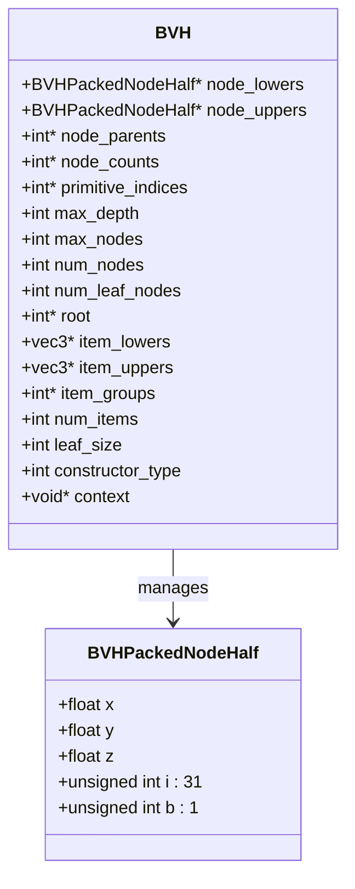
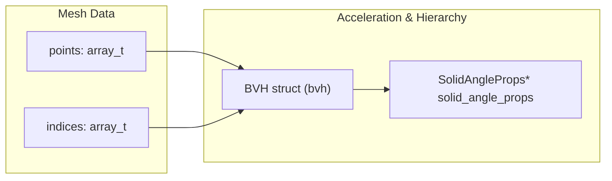

<!-- source: DeepWiki mcp.deepwiki.com · repo NVIDIA/warp · page 3.3 Spatial Data Structures · fetched 2026-10-26 -->

# Spatial Data Structures

<details>
<summary>Relevant source files</summary>

The following files were used as context for generating this wiki page:

- [asv/benchmarks/native_library_footprint.py](asv/benchmarks/native_library_footprint.py)
- [asv/benchmarks/spatial_query.py](asv/benchmarks/spatial_query.py)
- [docs/api_reference/warp_geometry.rst](docs/api_reference/warp_geometry.rst)
- [docs/img/examples/geometry_swept_volume.png](docs/img/examples/geometry_swept_volume.png)
- [licenses/moller-LICENSE.txt](licenses/moller-LICENSE.txt)
- [warp/_src/utils.py](warp/_src/utils.py)
- [warp/examples/benchmarks/benchmark_bvh.py](warp/examples/benchmarks/benchmark_bvh.py)
- [warp/examples/geometry/example_swept_volume.py](warp/examples/geometry/example_swept_volume.py)
- [warp/geometry.py](warp/geometry.py)
- [warp/native/bvh.cpp](warp/native/bvh.cpp)
- [warp/native/bvh.cu](warp/native/bvh.cu)
- [warp/native/bvh.h](warp/native/bvh.h)
- [warp/native/hashgrid.cpp](warp/native/hashgrid.cpp)
- [warp/native/hashgrid.cu](warp/native/hashgrid.cu)
- [warp/native/hashgrid.h](warp/native/hashgrid.h)
- [warp/native/intersect.h](warp/native/intersect.h)
- [warp/native/intersect_tri.h](warp/native/intersect_tri.h)
- [warp/native/mesh.cpp](warp/native/mesh.cpp)
- [warp/native/mesh.cu](warp/native/mesh.cu)
- [warp/native/mesh.h](warp/native/mesh.h)
- [warp/native/sort.cpp](warp/native/sort.cpp)
- [warp/native/sort.cu](warp/native/sort.cu)
- [warp/native/sort.h](warp/native/sort.h)
- [warp/tests/geometry/test_bvh.py](warp/tests/geometry/test_bvh.py)
- [warp/tests/geometry/test_hash_grid.py](warp/tests/geometry/test_hash_grid.py)
- [warp/tests/geometry/test_mesh.py](warp/tests/geometry/test_mesh.py)
- [warp/tests/geometry/test_mesh_query_aabb.py](warp/tests/geometry/test_mesh_query_aabb.py)
- [warp/tests/geometry/test_mesh_query_point.py](warp/tests/geometry/test_mesh_query_point.py)
- [warp/tests/geometry/test_mesh_query_ray.py](warp/tests/geometry/test_mesh_query_ray.py)
- [warp/tests/geometry/test_swept_volume.py](warp/tests/geometry/test_swept_volume.py)
- [warp/tests/geometry/utils.py](warp/tests/geometry/utils.py)
- [warp/tests/test_closest_point_edge_edge.py](warp/tests/test_closest_point_edge_edge.py)
- [warp/tests/test_intersect.py](warp/tests/test_intersect.py)
- [warp/tests/test_utils.py](warp/tests/test_utils.py)
- [warp/utils.py](warp/utils.py)

</details>


Warp provides efficient spatial data structures for accelerating mesh processing, collision detection, ray casting, and geometric queries. These structures are essential for high-performance physics simulations, graphics applications, and spatial data analysis. This page documents the spatial data structures and geometric algorithms in Warp, focusing on Bounding Volume Hierarchies (BVH), mesh processing systems, Hash Grids, and spatial query operations.

## Bounding Volume Hierarchy (BVH)

A Bounding Volume Hierarchy (BVH) is a tree-based spatial partitioning structure that recursively divides objects in space. Each node in the tree represents a bounding volume containing all of its children.

```mermaid
graph TD
    Root["\"Root Node (BVHPackedNodeHalf)\""] --> L1["\"Internal Node (node_lowers / node_uppers)\""]
    Root --> R1["\"Internal Node (node_lowers / node_uppers)\""]
    L1 --> L2["\"Leaf Node (primitive_indices)\""]
    L1 --> L3["\"Leaf Node (primitive_indices)\""]
    R1 --> R2["\"Leaf Node (primitive_indices)\""]
    R1 --> R3["\"Leaf Node (primitive_indices)\""]
```
Sources: [warp/native/bvh.h:160-173](), [warp/native/bvh.h:175-206]()

### BVH Structure

In Warp, the BVH structure is represented by the `BVH` struct, which contains arrays for packed nodes, parent tracking for refits, and primitive indices [warp/native/bvh.h:175-206]().

- **Node Layout**: Nodes are stored in `node_lowers` and `node_uppers` arrays using `BVHPackedNodeHalf` [warp/native/bvh.h:176-177]().
- **Packed Nodes**: `BVHPackedNodeHalf` uses bit-fields (`i : 31`, `b : 1`) to store either a child index or primitive range, with the boolean flag `b` indicating if the node is a leaf [warp/native/bvh.h:160-173]().
- **Backends**: Warp supports its native BVH implementation and an optional `cuBQL` backend for high-performance GPU construction (`BVH_CONSTRUCTOR_CUBQL`) [warp/native/bvh.h:23](), [warp/native/mesh.cpp:158-170]().


Sources: [warp/native/bvh.h:160-173](), [warp/native/bvh.h:175-206]()

### BVH Construction Methods

Warp offers multiple construction strategies:

1. **Surface Area Heuristic (SAH)**: `BVH_CONSTRUCTOR_SAH` (0). Minimizes the cost of traversal by splitting based on surface area [warp/native/bvh.h:21](), [warp/native/bvh.cpp:24-58]().
2. **Median Splitting**: `BVH_CONSTRUCTOR_MEDIAN` (1). Splits primitives into two equal-sized groups [warp/native/bvh.h:22](), [warp/native/bvh.cpp:44-46]().
3. **Linear BVH (LBVH)**: `BVH_CONSTRUCTOR_LBVH` (2). Uses Morton codes for fast GPU-based bottom-up construction [warp/native/bvh.h:23](), [warp/native/bvh.cu:151-179]().
4. **cuBQL**: `BVH_CONSTRUCTOR_CUBQL` (-1). Leverages the cuBQL library for spatial indexing [warp/native/bvh.h:24](), [warp/native/mesh.cpp:158-170]().

#### Construction Algorithm Flow & Code Entities

```mermaid
flowchart TD
    Input["\"Triangle/Item Bounds (item_lowers / item_uppers)\""] --> Constructor{"Constructor Type"}
    
    Constructor --> |"SAH / Median"| TopDown["TopDownBVHBuilder::build()"]
    Constructor --> |"LBVH"| LBVH["LinearBVHBuilderGPU::build()"]
    Constructor --> |"cuBQL"| CUBQL["wp::cubql_bvh_create_host()"]
    
    TopDown --> Split{"Split Heuristic"}
    Split --> |"SAH"| SAHCalc["TopDownBVHBuilder::partition_sah_indices()"]
    Split --> |"Median"| MedCalc["TopDownBVHBuilder::partition_median()"]
    
    LBVH --> Morton["compute_morton_codes()"]
    Morton --> Sort["radix_sort_pairs()"]
    Sort --> Hierarchy["build_hierarchy()"]
    
    SAHCalc --> BVHOutput["BVH Struct"]
    MedCalc --> BVHOutput
    Hierarchy --> BVHOutput
    CUBQL --> BVHOutput
```
Sources: [warp/native/bvh.h:20-24](), [warp/native/bvh.cpp:26-60](), [warp/native/bvh.cu:151-179](), [warp/native/mesh.cpp:158-173]()

---

## Hash Grid

The `HashGrid` is a spatial data structure designed for fast point-neighbor queries, mapping 3D world coordinates to a uniform grid of spatial cells.

### Structure and Indexing

- **Data Layout**: The native hash grid structures store point-to-cell mappings, sorted point IDs, and cell range boundaries (`cell_starts`, `cell_ends`).
- **Hashing**: World coordinates are converted into integer grid coordinates using floor operations to handle negative spatial coordinates robustly.
- **Queries**: Hash grid queries initialize query state structures to iterate over active neighborhood cells and evaluate distance thresholds.

Sources: [warp/native/hashgrid.h:11-30](), [warp/native/hashgrid.h:38-158]()

---

## Intersection Algorithms

Warp provides a robust collection of CUDA-callable geometric intersection and distance calculation primitives.

### Core Intersection Functions

| Function | Purpose | Return Values / Output |
|----------|---------|-------------------------|
| `closest_point_to_triangle` | Find closest point on triangle to a query point [warp/native/intersect.h:44-109]() | Barycentric coordinates `(u, v)` |
| `intersect_ray_aabb` | Fast ray-AABB slab intersection test [warp/native/intersect.h:127-152]() | Boolean hit + distance `t` |
| `intersect_ray_aabb_robust` | Robust ray-AABB test handling parallel rays [warp/native/intersect.h:158-181]() | Boolean hit + distance `t` |
| `intersect_ray_tri_moller` | Möller-Trumbore ray-triangle intersection [warp/native/intersect.h:208-238]() | Boolean hit + `t, u, v, w` |

Sources: [warp/native/intersect.h:44-238]()

---

## Mesh Processing

The `Mesh` structure integrates point attributes and triangle connectivity with an embedded `BVH` acceleration structure for complex spatial queries.

### Mesh Structure

A `Mesh` instance encapsulates point arrays, velocity vectors, triangle indices, bounding intervals (`lowers`, `uppers`), solid angle properties, and an internal `BVH` [warp/native/mesh.h:16-70]().

- **Solid Angle Properties**: When winding number support is enabled (`support_winding_number`), `SolidAngleProps` are precomputed to facilitate hierarchical inside/outside tests [warp/native/mesh.h:25](), [warp/native/mesh.cpp:52-116]().
- **Refitting**: Meshes support efficient refitting when point positions change without topological modifications, updating BVH bounding boxes bottom-up [warp/native/bvh.cu:42-144](), [warp/native/mesh.cu:62-121]().


Sources: [warp/native/mesh.h:16-70](), [warp/native/mesh.cpp:52-116](), [warp/native/mesh.cu:62-121]()

### Mesh Query Operations & Code Entity Map

Warp provides high-performance kernel query functions operating on `Mesh` handles:

1. **Closest Point Query**: `mesh_query_point()` searches the BVH for the nearest surface point within `max_dist` [warp/native/mesh.h:126-204]().
2. **Ray Intersections**: `mesh_query_ray_count_intersections()` computes ray intersection counts [warp/native/mesh.h:117-120]().
3. **Winding Number / Inside Checks**: `mesh_query_inside_ray_tracing()` and `mesh_query_inside_parity()` evaluate containment [warp/native/mesh.h:121-123]().

```mermaid
graph TD
    QueryCall["\"wp.mesh_query_point() / mesh_query_point()\""] --> MeshGet["mesh_get(id)"]
    MeshGet --> BVHTraverse["BVH Stack Traversal"]
    BVHTraverse --> AABBTest["distance_to_aabb_sq()"]
    AABBTest --> TriTest["closest_point_to_triangle()"]
    TriTest --> Result["Closest Face, Barycentrics (u,v), Distance"]
```
Sources: [warp/native/mesh.h:71-75](), [warp/native/mesh.h:90-96](), [warp/native/mesh.h:126-204](), [warp/native/intersect.h:44-109]()

---

## Sorting and Utilities

Spatial algorithms rely heavily on sorting, prefix sums, and atomic synchronization primitives.

- **Radix Sort**: `radix_sort_pairs` sorts key-value buffers (such as Morton codes and primitive indices) via CUB bindings on CUDA [warp/_src/utils.py:149-152](), [warp/native/sort.cu:45-173]().
- **Scan Operations**: `array_scan` computes inclusive or exclusive prefix sums on scalar and vector arrays, supporting CUDA and host CPU execution [warp/_src/utils.py:49-147]().
- **Atomic Synchronization**: `atomicAdd` and `__threadfence()` are utilized in refit kernels to coordinate hierarchical bottom-up updates across thread blocks [warp/native/bvh.cu:83-93](), [warp/native/mesh.cu:136-139]().

Sources: [warp/_src/utils.py:49-152](), [warp/native/bvh.cu:83-93](), [warp/native/mesh.cu:136-139](), [warp/native/sort.cu:45-173]()

---

