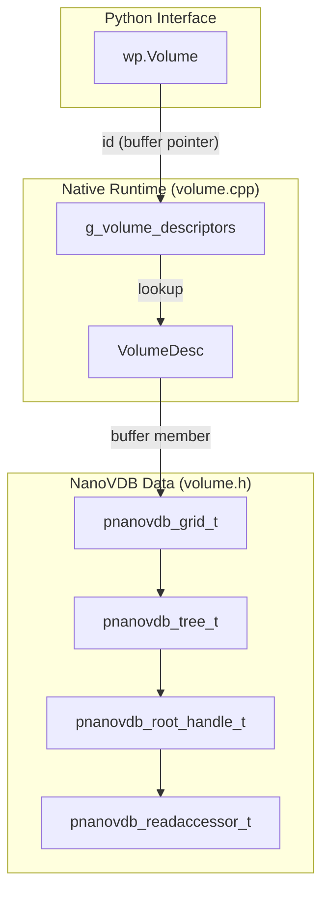
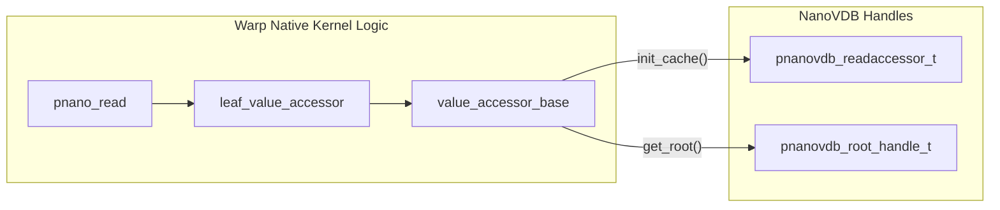

<!-- source: DeepWiki mcp.deepwiki.com · repo NVIDIA/warp · page 3.4 Volume Processing · fetched 2026-10-26 -->

# Volume Processing

Relevant source files

The following files were used as context for generating this wiki page:

- [warp/native/volume.cpp](warp/native/volume.cpp)
- [warp/native/volume.h](warp/native/volume.h)
- [warp/native/volume_builder.cu](warp/native/volume_builder.cu)
- [warp/native/volume_builder.h](warp/native/volume_builder.h)
- [warp/tests/geometry/test_volume.py](warp/tests/geometry/test_volume.py)
- [warp/tests/geometry/test_volume_write.py](warp/tests/geometry/test_volume_write.py)

This page documents Warp's volumetric data structures and operations, centered around the `wp.Volume` class and its integration with NanoVDB. It covers sparse voxel grid representation, hierarchical data access, and volumetric sampling operations.

## Overview

Warp provides support for volumetric data through the `wp.Volume` type, which implements sparse voxel grids based on the NanoVDB format. Volumes enable efficient storage and querying of 3D scalar and vector fields, with applications in signed distance fields (SDFs), level sets, density fields, and other volumetric representations used in simulation and rendering.

Key features include:
- **Sparse storage**: Memory-efficient representation using hierarchical grid structures [warp/native/volume.h:189-204]().
- **NanoVDB format**: GPU-optimized voxel grid format with broad tool compatibility [warp/native/volume.h:20]().
- **HDDA traversal**: Fast ray marching through sparse grids (Hierarchical Digital Differential Analyzer).
- **Multiple data types**: Support for `int32`, `float`, `vec3f`, `vec4f`, and double-precision variants [warp/native/volume.h:64-98]().
- **Trilinear sampling**: Hardware-accelerated interpolation for smooth field queries [warp/native/volume.h:30-31]().

Sources: [warp/native/volume.h:20-98](), [warp/native/volume.cpp:18-80]()

## Volume Data Structure

### NanoVDB Integration

The `wp.Volume` type wraps NanoVDB grid data structures, providing a GPU-friendly hierarchical sparse voxel grid. Warp manages these grids using a `VolumeDesc` structure on the host to track buffer ownership, metadata, and rebuild capacities [warp/native/volume.cpp:18-40]().

**Volume System Entity Mapping**

NanoVDB organizes data in a tree structure where leaf nodes typically represent $8^3$ voxel blocks. The `pnanovdb_buf_t` structure is used as the underlying memory handle for these grids [warp/native/volume.h:36-41, 203]().

Sources: [warp/native/volume.h:36-41, 189-204](), [warp/native/volume.cpp:18-43]()

### Volume Creation and Allocation

Volumes can be created on either the host or device. Warp provides native entry points for initializing these structures from existing NanoVDB buffers:

- `wp_volume_create_host()`: Creates a volume descriptor for CPU-side buffers, allowing for either aliasing or copying the input buffer [warp/native/volume.cpp:137-181]().
- `wp_volume_create_device()`: Creates a volume descriptor for GPU-side buffers, ensuring the CUDA context is managed via `ContextGuard` [warp/native/volume.cpp:184-235]().

**Supported Data Types**:
Warp uses `pnano_traits` to map C++ types to NanoVDB grid types:
- `float` -> `PNANOVDB_GRID_TYPE_FLOAT` [warp/native/volume.h:77-79]()
- `vec3f` -> `PNANOVDB_GRID_TYPE_VEC3F` [warp/native/volume.h:85-87]()
- `int32_t` -> `PNANOVDB_GRID_TYPE_INT32` [warp/native/volume.h:65-67]()
- `int64_t`, `uint32_t`, `double`, `vec3d`, `vec4f`, `vec4d` are also supported [warp/native/volume.h:69-99]().

Sources: [warp/native/volume.h:60-99](), [warp/native/volume.cpp:137-235]()

## Sparse Voxel Grid Representation

### Grid Coordinate System

The volume grid maintains mappings between world coordinates and index space using a `nanovdb::Map`. This map is initialized with a transform matrix and translation vector [warp/native/volume.cpp:122-132]().

| Property | Description | Source |
|----------|-------------|--------|
| `voxel_size` | The physical dimensions of a single voxel (`dx`, `dy`, `dz`) | [warp/native/volume.cpp:249-259]() |
| `tile_count` | Number of leaf nodes in the sparse tree | [warp/native/volume.cpp:261-268]() |
| `voxel_count` | Total number of indexable voxels | [warp/native/volume.cpp:268-282]() |

### Accessors and Caching

To optimize performance, Warp utilizes `pnanovdb_readaccessor_t` for cached lookups. This avoids full tree traversals for spatially coherent accesses by maintaining state of the last accessed nodes [warp/native/volume.h:140-153]().

**Access Logic Entity Mapping**

- `read_single()`: Performs a direct lookup from the root without using the cache [warp/native/volume.h:165-170]().
- `read_cache()`: Uses the internal `accessor` to speed up subsequent nearby lookups by checking the local node cache first [warp/native/volume.h:172-177]().

Sources: [warp/native/volume.h:140-188](), [warp/native/volume.cpp:249-283]()

## Volumetric Operations

### Volume Building

Warp includes a `volume_builder` module for constructing grids on the GPU. This system uses a multi-pass approach to identify active voxels, sort them into a hierarchical structure, and allocate the final NanoVDB buffer [warp/native/volume_builder.cu:19-170]().

- **RebuildKeyScratch**: Manages temporary device memory for sorting voxel keys during the build process [warp/native/volume_builder.cu:80-117]().
- **Capacities**: Rebuildable volumes track `VolumeRebuildCapacities` (voxel, leaf, lower, and upper node counts) to allow for dynamic grid updates [warp/native/volume.cpp:99-120]().

Sources: [warp/native/volume_builder.cu:19-170](), [warp/native/volume.cpp:99-120]()

### Ray Traversal and Sampling

Volume sampling supports different interpolation modes defined as constants:
- `CLOSEST` (0): Nearest neighbor sampling [warp/native/volume.h:30]().
- `LINEAR` (1): Trilinear interpolation [warp/native/volume.h:31]().

In Warp kernels, the following patterns are common for volumetric data:
- **Voxel Indexing**: `leaf_regular_get_voxel_index` converts coordinates and value addresses into a linear index [warp/native/volume.h:190-201]().
- **Coordinate Conversion**: `rebuild_point_to_coord` maps world-space points to integer voxel coordinates using the grid's inverse map [warp/native/volume_builder.cu:180-191]().

Sources: [warp/native/volume.h:30-31, 190-201](), [warp/native/volume_builder.cu:180-191]()

## Performance and Memory

### Memory Management

Warp tracks volume allocations through a global map of descriptors `g_volume_descriptors` [warp/native/volume.cpp:42-43](). 
- **Ownership**: The `owner` flag in `VolumeDesc` determines if the underlying NanoVDB buffer is deallocated by Warp upon volume destruction [warp/native/volume.cpp:22, 303-318]().
- **Context Awareness**: Device volumes are associated with specific CUDA contexts to ensure safety during multi-GPU execution [warp/native/volume.cpp:31, 196-198]().

### Metadata Access

Volumes can store "blind metadata"—arbitrary data associated with the grid. Warp provides host-side access to this metadata even for GPU-resident volumes by aliasing or copying the metadata pointers in `VolumeDesc` [warp/native/volume.cpp:27-28, 171-174, 222-225]().

Sources: [warp/native/volume.cpp:18-43, 171-225, 303-318]()

---

