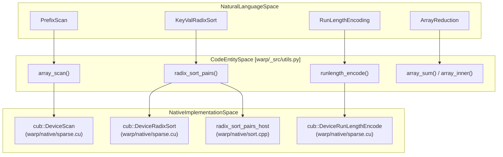
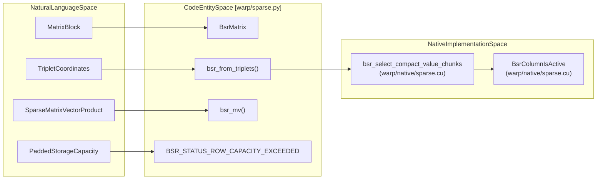

<!-- source: DeepWiki mcp.deepwiki.com · repo NVIDIA/warp · page 3.5 Sparse Linear Algebra · fetched 2026-10-26 -->

# Sparse Linear Algebra

<details>
<summary>Relevant source files</summary>

The following files were used as context for generating this wiki page:

- [docs/domain_modules/fem.rst](docs/domain_modules/fem.rst)
- [docs/domain_modules/sparse.rst](docs/domain_modules/sparse.rst)
- [warp/_src/sparse.py](warp/_src/sparse.py)
- [warp/_src/utils.py](warp/_src/utils.py)
- [warp/native/hashgrid.cpp](warp/native/hashgrid.cpp)
- [warp/native/hashgrid.cu](warp/native/hashgrid.cu)
- [warp/native/hashgrid.h](warp/native/hashgrid.h)
- [warp/native/reduce.cpp](warp/native/reduce.cpp)
- [warp/native/reduce.cu](warp/native/reduce.cu)
- [warp/native/runlength_encode.cpp](warp/native/runlength_encode.cpp)
- [warp/native/runlength_encode.cu](warp/native/runlength_encode.cu)
- [warp/native/scan.cpp](warp/native/scan.cpp)
- [warp/native/scan.cu](warp/native/scan.cu)
- [warp/native/scan.h](warp/native/scan.h)
- [warp/native/sort.cpp](warp/native/sort.cpp)
- [warp/native/sort.cu](warp/native/sort.cu)
- [warp/native/sort.h](warp/native/sort.h)
- [warp/native/sparse.cpp](warp/native/sparse.cpp)
- [warp/native/sparse.cu](warp/native/sparse.cu)
- [warp/native/temp_buffer.h](warp/native/temp_buffer.h)
- [warp/sparse.py](warp/sparse.py)
- [warp/tests/geometry/test_hash_grid.py](warp/tests/geometry/test_hash_grid.py)
- [warp/tests/test_sparse.py](warp/tests/test_sparse.py)
- [warp/tests/test_utils.py](warp/tests/test_utils.py)
- [warp/utils.py](warp/utils.py)

</details>


This document covers Warp's array utility functions and sparse linear algebra capabilities. The utilities module provides high-performance array operations including scanning, sorting, and reductions. The sparse module implements Block Sparse Row (BSR) matrices with comprehensive linear algebra operations optimized for both CPU and GPU execution.

Sources: [warp/utils.py:10-21](), [warp/sparse.py:4-14]()

## Array Utilities

Warp provides a comprehensive set of utility functions for common array operations that are optimized for both CPU and GPU execution. These utilities are implemented in `warp/utils.py` and leverage native implementations for performance-critical operations.

### Scan Operations

The `array_scan` function performs prefix sum operations on arrays with support for both inclusive and exclusive scans [warp/_src/utils.py:50-53](). The scan operation supports `int32`, `int64`, `float32`, and `float64` data types and automatically dispatches to optimized CPU or GPU implementations based on the array device [warp/_src/utils.py:117-140]().

On CUDA devices, scan operations utilize the CUB library's `DeviceScan` for parallel prefix sums [warp/native/sparse.cu:24-24](). For tile-based kernels, Warp provides specialized warp-level and block-level scan primitives.

```python
# Inclusive scan (default)
wp.utils.array_scan(in_array, out_array, inclusive=True)

# Exclusive scan  
wp.utils.array_scan(in_array, out_array, inclusive=False)
```

During CPU APIC graph capture, scalar and vector scans are recorded into the byte stream for persistent replay [warp/_src/utils.py:105-115]().

Sources: [warp/utils.py:10-13](), [warp/_src/utils.py:50-141](), [warp/native/sparse.cu:24-24]()

### Sorting Operations

Warp provides radix sort implementations for key-value pairs with support for different data types. These operations are essential for building spatial data structures and sparse matrices.

```python
# Basic radix sort
wp.utils.radix_sort_pairs(keys, values, count)

# Segmented sort within defined segments
wp.utils.segmented_sort_pairs(keys, values, count, segment_starts, segment_ends)
```

The sorting functions support `int32`, `uint32`, `float32`, `int64`, `uint64`, and `float64` key types with values that are 4 or 8 bytes wide [warp/_src/utils.py:143-157](), [warp/native/sort.cpp:71-74](). On CUDA devices, these operations utilize CUB's `DeviceRadixSort` [warp/native/sparse.cu:22-22](), while CPU executions rely on `radix_sort_pairs_host` [warp/native/sort.cpp:97-105]() with thread-local histograms [warp/native/sort.cpp:23-27]().

Sources: [warp/utils.py:16-21](), [warp/_src/utils.py:143-176](), [warp/native/sparse.cu:22-25](), [warp/native/sort.cpp:23-105]()

### Run-Length Encoding

The `runlength_encode` function compresses arrays by replacing consecutive identical values with value-count pairs. This is a critical primitive for uncompressing BSR row offsets or performing stream compaction.

```python
run_count = wp.utils.runlength_encode(values, run_values, run_lengths)
```

On CUDA, this dispatches to `cub::DeviceRunLengthEncode` [warp/native/sparse.cu:23-23]().

Sources: [warp/utils.py:19-19](), [warp/native/sparse.cu:23-23]()

### Array Reductions

Warp provides high-performance reduction operations including `array_sum` and `array_inner` (dot product) [warp/utils.py:11-13](). These utilize `cub::DeviceReduce` on CUDA and specialized iterators for strided access.

Sources: [warp/utils.py:10-13](), [warp/_src/utils.py:10-14]()

## Array Utilities Architecture

The diagram below bridges the high-level array utility concepts to their specific native code execution entities.

### Utility Dispatch System

Sources: [warp/utils.py:10-21](), [warp/_src/utils.py:50-151](), [warp/native/sparse.cu:22-25](), [warp/native/sort.cpp:97-105]()

## Sparse Linear Algebra

Warp's sparse linear algebra module implements Block Sparse Row (BSR) matrices. BSR is a generalization of Compressed Sparse Row (CSR) matrices that stores dense blocks (e.g., `wp.mat33`) instead of individual scalars [warp/sparse.py:4-9](). CSR is supported as a special case using 1x1 blocks.

### BSR Matrix System

The `BsrMatrix` class provides the core sparse matrix functionality. It manages primary structural arrays including `offsets`, `columns`, and `values` [warp/_src/sparse.py:110-129]().

- `nrow`, `ncol`: Number of rows/columns of blocks [warp/_src/sparse.py:109-110]().
- `nnz`: Upper bound for the number of stored blocks [warp/_src/sparse.py:111-113]().
- `offsets`: Array of size `nrow + 1` storing the start index of each row [warp/_src/sparse.py:114-116]().
- `row_counts`: Optional array for padded row-capacity storage [warp/_src/sparse.py:117-123]().
- `columns`: Column indices for each non-zero block [warp/_src/sparse.py:124-125]().
- `values`: The actual data blocks of type `BlockType` [warp/_src/sparse.py:126-127]().

Sources: [warp/_src/sparse.py:105-173](), [warp/sparse.py:4-13]()

### Matrix Creation and Initialization

BSR matrices are typically constructed from coordinate (COO) triplets. Warp provides high-level functions to handle the conversion and sorting required to build the compressed structure.

**From Triplets:**
```python
# Create a BSR matrix from COO-style arrays
bsr = bsr_from_triplets(rows_of_blocks, cols_of_blocks, rows, columns, values)

# Update values in an existing matrix structure
bsr_set_from_triplets(bsr, rows, columns, values)
```

**Pruning:** The `bsr_from_triplets` function includes a `prune_numerical_zeros` parameter which removes blocks that are exactly zero from the matrix topology [warp/tests/test_sparse.py:57-65](). On CUDA, this uses `BsrColumnIsActive` and CUB selection routines [warp/native/sparse.cu:117-139]().

Sources: [warp/sparse.py:34-52](), [warp/tests/test_sparse.py:57-65](), [warp/native/sparse.cu:117-139]()

### Matrix Operations

The sparse module supports a wide range of operations, including operator overloading for intuitive syntax (`+`, `-`, `*`, `@`) [warp/sparse.py:12-14]().

| Function | Operation | Description |
| :--- | :--- | :--- |
| `bsr_mv` | `y = Ax` | Matrix-vector multiplication [warp/sparse.py:44]() |
| `bsr_mm` | `C = AB` | Matrix-matrix multiplication [warp/sparse.py:43]() |
| `bsr_axpy` | `Y = aX + Y` | Matrix addition and scaling [warp/sparse.py:35]() |
| `bsr_transposed` | `B = A^T` | Matrix transposition [warp/sparse.py:51]() |
| `bsr_get_diag` | `d = diag(A)` | Extract the diagonal blocks [warp/sparse.py:40]() |

Sources: [warp/sparse.py:27-52](), [warp/_src/sparse.py:35-62]()

### Natural Language to Code Entity Mapping

The following diagram bridges the mathematical concept of sparse matrices to the specific implementation entities in the Warp codebase.


Sources: [warp/sparse.py:31-52](), [warp/_src/sparse.py:84-86](), [warp/native/sparse.cu:117-120](), [warp/native/sparse.cu:201-212]()

### Performance and Memory Management

Warp's BSR system is designed for high-performance simulation. Key features include:
- **Asynchronous Transfers**: The `nnz_sync()` method synchronizes active non-zero block counts from GPU to host on demand [docs/domain_modules/sparse.rst:140-147]().
- **Work Arrays**: Functions like `bsr_mm_work_arrays` and `bsr_axpy_work_arrays` allow pre-allocation of temporary memory buffers [warp/sparse.py:29-30]().
- **Gradient Support**: Integrates with Warp's `wp.Tape` for automatic differentiation [warp/_src/sparse.py:167-170]().
- **Padded Topology**: Matrices support `row_capacity` allocations for dynamic topology updates without full reallocation [docs/domain_modules/sparse.rst:168-175]().

Sources: [warp/sparse.py:29-35](), [warp/_src/sparse.py:163-170](), [docs/domain_modules/sparse.rst:140-175]()

---

